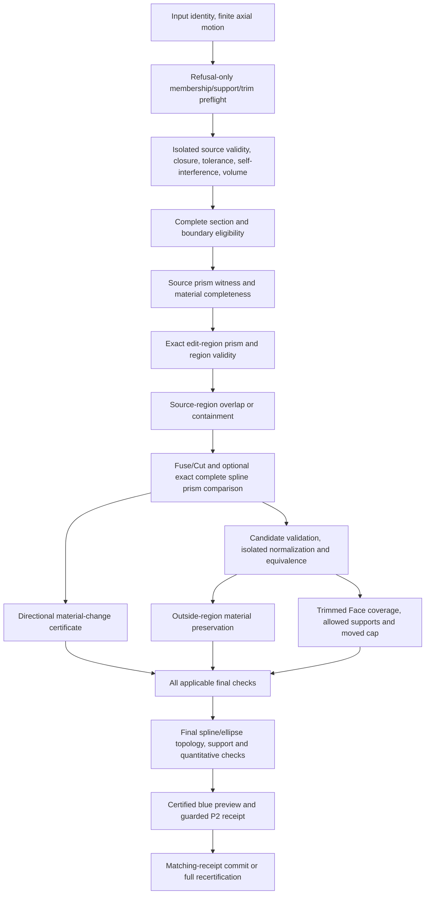

# Fast Direct Modeling Certification — F1.1 audit

Status: audit only, after P3D.5, on `feature/v0.5.7-shared-brep-reconstruction`.
No production/test changes, builds, tests, private-document loads or new benchmarks
were performed for this audit. Current exact B-Rep geometry is authoritative;
construction history, primitive metadata and recipes are not geometric proof.

## 1. Existing pipeline and evidence boundary

Reference: a nonzero axial translation of a planar end cap of a complete invariant
extrusion. Distinguish the generic planar local route, the opt-in complete spline
route, and the elliptical fallback; they do not have identical acceptance gates.

1. **Input/session:** `CadViewport::scheduleMoveNumericPreview` coalesces typed
   input; receipt invalidation is immediate. `previewMoveFace` resolves direction,
   placement and local displacement. Spline motion must be axial, not merely an
   oblique direction projected onto a cap normal. Exact source snapshots and the
   evaluation generation protect delivery/commit. These are transaction guards,
   not evidence of material correctness.
2. **Eligibility:** `MoveFaceGeometry::referenceForMove` calls
   `preflightPlanarSpline`; `analyzeNeighborhood(...,false)` checks copied source
   validity, closure, counts, tolerance, membership and adjacency, then
   `splineExtrusion(...,false)` checks the complete permitted boundary. This still
   includes support-area measurement; it is not a measurement-free preflight.
   Spline preflight omits source volume/self-interference and is refusal-only.
   Non-spline reference retains full source validation. Cap centroid integration
   positions controls; it is not a material certificate.
3. **Source certification:** `movePlanarLocal` calls `neighborhood`, which isolates
   geometry, runs `singleSolid`, enforces the source tolerance ceiling and indexes
   adjacency. `certifiedVolume` belongs only to this isolated source.
4. **Whole-extrusion proof (spline):** `splineExtrusion` requires one complete cap
   without holes/split cap patches, exactly one opposite cap, compatible spline
   and/or axial planar walls, manifold topology and positive oriented height.
   Every spline support needs its bounded invariant proof. The source is compared
   with a complete cap prism, and its volume with measured section area × height.
   Individual support recognition alone does not establish whole-solid material.
5. **Construction:** sweep the actual trimmed cap patch(es) to obtain edit region
   R. Validate R. Compute source Common R; growth requires negligible volumetric
   overlap, shortening requires the whole region to be inside source material.
   Fuse for growth, Cut for shortening. For spline edits construct an exact
   complete prism from the translated cap, compare it with the Boolean candidate,
   then use the prism (avoids unproven Cut-generated spline pcurves).
6. **Material certificate:** compute the directional Cut between candidate and
   source and require equivalence with R. Declare affected supports from actual
   neighborhood/swept-region intersections, rather than carrier type alone.
7. **Finish:** `finishLocal` certifies R (including solid ownership of lower
   topology), validates declared affected/moved membership, then `normalize`
   validates the candidate, attempts isolated cleanup/unification and independently
   compares material. Failed optional unification may retain certified valid splits.
   Compare source-minus-R with normalized-result-minus-R; map actual trimmed Faces
   and require unchanged Face-region coverage outside the affected set.
8. **Final operation checks:** only expected carriers/material sides may occur;
   Commons and area integration establish complete translated-cap coverage.
   Spline results additionally require tolerance/manifold checks, area × new-height
   volume, re-recognition of the final whole extrusion and surface integration.
   Return the result only after all applicable gates succeed.
9. **Preview/commit:** construct FaceChange, mesh/display blue geometry and capture
   the P2 receipt only after certified success. Confirmation either checks all
   exact receipt conditions or executes the full current-value certification path.
   Rendering success is not certification. Undo/Redo restores stored geometry.

`moveEllipticalCap` is a separate existing fallback, not evidence that every
nonplanar wall is supported. `BRepInvariantExtrusion::recognize` checks exact ellipse,
optional circular through-hole, cap/wall adjacency, opposing cap normals,
analytic section area, positive height, manifold/tolerance/source validity,
whole-prism material equivalence and bidirectional Face-region coverage. It also
certifies the result, swept region and directional change. Obrounds use the local
planar/cylindrical route. Generic B-spline surfaces do not gain eligibility.

## 2. Acceptance-guarantee matrix

S = source, C = candidate/final result, R = edit region, W = witness/intermediate.
B = OCCT Boolean; I = property integration. “Required” means the guarantee/mechanism
is required by the current applicable route; it does not assert every helper is
called for every route. Independence describes logical evidence, not call count.

| Exact function/check | Required input; scope | Property and independence | B / I | Required now; possible local replacement |
| --- | --- | --- | --- | --- |
| `referenceForMove`, `planarReference`, finite distance and membership checks | Current S, selected oriented Face, direction/frame | Correct target/context; independent of volume/material | No / centroid area only | Yes; retain cheap guards, centroid is UI work |
| `TopologyIndex::build`, `analyzeNeighborhood` | Exact Face/wire/edge occurrences; S/C | Records outer/inner wires, oriented edge uses, adjacency; boundary must have one inside/one outside patch owner. An index alone validates neither geometry nor manifoldness | No / No | Yes; reuse an immutable index only with proven identity |
| `validBRep` (`BRepCheck_Analyzer`) | Non-null S/C/R/W | OCCT topology/geometry consistency, including its edge/Face/pcurve checks; not proof of material equivalence or absence of every intersection | No / No | Yes; retain final validity; exact construction is not a substitute for checking an OCCT result |
| `closedShells`, `singleSolid` counts/ownership | S/C/R as applicable | Closure, exactly one solid/shell for direct-edit singleSolid, no extra loose Face/Edge/Vertex topology; independent of occupancy | No / No for these subchecks | Yes; closure/count/ownership remain. Boolean policy separately allows cavities/multiple solids |
| `manifold` | Indexed S/C | Two uses per nondegenerate edge; connected incident Face fan at each vertex; complements closure and B-Rep validity, does not prove embedding | No / No | Explicit for spline/ellipse routes, not universal in every helper; retain or independently prove same topology invariant |
| `withinTolerance(...,1e-6)` | S; invariant Faces; final spline/ellipse C | Every Face/Edge/Vertex tolerance finite and at most ceiling; independent of area/volume | No / No | Yes where applied; retain. Do not assume generic `singleSolid` itself enforces it |
| `singleSolid` positive volume + `BOPAlgo_ArgumentAnalyzer` | Isolated S/C/R/W, one shell | Finite positive material measure; copied self-interference analysis with errors/faults refused; complements manifold/closure | No material Boolean / Volume | Yes; a future global injective product/embedding proof could replace intersection analysis only within its proven domain |
| Oriented cap normal; `sameBoundary` cylinder material-side test | Oriented cap/supports; S/C | Outward requested direction and cavity/boss side distinction; independent of matching unoriented carriers | No / No (D1 used for cylinder side) | Yes; retain orientation/side evidence |
| `BooleanGeometry::certifiedSolid` | R, positive closed material solids | Validates whole set and each component, then InfinitePoint must be OUT. Permits cavity/multi-solid Boolean policy | No / Volume | Yes; P3D.5 reuses only the exact oriented root validation, not classification or compound validation |
| `SupportDescriptor::invariantSpline` | Located exact linear-extrusion Face, trims, optional index | Nonrational/nonperiodic degree ≤3 basis; finite rectangular isoparametric trim, planarity, regular/injective basis proof, axial continuation, cap links; independent of whole-solid completeness | No / Area | Yes for spline route; retain bounded proof, not sparse sampling |
| `splineExtrusion`, ellipse `recognize` | Complete S/C boundary and oriented height | All permitted supports, caps and section; currently complete prism equivalence establishes material completeness, not merely a surface list | Common / Volume and area | Yes; potential target for a stronger complete oriented product-boundary certificate |
| Exact `MakePrism`, transformed cap; support/trim checks | Exact current cap wires, axis, finite height; R/C/W | Constructs from exact trimmed curves without refitting; construction intent alone does not validate output, cross-profile intersections or hole preservation | Construction, not Boolean / No in constructor | Yes; direct boundary correspondence may replace later intersections only if verified after every topology-changing stage |
| `BRepMeasurement::volume/area` | Current valid bounded B-Rep; S/C/R/W/intersections | Finite properties; closed solid shells for volume. Adaptive paths require estimated relative error ≤1e-12; not symbolic or rigorous interval arithmetic | No / Yes | Yes for current quantitative gates; insufficient precision refuses. Retain an independent numerical oracle during any proposed certificate experiment |
| `Common(S,R)` growth/shortening gate | Valid S/R | Growth disjointness in material measure; shortening containment; independent of expected total volume | Common / Volume | Yes; product interval inclusion/disjointness could replace it after completeness and material-side proof |
| `equivalent(a,b)` | Non-null valid material sets with reliable measurements | Measures a, b, Common(a,b); all volumes agree within `1e-8*max(1,abs(Va),abs(Vb))`. Tests occupancy in measure, not equal volume alone; no boundary-identity guarantee | Common / 3 volumes | Yes at each current call site; not generally redundant. Product-domain equality could replace specifically enumerated comparisons |
| Directional Cut + equivalence; `difference` helper | S/C/R | Actual added/removed set matches intended edit; helper `difference` constructs both Cuts but does not itself prove their policy | Cut + Common / Volume | Yes; exact interval-set identities could replace only after complete product correspondence |
| `preservedOutside` | S/C/R | Compares `S\\R` and `C\\R`; independently protects remote material/cavities, including harm in the opposite change direction | 2 Cuts + Common / Volume | Yes; replaceable only by a proof that symmetric difference is contained in R |
| `normalize` validity + equivalence | Pre-cleanup C and actual normalized C | Cleanup did not change material; constructor history does not certify a mutated/unified graph | Common / Volume | Yes; retain unless normalization is omitted or independently certified without changing policy |
| `sameCarrier`, `coverage`, `sameTrimmedRegion`, `correspondInvariantSpline` / `correspondImpl` | Actual oriented Faces and trims; S/C | Carrier identity distinguished from trimmed identity, modified/split/merged/removed/new regions; ambiguity/duplicate overlap refusal. Spline basis-family matching alone is not trimmed identity | Face Commons / Areas | Yes; explicit verified trim-domain bijection and edge/wire coverage could replace some Face Commons |
| `finishLocal` unaffected area coverage; final translated-cap coverage/allowed supports | Declared affected set and actual result | Unaffected Face regions survive, moved cap complete, no unpermitted transition support/material side | Face/region Commons / Areas | Yes; material equivalence alone cannot provide selection/correspondence guarantees |
| `occupancy` point classifier | Valid solid and point | Local diagnostic/regression oracle only; finite point probes do not prove whole material preservation | No / No | Not a universal production acceptance gate; do not replace material checks by samples |
| P2 source/input/candidate receipt and generation checks | Exact current geometry, metadata, selection, placement/options/value | Certification belongs to this operation/revision; independent of geometric validity | No / No | Yes for reuse; retain, with failure falling back/refusing as currently defined |

Important limits: `closedShells` alone can vacuously succeed without shells;
`singleSolid` supplies counts. `validBRep` is not a self-interference analyzer.
`BooleanGeometry::validSolid` is not the stricter direct-edit `singleSolid` policy.
Positive volume alone is not an outward-orientation certificate. InfinitePoint
classification is explicit for R's Boolean certificate and ellipse recognition
checks opposing normals; generic candidate `singleSolid` uses B-Rep validity,
closure, positive signed volume and self-interference, not a separate universal
InfinitePoint test. Do not document checks as universal merely because they exist.
Likewise, the general Face-region helpers are weaker than full `correspondImpl`'s
bidirectional split/merge/ambiguity analysis; `finishLocal` uses coverage plus
operation-specific constraints, and spline coverage invokes scoped correspondence.

There is no general persistent Edge-to-Edge identity certificate in this path.
Exact boundary evidence is distributed across retained cap geometry, OCCT
edge/pcurve validity, the bounded invariant trim proof and Face-region/material
coverage. `TopologyIndex` retains oriented occurrences; it does not certify their
connected traversal order. A future local verifier must supply an explicit complete
Edge/wire correspondence instead of assuming a Face carrier match provides one.
The directional check in `movePlanarLocal` measures the requested change direction;
it is not alone a symmetric-difference certificate. Construction, contact,
protected-region and complete-prism checks supply complementary constraints.
Measurement accepts valid empty/lower-dimensional material differences as zero;
positive-solid certificates deliberately do not. Preserve that distinction.

## 3. Dependencies and scheduling



This is an evidence dependency graph, not a claim that execution is parallel.
The source witness needs the certified source volume; constructing a witness does
not itself establish equivalence. Every cleanup output is a different proof target.
Boolean failure must never be represented as an empty difference.

- **Before construction:** finite parameters, target ownership, operation/axis
  eligibility, bounded support continuation, adjacency, complete source checks,
  section validity, oriented material side and permissible height. Preflight may
  reject early; it cannot authorize acceptance.
- **After construction:** actual result validity, closure/ownership/tolerances,
  protected material, trim/correspondence, orientation and numerical policy.
- **Conditional mechanisms:** global source witness is currently necessary because
  wall recognition does not prove completeness; contact Common is necessary
  because continuation does not exclude remote material; normalization equivalence
  is necessary because cleanup may alter topology/material. No current helper's
  existence discharges these conditions automatically.
- **Already proven reuse:** P1 transaction-scoped validation, P2 identical certified
  preview confirmation, P3B identical ordered immutable Face-pair overlaps within
  one correspondence call, P3D.5 identical oriented root-solid validation inside
  `certifiedSolid`. These reuse the same evidence under explicit identity guards.
  Equal volume, carrier similarity and copy provenance alone do not justify reuse.

## 4. Narrow reference theorem: what could replace global checks

Let A be the **entire oriented planar material section**, with every boundary
component identified and nonintersecting; for the initial spline scope it has no
holes. Let `F(p,t)=p+t*n`, n a fixed unit cap normal, p in A, and 0 ≤ t ≤ H.
Require a globally injective embedding, complete oriented source boundary equal
to the boundary of F(A×[0,H]), correct side of every wire, no additional solids,
internal shells, omitted Faces or unclassified trims. H must be positive. Carrier
recognition of individual walls does not establish these hypotheses.

For axial displacement d with H+d above the existing minimum height:

- Growth d>0: C=F(A×[0,H+d]); added material is F(A×[H,H+d]) and no material is
  removed (shared boundary has zero volume).
- Shortening -H<d<0: C=F(A×[0,H+d]); removed material is F(A×[H+d,H]) and no
  material is added. Opposite cap at t=0 is unchanged.
- Section area is unchanged and V(C)=area(A)(H+d). This formula follows from the
  complete product proof, not conversely. It does not validate arbitrary B-Reps.

A verified certificate of **both actual source and actual final candidate** under
this same embedding would establish contact/containment, directional differences
and protected material by interval arithmetic/set identities, potentially replacing
those specific Commons/Cuts and complete-prism comparisons. It must handle wire
winding, global cross-segment intersections, adjacency, orientations, seam/split
coverage and source-to-result trim maps. Do not infer a complete product from
unchanged control points, one invariant wall, cap area or height alone.

No such complete independent certificate has been demonstrated here. Existing
source/final prism equivalence is the current global evidence. Retain production
checks. Replacing the Boolean construction itself is outside this audit; even a
certified prism constructor cannot certify a later unifier's actual output for
free. Retain generic fallback/refusal for every case outside a future proof domain.

### Safeguards that must remain

Input/revision/placement identity; atomic refusal; exact curves and trims; finite
noncollapsed domains; supported continuation proof; valid closed, correctly
oriented and manifold material as applicable; existing tolerance policy; complete
section/inner-wire accounting; unambiguous Face/Edge correspondence; independently
verified material/protected-region guarantees. Alternative mechanisms may establish
some guarantees, but may not delete them. Keep independent geometric/numerical
regression oracles and the current certified path during any experiment. OCCT
reported integration error and tolerance-based equivalence are numerical policies,
not exact-arithmetic proofs of arbitrary freeform equivalence.

## 5. Counterexamples and existing defenses

| Counterexample | Existing defense; limit |
| --- | --- |
| Equal volume but translated material, or a missing cavity compensated by outer material | `equivalent` Common volume; directional and outside-region checks. Total volume alone passes the wrong model |
| Added remote material while the intended addition is correct | `preservedOutside`, solid count/ownership and permitted support/Face checks; one directional Cut alone is insufficient |
| Lost cylindrical through-hole | Complete trimmed-cap prism, containment/directional equivalence, protected-region test and cylindrical material-side/trim checks; ellipse path additionally matches both hole wires and cylinder axis/radius. Spline-hole editing remains unsupported |
| Reversed shell | Signed-volume/validity checks; R's InfinitePoint classification; oriented cap normals and applicable material-side checks. Do not substitute unsigned volume |
| Duplicate/disconnected solids or loose topology | `singleSolid` counts/ownership, manifold check where applied, R ownership traversal, full correspondence ambiguity checks. Boolean multi-solid acceptance is a distinct deliberate policy |
| Wrong trim chosen on the same plane/cylinder/spline carrier | Face Common/area coverage, full translated-cap coverage and material checks. Same carrier/control points do not imply the same bounded region |
| Wrong boss/cavity side or inverted extrusion axis | Oriented cap/height, opposing cap normals in ellipse recognition, cylindrical normal/radial sign, overlap/containment and directional material tests |
| Nonregular/self-intersecting spline or intersecting separate section segments | Monotone derivative-control proof or bounded Bezier regularity/injectivity exclusion for each basis; B-Rep/source self-interference and complete-section/global material checks for interactions between different segments. Per-curve proof alone is insufficient |
| Generic B-spline surface merely resembling an extrusion | `invariantSpline` explicitly refuses unproven representation; no eligibility from sparse derivative samples |
| Missing pcurve, nonrectangular trim, seam duplication, inconsistent parameter intervals | OCCT validity plus invariant-support finite exact isoparametric trim/edge-use proof, topology indexing and ambiguity refusal |
| Cleanup silently removes a feature or changes a cavity | Pre/post normalization validity and `equivalent`; protected material and final support/trim checks |
| Insufficient integration precision or failed Boolean | `BRepMeasurement` finite/domain/estimated-error refusal, checked Build/HasErrors, cleared failure outputs; valid empty sets remain distinct from failure/null |
| Old preview certified for another value/source/Face/placement | Immediate numeric receipt invalidation, timer context/generation checks and exact P2 matching; full certification before commit if reuse fails |

## 6. Existing performance evidence (no new measurements)

Historical profiles are not interchangeable. P3A/P3B reports use synthetic solids;
P3D.2's older private source was 50→65 mm. P3D.3–P3D.5 below use the current
60→75 mm Part 2. Inclusive timings overlap; never sum nested certification totals.

- P3D.2 removed slow initial integration attempts: reported private preview
  37.333→4.368 s. Its report attributes remaining seconds chiefly to Boolean
  material work (~2.7 s), volume properties (~0.84 s), self-interference (~0.62 s).
  These are that phase's observations, not predictions for another source state.
- P3D.3 current-source detailed trace: atomic preview median 5.566 s; 18 Boolean
  builds with summed per-build median ~2.734 s; 27 volume readings ~1.885 s,
  90 area readings ~74 ms, five self-interference checks ~691 ms, 13 correspondence
  invocations ~168 ms. Protected-outside ~727 ms and six material equivalences
  ~2.987 s are inclusive subsets, not additional disjoint costs. Mesh ~69 ms;
  measured GUI residual ~106–120 ms. No evidence says rendering dominates.
- P3D.4 rapid typing `1`→`5`: 2→1 certified requests, median 9.829→5.413 s;
  debounce changes scheduling, not the final kernel certificate. P2 confirmation
  ~110 ms, no reconstruction. See [P3D.4](P3D4_NUMERIC_INPUT.md).
- P3D.5 current-source three trials: `certifiedSolid` 188.386→101.307 ms and
  root `validSolid` calls 2→1. First-preview medians 4920.27→4864.45 ms, with
  overlapping ranges (before 4863.12–4934.41; after 4820.23–4958.39): no reliable
  end-to-end speedup claim. Source 60 mm, certified result 75 mm. Evidence is the
  approved P3D.5 session and its `/tmp/od-p3d5-before.log` / `after.log` artifacts;
  temporary artifacts may not persist. No private geometry is reproduced here.

Repeated measurement readings on identical immutable graphs may permit further
bounded reuse, but are not independently proven redundant merely by a trace ID,
similar values or equal mass. The dominant opportunity for the new track is a
**stronger geometric certificate**, not assuming current independent global tests
are redundant. The evidence does not justify an estimated speedup for that work.

## 7. Exact questions and smallest F1.2 task

F1.2 should specify and independently review a **complete oriented product-boundary
certificate for one no-hole exact invariant extrusion**, in research/test scope
only. Do not change production routing or remove any check yet.

1. How will complete cap closure, nonintersecting distinct spline segments and
   global section orientation/material interior be proved without sampling or a
   Boolean witness? Which bounded algorithms must return “inconclusive”?
2. How will every source Face/Edge/wire use be exhausted by the product boundary,
   excluding internal shells, remote material, duplicate bands and partial trims?
3. How will exact carrier locations, curve domains, orientations and split regions
   map bijectively to A×[0,H]? Define a verifiable certificate, not persistent IDs.
4. How will the **actual** candidate be verified after construction/normalization?
   Is preserving valid splits preferable in an isolated experiment? A constructor's
   intended inputs are not a certificate for arbitrary downstream OCCT output.
5. Which explicit growth/shortening set identities discharge each current Boolean
   test? Which checks still require independent self-interference/orientation tests?
6. How are roundoff and geometric tolerances bounded without raising the 1e-6
   ceiling or existing 1e-8 material/coverage and 1e-12 integration policies?
7. How will independent polynomial/analytic volume oracles, old full material
   certification and adversarial negative fixtures test soundness (not just agreement
   on successful fixtures)? Include holes/cavities as refusal tests initially.

Required F1.2 outcome: written proof obligations, bounded representation/domain,
certificate fields and verifier responsibilities, counterexample fixtures and a
precise list of global mechanisms potentially discharged. Performance measurement
or production integration requires its own approved subsequent scope.

### Source inventory

Inspected `BRepReconstruction.cpp/.h` (neighborhood/preflight, splineExtrusion,
movePlanarLocal, finishLocal, normalize, prepare and legacy fallback separation),
`BRepCertification.cpp/.h` (validity/closure/tolerance/manifold/singleSolid,
equivalent/difference/preservedOutside, carrier/region correspondence),
`BRepMeasurement.cpp/.h`, `BRepInvariantSupport.cpp`, `BRepTopology.cpp/.h`
(SupportDescriptor, TopologyIndex and invariant proof records),
`BRepInvariantExtrusion.cpp`, `MoveFaceGeometry.cpp`, `BooleanGeometry.h`,
Move Face session/receipt/numeric scheduling paths, `tests/MoveFaceTest.cpp`,
`tests/BRepCertificationTest.cpp` and exact spline fixture. Reviewed shared
architecture, P3A/P3B Boolean/correspondence reports, P3D.2 integration report and
P3D.4 input report. Historical reports describe their then-current pipeline;
this audit's current source trace takes precedence over their older call order.

---

## F1.2 — Formal complete-product certificate (design only)

This section extends, and does not supersede, F1.1. It specifies a sufficient
conditional mathematical certificate; it does **not** assert that current APIs
verify every obligation. No production check is authorized for removal. The
second-pass review below leaves the executable certificate incomplete pending
independent geometric verifiers and a numerical soundness policy.

### F1.2.1 Formal model and representation assumptions

Choose a plane P and an orthonormal frame (e1,e2,d), with d its unit normal.
Fix an origin o in P, so the axial coordinate is `z(x)=(x-o)·d`. Let gamma be a
finite, piecewise regular, simple closed planar curve in P, with no intersections
between distinct parameter points except the identified closing endpoints.
Corners are allowed; zero-length arcs, overlapping arcs and retracing are not.
S is the closure of the bounded Jordan interior of gamma. In this first scope S
is one disk-like material region of positive area: one outer boundary, no holes,
slits, nested loops or point-touching lobes. Orient gamma counterclockwise in
(e1,e2). Its section can contain multiple exact supported spline segments;
regularity/injectivity must be established for the **whole joined contour**.

For any L>0 define `F(p,t)=p+t*d` and `K(L)=F(S×[0,L])`. Set h>0,
`h'=h+delta>0`, `M=K(h)` and `M'=K(h')`. Source and candidate mean the actual
located, oriented B-Rep solids presented to their verifiers, not ideal objects
inferred from a constructor name. Selected cap is the upper cap at z=h; bottom
cap is at z=0. A lower-cap operation needs a separate consistent frame choice.
Part placement must be a proven compatible rigid transform; reflected, scaled,
nonrigid or ambiguous locations are outside this first proposed scope.

Material is a bounded regular closed solid: closure of its interior, with the
complete embedded shell as its boundary, outward material orientation and
unbounded exterior classified outside. Zero-thickness internal membranes, loose
Face/Edge/Vertex additions, nonmanifold contacts, multiplicity-weighted shells and
independent hidden material assignments are excluded. These are representation
obligations, not consequences of an unsigned volume or a “closed” flag.

The exact theorem concerns exact carrier/trim maps. Binary stored coefficients can
be treated as exact nominal values, but rounded evaluations and near-equality do
not establish identities. All applicable existing OCCT validity, tolerance and
numerical policies remain additional required engineering checks.

### F1.2.2 Obligations and certificate evidence

Use the following obligations for both source and candidate. “Verified” means an
independent consumer has checked the evidence against the current immutable B-Rep;
a flag supplied by recognition or a constructor is only a claim.

| ID | Required verified property | Evidence required; limits of topology alone |
| --- | --- | --- |
| P0 — ownership/frame | Exact source revision, selected cap, geometry locations and positive rigid frame are fixed; h, delta, h' finite | All located geometry converted consistently to the same frame; full subshape-use census. Receipt identity cannot establish geometric correctness |
| P1 — Jordan section | gamma is closed, planar, globally simple, piecewise regular and positive-area; S is its unique bounded interior | Ordered, oriented edge-interval chain with exact endpoint identification; per-arc regularity/injectivity plus exclusion of every inter-arc intersection except intended endpoints, including first/last adjacency. Connectivity alone does not prove simplicity |
| P2 — cap domains | Exactly one lower and one upper planar cap, geometrically S and S+L*d, with no inner wires or trim multiplicity | Bijective ordered boundary/edge maps to gamma and its translation; verified bounded planar trim interior, no complement/unbounded region, no degenerate/extra trim. Matching boundary samples or area is insufficient |
| P3 — wall domains | Every section arc gamma_i has precisely the wall image `gamma_i(u)+t*d`, u in its complete arc interval, t in [0,L] | Exact carrier pullback and one-to-one finite trim rectangle, exact pcurve/3D-edge consistency, no fold/reversal of parameter extent, no hidden hole/partial strip. Axial invariance of a carrier alone is insufficient |
| P4 — complete boundary accounting | All and only these caps and walls occur, once, in one owned closed shell of one solid | Bijection between every actual Face and expected chart, plus every wire, edge use and vertex occurrence; no unowned children, cavities or extra shells/solids. Each cap edge joins its designated wall; longitudinal edges join consecutive walls; no unexpected adjacency. Initial design refuses splits/merged wall charts unless a later partition verifier is supplied |
| P5 — embedded gluing and orientation | Chart maps agree on each shared boundary and nowhere else; complete boundary is embedded and outward | Shared exact edge maps, correct incidence (opposite induced edge-use directions), top normal +d, bottom -d, wall outward normal proportional to `gamma_i'(u)×d` under its oriented chart, connected vertex fans. Face orientation flags must be reconciled with actual chart/location orientation |
| P6 — solid semantics and kernel safety | Actual B-Rep denotes the bounded regular material enclosed by this boundary, with no alternate hidden component | Existing source/result validity, closure, manifold, ownership/count, self-interference and orientation/exterior checks, plus explicit complete boundary inventory. Standard oriented-solid semantics is required; OCCT validity alone does not prove P1–P5 or material completeness |
| P7 — bounded continuation/edit | Selected cap perpendicular to d; common fixed section; permitted exact supports continue over the required t range; valid new height | Exact linear carrier relation over the full U interval and [0,max(h,h')], unchanged section/knots/coefficients; h' strictly positive with the existing collapse threshold and finite bounds. Generic B-spline surface resemblance gives no evidence |
| P8 — actual-result verification | Candidate satisfies P0–P6 at L=h' using the same S and frame as source | Source/candidate section and cap maps compared exactly, bottom region fixed pointwise; all candidate domains inventoried independently of constructor history. Reverify after any normalization or topology mutation |

To keep the first verifier bounded, require one Face per cap and one rectangular
wall Face per section arc. Refuse seams, periodic/rational bases, unproven generic
B-spline surfaces, split bands and multiple trims initially; this is a proposed
research subset, **not** a restriction to apply to existing production paths.
Exact wall parameter reparameterizations may be allowed only with a verified
invertible map; matching pole arrays or carrier pointers is not that map.

A certificate should carry the current immutable shape/context, frame, h/L,
ordered section arcs and parameter intervals, regularity/intersection witnesses,
cap interior/domain witnesses, complete chart/Face inventory, edge-use and vertex
incidence bijections, per-chart orientation and carrier/trim identities, numerical
bounds and verification status. Source-to-candidate maps use current subshape
occurrences, not persistent invented IDs. Every failure or exhausted proof budget
must distinguish “unsupported/inconclusive” from “verified”. No material Boolean
result may be a hidden field used to establish P1–P8 independently.

### F1.2.3 Source completeness proof

Assume P0–P6 have been independently verified at L=h.

1. **Embedding:** if `p+t*d=q+s*d`, taking the axial coordinate gives t=s;
   orthogonal projection to P then gives p=q. Thus F is injective on the entire
   product, with continuous inverse (projection, axial coordinate). It is an
   isometry of product coordinates, not merely a locally regular surface map.
2. **Expected boundary:** because S is a Jordan disk, K(h) has exactly the bottom
   disk S, top disk S+h*d, and side `gamma×[0,h]`. The boundary is an embedded
   topological sphere (with permitted geometric corners). P2–P5 identify the
   actual entire shell with this boundary, without overlap, omission or cover
   multiplicity. Inter-wall intersections reduce to section intersections by
   injectivity; those have already been excluded by P1.
3. **Material uniqueness:** an embedded sphere separates space into a bounded
   interior and an unbounded exterior. Under P6's regular-solid semantics and
   outward orientation, the solid is the closure of that bounded interior, hence
   equals K(h), including its boundary. The complete boundary has no second shell
   enclosing a cavity and no additional disconnected component. Selecting the
   unbounded complement violates boundedness/exterior orientation.

This establishes actual source material, not only a list of surfaces. Topological
incidence by itself supplies neither geometric embedding nor the correct trim
interiors. The separation argument requires the geometric identities and global
section proof; it cannot be replaced by “the OCCT solid was valid”.

A **complete boundary decomposition** can therefore prove the whole-product
claim without a global Boolean occupancy comparison. A merely local selected-cap
neighborhood cannot: a valid remote chamber, stepped section, internal shell or
omitted wall band may be invisible there. Enumerating the entire boundary and
proving its product decomposition is mandatory, even if individual witnesses are
local and compositional. This still entails global combinatorial accounting and
potentially expensive all-arc separation work; no speed advantage is assumed.

### F1.2.4 Candidate construction and independent verification

Given a verified source and P7, construct bottom S unchanged, top S+h'*d, and
exact side charts `gamma_i(u)+t*d` for 0≤t≤h'. Retain the original exact section
curves; do not refit. For every chart boundary establish a common exact 3D edge
and compatible pcurves on both incident Faces. Assemble those uses with the
required orientations into one closed shell and bounded solid.

This describes a sufficient construction, not a new production algorithm. The
existing cap-prism constructor is a possible producer. Its history can propose
maps, but an independent consumer must verify P8 against its **actual output**:
all chart domains and pcurves, complete Face/edge/vertex accounting and orientation,
including the unchanged bottom and identical S. Re-run required kernel safety
checks. P1 plus common interval charts excludes candidate self-intersections;
P4 excludes missing/extra/duplicate Faces; P6 excludes disconnected/alternate
material semantics. Applying the source completeness argument with L=h' proves
the candidate equals M'. Closed shell plus area(S)*h' alone proves none of this.

A unifier, splitter, sewing correction or ShapeFix operation may change this
proof target. Either reverify the actual final chart partition with independent
evidence, or declare the product certificate inapplicable and retain the current
full certification path. Do not silently transfer a pre-normalization certificate
to a normalized result. Omitting normalization in production is not approved.

### F1.2.5 Growth, shortening and boundary conventions

These arguments require verified source completeness **and** candidate P8.
Write `Q(a,b)=F(S×[a,b])`. Since the frame map is injective, interval set identities
lift to exact spatial set identities.

**Growth, delta>0.** M is contained in M'. Exactly
`M' \ M = F(S×(h,h'])` and `M \ M' = empty`.
The bounded closed edit sweep is R=Q(h,h'). Its intersection with M is only the
shared cap S+h*d, a zero-volume boundary. The regularized Boolean addition is R.
There is no extra material elsewhere because both whole sets are already proved
products of the same S, not because their volumes happen to agree.

**Shortening, -h<delta<0.** M' is contained in M. Exactly
`M \ M' = F(S×(h',h])` and `M' \ M = empty`.
R=Q(h',h) is contained in M. The new upper cap at h' remains as the boundary of
the surviving solid, even though raw set subtraction by closed R removes that
interface. Regularized Cut restores the closure of the remaining interior.
Bottom S is unchanged; h'>0 prevents bottom/top coincidence or inversion.

In both cases the symmetric difference is contained in R; consequently
`M \ R = M' \ R` pointwise. This proves protected material outside R and both
change directions, including the direction not explicitly tested by the current
single directional Cut. With unit axial Jacobian,
`volume(M)=area(S)*h`, `volume(M')=area(S)*h'` and
`volume(R)=area(S)*abs(delta)`. These are **consequences**, not eligibility tests.
Raw set differences above are half-open; comparing them literally to a closed
sweep would be incorrect. OCCT material comparisons measure volume and
regularized solids; geometric interface equality needs the boundary certificate.

**Boundary/refusal cases:** delta=0 is identity, handled under existing zero-motion
policy; do not construct a degenerate edit solid. Reject h'≤0 and every value at
or below the current collapse threshold, even if algebraically positive. Preserve
existing finite/nonzero motion thresholds and all tolerances. Refuse if rounding
cannot establish the required sign or interval ordering, or continuation/trim
identity is unproved. Non-axial motion, holes, periodic/rational supports, arbitrary
surface conversion and unaccounted split domains remain outside the first scope.

### F1.2.6 Adversarial counterexample matrix

Each rejection below requires actual verification, not the existence of an API
with a similar name. If the named obligation is inconclusive, the certificate is
incomplete for that shape and may not replace any production check.

| Attempted counterexample | Exact rejecting obligation |
| --- | --- |
| Top, wall or whole shell reversed | P5 chart-normal and edge-use orientation, P6 bounded-interior/exterior semantics; positive volume alone is not substituted |
| Missing sidewall with coincident cap edges | P4 chart/Face bijection and full incidence census; P5 gluing and retained closure checks |
| Duplicate overlapping Face or a chart traversed twice | P4 multiplicity-one inventory plus P3 injective parameter domain; topological closure with duplicate uses is insufficient |
| Unaccounted inner wire or slit on either cap | P1 single Jordan loop and P2 complete cap wire/domain census; not discarded as “small” |
| Extra solid, remote region, cavity or internal shell | P4 enumeration of every owned shell/Face/child and P6 one bounded regular solid; hidden region cannot be inferred absent from adjacency alone |
| Self-intersecting spline, two individually simple arcs crossing, or touching nonneighbor arcs | P1 whole-contour injectivity and complete pairwise intersection exclusion; per-wall monotonicity/Bezier certificates alone do not suffice |
| Correct cap plane but shifted, clipped or wrong destination trim | P2 and P8 boundary/interior bijection to exactly S+h'*d, independent of equal area |
| Correct unoriented carriers, wrong material side | P5 top/bottom/wall outward chart normal and P6 material semantics, not carrier equality |
| Equal-volume missing lobe plus extra material elsewhere | P2–P4 and P8 force the actual same complete product boundary; source and candidate uniqueness proof then excludes different occupancy |
| Edge curve differs from one Face's pcurve, or inconsistent parameter range | P3 exact edge/surface composition identity over whole domains, P5 common-edge gluing, retained kernel validity; sparse endpoint agreement is insufficient |
| Ambiguous arc matching, swapped coincident segments, folded reparameterization | P1 simplicity, P2/P3 bijective interval maps and P4 unique ownership; no guessed stable identity |
| Every individual wall invariant, but stepped caps, mixed heights, partial wall bands or remote attached chamber | P2 common cap levels and same S; P3 full common [0,L] trim coverage; P4 full chart census. Local support recognition cannot pass these by itself |
| Numerically near-closed loop whose exact nominal endpoints differ | P1 exact endpoint identification or a separately justified error-bound model; current topology tolerance does not prove exact closure |
| Valid initial prism, cleanup output loses or adds a region | P8 re-verification after mutation; cannot reuse the constructor's claim |
| Candidate has correct boundary samples but a trim folds between them | P2/P3 full-domain identity/injectivity; sampled agreement is not a witness |

### F1.2.7 Mapping obligations to current code and global checks

| Obligation | Existing evidence provider | Missing certificate/API | Global mechanism potentially discharged; retained safeguards |
| --- | --- | --- | --- |
| P0 | Neighborhood isolation, `movePartSnapshot`, P2 receipt/generation guards, actual located `SupportDescriptor` | A product-proof context bound to exact immutable geometry/frame and verified arc domains | No material check replaced by identity alone; keep P1–P3D.5 session guards |
| P1 | `TopologyIndex` wire/edge occurrences; `invariantSpline` per-basis monotone or bounded Bezier proof; OCCT validity | Ordered closed-contour verifier, complete distinct-arc intersection exclusion, certified bounded planar interior and endpoint identities | Prerequisite for source witness replacement; keep source validity, manifold, tolerances, self-interference and independent numerical checks |
| P2 | Actual planar caps, oriented normals, existing cap-prism inputs, ellipse analytic recognition | Exact cap-boundary/interior bijection for both actual caps, not Common-area agreement | Could discharge some cap Face Commons/coverage and complete source witness only with P1–P6; keep kernel/trim validity and selection mapping |
| P3 | `InvariantSplineSupport` exact linear carrier, finite rectangular trims, cap links; analytic planar/cylindrical support logic | Complete cross-chart section/axis identity, verified edge/pcurve composition and common full-height domain for every wall | Could discharge wall carrier/region Commons with P4/P5; retain representation restrictions, tolerance and continuation refusals |
| P4/P5 | `TopologyIndex`, neighborhood boundary adjacency, `manifold`, counts/ownership, material-side checks | Whole-shell expected-chart bijection, ordered Edge-use map, vertex and outward chart certificate; partition verifier deferred | With P1–P6 may replace source complete-prism `equivalent`; does not justify skipping validity/closure/orientation checks |
| P6 | `singleSolid`, `validBRep`, `closedShells`, tolerance/manifold helpers, existing InfinitePoint checks where present | Explicit verified linkage between product boundary and actual bounded regular-solid semantics; full exterior/orientation evidence | No removal of existing kernel safety checks proposed in this track stage |
| P7 | Exact extrusion carrier, `splineExtrusion` height/axis gates; current analytic adjacent-support checks | Signed edit interval certificate sharing the **verified** complete section and frame, with sound numerical decisions | Whole-product identities could replace `Common(source,R)` contact/containment; retain finite/collapse/axial restrictions |
| P8 | Exact transformed-cap prism, `normalize`, `finishLocal`, scoped spline correspondence | Independent actual-result product verifier and exact source/result domain map, including post-normalization output | With source proof could replace Boolean-candidate/prism equivalence, directional Cut+equivalence, `preservedOutside`, final complete-prism comparison and selected Face-region Commons; retain final validity, tolerance, orientation, ambiguity refusal and independent numerical oracles |

Replacement is per call site, not per helper: `equivalent`, `difference`,
`preservedOutside` and general correspondence remain necessary outside the proven
product domain. Normalization equivalence remains unless both its actual input
and actual output independently satisfy the same product certificate. Face/Edge
mapping must still represent genuine splits/merges or explicitly refuse them;
material equality cannot invent selection identities. Global self-interference
removal is not proposed by F1.2 even though an exact embedding theorem supplies
related mathematical evidence. Keep numerical measurements and their precision
requirements as independent checks while this certificate is researched.

### F1.2.8 Critical second-pass review and proof status

**Circularity check:** P1–P5 are specified using exact curves, trim-domain
identities, exhaustive topology accounting and bounded intersection/regularity
witnesses. They do not depend on `equivalent(source,prism)`, expected volume or
successful material Booleans. P6 uses validity/solid semantics and independent
kernel safety checks, not a material-equality oracle. P8 reuses verified section
evidence but checks the actual candidate, not the output of the production
certificate it seeks to supplement. Existing full certification is permitted as
an independent experimental comparison, never as an unstated proof premise.

**Established conditional result:** if P0–P8 hold exactly, projection proves a
product embedding, complete boundary plus bounded regular-solid semantics proves
material uniqueness, and interval identities prove both growth and shortening.
The counterexamples above violate explicit premises. There is no reliance on
volume alone, finite occupancy probes or original feature history.

**Essential gaps in an executable certificate:**

- Existing per-basis injectivity does not prove a multi-segment Jordan section.
  A sound, bounded adjacent-endpoint and all-pair intersection exclusion verifier
  is still needed; near tangencies may be inconclusive or costly.
- Topological sharing within OCCT tolerance need not mean exact nominal geometric
  coincidence. Ordinary floating-point subdivision/control-polygon comparisons
  with guard margins are not automatically a rigorous directed-rounding proof.
  Exact arithmetic or verified interval/error bounds for the admissible nominal
  curve/domain identities are not implemented by this document.
- If exact identities cannot be established, mere distance ≤1e-6 cannot promote
  near-geometry to exact set equality. A tolerance-based alternative would need
  a separate sound enclosure/topological-stability argument and quantitative
  material-error bounds within existing policies. It must not snap/refit the
  geometry or raise thresholds. Until then such input is inconclusive.
- Generic cap interior, exact pcurve-composition identity, complete chart inventory,
  material orientation and post-unification partition proofs lack a combined
  independent verifier. OCCT success flags/history are evidence proposals only.
- The theorem assumes standard bounded regular-solid semantics and an embedded
  complete boundary. If an actual kernel object cannot be shown to satisfy that
  representation contract, the boundary-to-material inference is unavailable.

Thus the **mathematical sufficient conditions are specified**, but a formal,
verified production certificate has not been delivered. No counterexample is
known under all exact premises; essential premises remain unverified by current
code. Completeness can be established without global material Booleans in the
restricted exact model, but not without whole-boundary verification and potentially
expensive geometric proofs. No responsiveness or numerical soundness claim follows
until those verifiers are independently tested. Production remains unchanged.

### F1.2.9 Smallest F1.3 architectural design

Design, without production integration, a three-stage research contract:

1. **Section witness:** exact current cap boundary, ordered arcs and parameter maps,
   full Jordan/planarity/regularity obligations, supported numerical proof backend,
   explicit Verified / Unsupported / Inconclusive outcomes with bounded work.
2. **Product boundary verifier:** immutable context, frame/height, complete source
   chart inventory and orientation/edge-use witnesses; a separate verification of
   an actual candidate against the same section. Construction history may suggest
   maps but cannot authorize them. Initially refuse holes and chart partitions.
3. **Edit consequence certificate:** signed interval relation between the two
   verified products; enumerate exactly which existing material checks it would
   discharge, while retaining independent full certification as the experimental
   oracle and all production checks.

F1.3's smallest useful deliverable is API/data ownership and verifier dependency
specification, including the numerical proof strategy, failure taxonomy and
adversarial synthetic validation plan. It should first resolve P1's whole-contour
proof and exact-versus-toleranced identity boundary. Do not implement a fast path,
remove Booleans, broaden representations or promise runtime savings at that stage
without separately approved scope.

---

## F1.3A — Whole-section certification design

Documentation/algorithm design only. F1.1 and F1.2 remain unchanged. This refines
F1.2 P1 and the section portion of P2; it does not establish a complete product
certificate or authorize production acceptance. All algorithms below are proposed
verifier responsibilities, not newly implemented capabilities.

### F1.3A.1 Certificate contract and sufficiency

Input is the **current exact located cap B-Rep** and its complete oriented edge
uses, not Sketch entities, interpolation points or a reconstructed recipe. Require
one outer wire and no other wires, loose subshapes or repeated ambiguous uses.
Supported curve proposals are finite lines, circular arcs/full circles and exact
nonrational, nonperiodic B-splines of degree ≤3 with supported bounded domains.
Nonconvexity and turning control polygons are allowed; chord monotonicity is only
an optional sufficient per-piece test, never a global eligibility requirement.

A `SectionCertificate` design comprises:

- Immutable input/Face/wire/edge-occurrence identity, all located curve and pcurve
  domains, plane/frame and associated unchanged tolerance policy.
- A complete cyclic ordering of oriented uses and a bijection back to every input
  occurrence; endpoint equalities, incidence and orientation witnesses.
- Exact planarity/domain identities and regularity/injectivity witnesses for
  individual arcs or parameter pieces.
- A **complete cover** of every relevant self/pair parameter domain by checked
  exclusion boxes and permitted endpoint neighborhoods; no unchecked remainder.
- Global orientation witness, one bounded Jordan interior and, separately, the
  cap's identification with that interior. No section certificate alone asserts
  source-volume completeness, absence of remote shells or axial continuation.
- Proof backend/version, directed rounding or exact-arithmetic assumptions,
  margins, work budgets and structured failure diagnostics. Evidence is rechecked
  by a consumer rather than trusted because a producer returned a success flag.

If the cyclic map from a parameter circle to the plane is continuous and injective,
its image is a Jordan curve. Its unique bounded complementary component has a
closure that is one bounded material region with no holes. Positive area and
orientation follow with an independent signed-area sign witness. This implication
is mathematical; a closed OCCT wire, successful Face builder or positive area does
not by itself establish the premises. The Face must actually select that bounded
interior, not the exterior, a folded UV domain or a multiply covered region.

### F1.3A.2 Invariants and proposed verification order

| ID | Required invariant | Proposed evidence / conservative boundary |
| --- | --- | --- |
| S0 | One common exact plane | Compose curve locations into one frame. A line lies in P iff its entire direction and a point do; a circle iff its center/axis/support plane agree; a polynomial B-spline lies in P if all relevant exact segmented control points do. Segmentation and frame arithmetic need exact identities or verified bounds. Numerical best-fit/projection is not proof; also verify the 3D-edge/pcurve-in-plane relation |
| S1 | Complete use inventory | Enumerate all Face wires and oriented edge occurrences with `TopologyIndex`; reject inner wires, INTERNAL/EXTERNAL uses, degenerate edges, repeated use or unexplained child. Connected traversal must exhaust this inventory, not merely whatever an explorer returns |
| S2 | One connected directed cycle | For ordinary open edge intervals require one incoming and one outgoing use at each vertex, one connected component and traversal of every occurrence exactly once. Repeated vertex visits away from closing endpoints reject. Preserve actual use orientation; inspect endpoints after accounting for location and reversal |
| S3 | Exact closure and correct ordering | Each oriented endpoint equals its successor's start geometrically and agrees with the actual shared topological vertex. Shared vertex identity or distance ≤ tolerance alone is insufficient. No endpoint clustering, snapping or refitting may bridge a gap |
| S4 | Finite nondegenerate regular pieces | Finite ordered parameter bounds, no zero interval/zero-length/degenerate support; derivative nonzero on each smooth piece, with one-sided regularity at permitted knots/corners. Certify a positive extent rather than relying on endpoint distance (a circle has coincident endpoints). Unresolvable short edges refuse; never delete them |
| S5 | Individual injectivity | All distinct parameters on an edge map to distinct points, except the certified closing pair of a full-circle special case. Prove by bounded derivative/convex-hull reasoning plus all nonlocal piece comparisons; no derivative samples as sole evidence |
| S6 | Complete inter-edge exclusion | Nonadjacent arcs are disjoint; adjacent arcs meet at exactly the designated shared endpoint(s), nowhere else. Includes first/last adjacency. For a two-edge contour, the same pair has two permitted endpoint pairs, requiring separate endpoint witnesses. Check all other parameter pairs |
| S7 | No overlap or multiplicity | Exclude identical/reversed duplicate geometry, partial coincident intervals, parameter folds and retracing, independently of topological identity. A tiny overlap is not zero; an unresolved near-coincidence refuses |
| S8 | Bounded interior/orientation | Jordan conclusion from S0–S7; signed area sign verified relative to the actual oriented plane/Face. Record the orientation, and check the material-side convention. A whole-cycle reversed parameter view can express the same region without mutation; a single inconsistent edge use is not silently repaired |
| S9 | Bounded numerical decisions | Every assertion has exact or outward-bounded evidence; unresolved equality, root, endpoint neighborhood, sign or work-budget exhaustion returns Inconclusive/Unsupported. Keep OCCT validity and existing tolerance checks as additional engineering safeguards |

**Full-circle exception:** one analytic circle edge can be an injective map on a
parameter circle although its interval endpoints coincide and one seam vertex has
two uses. Accept at section level only with a proven exactly-one-period domain,
nonzero radius, unambiguous orientation and a unique identified seam. A multiple
turn, unknown period, periodic B-spline or duplicate seam occurrence refuses.
This exception does not expand F1.2's initially seam-free product-wall verifier;
a certified circular section may still be unsupported by that product consumer.
A proof-only decomposition into arc charts must retain exact input correspondence
and may not split or alter production topology.

### F1.3A.3 Intersection tools and result taxonomy

Local installed OCCT declarations inspected: `Geom2dAPI_InterCurveCurve`,
`Geom2dInt_GInter`, `IntAna2d_AnaIntersection`, `BRepTools_WireExplorer`;
existing consumers include `SketchProfileValidation` and `SketchCurveOperations`.

| Curve pair / task | Reusable tools | Additional proof needed |
| --- | --- | --- |
| Line/line | Existing `Sketch::intersect`; `IntAna2d_AnaIntersection` | Robust/exact determinant and interval-domain predicates. Parallel/collinear cases require bounded projected interval intersection, not an empty-point-list test |
| Line/arc | Same analytic intersection tools; bounded domains through `Geom2dAPI_InterCurveCurve` | Discriminant sign/root enclosure, exact or bounded arc-membership/endpoints; tangent roots must not be lost or rounded outside the trim |
| Arc/arc | Analytic circle/circle intersection, trimmed curve intersector | Concentric/coincident support detection, oriented angular-domain overlap and seam unwrapping, all trimmed roots accounted for |
| Spline with line/arc/spline; self-intersection | `Geom2dAPI_InterCurveCurve`, underlying `Geom2dInt_GInter`; existing `SketchCurveOperations::intersect` | Independent exhaustive bounded-domain exclusion or root certificates. OCCT numerical results propose suspicious parameter regions; `IsDone` and zero reported roots are not a formal absence proof |
| Endpoint parameters and orientation | `BRepAdaptor_Curve`, `BRep_Tool::Curve/CurveOnSurface`, `TopExp::Vertices`, `BRepTools_WireExplorer` | Verify the complete use census, exact geometric endpoint identities and orientation. Compare explorer traversal with the inventory; do not assume it visits everything |
| Piece bounds | Existing `GeomConvert_BSplineCurveToBezierCurve` usage and convex-hull logic | Verified conversion/subdivision error enclosures, derivative hull certificates, full parameter-cover bookkeeping and endpoint handling across different original edges |

The analytic intersector uses machine precision, not arbitrary-precision exact
predicates (per the inspected `IntAna2d_AnaIntersection.hxx`). The high-level
intersector reports tangential **segments** at its supplied tolerance: these are
near-contact regions, not automatically exact coincidence intervals. Its default
tolerance must never silently replace the caller's policy. See the official
[InterCurveCurve reference](https://www.occt3d.com/dev/doc/refman/html/class_geom2d_a_p_i___inter_curve_curve.html).
The documented explorer limitations require inventory reconciliation; see
[WireExplorer reference](https://www.occt3d.com/dev/doc/refman/html/class_b_rep_tools___wire_explorer.html).
These online references may describe a newer release; installed declarations and
actual deployed implementation remain the integration authority.

Classify relations before deciding whole-section eligibility:

| Relation | Required evidence | Section outcome |
| --- | --- | --- |
| CertifiedDisjoint | Exhaustive strict separation/root-exclusion over the whole relevant domain | Accept this pair only |
| ValidSharedEndpoint | Exact designated endpoint equality plus a proof that these are the only intersections for this adjacent pair | Accept this pair only; two-edge loops require both joint witnesses |
| ProperCrossing | Verified interior/interior or unintended endpoint/interior intersection | Invalid section |
| TangentialContact | Verified contact at an unintended pair, even without a crossing | Invalid section; topology of a Jordan curve forbids the contact |
| CoincidentInterval/Overlap | Verified positive-extent shared interval, same or reversed traversal | Invalid section |
| NumericalAmbiguity | Near tangency/coincidence, uncertain root domain, incomplete intersector, unproved endpoint isolation or exhausted bounds | Inconclusive: safe refusal, never CertifiedDisjoint |

A smooth **intended adjacent joint** may have equal traversal tangents and still
be valid. Do not reject tangent direction equality alone. It must pass the unique
endpoint-intersection proof; a genuine retracing interval or another contact fails.
A numerical tangency/overlap report alone is a refusal reason, not sufficient
evidence to label the exact geometry invalid.

### F1.3A.4 Bounded proof algorithm and numerical strategy

1. Extract immutable exact B-Rep curves, located planar frame, trims and all edge
   uses. Verify S0–S4 and the directed cycle. Use a current curve adaptor rather
   than reconstructing a spline through interpolation points. Missing pcurves or
   a plane relation that can only be approximated make this certificate inapplicable.
2. Decompose supported nonrational splines at knots into exact polynomial Bezier
   spans in the nominal model, with verified error bounds for actual computations.
   Preserve nontrivial knot multiplicities; require one-sided regularity at joins.
   Analytic circles/arcs retain exact analytic support; bounds may use verified
   trigonometric ranges or proof-only positive-weight rational conic charts. The
   latter is an internal bound representation, not acceptance of general rational
   B-spline input or approximate conversion of stored geometry.
3. Certify regularity using a strictly positive projection of a derivative hull
   over a piece; subdivide when no such direction is certified. This permits
   turning multi-span splines without demanding one global monotonic chord.
   Subdivision is a proof partition only. A zero derivative or unproved regularity
   refuses this conservative subset, even when the geometric image might be simple.
4. Cover each distinct-piece pair's full parameter rectangle. Strictly separated
   convex hulls/outward-rounded boxes prove absence of roots of `A(u)-B(v)=0`.
   Subdivide unresolved cells; inspect same-edge nonlocal piece pairs as well as
   all different edges. A monotone piece's injectivity excludes its own diagonal;
   do not test that diagonal as an unintended self-contact. Artificial subdivision
   joints have the same endpoint obligations as original knots.
5. Handle designated joints separately: hulls necessarily touch at the shared
   endpoint, so repeated strict box separation alone cannot finish. A sufficient
   witness is a verified separating line through the exact joint with the two
   punctured arc neighborhoods strictly on opposite sides; prove the signs over
   the entire neighborhoods using derivative/control bounds or exact polynomial
   factorization after removing the known endpoint factor. Then exclude contacts
   outside those neighborhoods by the ordinary pair cover. Smooth joins often
   admit such a witness; high-order tangent/cusp configurations may not. A more
   general root-isolation proof can certify the sole boundary root, but is a
   missing facility. Never discard an arbitrary epsilon neighborhood of a vertex.
6. When exclusion fails, OCCT roots can guide subdivision. A verified nonsingular
   interior root enclosure (e.g. interval root-isolation) establishes a crossing;
   determinant/tangency ambiguity is not evidence of disjointness. For initial
   certification, detailed invalidity classification is optional: unresolved
   cells safely refuse. Exact overlap detection needs identity/domain predicates;
   failure to prove overlap must never imply absence of overlap.
7. Obtain a signed-area enclosure excluding zero after simplicity is proved.
   Piecewise polynomial Green integration has exact algebraic integrals in the
   nominal rational-coefficient case; analytic arc terms require sound bounds.
   Use the sign to check actual traversal/Face orientation. Existing numerical
   area calculations are independent cross-checks, not proof of injectivity.
   A verified simple curve defines its unique bounded interior by the Jordan
   theorem, without a sampling-based occupancy argument or material Boolean.
8. Check every input occurrence and parameter cell was consumed exactly as
   prescribed, return immutable witnesses and margins, and retain existing OCCT
   wire/Face validity and applicable `withinTolerance` checks. Certification is
   invalidated by geometry, trim, location or use-orientation changes.

**Arithmetic levels:** exact line and polynomial predicates can, in principle,
operate on rational values represented by stored binary coefficients; exact
segmentation/frame transformations still need justified arithmetic. General
circle/arc parameters and rigid rotations introduce algebraic/transcendental or
rounded identities: use sound interval bounds plus identity witnesses, or refuse.
An interval containing zero does not prove equality. Existing floating-point
Bezier guards and OCCT intersection outputs provide engineering evidence but are
not a directed-rounding proof backend by themselves. No such backend is added here.

Do not widen topology tolerance beyond 1e-6 or alter existing source/measurement
policies. Sketch validation's connection tolerance is a different recorded policy;
it must not authorize welding current B-Rep endpoints. A nonzero gap below either
tolerance still fails the exact nominal closure obligation unless a separately
sound tolerance-to-geometry argument is supplied. Keep geometric distances and
curve parameter tolerances distinct; conversion requires derivative/metric bounds.
No universal epsilon can replace those bounds. Extremely short edges, cancellation
at large coordinates and near-coincident curves require refusal if margins cannot
be established. Finite subdivision/root budgets are part of the contract; exhaustion
is Inconclusive, never a request to relax tolerances or discard a feature.

### F1.3A.5 Existing infrastructure: reuse and gaps

| Existing component inspected | Reuse | Limit / missing facility |
| --- | --- | --- |
| `SketchProfileValidation::validate`, internal `profileIntersections` | Existing geometry diagnostics, duplicate/overlap checks, endpoint graph/traversal, orientation/area and unsupported/numerical failure vocabulary | Operates on evaluated Sketch geometry, accepts tolerant connections for analysis, can reorder/reverse proposed traversals; explicitly returns `WireReadiness::NotCertified`. Not a history-free current-B-Rep proof adapter |
| `SketchCurveOperations::intersect` and `Sketch::intersect` | Existing analytic dispatch and bounded OCCT curve intersections; avoid another independent profile-intersection dispatcher | Returns numerical results at tolerance, not complete formal root-exclusion certificates; retain current callers' behavior |
| `SketchProfileBuilder::recheck`, `certifyWire`, Face construction checks | Revalidation rather than trusting flags; closure, oriented vertex sharing, count/tolerance/curve preservation, `BRepCheck_Wire/Face`, area cross-checks | Construction-oriented interface consumes validation/Sketch data; may establish endpoint consistency only within tolerance. It cannot certify current imported geometry by reconstructing its original Sketch |
| `BRepTopology::TopologyIndex`, `SupportDescriptor` | Exact current carriers/locations, outer/inner wires, oriented edge occurrences and adjacency | Topological enumeration is not connected traversal or an embedding proof; add a read-only evidence adapter, not a second modeling engine |
| `BRepInvariantSupport::CurveProof`, `invariantSpline` | Existing knot-span decomposition, derivative-control reasoning, bounded subdivision, piece-pair exclusion, trim and planarity evidence | Private per-basis scope; current guard arithmetic is not a general verified interval backend. Needs whole-section distinct-edge/closing-joint cover, externally verifiable witnesses and exact endpoint/plane identities |
| `BRepCertification::validBRep`, `withinTolerance`, `manifold`, region/correspondence helpers | Retain kernel safety, ceiling, orientation/ownership and independent region checks; reuse failure discipline | Face Common/area evidence does not supply a standalone Jordan certificate; no general ordered Edge-use certificate exists |

Future extraction should share current exact curve-intersection and diagnostic
primitives behind a read-only B-Rep adapter and a proof-evidence layer. Do not
copy the complete Sketch validator into Move Face or convert B-Rep geometry into
new Sketch interpolation entities. Existing validator success remains an
engineering check; a stronger evidence interface is additive until independently
validated. Reuse the existing Bezier logic incrementally with compatibility tests,
not an unreviewed replacement with a parallel profile engine.

### F1.3A.6 Counterexample decisions

| Section | Outcome under proposed obligations |
| --- | --- |
| Figure-eight spline | Reject on a verified nonlocal self-intersection; otherwise refuse as Inconclusive, never accept based on nonzero area |
| Tangential self-contact | Reject on verified unintended contact; unresolved tangency refuses even if OCCT reports no crossing |
| Two boundaries touching at a vertex | Reject: multiple cycles or branching/repeated vertex, or nonadjacent geometric contact; one outer wire flag cannot hide this |
| Overlapping collinear edges | Reject on projected interval overlap/duplicate evidence, regardless of traversal direction |
| Reversed edge | Accept only if its actual use orientation produces the complete coherent directed cycle and correct final orientation. A single flipped use breaking the cycle rejects; no silent repair |
| Very short edge | Exact positive extent alone may be mathematically valid; accept only if regularity, endpoint and unchanged engineering-policy margins are verified. Otherwise conservative refusal; no merging/deletion |
| Nearly coincident spline segments | Accept only with full-domain strict exclusion and sufficient policy margins. Exact coincidence rejects; unresolved near-coincidence refuses |
| Periodic seam ambiguity | Refuse unproved seam/multiple turn/periodic spline. A uniquely certified one-period analytic circle is a section-level exception, not newly enabled product editing |
| Nonconvex simple section | Accept when all obligations pass; convexity is not required. Overlapping coarse hulls prompt subdivision, not automatic rejection |
| Valid turning multi-span spline | Accept if local regularity and complete piece/pair/joint witnesses succeed; global chord monotonicity unnecessary. Proof-budget exhaustion still refuses |

### F1.3A.7 Remaining proof gaps and smallest F1.3B

Mathematical sufficiency is clear from a continuous injective parameter-circle
map and verified bounded-interior/orientation identification. Current numerical
components do not yet provide its complete machine-checkable evidence. Missing:
exact/interval arithmetic policy, current-B-Rep endpoint/plane/pcurve identities,
complete pair-domain coverage, adjacent-joint/root isolation including two-edge
loops, and a consumer-verifiable whole-section witness. Runtime and acceptance
rate for difficult tangencies are unknown. No claim is made that this design
certifies the private spline document or any untested representation.

**Smallest F1.3B:** specify the read-only `SectionInput`/evidence/outcome contracts
and one bounded verifier kernel, first for polynomial Bezier pieces with proven
endpoint and plane identities. Define exact/outward-rounded predicates, cyclic
use census, complete pair-cover and designated-joint witnesses. Plan independent
synthetic positive/negative cases from the matrix, with old profile validation and
full B-Rep/material certification retained as separate comparison oracles.
Analytic arc seam witnesses must be specified before claiming full circle coverage.
Code, tests or production integration require separately approved F1.3B scope;
no fast path, capability or tolerance change is implied by this design.

---

## F1.3B — Bounded whole-section verifier contracts

Architecture design only; no executable verifier or new acceptance path is
introduced. This defines a small evidence interface for F1.3A S0–S9, leaving
F1.1/F1.2/F1.3A intact. A section certificate proves a Jordan boundary and its
bounded interior, not that an entire solid is an extrusion product.

### F1.3B.1 Minimal read-only input

`SectionInput` is a read-only view with the following required fields/contracts:

| Field | Contract |
| --- | --- |
| `context` | Evaluation-owned immutable source B-Rep reference, selected cap Face and sole outer wire, exact revision/content identity. Retaining OCCT handles alone does not prevent mutation through aliases; require exclusive nonmutating evaluation ownership or an isolated snapshot with checked correspondence |
| `plane` | Actual located planar support and oriented frame, with exact plane/coordinate-map identity witnesses or a request to establish them. An approximate fitted plane is not accepted |
| `uses[]` | Proposed cyclic order of **all** current oriented edge occurrences; each stores evaluation-local occurrence index, actual edge/use orientation, start/end vertex identities and original wire occurrence. The verifier checks the order, never trusts it |
| `curves[]` | Current located 3D carrier and planar pcurve, exact trimmed parameter bounds, domain-to-traversal map and any period information. Retain full knots/multiplicities/control data where applicable; no interpolation/refitting or metadata |
| `vertices[]` | Actual positions, locations and tolerances, per-edge endpoint/vertex correspondence; distinguish exact geometric endpoint identity from tolerance consistency |
| `topology` | Complete Face/wire/edge-use census and adjacency from the same immutable context; included to detect omissions, duplicate uses, unexpected wires and incidence mismatches |
| `policy` | Unchanged applicable geometry/tolerance rules, permitted representations, arithmetic backend contract and finite limits on pieces, subdivision depth, pair nodes, witness bytes and consumer work. Limits are refusal budgets, not geometric tolerances |

Pseudocode-level operation: `verifySection(input, policy) -> SectionResult`.
No mutable output geometry, repaired wire, persistent IDs or global cache belongs
to this API. An adapter may propose ordering and curve decompositions, but the
consumer must verify them against the actual source. A missing field or unsupported
identity proof is Unresolved, not a guessed reconstruction of missing history.

### F1.3B.2 Three outcomes and independently checkable evidence

`SectionResult` has exactly three mutually exclusive outcomes:

- **Certified:** complete `SectionEvidence`, accepted by a separate bounded
  `checkSectionEvidence(input, evidence, policy)` consumer.
- **Rejected:** a checkable counterexample demonstrating invalid section structure
  or geometry (e.g. degree-four branch, exact gap, duplicate interval or proved
  unintended intersection). Record actual occurrences/domains and the witness.
- **Unresolved:** incomplete or insufficient evidence, with reason and remaining
  obligation/domain cells. Includes unsupported representations, uncertain numerical
  decisions, policy applicability failures, kernel-only suspicion, exhausted work
  or consumer budget. This does not label otherwise valid geometry invalid.

No partial certificate is committable. The producer may find a rejection witness
without finishing every pair; certification requires **every** obligation. A
malformed/truncated proof is Unresolved unless it independently demonstrates an
invalid input. A trusted success Boolean, OCCT `IsDone`, numeric root count or
producer-reported positive margin cannot replace consumer-checked witnesses.

Compact evidence is a tree/DAG of shared records, not copied sampled polylines:

| Evidence record | Consumer verifies |
| --- | --- |
| `PlaneWitness` | Full located curve/pcurve compositions lie in the actual plane, with the claimed domains and arithmetic semantics |
| `CycleWitness` | Permutation/bijection of every input use, one directed connected cycle, all endpoint/vertex relations including closure; no hidden wire or unaccounted use |
| `EndpointWitness` | Exact identified endpoint equality at each intended joint and consistency with the actual vertices; tolerance proximity is not equality |
| `PieceWitness[]` | Verified knot/domain partition, original-to-piece map, control data bounds, nonzero extent and derivative-projection bounds proving regularity/injectivity on each smooth piece |
| `PairCover` | Exhaustive self/inter-edge parameter coverage by valid separation, monotone-injectivity or designated-joint leaves; no skipped subdomain or unproved diagonal band |
| `JointWitness[]` | Exact permitted parameter pair and endpoint-only intersection neighborhood, with checked separation/sign factorization over the punctured neighborhoods and exclusion elsewhere |
| `InteriorWitness` | S0–S7 imply a simple parameter-circle image; signed-area enclosure excludes zero and establishes orientation relative to the actual frame. For this cap-input contract, additionally verify its complete planar trim domain selects that unique bounded interior |

Interior existence follows from the Jordan theorem after embedding is verified;
no sampled occupancy or Boolean material comparison is a premise. A sign-of-area
record alone does not establish embedding. Record both traversal orientation and
its compatibility with the actual Face/material-side convention; do not silently
reverse an inconsistent individual use. A globally reversed parameter view may
reference the same geometry through a verified map without mutating the source.

Evidence lives only with its immutable context and policy. Any curve/control,
knot, trim, location, vertex, wire membership or use-orientation change invalidates
it; so does losing the identity/ownership guarantee. A rigid transformation could
mathematically transport a proof, but verified transport is outside the minimal
contract. Recompute for changed placements. Source evidence cannot certify an
unverified candidate, copied graph or normalized result merely by pointer history.

### F1.3B.3 Bounded polynomial kernel

Initial polynomial domain: exact nonrational Bezier pieces of degree 1–3 and
eligible nonperiodic B-splines whose exact trimmed knot spans can be verified as
such pieces. Lines are degree-one pieces. Curves may turn; no global chord
monotonicity is required. Analytic arcs remain a separate evidence leaf family,
not approximate polynomial replacements.

1. **Verify decomposition:** cover the complete trimmed interval by knot spans;
   verify parameter maps, multiplicities, endpoints and the exact nominal polynomial
   identity to original B-Rep data. OCCT's Bezier conversion can propose controls,
   but rounded output is not self-authenticating. Exact rational recomputation
   or sound error enclosures are required; no arithmetic library is implemented here.
2. **Verify leaves:** for degree n, derivative controls are `n*(P[i+1]-P[i])`
   in normalized span coordinates, adjusted for the actual parameter map. A checked
   direction with strictly positive lower bound on every derivative projection
   proves local regularity and injectivity. Subdivide via de Casteljau where this
   fails; evaluate every knot/join one-sided. A failed sufficient test means
   Unresolved, unless a separate degeneracy witness is proved.
3. **Verify separation:** for two pieces, a checked direction and strictly disjoint
   projected control-hull intervals exclude all intersections. Axis-aligned boxes
   are an inexpensive subset of this test. Subdivide unresolved parameter rectangles
   into an exact cover. Every bound includes arithmetic error; a positive nominal
   floating-point distance with uncertain sign is not a separation witness.
4. **Verify joints/diagonal:** use derivative monotonicity to discharge a piece's
   own distinct-parameter pairs; use the F1.3A endpoint-only proof for neighboring
   pieces. Removing just `u=v` from a self-domain still leaves arbitrarily close
   parameters; cover that neighborhood with an injectivity witness, not an epsilon
   deletion. Two different original edges require their own joint witnesses.
5. **Check arithmetic and completion:** the consumer independently recomputes
   bounds/predicates and verifies the cover, not a replay of producer decisions.
   Producer and consumer both stop at finite budgets. Unclosed obligations return
   Unresolved, including near contacts where refinement fails to separate hulls.

Exact rational predicates can certify polynomial identities, derivative signs,
line overlap and signed polynomial integrals on exact nominal inputs. Directed,
outward-rounded interval arithmetic can certify strict inequalities when margins
are resolved; equality requires an identity witness, not an interval containing
zero. Ordinary OCCT double arithmetic/control-hull subdivision supplies proposed
partitions and engineering diagnostics, not a general validated backend. Existing
roundoff guards are not elevated to a formal proof by this contract.

For analytic edges, preserve the actual line/circle carrier and bounded trim.
Reuse existing analytic intersection dispatch and OCCT intersectors to locate
candidate contacts; certification still requires verified domain/period predicates,
root-exclusion bounds and endpoint identities. Circle arc trigonometric bounds
or exact conic chart identities need a separately justified backend. Where absent,
return Unresolved rather than converting arcs to sampled curves. The F1.3A
one-period full-circle exception requires its own verified seam witness; periodic
B-splines, unknown periods and duplicate seams remain Unresolved for this subset.

### F1.3B.4 Complete cyclic/pair ledger and safe local reuse

The verifier constructs its own manifest from the input inventory:

- For every original use i, require an individual self-injectivity obligation;
  every distinct-edge pair `{i,j}` with i<j is required exactly once. Adjacent
  pairs are not omitted. Their allowed intersection set contains the designated
  parameter endpoints only; a two-edge loop supplies two such pairs to the same
  unordered edge-pair record. First/last uses are cyclic neighbors.
- After piece decomposition, every original obligation owns a cover of its
  parameter domain. Self-obligations use unordered piece pairs plus each piece's
  injectivity leaf. Subdivision tree children must cover their parent exactly;
  common cell boundaries use a fixed ownership rule or are harmlessly checked
  twice. No unexplained area/line/endpoint of parameter space may disappear.
- Tangent **intended** joints may pass an endpoint-only witness. Unintended
  nonadjacent vertex contacts violate injectivity, even if both edge endpoints
  share a topological vertex. Unknown contact multiplicity is Unresolved.
- Reversed use orientation changes parameter maps/endpoints and must be checked.
  Repeated actual edge uses are retained in the census: a repeated traversal or
  reversed retracing gives a rejection witness, never a deduplicated valid loop.
  Distinct edge objects with identical geometry still need overlap exclusion.
- Numerical intersector reports may suggest crossings/overlaps. Rejected requires
  a checkable witness; otherwise report Unresolved. Exact overlaps reject even
  when short; unsupported coincidence testing cannot return CertifiedDisjoint.

Avoid duplicate work through one evaluation-owned immutable piece table and pair
DAG. Canonical unordered pair keys include occurrence identity, full domains,
locations and parameter maps. Swapping operands transports the actual witness
and allowed endpoint pairs explicitly. Share one pair proof for all obligations
that require **that same domain and assumptions**, including both joints in a
two-edge loop. Carrier equality, equal area, intersecting boxes or a prior result
for different trims are not reuse keys. The manifest consumer checks the root
obligation for every use/pair even when several reference one shared proof node.
This is evidence reuse, not omission of geometrically similar comparisons.

### F1.3B.5 Scheduling, limitations and existing reuse

Early eligibility can perform finite/type/domain checks, complete use/wire counts,
orientation/incidence census and available exact plane/endpoint predicates.
These may refuse input cheaply but cannot certify embedding alone. Existing
OCCT validity/tolerance guards remain; no expensive material comparison is used
as a hidden prerequisite for the new section proof.

Within one immutable evaluation, share verified decomposition, derivative/hull
bounds, exact joint identities and pair witnesses. Repeated consumers can reference
the checked section evidence instead of rebuilding it. Candidate construction
must verify its own trim/edge/Face inventory, actual boundary identity, orientation,
locations and kernel validity. Only an explicitly verified unchanged section map
may reference earlier geometric witnesses; reconstruction/normalization does not
automatically transfer a source certificate. Whole-solid material and P2 receipt
checks remain outside this contract and unchanged.

Worst-case pair accounting is quadratic in the number of pieces, with further
bounded subdivision near tangencies. This can still be expensive; do not predict
it outperforms Boolean certification. Reduce work with sound broad-phase hull
exclusion, exact pair sharing, bounded admissible complexity and early Unresolved.
An unresolved proof is not a faster accepted operation. The stronger reusable
output—checked Jordan/endpoint/domain witnesses—is the justification for an
experiment, not an unmeasured latency claim. Preserve all existing tolerances;
out-of-scope/high-tolerance input is Unresolved here, not declared mathematically
invalid merely because it exceeds this verifier's policy.

Directly inspected reuse points:

| Function/component | Reuse contract and missing part |
| --- | --- |
| `SketchProfileValidation::validate`, internal `profileIntersections` | Reuse established diagnostics and ordering/intersection semantics through shared primitives; do not duplicate the validator or pass B-Rep through recreated Sketch entities. Its tolerant analysis result remains `WireReadiness::NotCertified` |
| `SketchCurveOperations::intersect`, `Sketch::intersect` | Existing bounded/analytic dispatch and contact proposals; no guarantee of exhaustive formally verified root exclusion |
| `TopologyIndex::build`, edge `uses`, Face `wires` | Complete current occurrence/adjacency input. Add an independently checked cyclic permutation; index enumeration is not connected order |
| `CurveProof::split`, `positive`, `regularPieces`, `separated`, `disjoint`, `certify` in `BRepInvariantSupport.cpp` | Reuse algorithm structure incrementally: Bezier subdivision, derivative projections, pair exclusion and bounded work. They are private, per-basis and return booleans with floating guards; extraction/evidence emission and validated arithmetic remain unimplemented |
| `GeomConvert_BSplineCurveToBezierCurve`, existing OCCT curve adaptors/intersectors | Propose exact-representation decomposition/maps and numerical contacts; the new consumer must verify polynomial identities, bounds and complete domains |

No whole-section evidence producer/consumer, exact B-Rep identity adapter, validated
arithmetic backend, complete pair-cover checker or general analytic seam witness
currently exists. In particular, zero roots reported by OCCT and a successful
per-basis certificate do not jointly prove multi-edge closure/embedding.

### F1.3B.6 Smallest proposed F2.1 executable experiment

Subject to separate approval, use one isolated synthetic test/experimental target,
no production routing changes, no private documents and no new modeling engine.
Start with polynomial/line Bezier sections with dyadic nominal coordinates and
identity plane/location maps; select and justify an existing suitable arithmetic
facility before implementing any producer. If no sound backend is available,
report the prerequisite rather than relabel floating evidence rigorous.

| Fixture | Expected observable result and independent checks |
| --- | --- |
| Valid closed nonconvex polynomial section | Begin with degree-one Bezier edges through `(0,0),(6,0),(6,4),(3,2),(0,4)` and closure. Certified after the consumer verifies all five uses, five exact joints, each self-obligation and ten unordered distinct-edge obligations. Independent shoelace area is 18; positive orientation and one bounded interior follow only after embedding evidence. A later curved fixture must separately exercise turning cubic decomposition |
| Deliberate self-intersecting section | Bow-tie edges `(0,0),(4,4),(0,4),(4,0)` and closure: Rejected with nonadjacent edge parameters 1/2,1/2 and exact crossing `(2,2)`. Consumer checks that counterexample; signed area cancellation is not the rejection proof |
| Numerically ambiguous near-contact section | Use exact polynomial controls defining a narrow nonadjacent near-tangent approach in an otherwise closed contour. Record actual controls, gap, arithmetic precision and finite proof budget in the future fixture. Expect Unresolved with the specific remaining pair cells/sign bounds when they cannot be closed under that configuration; never manufacture an intersection or expand tolerance. Near-contact is not intrinsically undecidable: if sound bounds resolve it, Certified or Rejected is appropriate. A deliberately capped-budget variant must reproducibly exercise Unresolved without asserting the geometry itself invalid |

Observable evidence: outcome/reason, source-use and piece manifest, verified
endpoint identities, pair-cover completion or unresolved cells, derivative/separation
margins, orientation bound, backend/policy and work counts, consumer verdict and
source immutability. Tamper one ordering entry or remove a pair-cover node and
require consumer refusal. Repeat consumption of the same immutable proof without
rerunning contact searches; do not treat the producer's verdict as an oracle.
Use independent analytic identities for these fixtures and existing profile/B-Rep
validation only as comparison evidence. Do not infer general curve, arc or actual
Move Face support from this three-fixture experiment.

F1.3B stops at these contracts. F2.1 implementation, tests and any performance
measurement require explicit approval; all existing production certification stays.

---

## F2.1 — Isolated line-section experiment results

Implemented only under `tests/experimental/SectionVerifier.{h,cpp}` with
`SectionVerifierTest.cpp` and one dedicated CMake/CTest target. No production
modeling or certification code depends on it. No private documents were accessed.

**Scope/input:** one supplied OCCT wire plus its explicit complete ordered oriented
edge-use sequence, deep-copied with geometry into a private immutable input. Actual
`Geom_Line` carriers, finite trimmed domains and vertices are read from that
snapshot. Initial plane is global XY with +Z normal, identity carrier locations,
3–64 nondegenerate uses, no seams/curves/holes. Carrier endpoint evaluation must
agree **exactly** with vertex coordinates. Even ordinary rounded diagonal line
representations can therefore be Unresolved; no snapping or refitting occurs.
This certifies the mathematical wire's bounded region, not a cap Face's pcurve
interior or an entire source/candidate solid. Those F1 proof obligations remain.

**Arithmetic:** use existing header-only `boost::rational<cpp_int>` and exact
IEEE binary64 decoding, not a new arithmetic library or an OCCT intersection
success flag. Planarity, line endpoint identities, orientation determinants,
collinear interval overlap, exact segment intersections and signed area operate
on the stored nominal carrier/parameter values as rationals. Distinct endpoints
on a finite line prove its regularity/injectivity. There is no claim that rounded
OCCT line creation exactly represents an earlier intended drawing.

A separate **test-only conservative ambiguity policy** uses each edge's maximum
recorded edge/vertex tolerance (within the existing 1e-6 ceiling). For nominally
disjoint nonadjacent lines, require strict AABB separation exceeding the sum of
these guards; otherwise report Unresolved. This does not alter production
thresholds, prove uncertainty of exact rational predicates, or establish robustness
under all possible tolerance perturbations. It deliberately declines nominally
valid near-contact geometry and can also refuse separated diagonal segments whose
boxes overlap. No sampled points are used to accept a section.

**Evidence:** three-state outcome and reason; edge-use/required/assessed/verified
pair counts; planarity, closure, regularity, intersection, orientation and interior
statuses; exact signed twice-area; one record per unordered pair with determinant
witnesses, relation status and reason. “Verified pairs” counts conclusive exact
relations, including proved invalid intersections; it does not mean all pairs
passed. Uncertain pairs remain explicit. Structural refusals leave NotChecked
pair records rather than marking them disjoint. Orientation/interior remain
NotChecked when intersection verification prevents the Jordan conclusion.

`checkEvidence` recomputes obligations from the immutable snapshot and compares
all records, so tampered counts or a missing pair are refused. It shares the
producer's small exact predicates: this is a replay/audit checker, **not** a
separately implemented formally verified proof kernel. Independent fixture
coordinates, area and crossing assertions supply additional regression oracles.

| Mandatory fixture | Result / observable evidence |
| --- | --- |
| A: nonconvex orthogonal L-section `(0,0),(6,0),(6,2),(2,2),(2,4),(0,4)` | **Certified**; 6 uses, all 15 pairs assessed/conclusive, closed cycle, positive orientation, independently expected area 16 |
| B: closed orthogonal crossing path | **Rejected**; 8 uses, all 28 pairs assessed/conclusive; exact crossing of use 0 with use 3 at `(2,0)` independently asserted (other crossings also recorded). Closure passes; no interior/orientation certificate is issued |
| C: rectangular contour with an inward notch ending at y=`2^-24` above the bottom edge | **Unresolved**; 8 uses, all 28 pairs assessed, 25 conclusive and 3 uncertain. Exact positive nominal gap is asserted; recorded-tolerance AABB evidence fails for pairs (0,3), (0,4), (0,5). Not mislabeled as an actual intersection |

Additional cases check overlapping collinear intervals, duplicate uses, a zero
trim domain, omitted uses, wrong ordering, open closure and a single reversed
use. Reversing the whole fixture produces signed area -16 and is rejected for
orientation inconsistent with the fixed +Z contract; it is not claimed that the
underlying clockwise region is self-intersecting. Tests check repeatability,
source B-Rep serialization unchanged, and evidence-counter/pair tampering.

Validation: incremental build of **only** `OpenDesignerSectionVerifierExperiment`
with `-j4`; `ctest --test-dir build -R '^experimental-whole-section-lines$'
--output-on-failure -j2`: **1/1 passed**, final run 0.09 s. No benchmarks, GUI or
other tests. Polynomial Bezier verification was **not included**: general exact
segmentation/frame/pcurve identity and validated subdivision/joint evidence remain
outside this minimal line experiment. No Move Face capability follows from it.

**Smallest F2.2:** independently review/reinforce the line evidence consumer and
its input-identity/domain contract, then specify exact polynomial piece identities
and endpoint-only witnesses for one bounded nonrational quadratic/cubic fixture.
Keep the existing complete section/product and production material checks intact;
separate approval is required before implementing that extension or integrating
any experiment into production.

---

## F2.2 — Independent line evidence consumer results

Implemented `tests/experimental/SectionEvidenceConsumer.cpp` as a separate
read-only consumer. It never calls `verify`, the producer's extraction routine,
or its pair classifier. The shared `SectionExact.h` contains only the existing
binary64-to-Boost-rational conversion; exact value/evidence types are also shared.
This remains test-only, linked exclusively into the existing experimental target.

**Interface:** `consumeEvidence(input, evidence, requiredPolicyVersion)` returns
Certified / Rejected / Unresolved, evidence consistency, conclusive-pair and
pair-calculation counts, and a reason. `checkEvidence` now wraps this consumer
instead of replaying the producer. A geometric rejection is distinct from missing
or inconsistent evidence, which refuses certification as Unresolved. The current
policy version is explicitly required and checked; no default numerical algorithm
or tolerance is silently substituted.

**Identity binding:** input creation deep-copies source topology and geometry into
an inaccessible immutable snapshot, creates an evaluation-local context token and
records full wire/ordered-use geometry encodings plus plane data (no lossy hash or
volume key). Producer evidence binds to both token and encoding. A different
context is refused even for identical geometry. Evidence additionally records the
actual exact carrier endpoints, parameter bounds, vertex identities and tolerance
guard for every ordered use. The consumer independently extracts these from the
snapshot and compares them; rebinding a stale proof's token/encoding alone cannot
bypass geometry verification. These are temporary occurrence/context identities,
not persistent subshape IDs or global caches.

A caller's edited B-Rep cannot mutate the old isolated input through its original
handles. That old input still denotes its historical geometry; an old proof is
valid only there. A fresh input of the edited source refuses the old proof. This
experiment does not observe live Part revisions: any eventual caller must supply
the current immutable input and preserve the existing transaction/revision guards.

**Independent obligations:** re-enumerate actual oriented uses; verify a bijection
to the complete wire inventory, supported XY plane/locations and finite line
domains; recompute exact carrier/vertex endpoint identities, nonzero line extent,
unique-vertex cyclic connectivity and signed area. Verify all required unordered
pair identifiers with a duplicate-detecting ledger. Recompute determinant witnesses,
but classify intersections by **solving exact segment parameters**, separately
from the producer's four-orientation-sign classifier. Collinear overlap is checked
in parameter intervals, including endpoint-only contacts. Intended adjacency must
agree with actual exact closure; nonadjacent contact is forbidden. The unchanged
recorded-tolerance AABB ambiguity rule is independently applied.

Each pair's determinant values, relation kind/status and counters must agree with
the geometry. The consumer checks summary obligations, area/orientation and the
Jordan-interior conclusion only after complete pair verification. It derives the
geometric outcome before checking the producer's status: a fake Certified flag
cannot promote a crossing or unresolved contact. Contradictory status on otherwise
positive evidence also refuses certification. Descriptive top-level reason text is
not used as geometric evidence. Positive certification remains conditional on the
same narrow line-wire representation and ordinary exact-arithmetic/library trust
assumptions; it is not a machine-checked formal proof of OCCT or Boost.

**Adversarial validation:** all requested corruptions failed certification:
missing/duplicated pair; swapped pair identifiers; changed endpoint/domain witness;
wrong orientation/area; false disjoint and false shared-endpoint classifications;
modified determinant; changed binding/policy; other-section and cross-evaluation
proof; edited actual source; stale evidence after mutation; forged updated binding
with old endpoint evidence; flag-only fake certificate; fake Certified flags on
crossing and near-contact proofs. Eleven direct corruption checks plus source,
policy and fake-status cases are explicit in the test. Inconsistent evidence on
valid geometry returns Unresolved, not an assertion that the geometry is invalid.
The crossing remains Rejected when only its producer status is falsified; the
near-contact remains Unresolved. Immutable original and deliberately edited caller
sources both remain unchanged by consumption.

Valid regression outcomes remain A=Certified (15/15 conclusive pairs), B=Rejected
(28/28), C=Unresolved (25/28 conclusive, all 28 assessed). Clockwise traversal is
Rejected under the documented +Z orientation contract, without claiming its region
self-intersects. Repeated production/consumption is deterministic. Existing open,
zero-domain, duplicate and overlap cases remain covered.

**Focused measurements:** three separate producer/consumer timing samples per
fixture, within the single focused CTest; input copying/binding setup is excluded.
These small wall-clock samples show variability, not throughput guarantees.

| Fixture | Producer median (ms) | Consumer median (ms) | Consumer pair calculations / conclusive pairs |
| --- | ---: | ---: | ---: |
| A nonconvex | 1.078222 | 1.067490 | 15 / 15 |
| B crossing | 1.386540 | 1.028259 | 28 / 28 |
| C near-contact | 0.988434 | 1.087053 | 28 / 25 |

Consumer measurements include independent source extraction, exact endpoint and
area evaluation, pair parameter solutions, determinant witness checks and summary
validation. These intentionally repeat geometric work done by the producer;
producer/consumer each traverse every required pair once. No hidden OCCT contact
search or material Boolean occurs. No attempt was made to cache or optimize this
work, and no comparison or extrapolation to global B-Rep certification is valid.

Validation: only `OpenDesignerSectionVerifierExperiment` built incrementally with
`-j4`; only `experimental-whole-section-lines` run with CTest `-j2`: **1/1 passed,
0.10 s**. No GUI, private documents or other regression targets were accessed/run.
No production geometry, measurement, material or tolerance policy changed.

**Limits and next F2.3:** exact rational nominal-line scope, global XY/identity
locations, exact carrier-to-vertex identity and conservative AABB refusals remain.
No cap pcurve/Face interior, curve, hole, whole-solid completeness or Move Face
acceptance is certified. Shared extraction APIs and arithmetic conversion remain
common trust dependencies even though geometry checks/pair classifiers are separate.
The smallest next step is adversarial/metamorphic validation of both line
classifiers and identity/domain handling (collinear endpoint cases, closure
permutations and exact representability), including independent predicate oracles,
before any curved extension. Any F2.3 implementation or production use requires
separate approval. Existing material Booleans remain untouched.

---

## F2.3 — Adversarial and metamorphic line-section results

Expanded the isolated experiment with `SectionMetamorphicTest.cpp`, invoked by
the existing focused target. **34 deterministic geometry cases, zero observed
producer/consumer outcome disagreements.** All earlier F2.1/F2.2 tests still run.
Only experiment tests, optional timing instrumentation, CMake registration and this
document changed. Neither geometric classifier nor its policy required correction.

### Metamorphic classifications

| Transformation | Observed classification / equivalence |
| --- | --- |
| XY translations, including `(2^40,-2^40)` | Certified; independent area remains 16, same region translated |
| Positive scales 8, 1/8, 2^30, 2^-20 | Certified; exact area scales as 16*s². Scaling changes the material size, not its section topology |
| Scale 2^-24 | Unresolved under unchanged absolute tolerance/AABB guard; mathematical similarity does not imply policy-equivalent eligibility |
| Actual whole-wire reversal plus reversed oriented-use sequence | Rejected for clockwise orientation against fixed +Z; exact signed area -16. Geometry of the bounded region is unchanged, policy orientation is not |
| All five nonzero cyclic start-index rotations | Certified, same oriented boundary and exact area |
| Split a line at its exact midpoint; merge the two collinear pieces | Certified; 7 uses/21 pairs after split, 6/15 after merge, same exact region. Intended collinear endpoint contact is not overlap |
| Fresh valid shared-vertex identities at equivalent coordinates | Certified; geometric equivalence does not confer cross-context receipt identity |
| Permuted wire storage with correct explicit ordered uses | Certified; inventory order need not be traversal order |
| Wrong directed use order; geometrically coincident but topologically unshared joints | Rejected as an input-contract violation. A geometric polygon does not excuse inconsistent actual adjacency |

### Adversarial geometry and evidence

Exact crossings, nonadjacent same-coordinate vertex contacts (with distinct vertex
occurrences), positive-length collinear overlaps, duplicate uses and zero trim
extent were Rejected. A flat three-edge cycle has independently checked signed
area zero and is Rejected for its overlapping/retraced geometry, not accepted on
closure alone. Each in-scope, fully analyzed pair ledger contains exactly one
canonical entry per unordered pair; early structural refusals retain explicit
NotChecked entries rather than treating them as disjoint.

A notch clearance 2^-20 was Certified; positive clearances 2^-24 and 2^-40 were
Unresolved, with exact stored gap identities asserted independently. No false
crossing was invented. Vertex tolerance 1e-5 is outside the unchanged 1e-6 policy
and yields Unresolved. A 3–4–5 diagonal triangle also yields Unresolved: rounded
stored line direction/parameter data do not establish exact nominal carrier-to-
vertex endpoint equality. This is a representation/identity limitation, not a
claim that the intended triangle is invalid. The 64-use limit is tested with all
2,016 pairs Certified; 65 uses return Unresolved before pair evaluation (2,080
potential pairs explicitly reported). Tested coordinate/scale values are examples,
not proof of all finite-coordinate or all perturbation robustness.

Seven additional evidence-transfer/tampering cases cover replacing a pair's
contents while retaining its identifiers, omission, duplication, policy mutation,
changed oriented sequence, translated source and unrelated section. All refuse
certification. Earlier F2.2 stale-source, forged-binding, fake-status and endpoint
corruption tests remain active. Reversing the **evidence-record list** without
changing its complete unique pair identities is correctly accepted: record order
is not geometry order. Receipt identity is never inferred from area or equivalent
geometry. Every case checks deterministic repeated evaluation and unchanged source
serialization.

Structural Rejected and out-of-scope Unresolved cases agree in geometric outcome
while the consumer's `evidenceConsistent` may remain false: it independently
refuses before validating a complete positive/negative evidence packet. Logs retain
this distinction. Complete in-scope ledgers agree in outcome and witness consistency.
A disagreement prints both verdicts and the consumer reason, then fails the test;
none was suppressed or observed in the final run.

### Costs, boundaries and next step

Each new case has one timed producer/consumer evaluation, then one untimed
repeatability check; no repeated benchmark loop was added. Optional per-call
`EvaluationTiming`/`SectionTiming.h` records preparation and pair-validation phases
without becoming part of evidence or acceptance. Input copy/binding setup is
excluded. Shared timing instrumentation does not share geometric decisions.

Largest observed costs in this run were the **64-use/2,016-pair** case:

| Stage | Producer (ms) | Consumer (ms) |
| --- | ---: | ---: |
| Total | 48.809972 | 38.048361 |
| Preparation/extraction | 0.722630 | 1.137109 |
| Pair checking and final summary | 48.086895 | 36.910805 |

Thus repeated pair work dominates this stress case, not extraction. Both paths
independently perform exact rational predicates; the consumer also checks witness
determinants and solves line parameters. These phase timings do not isolate
rational-library CPU time from ledger, allocation and summary overhead. They are
single observed samples, not optimization estimates or a performance comparison
with global B-Rep/material certification. No optimization or cache was introduced.

Validation: build only `OpenDesignerSectionVerifierExperiment` incrementally with
`-j4`; run only `experimental-whole-section-lines` with CTest `-j2`: **1/1 passed,
0.51 s**. No other targets, GUI, private documents or production functionality
were exercised/changed.

Remaining limits: nominal exact line arithmetic, supported XY/identity location,
strict actual endpoint/vertex identity, bounded use count and conservative AABB
ambiguity policy. The policy is not a proof against every tolerance perturbation.
Cap pcurve/interior binding, complete solid-product certification and curved
geometry remain unimplemented. The smallest proposed F2.4 is a read-only,
line-only **section-to-cap evidence contract/experiment**, verifying that actual
cap wires/pcurves and selected bounded interior correspond to the independently
certified section. Specify refusal behavior first; retain all production material
checks and require separate approval before implementing or integrating it.

---

## F2.4 — Read-only section-to-cap correspondence results

Added test-only `SectionCapCorrespondence.{h,cpp}` and
`SectionCapCorrespondenceTest.cpp` to the existing experimental target. No production
code, modeling eligibility, material Boolean or tolerance policy changed.

### Supported geometry and extraction

Synthetic rectangular and nonconvex polygonal profiles were built as actual OCCT
Faces and swept with `BRepPrimAPI_MakePrism` to 20 mm. Vertex extrema independently
assert source height 20; nonconvex section area is independently 16. Extraction
consumes only the current source shape and selected oriented Face, never those
construction parameters or profile history. Positive cases have 4, 6 and 16 cap
edges, one outer wire, planar sidewalls and no holes. Initial cap subset requires
a FORWARD Face in the actual oriented source inventory, an actual `Geom_Plane`,
line 3D carriers and line pcurves with matching finite parameter domains. Correct
REVERSED carrier-oriented Faces, more general planar representations and other
parameterizations may be unsupported, rather than geometrically invalid.

`CapInput` deep-copies source geometry/topology, retains the corresponding selected
Face, a private evaluation token and full source/Face-index encoding. Reversed
selection is not accepted as the same oriented source member. `extractCap` reads
actual plane/location, sole outer wire, all oriented edge occurrences and a
connected traversal. Traversal must exhaust the independent occurrence census.
Every cap edge must have two actual source Face owners, including the selected cap
and a planar neighbor; actual vertex IDs, trim bounds and adjacency are recorded.
Source OCCT B-Rep validity and recorded Face/Edge/Vertex tolerances ≤1e-6 are checked.
This is not an additional whole-solid material or self-interference certificate.

### Local map and evidence binding

The local coordinates are the actual plane's UV frame. Read the plane origin and
axes and its location from the B-Rep, not from a Workplane or supplied transform.
Compute world `O,U,V,N` with exact rational conversions of stored binary data.
The current proof subset requires positive signed-permutation rigid linear parts
and coordinate-unit carrier axes, with `U×V=N`; translation is evaluated rationally.
The placed test uses an exact 90° X rotation and translation `(16,-8,32)`, so its
actual cap normal is `(0,-1,0)`, explicitly asserted. It is not global XY.

For each pcurve line `q(t)=a+t*b`, verify over the **whole trimmed domain**:

- `O + U*a.x + V*a.y` equals the located 3D line origin exactly;
- `U*b.x + V*b.y` equals the located 3D line direction exactly;
- 3D and pcurve first/last parameters are identical finite values;
- both oriented endpoints equal the actual located vertex geometry under the
  same exact map. Vertex sharing is retained, not inferred from proximity.

These coefficient identities prove full linear composition, not agreement at
sample points. Local line directions are initially coordinate axes. Construct a
proof-only XY wire from these exact pcurve coefficients/domains and shared vertex
identities using OCCT builders; binary conversion must round-trip exactly. This
is not a replacement Face or production reconstruction. Preserve recorded guards;
if the normalized representation cannot match them exactly, correspondence refuses.

Run the existing producer and **independent** line consumer on that immutable
normalized wire. `CapClaim` additionally binds the cap context/encoding, frame and
an explicit section-use-to-cap-use map. `consumeCap` requires independent section
certification, re-extracts the actual private source cap, and checks a complete
bijection with its actual endpoint/domain/vertex/guard records and frame. No cap
edge can be omitted or mapped twice. Equal count, area or perimeter is never the
correspondence test. Different contexts/placements cannot inherit a claim merely
because their normalized sections look identical.

`CapExtraction::Certified` denotes completed **extraction** obligations only;
without successful `consumeCap` it is not a cap certificate. The 2D consumer is
independent of the line producer. The 3D bridge's re-extraction shares the same
adapter code: it is not a second independently implemented or formally verified
B-Rep proof kernel. An immutable snapshot does not track later live Part edits;
future integration must retain the existing source-revision/transaction guards.

### Bounded region, orientation and numerical boundary

The independently certified simple positive local cycle defines a unique bounded
Jordan interior. Complete single-wire/pcurve correspondence links that boundary
to the actual planar Face. Additionally require OCCT `BRepCheck_Face` wire
intersection/classification/orientation checks and an OUT infinite-point result
from `BRepTopAdaptor_FClass2d`, using the Face's recorded tolerance. These are
explicit **kernel numerical trim-semantics checks**, not a new exact material
occupancy theorem. They supply the engineering-policy link between that bounded
interior and the actual trimmed Face. No area equality substitutes for it.

Exact claims concern the stored nominal line/pcurve coefficients, rational maps,
incidence census and domains. Ordinary OCCT construction/placement and its
classification APIs are not formally real-number-exact algorithms. General
floating rotations are refused unless independently bounded: the 30° test returns
Unresolved at the signed-permutation transform gate, not Certified by approximate
orthogonality. No snapping, fitting, pcurve repair or widened tolerance occurs.
The experiment does not demonstrate arbitrary rotations, cap reparameterizations,
curved edges or formal equivalence of all toleranced OCCT Faces.

### Adversarial outcomes and validation

**12 adversarial refusals passed:** missing/duplicated map entries; actual omitted
and duplicate cap edges; reversed cap selection; a valid prism containing an
unexpected inner rectangular wire; incorrect actual edge trim; a separately
Certified translated section with the same edge count and area; inconsistent
transformed frame; stale unplaced claim; ambiguous endpoint identity; and unproved
30° placement. The inner-wire fixture is independently checked valid before its
wire-count refusal. The bad trim is rejected by source B-Rep validity. A vertex
shift of 2^-30 within its recorded tolerance reaches the exact carrier/vertex
identity gate and is Unresolved. Malformed claims refuse without declaring an
otherwise valid cap geometrically invalid. Positive source and placed-source
serialization are unchanged, and correspondence is repeatable.

The malformed actual-wire fixtures required making **their disposable copied wire**
editable before OCCT topology removal/addition; no source or production behavior
was changed to accommodate invalid geometry.

### Focused costs and remaining obligations

Small deterministic samples, milliseconds; input snapshot/copy/binding setup is
excluded. Correspondence includes a fresh extraction/check against the actual cap
and mapping after independent section consumption. This repeated work was left
intact. Totals include all four stages, not additional nested costs.

| Case | Edges / section pairs | Extraction | Production | Independent consumption | Correspondence | Total |
| --- | --- | ---: | ---: | ---: | ---: | ---: |
| Rectangle XY | 4 / 6 | 1.225 | 0.152 | 0.131 | 1.213 | 2.725 |
| Nonconvex XY | 6 / 15 | 1.902 | 0.355 | 0.295 | 1.755 | 4.311 |
| Nonconvex XY repeat | 6 / 15 | 1.741 | 0.353 | 0.311 | 1.744 | 4.153 |
| Rotated/translated | 6 / 15 | 2.136 | 0.361 | 0.295 | 2.132 | 4.928 |
| Placed repeat | 6 / 15 | 2.152 | 0.388 | 0.303 | 2.485 | 5.332 |
| Subdivided square XY | 16 / 120 | 4.325 | 2.462 | 2.201 | 6.292 | 15.288 |

Section pair obligations scale as n(n-1)/2. Extraction also includes whole-source
kernel validity, wire checks, census/mapping and builders; no linear runtime bound
is claimed. These samples are not throughput guarantees or comparisons with global
B-Rep material certification: this experiment proves far fewer properties.

Only `OpenDesignerSectionVerifierExperiment` built incrementally with `-j4`; only
`experimental-whole-section-lines` run using CTest `-j2`: **1/1 passed, 0.38 s**,
including prior F2 regressions. No GUI, private document or other test suite ran.

Still missing before any complete product certificate: second-cap correspondence,
common section/height/axis proof, full wall/chart accounting, shell orientation and
embedding/material-side proof, absence of unaccounted cavities/components,
continuation/candidate verification and post-normalization correspondence. All
production material checks remain. The smallest proposed F2.5 is a bounded
read-only **two-cap and complete wall-accounting design/experiment for line prisms**,
with explicit proof obligations and refusals before any product or fast-path claim.
Separate approval is required; F2.4 stops here.

---

## F2.5 — Bounded two-cap and complete wall accounting

Added isolated `SectionPrismVerifier.{h,cpp}` and
`SectionPrismVerifierTest.cpp` to the existing experimental target. All production
reconstruction, certification, material Booleans, measurements and command routing
remain untouched. Earlier F1/F2 results remain in force.

### Representation and evidence boundary

Positive fixtures are actual OCCT rectangular and nonconvex polygonal prisms,
height 20, plus the nonconvex prism located by the previously demonstrated exact
90° X rotation and translation `(16,-8,32)`. Only line edges, planar Faces,
one outer wire per Face, no holes, one solid and one shell are admitted. Requested
height is an explicit test certificate condition, not an Extrude-history parameter;
actual height is independently derived from the current cap planes and endpoints.

`PrismInput` deep-copies the source, binds the selected oriented top Face and
requested height, and owns immutable per-Face `CapInput` contexts. Full source
encoding and evaluation-local identity bind the product evidence. No global cache,
primitive tag, Sketch, recipe or persistent subshape identity is used.

The F2.4 adapter gained an **opt-in experimental** mode for actual REVERSED
carrier-oriented Faces. It reflects local V, normal and pcurve Y coefficients
together; the resulting world line/pcurve/vertex identities remain checked exactly.
Actual edge-use directions are retained. This handles the bottom cap and applicable
walls without modifying their geometry. The default F2.4 policy remains unchanged.
UV bounded-interior kernel checks use the canonical FORWARD carrier Face, while
material-side normals and global incidence use the actual source orientation.
General floating rotations remain unsupported; no 30° support was added.

`PrismEvidence` records per-Face cap/section claims, selected top/opposite bottom,
actual height, a top-to-bottom edge bijection, one wall Face and top/bottom/lateral
edge IDs per top edge, and global vertex/edge/use counts. Its producer verdict
means a **proposal was collected**, not that the solid is accepted. The separate
`consumePrism` ignores that verdict, independently consumes every Face claim,
reconstructs actual global topology and checks all proposed relations. Tests change
a valid proposal's flag to Rejected and still obtain the same verified boundary;
forcing invalid proposals to Certified never authorizes acceptance.

### Verified cap and wall invariants

| Property | Actual verification |
| --- | --- |
| Current complete source | One direct solid/shell, no additional direct source children, unique Face occurrence census, closure and OCCT validity; bound Face budget. All source Faces must have independently consumed section-to-Face evidence |
| Two caps | One selected member and exactly one oppositely oriented parallel cap; every remaining Face normal perpendicular to the common extrusion direction. No inner/missing cap wire or omitted edge can pass Face consumption |
| Same section | Each oriented top edge has exactly one bottom edge with reversed endpoints translated by `-h*d`; the bottom map is a bijection. Actual line/pcurve certificates cover the whole trimmed edges, not just a sampled shape or equal area |
| Height/placement | Exact rational dot product of cap origin difference with the top unit normal; h positive, equal to the requested 20 and the evidence value. Full endpoint translation checks additionally exclude lateral section displacement. Signed-permutation world/local maps support the 90° placed case |
| Every wall | Each actual top edge and its matched bottom edge have the same other source Face owner. Each unique wall has exactly four boundary edges and the four expected cap vertices; its remaining two edges join the correct translated vertex pairs |
| Wall trims/supports | Every wall passes the reused planar Face extraction, full line/pcurve coefficient/domain identities, independent Jordan section consumption and actual bounded-Face trim checks. A count of four edges alone cannot establish its domain |
| Material side | Actual oriented wall normal is parallel to and has positive dot product with `(topEnd-topStart) × d`. Cap normals oppose and height is positive. Shared global edge uses have opposite endpoint identities/directions |
| Closed manifold incidence | Every global edge has exactly two distinct Face owners with opposite uses; incident Face fans at each vertex are connected. All source vertices/edges are owned and all Face claims are exhausted |
| Complete coverage | With N top edges: exactly N unique wall Faces, N unique lateral edges, 2N vertices, 3N edges and 6N oriented uses. These counts are checked **after** geometric/ownership bijections, not used as substitutes for them |

The producer and consumer share a small actual-topology extraction/check helper
and the existing exact arithmetic/Face adapter. The consumer's independent wall
and cap-map checks do not call the product producer or trust its flags. The line
consumer remains separately implemented with its own segment-parameter classifier.
This is independent evidence consumption, not a formally verified second OCCT
implementation; shared extraction/copy/trim-semantics dependencies remain explicit.

### Outcome and mathematical status

All three positive fixtures return **boundary=Certified, material=Unresolved**:

| Fixture | Caps | Walls | Vertices | Edges | Oriented edge uses |
| --- | ---: | ---: | ---: | ---: | ---: |
| Rectangle | 2 | 4 | 8 | 12 | 24 |
| Nonconvex polygon | 2 | 6 | 12 | 18 | 36 |
| Nonconvex, 90° rotated/translated | 2 | 6 | 12 | 18 | 36 |

Here Certified means the complete oriented **nominal boundary** and its declared
numerical Face semantics pass this bounded experiment. Exact section embedding,
common cap translation and complete rectangular wall patches give the intended
product boundary under the F1.2 hypotheses. They support the conditional argument
that a bounded regular solid with that entire outward boundary is
`{p+t*d | p in S, 0<=t<=h}`; unrelated material cannot simply be omitted from the
Face census. But the executable experiment still uses ordinary OCCT validity,
copy and bounded-Face interior/orientation classification, rather than a validated
proof of those kernel semantics for all toleranced inputs. No independent full
material occupancy certificate, volume oracle or global self-interference analyzer
is substituted here. **Complete material certification is deliberately never
reported Certified.** Existing production checks cannot be removed on this result.

### Adversarial results

All requested categories refuse certification:

| Adversary | Observed refusal/evidence |
| --- | --- |
| Missing / duplicate sidewall | Rejected at actual shell closure; direct counts/ownership are not trusted as proof of a valid shell |
| Incorrect actual wall connection | Rejected at shell closure. Separately swapping wall bottom-edge evidence on a valid source reaches correspondence refusal without relying on invalid source topology |
| Wrong top/bottom edge correspondence | Swapping two bottom indices preserves counts but fails exact translated endpoint correspondence; selecting a side Face as the requested 20 mm top also yields Unresolved height mismatch |
| Reversed sidewall | Rejected by actual source B-Rep validity; actual normals/edge directions are additionally checked in positive boundary consumption |
| Extra unexpected Face | Rejected at shell closure; an added Face claim on a valid source independently fails the complete claim census |
| Nonparallel caps | A moved-only cap makes an invalid/open source and is Rejected. An independently valid planar wedge with a selected X cap and sloping opposite region is Unresolved at the unproved carrier-axis representation gate; no arbitrary oblique support is inferred |
| Wrong height | Valid 21 mm prism yields Unresolved against requested 20 mm; it is not labeled an intrinsically invalid solid |
| Invalid trim / pcurve | Both actual source mutations are Rejected by B-Rep validity; full coefficient/domain identities remain required for all accepted Faces |
| Additional disconnected shell | Rejected by direct shell census |

There are **12 negative geometry/selection scenarios**, including the valid wedge
and separate trim/pcurve faults. False producer-success flags cannot promote any.
Within every positive trial, additional evidence corruption tests omit a wall,
duplicate its owner, swap bottom matches/wall connections, falsify a lateral edge
or coverage counter, append a Face claim, corrupt binding, and remove a cap pair
witness. All refuse. Cross-context product evidence is also refused. Malformed
fixtures are disposable copies; marking their copied shells closed does not
circumvent the actual shell/source checks. Serialization of positive, located
and negative input sources remains unchanged by evaluation.

### Timings and validation

Three deterministic trials per positive source, medians in milliseconds. Context
copy/binding setup is excluded. Cap certification includes section production and
Face consumption; wall correspondence includes wall section/Face certification
and proposed global map assembly. Complete independent verification independently
rechecks all Face evidence and actual topology. These deliberately repeat work;
no optimization was implemented. The last column is a separate consumer evaluation,
not an additional subphase of wall correspondence; medians need not sum to a total.

| Case | Cap extraction | Cap certification | Wall extraction | Wall correspondence | Complete evidence verification |
| --- | ---: | ---: | ---: | ---: | ---: |
| Rectangle | 2.005 | 2.487 | 4.000 | 5.555 | 8.787 |
| Nonconvex | 2.849 | 3.999 | 7.666 | 10.015 | 13.560 |
| 90° rotated/translated | 3.604 | 4.754 | 9.781 | 11.908 | 16.777 |

Only `OpenDesignerSectionVerifierExperiment` was built incrementally with `-j4`;
only `experimental-whole-section-lines` ran with CTest `-j2`: **1/1 passed, 1.74 s**,
including prior F2 regressions. No GUI, private documents or other suites ran.
No complete-material speedup is claimed from this partial proof experiment.

### Remaining obligations and smallest next phase

The restricted nominal two-cap/wall boundary decomposition is demonstrated;
formal real-number correctness of kernel Face-interior semantics and toleranced
geometry is not. A complete-product certificate still needs a sound independent
link from each actual bounded Face domain to its nominal chart, explicit trusted
solid-interior/orientation semantics, numerical applicability/error bounds and
independent material/volume counterexample validation. Candidate edits and
post-normalization certificate transfer have not been attempted. Curves, holes,
cavities, split wall partitions and non-signed-permutation placements remain out
of scope; source revision integration is still required for any eventual caller.

Smallest proposed F2.6: audit and independently test the **bounded planar Face-domain
and material-side obligations** for this line-prism subset, keeping the existing
full material certificate as an external comparison oracle. Resolve or precisely
bound the remaining numerical/kernel assumptions before proposing any production
Boolean removal. F2.5 stops here; further work requires explicit approval.

---

## F2.6A — Bounded planar domains and oriented material sides

Implemented only in the experimental target:
`SectionFaceDomain.{h,cpp}`, `SectionPrismDomains.{h,cpp}` and
`SectionPrismDomainsTest.cpp`. Reuses `consumePrism`, `consumeCap`, the independent
line consumer and exact rational types; it does not copy the complete-boundary
verifier or modify production behavior. A narrowly scoped friend accessor reads
actual immutable Face/wire flags and numerical Face classification. No source
geometry is modified and no Boolean or volume check is removed.

### Domain evidence and independent verification

For each actual Face, reuse the F2.4/F2.5 coefficient, trimmed-domain, located plane,
orientation and occurrence binding checks. Evidence additionally records actual
Face/wire orientations, NaturalRestriction, all normalized UV vertex X breaks,
a finite cell cover and exact cell area. Restrict to the existing axis-aligned
local line domains; diagonal/curved pcurves, alternative natural domains, holes
and unsupported placements remain out of scope.

The producer proposes cells with a **vertical sweep of horizontal directed-edge
events**. The consumer uses a separate **horizontal-ray winding calculation on
vertical edges**. It independently checks:

1. Actual Face membership and exactly one wire; metadata matches the immutable
   Face, not producer flags. NaturalRestriction must be false for this contract.
2. Complete independent cap/section consumption, including the closed simple
   boundary, full line/pcurve/3D identities and no unaccounted inner wire.
3. X breaks exhaust all actual verified section vertices. Between consecutive
   breaks no horizontal event starts/ends and no vertical boundary occurs.
4. Every Y interval between the slab's horizontal boundary levels has winding
   zero or one; below/above the complete levels it is zero. Select exactly the
   winding-one intervals, rejecting unproved/unbounded/alternative domains.
5. Proposed cells match this entire partition, with positive dimensions and an
   exact area cross-check against the oriented polygon integral. Area alone is
   not the domain proof. Open cell interiors cover the two-dimensional domain;
   closure, with the already-verified Jordan boundary, accounts for cell breaks
   and actual boundary edges/vertices. Nonconvex domains need multiple cells.

Although a midpoint is used to evaluate a winding interval, this is **not sparse
sampling**: all edges are rectilinear and every endpoint coordinate is a partition
break, so the crossing events are provably constant over each entire open cell.
The independently certified simple boundary supplies the regular closed Jordan
interior and excludes isolated slits/membranes. Exact claims concern nominal
stored-data polygons and their coordinate maps.

As additional consistency evidence, the consumer asks OCCT to classify each cell
center IN and a point beyond the complete UV bounds OUT. It maps normalized UV
back to the actual carrier coordinates for REVERSED Faces and uses the Face's
recorded tolerance. Cell clearance must exceed that tolerance and query coordinates
must round-trip to binary64 exactly; otherwise return Unresolved. These queries
are explicitly **not an all-point proof of OCCT's Face-domain interpretation**.
They cannot certify tolerance bands or full material occupancy by sampling.

`FaceDomainVerdict.nominalDomain=Certified` denotes the checked exact winding-cell
cover plus successful consistency checks. `actualDomain` deliberately remains
Unresolved. Missing/corrupt evidence or numerical inconsistency is Unresolved;
a conclusively invalid structural/geometric source is Rejected. `PrismDomainVerdict`
keeps separate nominal-domain, actual-domain, material-side and material outcomes;
its overall outcome is never Certified merely because the nominal checks pass.

### Material-side evidence

Every Face carries its actual oriented normal, intended role (top/bottom/wall),
inward/outward vectors and a negative-normal-side-is-interior claim. The consumer
ignores producer success flags and verifies against already consumed immutable
Face frames and complete prism boundary evidence:

- Top normal is the extrusion direction d; bottom normal is -d, with positive
  independently checked height and matching cap boundaries.
- For the wall belonging to a directed top edge, its normal has zero cross product
  and strictly positive dot product with `(edgeEnd-edgeStart) × d`.
- Claimed normal equals the actual oriented planar normal; inward is exactly -n,
  outward +n, with strict corresponding dot-product signs and correct Face role.
- Every actual Face has one side witness. F2.5's opposite shared-edge uses,
  complete ownership and connected vertex fans remain required for the shell.

These are constant normal/half-space relations over each planar Face, not tests
at isolated surface points. The local intended side follows the positive Jordan
section orientation and exact product boundary. For a nonconvex prism this does
**not** say the entire solid lies in every wall's negative half-space. Global
occupancy is not inferred from orientation. `materialSides=Certified` means this
nominal oriented-boundary relationship, conditional on the declared bounded
regular-solid interpretation; `material` remains Unresolved.

### Outcomes and adversaries

Three positive sources, three deterministic trials each:

| Source | Faces independently covered | Domain cells | OCCT consistency queries |
| --- | ---: | ---: | ---: |
| Rectangle | 6 | 6 | 12 |
| Nonconvex | 8 | 10 | 18 |
| Exact 90° rotated/translated nonconvex | 8 | 10 | 18 |

All yield **nominalDomains=Certified, materialSides=Certified,
actualDomains=Unresolved, material=Unresolved, overall=Unresolved**.
All previous F2.5 positive/negative cases continue to pass.

Seven additional actual-source adversaries refuse:

- Reversed cap, reversed wall, incorrect outer-wire orientation and reversed
  pcurve direction: Rejected by retained actual B-Rep validity/boundary checks.
- Incomplete Face domain: Rejected at source shell closure.
- An unintended inner wire: Unresolved outside the complete single-wire contract.
- A Face marked with an unproved natural domain: Unresolved at the new actual
  NaturalRestriction gate; no normalization or repair clears that flag.

Twelve witness corruptions per positive fixture (36 checks) also refuse: omitted
or shifted cells, missing X break, wrong area, incorrect Face/wire orientation,
false natural-domain flag, misclassified interior side, swapped inward/outward
vectors, reversed normal, incorrect role and missing side witness. A valid-looking
unchanged boundary with a false side witness cannot pass. Source metadata and
geometry are checked independently of witness flags. Changing valid producer
status flags to Rejected leaves the independently established nominal results
unchanged. Input serialization remains unchanged on all positive and negative
cases.

### Added and total verification cost

Medians over three trials, milliseconds, measured inside the same consumer call.
Input copying and all proposal generation are excluded. “Domain checks” comprises
exact cell-cover verification and the added classifier consistency queries.
“Repeated binding” is the repeated immutable Face/section consumption before those
new checks. Added independent verification includes both plus material-side checks
and loop/witness overhead; its columns are nested, not independent extra totals.
F2.5 baseline is measured inside the current call, not compared to an older run.

| Source | New domain checks | New side checks | Repeated binding | All added independent verification | F2.5 baseline | Complete F2.6A verification |
| --- | ---: | ---: | ---: | ---: | ---: | ---: |
| Rectangle | 0.278 | 0.071 | 6.773 | 7.120 | 8.021 | 15.176 |
| Nonconvex | 0.440 | 0.098 | 11.848 | 12.388 | 13.960 | 26.432 |
| Placed nonconvex | 0.567 | 0.098 | 14.651 | 15.349 | 16.502 | 31.836 |

Separate medians need not add exactly. These are small deterministic samples, not
performance guarantees or proof of a complete-material-certification speedup.
Each Face is independently consumed in F2.5 and again for the new domain proof;
that repeats section pair checks, exact extraction and OCCT validity/trim checks
(6 or 8 Faces per source). Those repetitions dominate added cost. A future
consumer-owned, immutable-evaluation receipt could reuse **already independently
verified** Face bindings with exact context/claim/policy identity. No such reuse,
persistent cache or other optimization was implemented here.

Validation: build only `OpenDesignerSectionVerifierExperiment` incrementally with
`-j4`; run only `experimental-whole-section-lines` using CTest `-j2`:
**1/1 passed, 3.14 s**, including earlier experimental regressions. No production
C++/tolerance changes, GUI, private document access, other test suite or material
Boolean changes occurred.

### Explicit proof answers and smallest F2.6B

1. **All planar Face domains independently verified?** Their complete nominal
   oriented pcurve regions are independently covered by exact winding cells.
   Actual OCCT all-point/toleranced Face-domain interpretation is still conditional
   and is explicitly Unresolved, rather than inferred from validity or probes.
2. **Every Face orientation verified?** Yes for the restricted nominal geometry:
   actual Face/wire orientation, cap roles, wall normals, local side signs and
   connected shell incidence. The global solid-interior meaning remains conditional.
3. **Does the complete boundary establish the intended material set?** Under
   F1.2's exact bounded regular-solid semantics, the verified nominal product
   boundary supports that conditional theorem. The experiment does not yet issue
   an unconditional complete material certificate or authorize Boolean removal.
4. **Precise remaining obligation:** independently link the **entire** actual
   trimmed Face/closed-solid interpretation—including boundary/tolerance bands and
   the unbounded exterior—to the verified nominal domain/degree. Center/exterior
   probes, correct normal signs and numerical OCCT validity do not establish that
   universal link. No independent complete 3D occupancy/degree certificate or
   sound all-point tolerance error model was implemented.
5. **Smallest F2.6B experiment:** one rectangular prism only, construct a finite
   exact 3D coordinate-cell/degree certificate from its verified oriented Faces,
   with every open cell and boundary stratum accounted for, and compare it with
   the independent analytic product. State the trusted B-Rep-to-trimmed-domain
   semantics explicitly; test complement/reversed-shell adversaries and keep
   ambiguous tolerance bands Unresolved. A finite arbitrary point sample is not
   sufficient. This could close the **nominal** bounded-solid occupancy obligation
   under that representation contract; it must not be advertised as resolving
   general kernel/tolerance semantics without the missing bounds. Retain current
   global material certification as the external oracle and require separate
   approval before any implementation or production use.

F2.6A stops here. No complete solid-material certification is claimed.

---

## F2.6B-R — Minimum Validation Audit

Analysis/documentation only, 2026-11-16. The previously proposed F2.6B exact 3D
rectangular-prism certificate is **paused/unstarted**. Earlier findings are retained
as historical evidence, not requirements to build a general proof kernel before
improving production. This audit recommends OCCT-native, operation-specific
contracts and bounded reuse. No C++, tests, experiments, tolerances, roadmap,
production behavior or caches changed; no build, CTest, benchmark or private-model
access occurred. Existing reports and derived timing artifacts alone were read.

### 1. Current production path

Source anchors below refer to this working tree; line numbers may shift later.
Relevant paths: [MoveFace.cpp](../src/MoveFace.cpp),
[MoveFaceGeometry.cpp](../src/MoveFaceGeometry.cpp),
[BRepReconstruction.cpp](../src/BRepReconstruction.cpp),
[BRepInvariantExtrusion.cpp](../src/BRepInvariantExtrusion.cpp),
[BRepCertification.cpp](../src/BRepCertification.cpp),
[BRepMeasurement.cpp](../src/BRepMeasurement.cpp),
[BooleanGeometry.h](../src/BooleanGeometry.h),
[BRepInvariantSupport.cpp](../src/BRepInvariantSupport.cpp),
[BRepTopology.cpp](../src/BRepTopology.cpp), and
[CadViewport.cpp](../src/CadViewport.cpp).

1. **Availability/start:** `SelectionContext.cpp:314` checks planar `reference` once
   for Move availability; P1 removed its duplicate planar fallback. Other menu
   commands can still perform their own checks (`supportsResize:138`). A later
   `startMoveFace` (`MoveFace.cpp:219`) resolves existing transitions and uses
   `referenceForMove` for the actual planar Move policy. Menu evaluation and a
   later command invocation are not automatically one immutable transaction.
2. **Input scheduling/context:** P3D.4's typed-input single-shot timer
   (`CadViewport.cpp:180,248,263`) invalidates candidate/receipt immediately and
   coalesces input. Explicit preview and manipulator updates remain synchronous.
   `previewMoveFace:384` pins source/Face, checks current source snapshot and
   generation, resolves reference direction and converts placement/displacement
   to local coordinates. Spline oblique directions refuse.
3. **Reference/source eligibility:** `MoveFaceGeometry.cpp:70,107,205` checks finite
   displacement, Face membership/plane and complexity. The reference membership
   uses `IsSame`, not a universal oriented-identity certificate; actual patch
   copying and P2 guards provide further context, and any reduced contract must
   verify the selected oriented source Face explicitly. A nonzero axial Move first
   uses `preflightPlanarSpline`. For splines this is refusal-only: copied B-Rep
   validity, closure, counts, tolerance, topology and complete permitted support
   neighborhood, but no source volume/self-interference. It still measures support
   areas. Non-spline reference retains full `singleSolid` validation.
4. **Source certificate:** `movePlanarLocal:232 -> neighborhood:165 ->
   analyzeNeighborhood:118` copies source, runs `singleSolid`, checks source
   tolerance ≤1e-6, maps copied Faces and indexes patch/neighbor/edge adjacency.
   `singleSolid` combines counts/ownership, B-Rep validity, closure, positive volume
   and copied `ArgumentAnalyzer` self-interference. It is not a cheap validity-only
   helper. `Neighborhood.certifiedVolume` is local to this private graph.
5. **Execution/intent:** construct the exact swept cap region R, validate it,
   Common source/R for growth disjointness or shortening containment, then Fuse
   or Cut. Spline mode additionally proves the source is a complete permitted
   extrusion, builds a complete cap prism and compares it with that Boolean result.
   `BooleanGeometry::combine:56` requires `IsDone && !HasErrors`, with non-destructive
   mode. Those statuses prove completion, not intended occupancy. Prism builders
   yield Shapes/throw; they are not all explicitly checked by a uniform IsDone
   wrapper. Downstream non-null/solid/intent certification supplies further gates.
6. **Candidate/material:** `movePlanarLocal:290` checks the actual directional Cut
   against R. `finishLocal:191` validates R and its owned topology, checks affected
   membership, normalizes candidate and independently compares material before/after
   cleanup. `preservedOutside` compares source-minus-R with normalized-result-minus-R.
7. **Boundary/correspondence:** `finishLocal:213` indexes the result and checks
   unchanged trimmed Face coverage. `movePlanarLocal:307–356` checks permitted
   supports/material sides and complete translated-cap coverage. Spline mode adds
   manifold/tolerance, section-area×height, re-recognition, complete final-prism
   equivalence and surface-property precision. Ellipse uses the separate fallback
   described below. Not every route calls the same full correspondence helper.
8. **Delivery/acceptance:** after successful geometry, create FaceChange, bounds,
   blue mesh/presentation and a P2 receipt (`MoveFace.cpp:82,454–478`). Confirmation
   (`CadViewport.cpp:412`) either matches all P2 conditions and commits that exact
   certified FaceChange, or fully evaluates the current input. A pending typed
   value is synchronously certified first. Source changes, selection/reference/
   placement/options changes, Cancel and restart invalidate applicable reuse.
   No provisional rendered result is committable.

Orientation/ceiling nuance: `singleSolid:127` uses positive signed volume, B-Rep
checks and self-interference; it does **not** universally run InfinitePoint or
`withinTolerance`/`manifold`. Region `certifiedSolid` explicitly runs InfinitePoint;
ellipse recognition does too. Final spline/ellipse routes explicitly check the
ceiling/manifold, while the generic planar Box finish does not contain the same
explicit final ceiling scan. Do not advertise all these helpers as interchangeable.
A reduced experiment should check the final ceiling explicitly, never relax it.

Keep the existing 1e-6 topology ceiling, 1e-8 material/coverage policies and
1e-12 estimated relative-error requirement on adaptive property integration.
These are distinct policies, not interchangeable error bounds.

### 2. Validation-cost matrix

Classification concerns the **current mechanism**, not permission to omit the
underlying guarantee. **M Mandatory:** keep a sufficient guard. **C Conditionally
required:** needed when its triggering risk/stage exists. **P Potentially
replaceable:** an operation-specific alternative is plausible but not demonstrated
as a production-equivalent replacement. **D Proven redundant:** only the identified
same-evidence repetition, already eliminated/reused where stated. **U Unresolved:**
sufficiency or benefit is unproved. S=source, Cnd=candidate, R=edit region.
Reported times belong to the named recorded phase; no row is a new benchmark.

| Function / location | Property and class | Already established elsewhere? | Scope | Boolean / integration | Recorded cost | Cheaper equivalent / assumptions |
| --- | --- | --- | --- | --- | --- | --- |
| `referenceForMove`, `planarReference`, MoveFaceGeometry:70–114 | Member planar target, finite input, direction; **M** | Reference/start repeated at later evaluation; not an authorization certificate | Local target, global membership scan | No / centroid area | Earlier startup 77–110 ms includes UI, not this helper alone | Share reference facts only within fixed source/Face/frame; no primitive-history shortcut |
| `preflightPlanarSpline`, Reconstruction:169 | Inexpensive-before-volume refusal/support eligibility; **C** | Full neighborhood/recognition follows before acceptance | Whole source/support neighborhood | No material Boolean / support areas | Current-source eligibility ~4 ms in P3D.3/4, phase dependent | Reuse index/support descriptors on the exact same immutable graph; keep refusal-only semantics |
| `validBRep`, Certification:44; Measurement:117 | OCCT geometry/topology consistency; **M** | Repeated directly and within property measurement on same shapes | Whole checked shape | No / No | P3D.3: 151 calls, 111 repeated identities, ~43.858 ms repeated work | Local validated-result reuse with identical analyzer options and no mutation; disabling geometric controls is not equivalent |
| `singleSolid`, Certification:127; Reconstruction:110 | One solid/shell, owned topology, closure, positive volume and SI; **M** guarantee bundle | Original reference, isolated neighborhood, region, candidate, normalized/final copies may revisit it | Global | No material Boolean / Volume | Five SI calls ~691 ms in P3D.3; bundle time overlaps integration | Unbundle evidence or carry private validated results. Copies/new normalization outputs need correspondence/mutation guarantees first |
| `closedShells:50`, counts/ownership in `singleSolid:127` and `finishLocal:197` | Actual closed owned material, no loose pieces; **M** | Some topology checks overlap analyzer, but closure flags/counts alone differ | Global combinatorial | No / No | Not separately measured | Cheap OCCT exploration/owner maps; retain explicit source/result and region-policy distinctions |
| `manifold`, Certification:150 | Two edge uses/connected vertex fans; **C** explicit spline/ellipse policy | Not provided by index construction alone; stricter than general OCCT shapes | Global combinatorial | No / No | No isolated production cost available | Reuse edge ownership data; do not impose this restrictive helper on arbitrary seam/degenerate-edge solids |
| `withinTolerance`, Certification:57; neighborhood:138, invariantSpline:123, final spline:347, ellipse:92 | Finite tolerances ≤1e-6; **M** policy, currently route-specific sites | Rechecked on Faces and final shapes; source check does not cover changed output | Global scan/local Face | No / No | Not separately measured | Share scan for identical graph; candidate/new tolerances always need evidence. IsValid does not replace the explicit ceiling |
| `PerformInfinitePoint`, BooleanGeometry:50, ellipse recognize:96 | Unbounded point OUT / outward solid orientation; **M** orientation evidence | Positive volume and adjacent orientation provide complementary evidence | Global classifier | No material Boolean / No | No isolated recorded cost | OCCT classifier can establish this narrower property without volume, but not occupancy equality; ON/UNKNOWN/error must not pass |
| `ArgumentAnalyzer::SelfInterMode`, Certification:139 | Self-interference/errors refused; **C** mechanism, mandatory unless excluded by a sufficient construction contract | No repeated exact-input SI key in P3D.3; copied origins are not identical inputs | Global | Intersection engine, not material-set Common / No | ~691 ms across five checks; one copy-related repeat ~176.751 ms historical | Reuse certified source SI; candidate changes require new check. Direct CheckerSI/local scopes need equivalent coverage/fault handling; no measured benefit established |
| `BooleanGeometry::validSolid/certifiedSolid:27–53` | Positive closed edit material, components, outward region; **M** current policy | Exact oriented root formerly validated twice | Global | No / Volume | P3D.5 certificate 188.386→101.307 ms | **D:** same-root repetition already removed. Compounds/components/InfinitePoint remain; no further automatic saving claimed |
| `splineExtrusion`, Reconstruction:67 | All permitted walls/caps, axes/height, complete source/final material; **P** global witness mechanism | Source and final recognition intentionally target different solids | Whole extrusion | Complete-prism Common / Volume+area | Six material equivalences ~2.987 s inclusive in P3D.3, not this helper alone | Complete operation contract could discharge a witness; per-wall recognition alone cannot |
| `recognize`, InvariantExtrusion:86 | Ellipse/caps/hole/support/adjacency/orientation and full prism; **P** material witness mechanism | Repeated for actual result; source evidence does not validate result | Whole extrusion | Common, Face overlaps / Volume+area | Earlier ellipse Common/Cut costs below | Analytic complete-body/postcondition checks might replace selected comparisons; imported/native origin is irrelevant |
| `MakePrism`, `combine`, Reconstruction:264–280; BooleanGeometry:56 | Exact construction and completion diagnostics; **M** | No validity/intent guarantee from status alone | Operation operands | Fuse/Cut/Common execution / No direct integration | Historical Box Fuse 5.337 ms; ellipse no Fuse on specialized route | Retain status/error handling; history only proposes maps. No substitution for result/intent validation |
| Source/R Common, Reconstruction:272 | Growth nonoverlap; shortening containment; **C/P** | Not established by invariant carrier type | Global sets | Common; shortening equivalence adds Common / Volume | Part of historical “other Common”; no isolated current figure | Omit only for a verified complete source/product with certified noncontact interval; otherwise retain |
| `equivalent`, Certification:180 | Equal material in measure via three volumes including Common; **C/P** | Not implied by two equal volumes; distinct call sites establish different relations | Global sets | Common / Three volumes | Six inclusive ~2.987 s; individual current Commons hundreds of ms | Replace only the specific relation implied by a sufficient operation contract; no generic IsValid alternative |
| Directional Cut+equivalence, Reconstruction:290; ellipse:172–176 | Actual permitted added/removed material; **C/P** | Swept-region construction is not evidence of actual Boolean output | Global sets | Cut+Common / Volume | Historical Box 3 Cuts 14.383 ms; ellipse 4 Cuts 236.617 ms | Verified actual result/support bounds plus known complete source can imply interval difference; otherwise essential |
| `normalize`, Reconstruction:362–406 | Cleanup validity and material preservation; **C/P** | Candidate validated before cleanup; post-cleanup is a new graph/proof target | Global | Equivalence Common / Volume+SI via validSolid | No isolated nonoverlapping current cost | Preserve sufficient checking after any topology change; no mutation-free equivalence transfer inferred from copy ancestry |
| `preservedOutside`, Certification:220 | Unchanged remote material/cavities outside R; **C/P** | Single directional difference does not generally exclude opposite-direction harm | Global sets | Two Cuts+Common / Volume | ~727 ms inclusive P3D.3 | Known complete source/result modification confined to R can imply it; otherwise retain |
| Coverage/`sameTrimmedRegion`, Certification:276–334; `finishLocal:213` | Unaffected bounded Faces and selection correspondence; **M** guarantee, **P** overlap mechanism | Carrier equality is weaker; full correspondImpl adds split/merge/ambiguity checks | Face pairs + global candidate index | Face Commons / Area | 13 correspondence calls ~168 ms inclusive, 90 area reads ~74 ms in P3D.3 | OCCT history plus independently verified trims/coverage may prune pairs, not invent identity; retain ambiguity refusal |
| `OverlapTable`, Certification:270–299 | Identical ordered oriented Face-pair reuse; **D** identified repetition | P3B already shares one result within a correspondence invocation | Per invocation | Avoids repeated Common/area | Synthetic spline 26→18 Booleans; 8 hits | Existing mechanism preserved. Cross-invocation copying needs its own immutable context; matching carriers cannot key reuse |
| Final cap/support/section-height checks, Reconstruction:307–356; ellipse:181 | Requested cap position, intended supports, bottom/hole preservation and final eligibility; **M** intent, **P** some global mechanisms | Material equality alone does not prove Face mapping; volume alone does not prove shape | Local supports + whole final body | Face/material Commons / Area+volume | Not separately isolated; nested in above totals | Box analytic limits/trim postconditions may establish equivalent intent. Ellipse/spline assumptions require their actual representations |
| `BRepMeasurement::measure`, Measurement:112; knotAwareVolume:87 | Valid bounded input, reliable properties, finite values/precision; **M** whenever properties are used, **C/P** number of readings | Same immutable S/Cnd/Common sometimes measured repeatedly | Whole supplied shape | No new material Boolean / Analytic or adaptive volume/area | P3D.3 repeats: volume ~743.786 ms, area ~50.467 ms | Reuse complete measured Result with exact identity, ownership, mode and policy. Preserve valid empty differences, precision and invalid-input refusal |
| `TopologyIndex::build`, Topology:12; SupportDescriptor / invariantSpline:113 | Current adjacency/trim uses and eligible exact supports; **M** facts, **C** repeated construction | Same neighborhood may be indexed again; copied/new result differs | Global index/local support | No material Boolean / spline support area | Historical Box ~0.165 ms, spline 31 indexes ~0.390 ms in one trial | Evaluation-local indexes/proofs could be shared; not a seconds-scale win on that evidence |
| P2 receipt, MoveFace:39–113; confirm:412 | Same source/revision, Face/owner, value, frame, placement, options and already certified result; **M** for reuse | Confirmation's geometry certificate is already present when all guards match | Session local | No reconstruction/Boolean / No | Current confirmation ~0.10–0.13 s, zero reconstruction | **D:** full recomputation on exact matching receipt already eliminated. Guard uncertainty falls back/refuses; do not broaden keys |

Alternatives still classified **U** include a cheaper direct CheckerSI drop-in,
history-only material preservation and unproved numerical residual criteria for
a reduced Box gate. No new global material comparison is classified D.

“Required” does not mean every current helper already proves every desired property
on every route. In particular, preserve the Box-vs-spline/ellipse ceiling/manifold
and orientation distinctions above rather than treating the broad matrix as an
invented universal validation sequence.

### 3. Cases A/B/C: guarantees versus implementation

**A — Box axial planar Move.** Current `movePlanarLocal` succeeds: analytic axial
neighbors, exact cap prism, source/R contact gate, Fuse/Cut, directional difference,
region certificate, candidate normalization/material equivalence, protected outside,
unaffected Face coverage, translated-cap and allowed-support checks. It does not
first prove that every input is a complete box; the generic local path also accepts
other eligible solids. Consequently the word “Box” in a Part label or native
primitive flag cannot justify dropping any global comparison. A future narrow
whole-B-Rep box eligibility gate and actual box postconditions could make an
interval/half-space intent argument sufficient. Existing native/imported-compatible
behavior, including generic local reconstruction, must remain available.

**B — Elliptical axial cap Move.** Generic local reconstruction first rejects the
elliptical wall and the Move-only `moveEllipticalCap` fallback runs. Recognition
requires both matching elliptical caps, the exact outer extrusion wall, actual
adjacency, correct orientation, optional central cylindrical hole, finite height,
analytic area×height and complete-prism material/region coverage. Construct the
candidate from the opposite cap, compute both material differences and compare the
intended change region, then `finishLocal` and final recognition/bottom/support/
hole checks. Some initial validation on the unsuccessful local attempt revisits
the same source but must be shared under explicit copy/context ownership, not
removed blindly. Equal analytic volume does not exclude a lost hole or different
trim. A cheaper complete extrusion contract is plausible, not established here.

**C — Supported two-spline extrusion.** `referenceForMove` preflights without volume;
full source validity/SI still precedes accepted construction. `splineExtrusion`
checks all walls, two complete no-hole caps, axis/height, bounded exact nonrational
nonperiodic degree≤3 supports and whole source witness. The route constructs a
Boolean candidate and a complete exact prism, compares them, then retains the prism
to avoid unproven Cut pcurves. Directional change, normalization equivalence,
protected material, scoped spline correspondence and final complete-prism/
section-height/surface-precision checks follow. Generic B-spline surfaces,
unsupported trims and nonaxial edits remain refusals. Do not transplant a Box
minimum rule to multiple spline walls: a recognized carrier or a regular individual
curve does not establish complete material or region correspondence.

### 4. Repeated work: established facts versus safe reuse

Already preserved and unavailable as new savings: P1's duplicate planar availability
fallback removal; P2 certified confirmation reuse; P3B overlap sharing; P3D.2 direct
knot-aware integration selection; P3D.4 input coalescing; P3D.5 same-root validation
reuse. Unchanged code must not be re-benchmarked to claim these benefits again.

Existing P3D.3 derived artifact `/tmp/od-p3d3-duplicates.json` records three trials:

| Historical calculation | Observed repetition | Recorded median repeated work | Audit conclusion |
| --- | --- | ---: | --- |
| Volume properties | 27 calls, 18 exact oriented-shape keys, 9 repeats | 743.786 ms | Proven repeated readings; safe reuse remains conditional on unchanged geometry and identical numerical policy. This predates P3D.5, so its root saving overlaps |
| Area properties | 90 calls, 22 keys, 68 repeats | 50.467 ms | Same conditional reuse; overlaps nested measurement/validity timings |
| Raw B-Rep validity | 151 calls, 40 keys, 111 repeats | 43.858 ms | Repeated same-input evidence could be retained; not an independent additional saving on top of measurement reuse |
| Self-interference | Five exact keys, no exact repeat | 0 ms exact repetition | No proven duplicate SI on identical graphs. One copy-origin relation (~176.751 ms) needs a certified transfer/no-mutation argument |
| Boolean builds | 18 exact operand-pair keys, no exact repeat | 0 ms exact repetition | Do not call six independent material Commons redundant. Two copy-related Face overlaps (~52.941 ms) need a broader but still single-evaluation correspondence context |

Shape trace identity is not an immutable-ownership proof: non-destructive operations
can affect flags/caches and normalization changes geometry/topology. Retain checked
properties/indexes or successful intermediate results only inside an explicitly
owned synchronous evaluation, with orientation/location/trim/domain/policy in the
key and no mutation between consumers. No transfer across edited revisions, retries
with different options, unrelated copies or sessions. Failed Booleans/measurements
must never become cached valid empty results. An unchanged Face needs geometric
trim evidence; kernel history is a hint to find it, not the evidence itself.

### 5. Proposed routes A/B/C

These are designs, not enabled production modes. Minimum **guarantees** are input
identity and supported intent; successful operation; valid bounded closed owned
material with correct orientation and tolerances; required noninterference; complete
actual result/trim correspondence; no unauthorized material change; atomic refusal;
and matching receipt before reuse. Not every guarantee requires a separate global
Boolean if an operation-specific OCCT construction/result contract implies it.
It is unnecessary to build a general exact geometry kernel or formally verify the
OCCT implementation to explore this engineering contract. Finite test agreement
alone, however, does not establish it for arbitrary B-Reps.

**Route A — minimal certified local operation, narrowly gated.** First candidate
scope: actual current B-Rep is a complete clean rectangular box, not merely locally
planar. Verify its six bounded planar Faces, eight corner vertices, twelve shared
linear edges, three opposite orthogonal support pairs, oriented manifold shell,
no inner wires/extra topology and the actual trims selecting the intended rectangle
on each support. A candidate must have the same complete arrangement except the
selected support displaced axially; all expected corners/trims and unaffected
supports must agree, with positive resolvable height. Counts alone do not pass.
Use OCCT analysis, classification, exploration and existing correspondence; no
new general intersection/proof engine is proposed.

Under this **verified complete actual source and actual result** contract, the
bounded solid is the corresponding six-plane box. Changing one interval bound
implies the exact permitted added/removed slab and unchanged outside material.
There is no missing cavity or remote component because the complete bounded
Face/wire/shell arrangement excludes it. Then source/R Common, directional material
Cut+Common and protected-outside Cuts/Common may be unnecessary for that operation.
This is an operation-specific sufficiency argument, not a consequence of IsDone,
IsValid, correct area/volume or the name MakeBox. The source/result analytic
constraint residuals must imply the existing material-error policy: a 1e-6 geometric
ceiling does not automatically imply 1e-8 relative material equivalence for all
scales. Unproved/ill-conditioned bounds go to B/C or refuse, rather than raising
thresholds or assuming exact real arithmetic from a float comparison.

Keep candidate validity, closure/ownership, explicit orientation/ceiling and intent
checks. Start experiments with the current full candidate self-interference check;
reducing it to local pairs requires proof that *all* other possible interferences
are excluded. For a complete verified box this may follow from its convex bounded
Face arrangement; for a general local edit it does not. Any cleanup must preserve
or re-establish this full postcondition; old constructor history does not certify
its mutated output. **No existing production operation is newly approved for Route
A by this audit.**

**Route B — extended, risk-directed validation.** For incomplete source/result
contracts, preserve required source/candidate SI, contact/containment, directional
and protected-region material checks, trim and normalization comparisons. Reuse
verified immutable facts where possible; drop a mechanism only when the specific
relation it establishes is already implied. Ellipse and spline initially stay here
with their current operation-specific gates; retaining most/all existing checks is
correct when no smaller sufficient set is demonstrated. Local SI must include
interactions against every relevant unchanged region, not only the selected patch.

**Route C — current full reference certification.** Preserve the existing operation
pipeline and policies as the independent development/regression reference. Run it
on new/specialized cases, adversaries and diagnostics. A new reduced checker may
never authorize production while comparison is experimental. “Fallback to full”
means an already supported sufficient route for the **same** intended edit; full
validation cannot confer eligibility on an unsupported construction/representation.
Keep the existing no-global-offset retry restrictions for spline/ellipse and safe
refusal for ambiguity, errors or insufficient precision. Complex unsupported cases
may remain refused, not forced through a generic engine.

### 6. OCCT-native alternatives and limits

- **BRepCheck_Analyzer:** reuse one analyzer/result for the same immutable checked
  shape/options. Its topology/geometry diagnostics help edge/pcurve consistency,
  wire orientation and shell validity; they do not encode intended material edits.
  Installed headers document default finite-point curve-on-surface checks and an
  optional exact-distance method for SameParameter edges. That option is not a
  material oracle and may be slower; switching it or disabling geometric controls
  is not an approved optimization. Explicit tolerance limits remain separate.
  [Official analyzer reference](https://occt3d.com/dev/doc/refman/html/class_b_rep_check___analyzer.html).
- **BOPAlgo_CheckerSI:** ArgumentAnalyzer already delegates its self-interference
  work to CheckerSI in OCCT 7.9.3. Replacing the wrapper does not remove the kernel
  cost. Checker levels select different interference types; lower levels are not
  equivalent coverage. A direct consumer must interpret interference results,
  reject errors and preserve legitimate adjacency/seam behavior, not just test
  `HasErrors()==false`. Removing the application's isolation copy needs separate
  immutability evidence even with non-destructive mode. [7.9.3 implementation](https://raw.githubusercontent.com/Open-Cascade-SAS/OCCT/V7_9_3/src/BOPAlgo/BOPAlgo_ArgumentAnalyzer.cxx),
  [official CheckerSI reference](https://occt3d.com/dev/doc/refman/html/class_b_o_p_algo___checker_s_i.html).
- **SolidClassifier:** InfinitePoint supplies exterior/orientation evidence; point
  classification supplies local diagnostics. Neither a handful of IN/OUT points
  nor an outward shell proves unchanged cavities or equal material sets.
- **Exploration/closure:** TopExp maps, edge-owner incidence, BRep_Tool::IsClosed
  and existing manifold checks are low-overhead candidates for combining census
  work. They are not substitutes for geometry/SI/intent or bounded trim validation.
- **Boolean status/history:** keep IsDone/HasErrors and diagnostic reports; current
  combine does not blanket-reject warnings. Any new warning policy needs compatibility
  review; warnings require contextual review rather than silently authorizing incomplete output.
  Modified/Generated/IsDeleted and unification history can propose maps and prune
  searches, but need actual membership/coverage and ambiguity checks. A deletion
  history entry does not prove the material removed was permitted. Reusing an
  existing successful Common result for the same operands/options is different
  from removing an independent source/candidate material test.

API observations use installed headers and the pinned 7.9.3 source above. Online
reference pages may describe a newer version; no upgrade, option change or API
performance claim is implied. There is no measured drop-in OCCT validity or history
call that replaces arbitrary `equivalent`/`preservedOutside` guarantees.

### 7. Performance evidence and realistic opportunities

Use existing measurements only; old synthetic timings are phase-specific, not
current forecasts. [Startup investigation](MOVE_FACE_STARTUP_TIMINGS.md) reported
20 mm synthetic prisms with +15 mm edits:

| Historical case | First-preview median | Selected disjoint work buckets from one recorded trial |
| --- | ---: | --- |
| Box | 148.062 ms | Material Commons 13.536 ms, other Commons 8.001 ms, Cuts 14.383 ms, Fuse 5.337 ms, SI 6.555 ms; that trial total 138.031 ms |
| Ellipse | 824.247 ms | Material Commons 209.924 ms, other Commons 47.895 ms, Cuts 236.617 ms, SI 126.565 ms; trial total 747.635 ms |
| Synthetic spline | 1842.310 ms | Material Commons 782.403 ms, other Commons 266.710 ms, Cuts 312.423 ms, Fuse 46.180 ms, SI 269.995 ms; trial total 1842.310 ms |

Median and single-trial values must not be mixed to calculate an attributed
speedup. Historical topology indexing was sub-millisecond, whereas material
Booleans dominated ellipse/spline work. Default/UI centroid, bounds, source snapshots,
mesh/display and redraw also consume time; optimizing geometry cannot remove all
interaction latency.

For the later recorded **two-spline source at 60→75 mm**, P3D.3 measured first
preview ~5.566 s, 18 Boolean builds ~2.734 s summed per-build median, volume
measurement ~1.885 s and five SI checks ~0.691 s. Protected-region ~0.727 s and six
equivalence checks ~2.987 s are inclusive/nested, not extra additive costs. P3D.5
subsequently observed ~4.864 s median, but its ranges overlapped baseline; the
reliable local result was 2→1 root validations and ~188→101 ms certificate cost.
No model was reopened for this audit.

[P3D.2](P3D2_SPLINE_VOLUME_INTEGRATION.md) already removed ~33.1 s of initial GK
attempts on its historical source and preserved numerical precision. That is not
remaining recoverable cost and must not be pooled with the later 60 mm state.
[P3B](P3B_CORRESPONDENCE_REUSE.md) already removed eight repeated Commons per
synthetic spline preview (26→18 total); independent material Commons remained six.
[P3D.4](P3D4_NUMERIC_INPUT.md) removed a transient numeric request (rapid typing
9.829→5.413 s), not the final certified kernel work. P2 already removes confirmation
reconstruction. Preserve all these gains.

**Measured opportunity, not promised saving:** historical repeated volume readings
accounted for ~0.744 s and area readings ~0.050 s; valid reuse could recover some
of that, minus receipt/ownership overhead and work already removed by P3D.5.
Validity/SI/copy-origin figures overlap; do not add them as independent savings.
No identity proof currently allows discarding ~2.7 s of distinct material Boolean
work in the general spline route. A new sufficient operation contract could change
that, but its runtime and acceptance domain are hypothetical until tested.

The 100–200 ms target is plausible for **some simple supported operations**: the
historical fully certified Box already measured ~148 ms. It is not a guaranteed
budget for ellipse/spline or all hardware/placements, and does not include user
think time. Existing evidence does not support a claim that local reuse alone
turns a ~5 s complex spline preview into 100–200 ms. The paused F2 proof experiments
measured partial boundary evidence, not unchanged production reconstruction plus
full material certification; their millisecond timings cannot be substituted here.

### 8. Smallest follow-up experiment — Box shadow validation

Propose **one test-only/headless option in the existing Move Face test infrastructure**,
using its synthetic 100×80×20 Box and axial top-cap +15 and valid -5 mm edits. No
production acceptance changes and no new proof engine. Keep geometry execution
unchanged, including current certification and normalization.

1. On an isolated exact synthetic B-Rep, call the existing
   `MoveFaceGeometry::move(..., AxialInvariantCap)` to obtain candidate C0. Record
   generation/full-path cost separately; it already includes full certification.
2. Run a proposed reduced **shadow checker** on an isolated C0: source/Face identity,
   narrow complete-Box eligibility and six-support/actual trim postconditions,
   current candidate validity/solid/closure/SI, explicit orientation and tolerance,
   requested bound/height and unchanged bottom/lateral supports. Initially retaining
   `singleSolid` is acceptable; its bundled volume/SI cost must be disclosed, not
   called validity-only. No material Boolean in this reduced checker. Out-of-contract
   representation, topology ambiguity or unresolvable residual is Unresolved.
3. Independently rerun the unchanged full Move route on another source copy to
   obtain fully certified Cref. Compare acceptance, protected geometry, correspondence
   and C0/Cref material using existing certification helpers. Count and time reduced
   validation, full regeneration, and reference comparison separately; the latter
   two are not “pure validation time”. Since C0 generation already used full
   certification, this experiment cannot demonstrate an end-to-end fast path or
   estimate total preview savings by subtracting unrelated timers.
4. Inject controlled candidates: translated equal-volume material, wrong cap
   displacement, additional/disconnected material, a drilled/missing region,
   reversed orientation, invalid pcurve/trim and excessive tolerance. Test collapse,
   changed source identity and ambiguous mapping. Independently known construction
   parameters locate the errors, but the proposed checker must inspect actual B-Rep,
   not trust those parameters or model tags.
5. Important API boundary: public Move regenerates its own candidate; it is **not**
   a full validator for arbitrary injected candidates. For negative candidates use
   Cref as the certified intended-result oracle plus existing `singleSolid`,
   `equivalent`, `difference`, `preservedOutside` and trimmed/correspondence helpers.
   Validate intent/support/trim comparisons too. Do not call `finishLocal` alone
   the full Move certificate: it omits other movePlanarLocal acceptance gates.
   Label this reference as full production regeneration **plus candidate-to-certified-
   result checks**, not a nonexistent public full-candidate validator.
6. Record Accept/Reject/Unresolved by contract, every mismatch, actual non-overlapping
   validation-stage costs, Boolean/integration/SI counts and source immutability.
   First aim is to falsify the proposed minimum with valid-but-wrong candidates.
   A successful reduced shadow verdict never creates a production receipt or
   approves preview/commit. Full reference remains authoritative. No extrapolation
   from the clean Box to ellipse/spline is allowed.

This is smaller and more actionable than resuming general exact cell/degree
certification. Approval of this audit is not approval to implement the experiment.

### 9. Risks, unresolved decisions and stop

Retain guards against equal-volume wrong occupancy, remote material/cavity loss,
wrong material side, trim errors on matching carriers, unintended contact/topology
changes, false stable identities, normalization mutation and insufficient integration
precision. OCCT success/validity/closure/orientation/intent are separate properties.
Every reduced route must identify exactly which implication replaces each removed
global relation and its numerical applicability domain; otherwise use sufficient
existing validation or refuse. No checker-level reduction, looser tolerance,
provisional committable preview or construction-history dependency is proposed.

Unresolved: whether the Box contract is sufficient at current numerical/material
thresholds; which copy/normalization transitions can transfer immutable validation;
which property/index reuse actually saves current time; whether direct SI diagnostics
can preserve the existing fault semantics; and whether an ellipse/spline contract
can ever justify fewer global comparisons without new refusal/false-acceptance
behavior. Existing F1/F2 findings inform these questions but do not authorize a new
engine or fast path. Stop after F2.6B-R; await explicit implementation approval.

## F2.7A — Box Shadow Validation

### Scope and executable contract

Implemented in `tests/experimental/BoxShadowValidation.cpp`, registered as
`experimental-box-move-shadow-validation`. This executable has no application,
command-session, preview-receipt or production-acceptance integration. It accesses
no documents. Reference source: exact OCCT 40×30×20 mm Box; selected actual +Z
planar cap; displacements +15 and -5 mm. Expected heights are 35 and 15 mm;
volumes 42,000 and 18,000 mm³, independently calculated from the nominal dimensions.
Expected added/removed volumes are respectively 18,000 and 6,000 mm³.

Candidates are generated exclusively by unchanged
`MoveFaceGeometry::move(..., AxialInvariantCap)` on a deep source copy with its
mapped, oriented selected Face. The public API exposes a returned shape/error,
not an external reconstruction `IsDone()` flag. Success here means a non-null
result with no error from that already fully certified production operation.
Injected negative candidates deliberately retain successful attempt metadata:
shadow must inspect their geometry rather than trust that metadata.

Shadow evaluation is read-only and returns Certified, Rejected or Unresolved:

- Bind to an evaluation-local immutable source identity, captured B-Rep
  serialization, oriented selected Face and exact signed displacement. Changed
  source/selection/context/parameter binding is Unresolved; failed/null operation
  is Rejected. This is a test-local binding, not a new document revision mechanism.
- Retain `BRepCertification::withinTolerance(..., 1e-6)`, `singleSolid` and
  `manifold`. **`singleSolid` includes positive-volume numerical measurement and
  global self-interference analysis**, not just inexpensive B-Rep validity. It
  also requires one solid, one closed shell, valid B-Rep and no loose lower
  topology. Explicit infinite-point solid classification requires OUT.
- Inspect actual geometry: six planar Faces, twelve straight Edges, eight distinct
  Cartesian corner vertices, exactly three opposite axis-aligned support pairs.
  Each edge has a finite positive trimmed domain, an exact coordinate-axis carrier,
  matching stored-data endpoint images and one unique expected corner connection.
  Every Face has four edge uses/four unique edges/four vertices and one outer wire,
  with the exact expected support rectangle, ordered shared-vertex cyclic closure,
  no omitted/duplicate edge and the correct outward normal.
- Require affine line pcurves on planar supports, matching parameter domains and
  lifted endpoint agreement. Both maps are affine, so endpoint residual bounds
  bound the residual on the whole interval; this is not sparse sampling of an
  arbitrary curve. Retain OCCT B-Rep validation for consistency/orientation.
- Re-evaluate source and candidate. Require identical minimum bounds and lateral
  extents, with only maximum Z changed by the requested delta. Combined with the
  complete six rectangular domains, this checks the actual opposite cap and
  complete intended Box boundary, not merely its bounding box or volume. Check
  measured volume against width×depth×height using the existing 1e-8 comparison.

The returned production shape may have a one-solid compound wrapper. The first
run exposed this representation difference; the experimental checker was corrected
to use the existing owned-topology/single-solid checks rather than reject solely
on the root shape enum. Face/edge/vertex accounting and all other guards remain.
Unrecognized carriers, nonidentity subshape locations, nonexact axis data or
otherwise valid split topology are outside this strict contract and refuse as
Unresolved. No production algorithm or policy changed.

### Independent full-reference comparison

For **each** positive, negative and binding case, regenerate Cref by independently
calling the unchanged full production Move route on another deep source copy.
The public API cannot accept an arbitrary supplied candidate for full Move
validation. Consequently, injected candidates are assessed using **full production
regeneration plus candidate-to-certified-result checks**, not a purported new
public full-candidate certification API:

1. Existing candidate tolerance, `singleSolid`, manifold and outward-orientation
   checks, independent of the shadow verdict.
2. `equivalent(candidate, Cref)` (Common and independent volume measurements),
   excluding equal-volume/different-occupancy candidates.
3. `difference(source, candidate)`: the intended directional difference must be
   materially equivalent to the bounded cap sweep; the opposite difference must
   be empty within the existing relative material policy. The sweep is an edit-
   region oracle, not an alternative candidate reconstruction.
4. `preservedOutside(source, candidate, sweep)`.
5. `correspond(Cref, candidate)`: no new or removed/modified reference regions;
   supported complete split/merge correspondence is allowed by this reference
   helper. Shadow's unsplit Box contract is deliberately narrower.

Failure short-circuits further expensive checks and records the first reason.
Serialized source/candidate B-Reps remain unchanged after successful and failed
checks; regenerated positive references are also checked for immutability. Neither
checker creates a receipt or makes a production acceptance decision. Production
continues to use full certification exclusively.

### Results and adversarial coverage

Focused CTest passed: **1/1**, 3.29 s wall time, **38 case evaluations**:
three independent trials for each positive displacement; ten geometric negatives
for each displacement; six operation/binding negatives for each displacement.

| Candidate / context | Shadow | Independent reference | First shadow refusal |
|---|---|---|---|
| +15 / -5 intended edits | Certified | Certified | — |
| Unchanged Box | Rejected | Rejected | Requested bounds/displacement |
| Wrong direction | Rejected | Rejected | Requested bounds/displacement |
| Wrong amount | Rejected | Rejected | Requested bounds/displacement |
| Reversed solid/shell orientation | Rejected | Rejected | Existing positive single-solid validation |
| Extra disconnected solid | Rejected | Rejected | Single-solid policy |
| Missing Face | Rejected | Rejected | Source-independent candidate validity/closure |
| Wrong sidewall edge connection | Rejected | Rejected | Candidate B-Rep/topology validation |
| Enclosed unexpected cavity | Rejected | Rejected | Existing one-shell direct-edit policy |
| Translated equal-volume Box | Rejected | Rejected | Intended support positions, not volume |
| Vertex tolerance 2e-6 mm | Rejected | Rejected | Existing 1e-6 ceiling |
| Failed operation / null result | Rejected | Rejected | Operation outcome |
| Different evaluation identity | Unresolved | Unresolved | Binding |
| Changed oriented selected Face | Unresolved | Unresolved | Binding |
| Changed displacement | Unresolved | Unresolved | Binding |
| Replaced source geometry | Unresolved | Unresolved | Binding |

No verdict or acceptance disagreements; no tested invalid candidate passed.
Negative geometry is independently constructed or altered on disposable copies:
wrong-height/translated Boxes, extra remote solid, removed shell Face, replacement
wall edge, internal Boolean-cut cavity and raised vertex tolerance. Tests do not
modify the source, private models or production code. The reversed fixture reverses
the solid including its shell/Face uses; it does not repair orientation.

### Measured costs

Three deterministic trials per positive edit; medians in ms, opt-in existing
`BRepTiming` instrumentation enabled. No GUI timing or spline measurement.

| Non-overlapping stage | +15 mm | -5 mm |
|---|---:|---:|
| Initial production generation, **including full certification** | 61.938 | 61.620 |
| Shadow, source plus candidate | 6.011 | 5.300 |
| Independent full production regeneration | 61.342 | 61.711 |
| Candidate/reference safety, material and correspondence comparisons | 48.253 | 42.139 |
| Paired regeneration + comparisons | 109.595 | 103.729 |
| Paired incremental comparisons minus shadow | 42.242 | 36.828 |

The last row is the observed difference between these two different validation
workloads, **not** demonstrated production-preview savings. Initial generation
already pays full certification; independent regeneration is not pure validation.
The reference deliberately adds independent material/correspondence evidence.
Do not subtract its total from preview time or extrapolate to ellipse/spline.

| Stage | Boolean events (+15 / -5) | Volume events (+15 / -5) | SI analyses (+15 / -5) | Repeated exact-shape volume events (+15 / -5) |
|---|---:|---:|---:|---:|
| Production generation | 15 / 16 | 16 / 19 | 5 / 5 | 4 / 6 |
| Shadow | 0 / 0 | 2 / 2 | 2 / 2 | 0 / 0 |
| Reference regeneration | 15 / 16 | 16 / 19 | 5 / 5 | 4 / 6 |
| Reference comparisons | 13 / 13 | 11 / 11 | 1 / 1 | 1 / 1 |

Counts are recorded events, not a claim that each is an adaptive integration or
logically redundant. Exact-shape repeats mean the same oriented/location-bearing
shape identity occurred more than once **within that timing stage**; separately
copied equivalent shapes and cross-stage work are not conflated. Source/candidate
validation and fresh reference generation intentionally repeat independent work.
No reuse or optimization was implemented. Individual negative comparisons log
first refusal, verdicts and elapsed cost; no negative benchmark loop was added.

Validation commands: incremental
`cmake --build build --target OpenDesignerBoxShadowValidation -j4`, then
`ctest --test-dir build -R '^experimental-box-move-shadow-validation$' -j2 --output-on-failure`.
Only this focused CTest ran. An initial experiment failure on the compound wrapper
was corrected as above; final expanded accounting/binding run passed. No full
suite or private-document access.

### Numerical limitations, false-acceptance risks and next step

This is an OCCT-based numerical experiment, not a formal real-arithmetic material
proof. Strict comparisons of nominal support positions, axis directions and corner
coordinates use stored doubles; they do not certify equivalence of independently
rounded placements. Pcurve endpoint residual checks use the actual edge tolerance
with the existing nominal 1e-7 floor, below the unchanged 1e-6 topology ceiling;
OCCT validity, integration and solid classification remain numerical dependencies.
Exact-grid requirements deliberately refuse many equivalent representations.

Six plane counts, expected volume and bounding bounds alone would permit wrong
trims/occupancy. The shadow also inspects every complete rectangular domain, edge
connection and oriented support, but finite adversarial coverage does not prove
absence of all malformed OCCT representations or classifier defects. No result
here discharges the earlier general full-product proof gaps, proves correctness
for curved Faces/split topology, or authorizes replacing material certification.
The source identity scheme is synchronous test-local evidence, not a substitute
for production Part revision/placement/selection/receipt invalidation.

**Smallest proposed F2.7B:** strengthen this same shadow/reference test with
independently corrupted affine pcurves, same-support/wrong-trim candidates and
explicit unsupported split/placed representations. Verify refusal and immutable
binding under those cases before proposing any production eligibility contract.
Keep production acceptance unchanged; do not resume a separate geometry kernel,
spline-hole work or integrate a fast path without approval.

Stop after F2.7A; await explicit approval.

## F2.7B — Adversarial Box Shadow Validation

### Scope and candidate construction

Extended only `tests/experimental/BoxShadowValidation.cpp` and this document.
Reused the existing target, shadow, source/selection binding, complete rectangular
Face checks and independent full-reference comparison. No production change,
new verifier framework, arithmetic engine, tolerance, cache or material-check
removal. The 38 F2.7A evaluations remain; **35 new evaluations** cover both edit
signs for pcurve/trim/split/copy cases and +15 mm for placed source/candidate pairs.
All fixture geometry is synthetic. No document or GUI access.

Initial candidates still come from the unchanged fully certified production Move
route. Corruption is applied to deep disposable copies, without subsequent healing
or normalization by the experiment. Replacement Faces use OCCT planar polygon
construction and `BRepTools_ReShape`; added Face regions use `BRep_Builder`.
Splitting uses `BRepFeat_SplitShape`. Candidate diagnostics record actual unique
Face/Edge/Vertex counts, root location, `validBRep`, both verdicts/reasons and costs.
Pcurve cases also record storage status, effective geometry, parameter domains,
SameRange/SameParameter flags and endpoint residuals. These diagnostics describe
the evaluated representation; fixture labels are not trusted by either validator.

### Corrupted pcurves

One top-cap Edge is changed on each candidate, for both +15 and -5 mm. Its actual
3D curve remains a line over [0,30]; nominal topology remains 6/12/8. Deliberately
wrong pcurves are stored and remain wrong at evaluation time.

| Pcurve candidate | Effective representation observed | Shadow | Independent reference |
|---|---|---|---|
| Incorrect domain | Pcurve [1,29], 3D edge [0,30]; SameRange/SameParameter false; zero residual at the evaluated pcurve parameters does **not** prove complete trim identity | Rejected | Rejected |
| Reversed direction | Affine reversed mapping over [0,30]; endpoint residual 30 mm; flags left true | Rejected | Rejected |
| Does not match 3D Edge | Affine UV shift (1,0); endpoint residual 1 mm; flags left true | Rejected | Rejected |
| Removed stored planar pcurve | **Not stored**, but OCCT returns an affine projection over [0,30] with zero endpoint residual | Certified | Certified |
| Plausible inconsistent placement | Affine UV shift (0,0.01); endpoint residual 0.01 mm; flags left true | Rejected | Rejected |

All four incorrect cases are already refused by existing B-Rep/source-independent
candidate safety validation. Their later explicit shadow pcurve checks need not be
reached; this does not establish independent coverage of every pcurve-check branch.
The experiment does not require a particular rejection mechanism.

A missing **stored** pcurve on a plane is not necessarily missing required geometric
information. The local `BRep_Tool::CurveOnSurface` API explicitly supports computed
planar projections and reports `theIsStored=false`. Removing that representation
therefore produces a valid equivalent candidate, not a false acceptance. No stored
repair is performed: serialization remains unchanged after all reads. A genuinely
unavailable required pcurve was not demonstrated for a valid planar straight Edge;
this phase does not extend to nonplanar Faces to manufacture that case.

### Same-support, wrong trims

Each case is tested for both signs. Planar support alone never authorizes acceptance.

| Candidate | Actual geometry/topology | Shadow / reference |
|---|---|---|
| Correct cap plane, wrong boundary | Triangle (0,0,h'), (40,0,h'), (20,30,h'); actual 6/15/11 | Rejected / Rejected |
| Wrong cap dimensions | Cap rectangle 39×30 mm on unchanged top plane; actual 6/16/12 | Rejected / Rejected |
| Shifted cap trim | Original-sized cap shifted +1 mm in X; actual 6/16/12 | Rejected / Rejected |
| Incorrect sidewall trim | X=40 sidewall shortened by 1 mm while other Faces stay unchanged; actual 6/16/12 | Rejected / Rejected |
| Additional bounded Face region | Extra 2×2 mm patch on the top plane, added to shell; actual 7/16/12 | Rejected / Rejected |
| Equal-area different cap | 60×20 mm cap replaces 40×30 mm cap on same plane; actual 6/16/12 | Rejected / Rejected |
| Valid equal-volume wrong dimensions | Independently built complete 60×20×h' Box; actual 6/12/8, OCCT-valid | Rejected / Rejected |

Here h'=35 or 15 mm. The replacement patches deliberately do not repair the
surrounding shell or rebind their newly constructed edges to its old topology.
The first six are OCCT-invalid complete candidates and are refused by existing
candidate safety checks. They test consistent refusal, not a proof that the later
shadow trim checks independently catch every defect in an otherwise valid shell.
The last case is a valid closed solid with exactly the expected volume; shadow
rejects its actual dimensions/support locations and reference rejects material
inequivalence. Validity and equal volume are demonstrably insufficient for intent.

### Correct and unsupported representations

All rows below are OCCT-valid with independently known intended geometry. For
placement cases **both source and production-generated candidate** receive the
same rigid transformation, with fresh source/Face/evaluation binding; the independent
reference regenerates the operation from that actual transformed source. All test
rotations are around Z, keeping the diagnostic cap displacement axial along +Z.
No arbitrary-axis placement support is claimed.

| Representation | Actual result / scope | Shadow | Independent reference |
|---|---|---|---|
| Split planar top Face, both signs | 7/15/10, same complete material | Unresolved | Certified |
| One split collinear Edge, both signs | 6/13/9, same complete material | Unresolved | Certified |
| Deep copied B-Rep, both signs | 6/12/8, distinct shape and Edge identities | Certified | Certified |
| Translation stored as location | (7,11,3) mm, nonidentity locations | Unresolved | Certified |
| Same translation baked into geometry | Identity locations, coordinate-aligned exact nominal data | Certified | Certified |
| Exact 90° rotation plus translation, stored as location | Explicit signed-permutation matrix, nonidentity locations | Unresolved | Certified |
| Same exact 90° placement baked into geometry | Identity locations, axis-aligned exact nominal data | Certified | Certified |
| General 30° rotation baked into geometry | Identity locations, non-axis-aligned sidewalls/corner grid | Unresolved | Certified |

Thus there are **seven conservative shadow refusals/verdict disagreements**:
two split representations for each edit sign, two location-bearing placements,
and the general 30° placement. They are supported by the current full reference
and outside the strict shadow contract. They are not geometrically invalid.

One small experimental correction was required: the existing non-Cartesian corner-
grid branch returned Rejected. It now returns **Unresolved / outside strict Box
contract**, because a valid oblique Box is a counterexample to interpreting this
condition as geometric invalidity. Acceptance criteria are unchanged. The existing
location and split-topology refusal rules remain in place; support was not broadened.

### Independent comparison and false-acceptance accounting

Every new candidate runs shadow independently of reference. Reference still means
fresh full production regeneration **plus** existing candidate safety, Common-based
material equivalence, directional differences, protected-region and trimmed-Face
correspondence checks, as defined in F2.7A. It is not a new public arbitrary-candidate
Move certification API, and is not treated as a perfect mathematical oracle.

For the 35 new cases:

- Shadow: **6 Certified, 22 Rejected, 7 Unresolved**.
- Reference: **13 Certified, 22 Rejected, 0 Unresolved**.
- **Zero shadow false acceptances; zero reference acceptances of deliberately
  incorrect fixtures.** Seven disagreements are the conservative refusals above.
- All 13 independently correct representations are OCCT-valid. The complete
  wrong-dimension Box is also OCCT-valid; the deliberately malformed replacements
  and pcurve corruptions are not.
- No reference inconclusive result occurred in this run. The test-local comparison
  wrapper records OCCT/evaluation exceptions as Unresolved with a reason rather
  than silently treating a failed Boolean as an empty intersection or a successful
  material certificate. A future malformed-input disagreement must be investigated,
  not settled by assuming reference infallibility.
- Each candidate and source serialization is checked unchanged after shadow,
  reference and diagnostics. A copied candidate is judged by actual geometry,
  not persistent subshape IDs. Test metadata for expected correctness is used only
  for assertions/accounting, never as validation evidence.

### Performance and focused validation

Final focused run: **1/1 CTest passed in 6.37 s; 73 evaluations total** (38 original,
35 added). Three deterministic positive trials per displacement, with the same
existing timing instrumentation, yield:

| Positive shadow evaluation | F2.7A recorded median | F2.7B median |
|---|---:|---:|
| +15 mm | 6.011 ms | **6.087 ms** |
| -5 mm | 5.300 ms | **5.496 ms** |

Positive shadow still records **0 Boolean events, 2 volume measurements and 2
self-interference analyses** per evaluation. No new positive-path validation check
was added; the only checker correction changes an unsupported-case verdict. The
small timing differences across separate runs are not evidence of a measured
algorithmic overhead or improvement. Extra diagnostics and case generation are
outside the positive shadow timer. Individual new candidates are evaluated once;
there is no extensive benchmark loop or production-preview speedup claim.

Built only `OpenDesignerBoxShadowValidation` with `-j4`; ran only
`ctest --test-dir build -R '^experimental-box-move-shadow-validation$' -j2 --output-on-failure`.
Both focused runs during development passed; the final run includes clarified
combined case/disagreement accounting. No full suite, GUI or private-document use.

### Remaining risks and smallest F2.7C

Finite malformed-input tests do not prove complete solid-material equivalence.
These results retain numerical OCCT validity, classification, integration and
self-interference dependencies. Some corruptions are caught before the explicit
trim/pcurve checks, so passing this matrix does not establish their independent
sufficiency. Exact stored-data comparisons deliberately refuse many valid shapes;
the accepted on-demand planar pcurve demonstrates that storage absence and missing
geometric information must remain distinct. General placements, split topology,
curved geometry and source revision handling remain outside any proposed production
shadow contract. Production routing, full material certification, preview timing,
P2 reuse and tolerance policies are untouched.

**Smallest recommended F2.7C:** keep this same experiment and test affine pcurve/
trim residuals just below and above the existing per-edge tolerance, with coherent
and deliberately misleading SameRange/SameParameter flags. Independently assert
the actual residual/domain and distinguish policy-acceptable agreement, demonstrated
inconsistency and numerical uncertainty against the full reference. Do not change
thresholds or integrate production acceptance; first identify whether any accepted
near-boundary representation has a material or trim interpretation inconsistent
with the proposed Box contract.

Stop after F2.7B; await explicit approval.

## F2.7C — Tolerance and Parameter Consistency

### Scope and actual numerical policy

Only `tests/experimental/BoxShadowValidation.cpp` and this documentation changed.
The existing 73 evaluations remain. Added 43 deterministic +15 mm candidate cases;
original positive +15/-5 trials still run. No production changes, support expansion,
new arithmetic library, material-Boolean removal or private-document access.

Existing comparisons, distinguished from OCCT status/validity evidence:

| Check | Actual comparison / evidence |
|---|---|
| Production `withinTolerance` | Every Face/Edge/Vertex stored tolerance must be finite and <=1e-6; this does not measure geometric residuals |
| Production `validBRep` / `singleSolid` | `BRepCheck_Analyzer::IsValid`, one solid/shell, closure, volume and copied self-interference analysis; flags alone are not geometric equality |
| Shadow grid/carrier/trim | Exact stored-double corner grid, axis directions, plane positions, 3D curve endpoint images and requested source/result bounds |
| Shadow connectivity | Actual shared vertex/edge identities, cyclic oriented uses, complete ownership/fans; mere proximity does not connect topology |
| Shadow affine pcurve | Same stored parameter domains as 3D line; lifted endpoint distances <=max(actual edge tolerance,1e-7). Affine maps fix the interior by endpoints, subject to the documented numerical limits |
| Material/reference comparisons | Existing Common/Cut, protected-region and trimmed-region checks with unchanged 1e-8 policies and shared measurement precision; not exact requested-coordinate equality |

Nominal fixture edge and vertex tolerances are **t=1e-7 mm**. Residual levels:
`t/2`, `nextafter(t,0)`, `t`, `nextafter(t,+infinity)`, `2*t`. The neighboring
binary values are approximately 9.9999999999999982e-8, 9.9999999999999995e-8 and
1.0000000000000001e-7 mm. They are representational neighbors, not new tolerances.
Pcurve shifts use an initially zero UV component and a unit-axis line/plane frame:
the stored UV offset equals the requested binary value. Diagnostics additionally
report actual OCCT endpoint evaluations, not just that construction parameter.
Moved-Face diagnostics record the maximum actual mapped-vertex displacement;
wrong-height diagnostics record the actual stored height difference.

### Residual tests and outcomes

Five applications at all five residual levels (25 cases): one pcurve shifted along
its line, only the 3D edge's first trim parameter changed, one shared vertex moved,
one Face edge endpoint disconnected, and one cap translated without reconnecting
to its adjacent Faces. The last two deliberately break topology as well as create
a geometric gap; they are not tests of distance predicates in isolation.

C/R/U mean Certified/Rejected/Unresolved. Each entry is shadow / independent reference.

| Application | t/2 | nextafter below t | t | nextafter above t | 2t |
|---|---|---|---|---|---|
| Affine pcurve displacement | C/C | U/R | U/R | U/R | R/R |
| 3D trim endpoint changed, pcurve domain unchanged | R/R | R/R | R/R | R/R | R/R |
| Shared vertex position changed | U/C | U/C | U/C | U/R | R/R |
| Face cycle with disconnected endpoint | R/R | R/R | R/R | R/R | R/R |
| Cap/adjacent Faces no longer share complete edges | R/R | R/R | R/R | R/R | R/R |

The displaced vertex is genuinely distinct even below t; it no longer fits the
strict exact Cartesian grid. This is not automatically an invalid mathematical
solid: below/at the boundary OCCT still accepts its tolerant B-Rep. Shadow safely
refuses unsupported/uncertain geometry. Broken edge ownership is conclusively
refused regardless of gap size; increasing proximity cannot repair the topology.

The baseline experiment, before the new uncertainty screen, rejected all three
pcurve boundary variants in OCCT validity. For example a nominal boundary endpoint
can evaluate to a residual about **1.000000011686e-7** mm when adding the offset to
30 mm. Even the immediately smaller stored offset can therefore be numerically
indistinguishable at the evaluated world coordinates. A crisp geometric-invalidity
claim at that boundary would exceed the available evidence.

### Parameter flags, reparameterization and other adversaries

Twelve cases exercise all four SameRange/SameParameter combinations at residuals
0, t/2 and 2t. Actual geometry/domain diagnostics are recorded alongside the flags.

| Data / flags | Observed result |
|---|---|
| Both true; zero residual | C/C |
| Both true; t/2 residual | C/C under the existing tolerance policy |
| Both true; 2t residual | R/R; true flags do not make inconsistent geometry valid |
| Any false flag, even zero residual and matching domains | R/R in this OCCT validity path |
| Both true, but pcurve domain [1,31] vs 3D [0,30] | R/R |
| Coherent shared reparameterization [0,30] -> [8,38] | C/C |
| Pcurve alone reparameterized by +8, with both flags false | R/R in OCCT validity, despite equivalent geometric line images |
| One Face's Edge use reversed | R/R |
| Elevated stored edge tolerance 1e-6; pcurve residual 5e-7 | C/C under current policy |
| Complete Box height 35+t/2, instead of requested 35 | R/C |

The shared reparameterization adjusts the 3D line origin, both owner pcurves,
all ranges and vertex parameters. It preserves the actual endpoints, not just
length or area. The independently reparameterized pcurve has the same geometric
image but is not accepted by the current OCCT direct-edit validity path; it is
not evidence that arbitrary unequal domains are supported or geometrically wrong.
Similarly, false flags on otherwise matching data are an invalid/unsupported
OCCT representation here, not a proof of incorrect material occupancy.

The elevated-tolerance case stays at the existing **1e-6 ceiling**, not above it.
It demonstrates that stored tolerance can permit larger pcurve inconsistency than
the original 1e-7 edge. Neither check establishes literal pointwise equality or an
exact closed UV domain in that case. The accepted result is policy-relative;
it must not be relabeled a rigorous exact material proof.

The wrong-displacement Box is OCCT-valid, with actual height error approximately
**4.9999997031591192e-8 mm** and volume difference about 6e-5 mm³. The reference's
material allowance at 42,000 mm³ is 4.2e-4 mm³, and its trimmed comparisons also use
numerical tolerances. The shadow's exact requested-bound check rejects the candidate.
**This is an injected-candidate/reference-helper discrepancy, not evidence that
production Move generates or accepts that wrong height.** Public Move independently
regenerates the intended result; it is not an arbitrary-candidate validator.

### Minimal experimental uncertainty safeguard

No acceptance of a demonstrably over-permitted residual was observed in the first
run. The correction addresses **overconfident boundary classification**, not a
claimed production false-acceptance defect:

- Retain the existing tolerance ceiling and all mandatory acceptance checks.
- Move the existing manifold check before the new uncertainty screen, avoiding a
  duplicate call. Conclusive broken ownership/fan errors remain Rejected.
- For bounded planar/line data with matching actual domains, screen pcurve/3D and
  vertex/trim endpoint distances near their existing tolerances. The resolution
  screen sums one upward representable coordinate step for both evaluated 3D
  endpoints plus one for the evaluated distance. If the distance/tolerance gap
  lies within that resolution, return **Unresolved before expensive validity**.
- Clearly mismatched parameter domains still take the existing refusal path.
  A non-null but non-finite distance/resolution cannot provide acceptance evidence.

This is a **refusal-only floating-point sensitivity test**, not interval arithmetic,
not a formal OCCT roundoff bound and not a new acceptance threshold. It can never
return Certified or waive source validity. It does not prove that every possible
numerical ambiguity is detected. Inputs outside the screen's line/plane/identity-
location scope still encounter the existing checks and conservative refusals.

### Independent comparison, immutability and evidence limits

Each of the 43 cases runs shadow and fresh full production regeneration plus the
unchanged independent candidate/reference checks. Every case records both outcomes,
reasons, requested/stored/measured residual information and relevant pcurve flags.
Every candidate/source serialization remains unchanged; shadow Boolean count is
asserted zero. Explicit expected shadow outcomes now guard each new deterministic
case; the reference is not used as the shadow oracle.

Final new-case totals:

| | Certified | Rejected | Unresolved |
|---|---:|---:|---:|
| Shadow | 5 | 31 | 7 |
| Reference | 9 | 34 | 0 |

**Eight disagreements:** three pcurve boundaries U/R, one above-neighbor vertex
boundary U/R, three supported-by-reference but strict-grid/uncertain vertex cases
U/C, and the wrong requested height R/C. No clearly invalid/over-permitted candidate
passed shadow; no ambiguous boundary was Certified. The first run also found zero
such unsafe acceptances; it was not used to tune acceptance thresholds.

Reference rejection at a numerically delicate boundary is not a proof of mathematical
invalidity. Reference acceptance of small perturbations is not a proof of exact
identity. Most domain/flag/connectivity defects still fail before the explicit
pcurve-distance branch: this phase does not establish that branch's independent
sufficiency against every malformed OCCT representation.

### Focused validation and measured cost

Built only `OpenDesignerBoxShadowValidation` with `-j4`; ran only
`experimental-box-move-shadow-validation` using CTest `-j2`.
Final result: **1/1 passed, 116 evaluations, 9.72 s**. Both focused development runs
passed; final assertions include the uncertainty classification and all earlier
positive/negative/unsupported cases. No full suite, GUI, private model or benchmark
loop was used.

Three positive trials per displacement, median ms:

| | Before uncertainty screen, this phase | Final shadow | Included uncertainty-screen cost |
|---|---:|---:|---:|
| +15 mm | 6.233 | **6.119** | **0.116** |
| -5 mm | 5.444 | **5.525** | **0.061** |

The last column times the new source-plus-candidate screen directly. Total timing
changes include run variability; no improvement or precise net slowdown is claimed.
Positive shadow still records zero Boolean events, two volume measurements and
two self-interference analyses. These are not production-preview measurements.

### Remaining risk and smallest next step

The tolerance ceiling bounds stored metadata, not actual geometric errors; OCCT
flags and validity cannot alone establish operation intent or exact material.
Accepted sub-tolerance pcurves and elevated tolerance remain policy-relative evidence,
not an independent complete-material certificate. Ordinary floating-point residuals
and the refusal-only sensitivity screen are not validated arithmetic. Generic
placements, split topology, curved geometry, source-revision changes and application
receipt ownership remain outside any newly proven fast-path capability. Production
reconstruction, certification, tolerances and preview/confirmation stay unchanged.

**Smallest proposed F2.7D:** use the same Box test and accepted t/2/elevated-tolerance
pcurve candidates to examine the bounded planar domain interpretation explicitly:
record adjacent pcurve endpoint gaps and OCCT Face classification at independently
chosen near-boundary points, alongside the unchanged full reference. Determine
whether a future Box contract must require stronger pcurve continuity or explicitly
remain unresolved for those policy-valid representations. Do not implement a new
proof kernel, expand support or authorize production fast acceptance.

Stop after F2.7C; await explicit approval.

## F2.8A — Production-Path Shadow Instrumentation

### Integration, activation and strict scope

Added a development-only observer to the real `CadViewport::previewMoveFace` path.
Extracted the unchanged read-only F2.7 inspection implementation into
`tests/experimental/BoxShadowValidator.h`; the adversarial executable and the
observer share it. No second validator/geometry engine or production acceptance
policy was created. `BoxShadowObservation.{h,cpp}` also remain under
`tests/experimental`. `src/MoveFace.cpp` contains only conditional observation hooks.

Two explicit opt-ins are required:

- CMake `OPENDESIGNER_ENABLE_BOX_SHADOW=ON` (default **OFF**). This links the
  experimental observer and compiles its guarded hooks into viewport targets.
- Runtime `OPENDESIGNER_BOX_SHADOW=1`. Unset or `0` bypasses observation. A default
  build compiles the integration out; no numerical or material validation changes.

For future manual collection with synthetic geometry, configure the option, build
`OpenDesigner` with `-j4`, then launch with `OPENDESIGNER_BOX_SHADOW=1`, redirecting
stderr if desired. This phase built the focused session executable using the same
production sources, **not the application executable**, and performed no manual GUI
acceptance. Runtime remains disabled unless explicitly enabled. Current build cache
has the development option ON for the completed tests.

Eligibility is deliberately narrower than Move Face: Face Normal mode, unblended
planar operation, identity B-Rep locations, one solid/shell, six axis-aligned planes,
twelve lines, one wire per Face, actual selected outward +Z top cap. A cheap filter
only selects potential observations; the shared full Box source inspection then
requires valid closed/manifold rectangular topology, eight exact-grid corners,
complete domains, orientation, pcurves and existing tolerances before a shadow
verdict is produced. No recipe/primitive tags are used. Other representations and
reference-driven modes bypass observation, not production modeling.

The existing Part/source and numeric-context guards run first. Production execution,
certification and fallback calls are unchanged and run in their original order.
After evaluation, the existing reentrant source/Face/revision check still precedes
observation. The observer additionally binds the source/selected handles and an
in-memory source serialization from the same synchronous invocation. It checks that
binding again, copies source/candidate and maps the oriented selection into the copy.
All shadow OCCT checks run on those copies. Part presentation placement remains
covered by the existing source snapshot; the observer evaluates the actual canonical
B-Rep and actual local displacement, not a recovered Workplane or feature recipe.

`observe` returns **void**, is `noexcept`, and catches observer/reporting failures.
No verdict is read by session acceptance, candidate assignment, presentation,
receipt creation, commit, fallback or history. Failed production still fails;
successful production is not blocked by Rejected/Unresolved shadow evidence. No
candidate or geometry cache is retained: invocation state is destroyed at return.
The test-visible last record/counter contains only scalar/string telemetry. Existing
profiler shape references are released when this observer owns the profiling phase;
an externally active profiler retains its own existing lifetime semantics.

### Profiling mechanism and interpretation

Reuse existing `BRepTiming` scopes/events. For a structurally eligible opt-in preview,
record a start clock, temporarily enable detailed tracing, freeze production records
before shadow work, and restore the previous profiling state afterward. Automatic
tracing starts after the pre-existing transaction guards. The total clock starts
at preview entry; initial guard costs are therefore in total wall time even when
not individually traced. Unsupported geometry starts no tracing/validation phase.

Output includes:

- `BOX_SHADOW`: production non-null/refused outcome, actual shadow outcome, binding/
  eligibility reason, disagreement, full geometry-evaluation time, shadow validation,
  complete observer work and preview-to-pre-log wall time.
- `BOX_STAGE production`: frozen existing scope counts, inclusive and **exclusive**
  self times. `BOX_STAGE observer-and-delivery` reports subsequent shadow/receipt/
  presentation work separately, not as additional production certification.
- `BOX_EVENT`: each production Boolean and integration/validity event with ephemeral
  operand/result IDs, source-origin/returned-candidate/intermediate attribution,
  elapsed cost and scope path. Unknown intermediates are not guessed to be candidates.
- `BOX_REPEATS`: repeated volume/area evaluations of identical oriented/location-
  bearing shape handles in this invocation. Identity alone is explicitly **not** an
  immutable revision proof or permission to cache.
- Focused session `BOX_SESSION`: outer wall time through actual parameter evaluation,
  preview delivery, redraw and observer logging. `BOX_CONFIRM` separately measures
  confirmation and existing P2 reuse. No artificial GUI events or async OCCT worker
  were introduced into production.

Inclusive scope times overlap and must not be summed. Measurement events contain
validity and integration; validity events within those measurements must not be
added again to measurement totals. Individual kernel Boolean events can be summed
for their kernel budget; Common/Cut/Fuse include both reconstruction and evidence.
`MoveFaceGeometry::move` already includes full certification. There is no separate
public uncertified-candidate API: a pure construction-versus-all-certification wall
split is **not** inferred by subtracting overlapping timers. The bounded sweep,
primary reconstruction Fuse/Cut and subsequent checks are individually visible by
path, while the full authoritative production evaluation is reported as a whole.

### Focused safeguards and results

Synthetic canonical 40×30×20 mm Box, +15 ->35 mm and -5 ->15 mm. Three pairs of
fresh commands per displacement compare runtime-disabled and enabled first nonzero
previews. Tests require identical serialized preview B-Reps and independent material
equivalence. Confirmation must commit the exact candidate identity, preserve Part
identity/presentation, add one history entry and retain exact Undo/Redo identities.
No observer call or reconstruction may occur during successful P2 confirmation.

Additional cases cover repeated unchanged preview, changed displacement +10,
invalid/collapsed -25, exact elliptical geometry bypass, source replacement before
confirmation, and injected observer exception/Unresolved. The reserved development
variable `OPENDESIGNER_BOX_SHADOW_TEST_FAULT=throw|unresolved` affects telemetry only.
Both injected faults produced Accepted/Unresolved disagreement records while valid
preview and P2 confirmation still succeeded. The invalid height produced matching
Refused/Rejected records. Source replacement was refused by existing guards before
any new observation. Ellipse preview succeeded without a Box observation.

Normal eligible Box observations agreed; no natural disagreement was seen. The two
intentional fault disagreements do not replace any production decision. Existing
source geometry serialization remained unchanged. Rendering and native persistence
continue to use the original production candidate/document, not observer copies.
The existing P2 regression additionally covers synthetic Save/Open and placed Parts.

Focused validation only, builds `-j4`, CTest `-j2`:

| Test | Result |
|---|---|
| `experimental-box-move-shadow-validation` | Passed, all 116 evaluations, 9.71 s |
| `move-face-preview-reuse` | Passed, 20.71 s |
| `move-face-box-shadow-observation` | Passed; final fresh-command timing run 13.21 s |

Only the observation test was rerun after adding operand-ID telemetry and correcting
the measurement setup to use fresh commands for both sides; unaffected regressions
were not repeated. Automated Qt/OCCT viewport sessions used the existing X display;
this is not manual GUI acceptance, a human typing benchmark or a cold application-
startup measurement. No private `.odc`, full suite, commit, push, PR or merge.

### Actual first-preview and confirmation measurements

Final fresh-command run, three trials per edit, medians in ms:

| Measurement | +15 | -5 |
|---|---:|---:|
| Complete parameter-to-preview wall, runtime disabled | 106.720 | 106.340 |
| Complete parameter-to-preview wall, enabled | **117.289** | **133.287** |
| Production geometry evaluation, including full certification | 83.392 | 97.415 |
| Shared shadow source/candidate validation | 6.571 | 5.626 |
| Observer total, including copies/binding/record preparation | 7.107 | 6.155 |
| Preview entry to pre-log exit clock | 113.740 | 129.293 |
| Receipt creation | 0.187 | 0.182 |
| Preview mesh/AIS creation | 0.828 | 0.647 |
| Viewer redraw | 13.149 | 20.319 |
| Complete confirmation wall | 107.595 | 104.514 |
| P2 reuse guard | 0.231 | 0.215 |

Each confirmation reused the certified receipt with **zero reconstruction calls**.
Its remaining wall time is commit/history/presentation work, not repeated geometry
certification. Pre-log preview clocks exclude observer output/controller return costs;
outer complete-preview clocks include them. The fixed disabled-then-enabled order,
warm-up and run variability limit causal timing comparisons. The observed median
wall differences (10.569 / 26.947 ms) include detailed profiling, logging, copies,
shadow and scheduling variation: they are not an isolated shadow-only overhead.
The directly measured observer totals above are its local cost. Normal/default
production never enables the detailed observer. No speedup is claimed.

### Production-stage evidence

Median costs in the enabled fresh-command trials. Values are observations of this
Box and run, not transferable budgets for spline geometry.

| Stage / event | Calls +15 / -5 | ms +15 / -5 |
|---|---:|---:|
| Source-origin attributed B-Rep validity | 4 / 4 | 8.500 / 8.174 |
| Returned-candidate attributed B-Rep validity | 3 / 3 | 3.018 / 1.849 |
| Intermediate/unattributed B-Rep validity | 24 / 27 | 17.436 / 19.505 |
| `singleSolid`, inclusive validity/measurement/SI | 5 / 5 | 27.071 / 25.442 |
| Shell closure | 6 / 6 | 0.049 / 0.054 |
| Explicit topology tolerance scan | 1 / 1 | 0.026 / 0.024 |
| Neighborhood copy/topology preparation, inclusive | 1 / 1 | 5.626 / 5.505 |
| Normalization plus its certification, inclusive | 1 / 1 | 21.977 / 12.160 |
| Self-interference `Perform` | 5 / 5 | 8.223 / 8.339 |
| Volume measurement, inclusive validation/integration | 16 / 19 | 22.664 / 23.335 |
| Area measurement, inclusive validation/integration | 9 / 9 | 1.652 / 2.014 |
| Actual analytic volume integration | 16 / 19 | 2.167 / 2.483 |
| Actual analytic area integration | 9 / 9 | 0.290 / 0.347 |
| Exact cap-sweep construction (`Prism`) | 1 / 1 | 0.199 / 0.216 |
| Cut kernels | 3 / 4 | 13.198 / 14.503 |
| Fuse kernel | 1 / 0 | 3.534 / 0 |
| Common kernels other than material Common | 8 / 8 | 8.787 / 11.610 |
| Material Common kernels | 3 / 4 | 13.190 / 15.684 |
| All Boolean kernels, median of each trial's sum | 15 / 16 | **35.399 / 44.586** |
| Protected-region check, inclusive Cuts/Common/measurement | 1 / 1 | 15.983 / 13.085 |
| Retained Face-region correspondence (`coverageImpl`) | 6 / 6 | 6.331 / 5.937 |

Attribution uses recorded copy provenance, not stable subshape identities. The
intermediate category remains explicit. Neighborhood timing is not a pure topology-
index timer; sweep timing is not the complete candidate constructor. Individual
Boolean operations remain separate in the log, with paths distinguishing initial
contact, primary Fuse/Cut, directional differences, normalization equivalence,
protected-region differences and Face overlaps. Table rows overlap; their sum would
be invalid. In particular measurement includes many of the validity events.

### Proven repetition, potential savings and F2.8B

Observed repeated exact-handle volume events: **4 for growth, 6 for shortening**;
no repeated exact-handle area event. Region, pre-normalized and normalized candidate
handles recur across `singleSolid`, material equivalence and edit-region checks.
These counts do not prove safe reuse across normalization/mutation boundaries.
No result reuse was implemented in this phase.

A smaller, precisely supported next optimization exists: within each
`BRepCertification::singleSolid(shape, volume)`, `validBRep(shape)` already succeeds,
then the immediately invoked `BRepMeasurement::volume` -> `measure` runs the same
non-null `BRepCheck_Analyzer(shape).IsValid()` predicate again. Intervening closure
and ownership traversals are read-only; the same shape is passed before measurement
copies or container construction. There are **five such second validity events**
per evaluation, costing a measured median **6.721 ms growth / 5.184 ms shortening**
in these traces. This is separate from the earlier removed `certifiedSolid` duplicate.

**Smallest recommended F2.8B:** narrowly reuse that already successful B-Rep validity
result within the same immutable `singleSolid` -> measurement invocation, after
verifying identical analyzer options and input identity. Keep measurement's shell,
precision/empty-material policies, positivity, SI, tolerances, operation intent and
all material Booleans unchanged. An unvalidated public measurement must still
validate normally; no caller-supplied blanket Boolean or persistent cache. The
measured duplicate cost is an opportunity budget, not a promised net speedup.

The larger 35–45 ms Boolean budget includes construction as well as independent
material/trim evidence. No global material comparison has been proven removable.
Shadow's 5–7 ms does **not** establish that full certification can be replaced for
that cost, nor that any analogous saving is possible on the private spline solid.
Full material equivalence, tolerance-consistent domain interpretation and safe
production fast-path obligations from F1/F2 remain open. Do not integrate a reduced
acceptance route or resume spline-hole development on this evidence.

Stop after F2.8A; await explicit approval.

## F2.8B — Invocation-Local Validity Reuse

### Proven predicate equivalence and exact boundary

This phase changes only the repeated **input B-Rep validity predicate** between
`BRepCertification::singleSolid` and its immediate volume measurement. It does not
reuse a complete solid/material certificate or remove an independent check.

| Call site | Input/state and options | Decision |
|---|---|---|
| `singleSolid` -> `validBRep(shape)` | Non-null exact argument, including TShape, location and orientation; `BRepCheck_Analyzer(shape).IsValid()` | Retained |
| Immediate `BRepMeasurement::measure` input check | Same borrowed argument, same geometry/state, same analyzer constructor/default options | Reuse the successful first result |
| `BooleanGeometry::validSolid` -> public volume | Also contains a first validity check, but a separate caller and positive/multiple-solid policy | Unchanged; no permission to use this handoff |
| Standalone volume, area or material comparison measurement | No local proof from this `singleSolid` invocation | Fresh input validity required |
| Copied, mutated, located/reoriented or normalized shape in another call | Potentially different TShape, geometry state, location or orientation | Fresh input validity required |
| Knot-aware NURBS conversion output | Newly constructed representation | Existing conversion-output validity remains fresh |

The installed OCCT constructor defaults are identical at the two optimized sites:
**GeomControls=true, isParallel=false, isExact=false**. Neither changes analyzer
options or introduces an independent tolerance parameter. Both inspect the same
stored tolerances. This is not an upgrade to exact-distance validation and does
not substitute for the existing 1e-6 topology ceiling.

Between the successful first predicate and measurement entry, `singleSolid` only
explores the solid/shell, reads closure and compares owned Face/Edge/Vertex counts.
There is no copy, normalization, geometry mutation, callback or event-loop yield.
The synchronous immutable-input requirement is unchanged. Equal volume, matching
carriers, provenance or `IsSame` alone are not the argument for reuse: measurement
receives the **same original const argument** through a lexically restricted path.

### Implementation and safeguards

Changed files: `src/BRepCertification.cpp`, `src/BRepMeasurement.cpp`, new internal
`src/BRepMeasurementPrivate.h`, `tests/BRepCertificationTest.cpp`, and this appendix.
Public measurement/certification headers and public signatures are unchanged.

The internal `detail::SingleSolidVolume` handoff:

- Has a private constructor, destructor and measurement entry; only the existing
  `BRepCertification::singleSolid` function is a friend.
- Is noncopyable/nonmovable and borrows the exact shape argument. Its entry accepts
  only outputs/error, **not another shape, a success Boolean, options or policy**.
- Is constructed on the stack only after original validity and ownership/closure
  checks pass, then consumed immediately. It never escapes or persists.
- Selects an anonymous-namespace measurement mode that omits only the identical
  entry predicate. Public volume/area always select the ordinary checked mode.
- Emits `Validate.BRep.Reused` instead of pretending an OCCT analyzer ran. This
  diagnostic event is distinct from actual `Validate.BRep` calculations.

No global/evaluation map, persistent validity record, cross-preview reuse, volume
cache or caller-forgeable validity flag was added. The internal header is not a
new public modeling API; compile-time tests verify external construction/copy/move
are unavailable. Public measurement still rejects invalid input even after a prior
successful certificate on the same handle.

Unchanged: source and candidate validity requirements; single solid/shell and
ownership rules; shell closure; orientation policies; topology tolerance scans;
self-interference; correspondence; Common/Cut/Fuse and protected-region evidence;
positive-volume acceptance; empty/lower-dimensional measurement policy; direct
knot-aware selection/retry/refusal; and **1e-12** integration precision. The
handoff applies before measurement performs any material copy/container creation;
it supplies no transferable certificate for those outputs. It is not used for
newly normalized or converted shapes.

### Regression evidence

Added a frozen pre-F2.8B `singleSolid` reference retaining the original second
predicate via public measurement. Compare its verdict/volume to the optimized
certificate on the same immutable test inputs; independently compare moved Boxes
with exact OCCT Boxes of the expected dimensions using material equivalence.

New checks establish:

- +15/-5 Box results retain heights 35/15 mm and volumes 42,000/18,000 mm³.
- Valid `singleSolid`: **one actual predicate + one local reuse**, rather than two.
- Invalid source with a missing Face: actual validity fails, zero reuse; full Move
  also refuses it and leaves its geometry unchanged.
- A copied shape passes, is mutated through a vertex while retaining the same root
  identity, then fails a **fresh** validity check with zero reuse. Root identity
  alone cannot keep a stale success alive.
- A separately located shape, reversed shape and independently normalized output
  each receive their own fresh check. Normalization does not transfer the handoff.
- Public volume and area on a previously certified normalized shape each perform
  one fresh predicate and zero reuse. Invalid public measurement remains refused.
- Source and tested geometry serializations remain unchanged by certification.
- Full Box evaluations retain exactly **15/16 Boolean operations and five SI
  analyses**. The retained public material comparisons continue to reject
  equal-volume/different-occupancy and cavity counterexamples.

Built only the four affected test targets and dependencies with `-j4`. CTest `-j2`,
**5/5 passed** (44.00 s combined):

| Focused test | Result / duration |
|---|---|
| `brep-certification-correspondence` | Passed, 0.60 s; includes new invocation/legacy-reference checks |
| `spline-geometric-certification` | Passed, 6.43 s; numerical, empty and invalid-input policies |
| `experimental-box-move-shadow-validation` | Passed, 10.28 s; all 116 adversarial evaluations |
| `move-face-preview-reuse` | Passed, 20.42 s; P2, history, placement and synthetic persistence |
| `move-face-box-shadow-observation` | Passed, 13.30 s; enabled/disabled, fresh commands, input/revision changes, failure isolation and Undo/Redo |

No full suite, private-document access or manual GUI acceptance. Reconstruction,
UI scheduling and receipt implementation were not modified.

### Controlled before/after evidence

One pre-edit and one post-edit run of the existing session scenario, three trials
per displacement and runtime observer setting. The same synthetic 40×30×20 source
and fresh-command setup were used. Baseline synthetic output was retained in a
unique temporary log outside the repository. Production event totals below exclude
shadow/delivery, as in F2.8A. Reuse markers are not counted as analyzer calls.

| Production event count | +15 before -> after | -5 before -> after |
|---|---:|---:|
| Actual input validity (`Validate.BRep`) | **31 -> 26** | **34 -> 29** |
| Explicit local reuse markers | 0 -> 5 | 0 -> 5 |
| Volume measurements | 16 -> 16 | 19 -> 19 |
| Area measurements | 9 -> 9 | 9 -> 9 |
| Boolean kernels | 15 -> 15 | 16 -> 16 |
| Self-interference analyses | 5 -> 5 | 5 -> 5 |

Median times in ms:

| Measurement | +15 before -> after | -5 before -> after |
|---|---:|---:|
| Total actual validity event time | 26.624 -> 16.752 | 24.360 -> 19.595 |
| Five duplicate predicates inside measurement | 6.363 -> 0 | 4.668 -> 0 |
| Full production geometry evaluation, including certification | 89.905 -> 66.396 | 81.779 -> 71.073 |
| Complete first preview, observer runtime disabled | 111.974 -> 93.040 | 106.998 -> 98.799 |
| Complete first preview, observer runtime enabled | 117.428 -> 100.769 | 124.583 -> 108.962 |
| Shadow validation | 6.868 -> 4.206 | 5.675 -> 4.187 |
| Complete observer work, including copies/binding | 7.422 -> 4.748 | 6.353 -> 4.691 |
| P2 receipt reuse guard | 0.238 -> 0.222 | 0.222 -> 0.245 |

Shadow also benefits from using the same production `singleSolid` helper on its
isolated source/candidate; its numerical and material policy did not change. The
five production reuse markers together measured approximately 0.0014 ms, not an
OCCT validity calculation. Detailed tracing is still opt-in and disabled normally.

**Do not attribute the entire wall-time difference to this optimization.** Baseline
production ranges were 77.659–145.418 ms (+15) and 78.625–111.317 ms (-5); post-edit
ranges were 65.543–67.168 and 69.603–74.844 ms. Enabled complete-preview ranges were
109.916–188.182 / 119.826–141.143 ms before and 99.071–101.434 / 105.832–111.688 ms
after. Three trials, a large baseline outlier, OS/graphics variability and detailed
profiling limit end-to-end conclusions. The measured 6.363/4.668 ms duplicate cost
is smaller than the observed full-pipeline median changes. Counts prove the precise
reduction; these samples do not establish a stable general preview speedup or any
spline/private-model improvement. Inclusive event totals still overlap; do not add
validity, measurement and full production time together.

### Remaining work and smallest next step

Repeated volume measurements and other `singleSolid` invocations remain. No check
is reused across normalization, mutation or another preview simply because IDs or
material happen to match. Boolean/material certification remains authoritative;
F2.7 shadow evidence is still insufficient to replace it.

**Smallest recommended next optimization:** separately audit the unchanged
`BooleanGeometry::validSolid` -> public volume duplicate using the same exact-input,
analyzer-option and read-only-boundary argument. Its positive/multiple-solid/cavity
policy must stay distinct from `singleSolid`; do not substitute whole certificates
or broaden the private handoff without targeted compatibility tests. Defer broader
measurement caches and material-Boolean reductions.

Stop after F2.8B; await explicit approval.

## F2.9A — Provisional Preview Architecture Audit

### Scope, baseline and conclusion

Analysis/documentation only. F2.8B is retained. **F2.8C was stopped and is not
resumed or approved here.** Its partial working-tree changes are preserved; the
previously launched build had already completed when inspected, and no build/test
process remained active. No new build, CTest, benchmark, source/test modification,
private-document access or roadmap change occurred in this audit. Historical
measurements below refer to their recorded approved phases, not a newly measured
or validated F2.8C binary.

A separate provisional AIS preview is feasible without putting it in the document.
However, current construction, acceptance and session-validity semantics are coupled.
A production provisional mode is **not** a safe one-flag change. The initial proof of
concept should remain test-only, bounded to an exact Box and the existing constructors;
full production Move must remain the sole source of a committable result.

### 1. Actual Move Face execution sequence

Source locations refer to this working tree and may shift with later edits.

| Stage | Current functions / locations | Behavior |
|---|---|---|
| Selection and startup | `MoveFace.cpp:206 moveFace`, `:222 startMoveFace`; `CadViewport.cpp:292 beginCommandSession` | Resolve selected Part/Face and existing transition handling; obtain reference/normal; capture `faceBefore`, actual Face, original selection/owners and Part snapshot; create existing controls/arrow |
| Source and input binding | `MoveFace.cpp:42 movePartSnapshot`, `:65 moveInputSnapshot`, `:76 moveSourceUnchanged`; `CadViewport.h:433 CommandSession` | Snapshot exact B-Rep, Part identity/metadata/placement and presentation transform. Require live source/shape/presentation identity and unchanged contents. P2 input snapshot has a deliberately narrow Face Normal/unblended policy |
| Direction and coordinates | `ReferencePicking.cpp:237 setMoveFaceDirection`, `:297 moveFaceDirection`; `MoveFace.cpp:387 previewMoveFace` | Re-resolve references; calculate direction and its component on the selected normal; divide by absolute Part placement scale for local distance. By Points derives displacement from current A/B, not stale numeric text |
| Typed scheduling | `CadViewport.cpp:180` timer setup, `:233 stopMoveNumericPreview`, `:237 invalidateMoveNumericContext`, `:248 consumeMoveNumericPreview`, `:263 scheduleMoveNumericPreview` | 300 ms single-shot debounce; edits clear receipt/candidate/FaceChange, bind pending text/source/Face/owners/selection/revision. Valid pending input may enable OK while `valid=false` |
| Explicit/drag evaluation | `CadViewport.cpp:349 previewCommand`, `:380 updateCommandParameter`; `MoveFace.cpp:499 beginMoveFaceDrag`; `CadViewport.cpp:3087` dragging branch | Parse current finite value or derive reference displacement; explicit requests stop pending debounce. Each delivered drag update calls preview synchronously; dragging is not generally debounced |
| Geometry and full certification | `MoveFaceGeometry.cpp:205 move`; `BRepReconstruction.cpp:232 movePlanarLocal`, `:191 finishLocal`, `:362 normalize` | Produce a certified candidate or null. Specialized and fallback routes retain their own complete gates. No public raw/uncertified-candidate return exists |
| Delivery and transaction staging | `MoveFace.cpp:459–495` within `previewMoveFace` | Check captured session/source pointer and numeric revision after evaluation. Assign certified candidate; prepare a separate `FaceChange{before,after}` with metadata/bounds; do not yet apply it to `boxes_` |
| Mesh/AIS/render | `MoveFace.cpp:324 createFacePreview`, `:364 presentFacePreview`, `:313 redrawFacePreview` | Mesh at existing display settings, require triangles on every Face, create blue translucent nonpickable AIS with Part transform; hide source presentation only after successful creation, invalidate/redraw viewport |
| P2 receipt | `MoveFace.cpp:85 certifyMovePreview`, `:98 reuseMovePreview` | Capture exact candidate/change/input/source/selection/owner guards after valid fully certified preview; reuse only if all original guards still match |
| OK/Enter | `CadViewport.cpp:412 confirmCommandSession`; button/return connections `:171,209`, key handling `:579–594` | Consume pending numeric context, try eligible P2 reuse; otherwise `updateCommandParameter` performs the full geometry/certification/display path. Only success closes with confirmation |
| Cancel and commit | `CadViewport.cpp:445 cancelCommandSession`, `:457 closeCommandSession`; `MoveFace.cpp:523 applyFaceState` | Cancel removes overlays/restores display without applying Move Face geometry. Confirm applies certified `FaceChange.after`, retains Part identity/placement, creates one history operation and clears redo |
| History and persistence | `CadViewport.cpp:1336 undoPull`, `:1363 redoPull`, `:2363 restorePullChange`, `:1408 exportDocumentSnapshot`, `:1590 importDocumentSnapshot`, `:1463 resetDocument`; `NativeDocument.h:44` | Undo/Redo cancel current session, restore stored before/after shapes rather than replay geometry. Save reads committed `boxes_`, not Move preview. Import resets/cancels the old document/session when replacement is ready |

`previewMoveFace` is synchronous on the GUI thread; it explicitly performs no event-
loop pumping or worker evaluation. Revision checks protect processed input/context
and reentrant changes; they are not proof of an existing asynchronous delivery system.

### 2. Where construction and certification are coupled

For the axial local route:

1. `reference/referenceForMove` (`MoveFaceGeometry.cpp:70–114`) establishes membership,
   plane/normal and current eligibility. Analytic reference normally calls full source
   `validSolid`; spline preflight is refusal-only and cannot authorize a result.
2. `neighborhood/analyzeNeighborhood` (`BRepReconstruction.cpp:119–169`) copies the
   current B-Rep, validates source, scans 1e-6 tolerance, maps original/copy Faces and
   builds `TopologyIndex` (`BRepTopology.cpp:12`). The public normal neighborhood
   includes volume/SI; preflight's weaker path is not an acceptance certificate.
3. `movePlanarLocal:265` makes exact trimmed-cap sweep(s) with
   `BRepPrimAPI_MakePrism`. It then validates the region, computes source/region
   Common and its properties, and checks whether growth contacts other material
   or shortening leaves the source. **Only then** does `:276` construct the candidate
   with existing non-destructive Fuse/Cut. These builds have their own unavoidable
   OCCT interference/topology work and checked completion/errors.
4. Further Cuts/Common/measurements compare actual directional material change to
   the intended sweep. Spline continuation additionally builds/compares a complete
   cap prism. This is interleaved construction/evidence, not one removable final test.
5. `finishLocal` certifies edit-region material, calls `normalize` (validity, copies,
   unification and independent material equivalence), checks `preservedOutside`, and
   verifies unaffected Face-region coverage/correspondence.
6. Final checks (`movePlanarLocal:309–356`) require complete moved-cap coverage,
   allowed retained supports/material sides, and spline-specific topology, height,
   volume and surface measurements before returning the final candidate.
7. Only afterward can the session mesh/show the candidate and capture P2 evidence.
   The development Box observer is additional observation, never certification.

`singleSolid` bundles validity, solid/shell/owned topology, positive volume and SI.
`normalize` bundles acceptance and material comparison. Neither is a cheap preview-
only primitive. `finishLocal` alone also omits other Move-specific guarantees; it
is not an independent complete arbitrary-candidate Move validator. F2.8B's private
measurement handoff proves only an input validity predicate, not candidate material
or permission to commit. Do not repurpose it as a provisional/P2 receipt.

### 3. Minimum provisional admission versus permanent acceptance

The following is a proposed engineering contract, not implemented or demonstrated
as sufficient for arbitrary B-Reps. Start with source Box 40×30×20, outward +Z cap,
Face Normal mode, no holes/blends/references, identity canonical geometry, +15/-5.

| Check/work | Before provisional visualization | Before permanent acceptance |
|---|---|---|
| Live Part/Face/source/input/placement binding | Required; fail closed on missing identity evidence | Freeze and recheck before certification and commit |
| Existing supported geometry and finite input | Required; no expanded carriers or fallback eligibility | Retain complete operation policy |
| Source B-Rep validity/closure/tolerance/finite supports | Required source admission; initially retain existing fully checked source preparation | Existing mandatory source checks remain authoritative |
| Exact prism and primary Fuse/Cut construction | Required, including their internal OCCT work; check completion/errors/non-null | Same existing construction/acceptance semantics |
| Candidate finite topology/domains | Require bounded work and supported carriers, finite vertex/placement/curve-trim/Face UV data | All existing final checks retained |
| Candidate B-Rep validity | **Keep** the existing OCCT geometric validity predicate for initial Box POC | Required; does not prove material occupancy |
| One solid, closed shell and orientation | Keep cheap topology/closure/orientation guards for this bounded Box; not a material certificate | Preserve operation-specific full rules |
| Stored tolerance ceiling | Keep existing ceiling; no relaxed geometry or display-induced healing | Required existing policies |
| Global candidate SI | Potentially defer only for admitted bounded Box after safe candidate/display checks | Mandatory wherever currently required |
| Volume/surface integration and error bounds | Not inherently necessary to draw the admitted Box; retain any source measurements/preconditions still needed by preparation/constructor | Full existing measurements/precision/material policies |
| Directional material, global equivalence and protected regions | May be postponed for visual-only candidate in this narrow experiment | Full Common/Cut/material policy before acceptance |
| Face correspondence and complete intent verification | Input binding/local support checks still required; global acceptance correspondence may wait | Full original mapping/coverage/intent policy |
| Meshing/AIS presentation | Required; geometric display success is not CAD certification | No new acceptance shortcut from mesh success |
| P2 receipt / `FaceChange.after` | **Forbidden for provisional geometry** | Only after successful full certification and unchanged guards |

Underlying planes may have infinite carrier domains; the requirement concerns finite
**actual trims**, not making every carrier globally bounded. `BRepMeasurement.cpp:80
boundedFaces` demonstrates existing finite/nondegenerate UV checks but is private and
must not be accessed by performing an expensive property integration just to test UVs.

Use isolated geometry for construction and display: non-destructive Boolean mode
alone may still share unchanged subshapes. Meshing attaches triangulations; it must
not write into shared source topology. Keep finite, resolvable positive height and
source complexity budgets, refuse collapse/inversion/unproven continuation, check
finite mesh nodes/index ranges and positive triangle coverage before publishing.
The current mesh/AIS path catches `Standard_Failure`; provisional boundary cleanup
must also account for other exceptions without producing committable state.

There is **no universal in-process crash/time bound** implied by `IsDone`, `IsValid`
or successful tessellation. Invalid/unbounded/pathological topology can hang or fault
inside OCCT/meshing. Cheap guards plus a tiny supported construction domain are the
initial safety argument; unknown representations refuse or use existing fully
certified preview. Do not run arbitrary malformed B-Reps through the mesher to
claim provisional support. Removing a material Common does not make the remaining
Fuse/Cut cheap or interruptible.

### 4. Provisional state, ownership and P2 interaction

Extend the existing Move Face session, not the document schema or a parallel command
system. Proposed Move-specific quality is `None/Pending/Provisional/Certifying/Certified`
(the names are design labels, not current code). Keep displayability and committability
separate. A session-owned provisional entry contains a generation-bound input key,
isolated raw shape and its AIS handle; it is neither a `CadPart` nor a `FaceChange`.

The key binds current Part ID/presentation and source content/revision, session/source
snapshot lifetime, oriented selected Face, numeric value/local delta, direction/reverse,
resolved references, coordinate frame/placement and applicable options/policy. Current
Face/shape handles are not persistent subshape IDs. No source/selection ambiguity may
be repaired by matching only a carrier, bounds, area or volume.

Ownership rules:

- Provisional shape never enters `boxes_`, `changes.faceChange`, Undo/Redo or Native
  snapshot. Do not call `applyFaceState` to show or discard it. Hide only the source
  **AIS actor**, not `part.visible` or committed geometry; keep preview nonpickable.
- A valid provisional display must **not** set existing `valid` to mean fully certified.
  Enable OK as a request to certify, just as pending numeric input already can; label
  the existing panel/status as unverified. No new command or transaction architecture.
- `presentFacePreview` currently gates on `session.valid`, changes it from mesh success,
  clears candidate/FaceChange on failure and controls OK. It needs a typed display-
  quality adapter before live provisional use; toggling `valid` for rendering is unsafe.
- `certifyMovePreview` does not perform geometric certification itself: it captures a
  receipt under the **current invariant** that the candidate came from fully certified
  evaluation. Future code must explicitly require a successful full-evaluation witness;
  a renderable provisional shape can never satisfy or mint that witness.
- `closeCommandSession(true)` assumes callers supplied certified state. It does not
  independently certify; a nonzero value can create history even if FaceChange is
  absent. Add a Move-only certified-state/input guard before any session consumption,
  application or history creation when implementing live provisional mode.
- `beginMoveFaceDrag` currently derives its anchor from `session.valid`. Future
  provisional display needs a separate current-display value for arrow/drag continuity,
  rather than resetting drag origin to zero or marking geometry certified.

P2 remains usable for an **already fully certified** current preview when all original
exact source/input/change/owner/AIS identity conditions match. Do not weaken those
guards to accept a visually equivalent provisional copy. Any new provisional generation
or actual input/context change clears the old committable receipt; unchanged current
certified display need not be downgraded merely because its value is reformatted.

Save already reads committed `boxes_` (`exportDocumentSnapshot`) rather than Move
preview fields. No provisional serialization or schema change is needed. Undo/Redo
already cancel the current session before restoring stored shapes. Document reset/
import cancels the old session; constructor/destructor ownership must additionally
remove provisional AIS while the context is alive, stop timers and discard keys.
The inspected code has no dedicated provisional destructor path; do not assume that
releasing a shape handle alone removes an AIS object retained by the context.

### 5. OK/Enter contract

1. Consume/cancel pending debounce through the existing binding checks; parse the
   **latest** finite value, re-resolve references and freeze source/Face/frame/options
   and generation. Invalid/intermediate text cannot trigger commit.
2. Try P2 only for an actual Certified entry with all existing guards. There is no
   such thing as a provisional P2 receipt.
3. Otherwise explicitly request **FullCertification**, distinct from an interactive
   preview request. Current confirmation falls back to `updateCommandParameter` ->
   `previewCommand` -> `previewMoveFace`; a blanket provisional mode there would let
   OK mistake display success for acceptance. A typed request purpose or dedicated
   full-confirmation adapter is required, not a persistent skip-certification flag.
4. Initially regenerate via unchanged `MoveFaceGeometry::move` using the frozen
   current source/Face/delta/policy. The public method certifies its own output;
   it cannot certify an arbitrary supplied provisional candidate. Keep all source,
   candidate, tolerance, SI, material, protected-region and correspondence rules.
5. Check source/context/generation again after the synchronous call and immediately
   before commit. Candidate geometry and its certificate must bind that exact input.
   Commit **only the returned certified shape**, never the provisional object merely
   because dimensions look equal. Normalization may legitimately change splits/IDs.
6. For the Box experiment independently compare provisional/full material and intended
   dimensions on OK. If correspondence/equivalence is not established, do not silently
   commit a materially different preview: reject or show the newly certified result
   for review. This extra comparison is confirmation work, not interactive work.
7. Only full success may create `FaceChange`, certified display/P2 evidence and the
   existing one-step Undo transaction. Preserve Part identity, placement, metadata and
   native persistence through current application/commit functions.
8. On failure discard committable state, restore the current committed display, keep
   input editable and report the reason. No source/history write; allow correction or
   cancellation. A changed/deleted source or ambiguous Face requires re-selection.

This first approach repeats construction during OK and may make OK much slower than
current P2 confirmation. Certifying the *same* raw candidate without regeneration
would require a larger validated extraction of all currently interleaved Move checks;
it is not justified by `finishLocal` alone and is not the smallest experiment.

### 6. Invalidation and recovery

| Event | Required conservative behavior |
|---|---|
| Numeric edit, including incomplete '-' or locale-invalid text | Invalidate committable receipt immediately; remove/mark stale old overlay, clear old provisional key; only stable acceptable input gets scheduled |
| Rapid typing | Reuse current 300 ms numeric coalescing; do not reconstruct each transient value; do not impose it on every manipulator update |
| Explicit drag/reference update | Bind each evaluated value/direction to current generation. Preserve current coordinate conversion and immediate interaction semantics |
| Invalid configuration/collapse | Refuse before unsafe construction where known; restore source, keep editable input and no commit-ready candidate |
| Source edit, selection/reference change, Part movement, Undo/Redo, document replacement | Invalidate key, provisional and P2 state. Do not roll back a newer committed edit using the old `faceBefore` snapshot |
| Stale result | Discard before publishing and before commit if session/source/Face/generation differs. Current implementation is synchronous, not an existing worker system |
| OK before timer fires | Stop/consume timer, freeze latest input and perform full certification; never commit an older displayed value |
| Certification or render exception | No acceptance; remove temporary AIS, restore current source and clear staged commit data. Keep error/correction/Cancel path usable |
| Cancel/Escape/panel close | Stop timer, invalidate generation and both candidate kinds, remove overlays/manipulators; preserve committed Part and both history stacks |
| Session/widget destruction | No callbacks into destroyed state; explicit overlay cleanup before view/context teardown. QObject timer ownership alone is not a material/transaction guarantee |

Current OCCT work is synchronous and non-preemptible. Escape cannot interrupt a kernel
call, and queued cancellation is not processed until it returns. Do not promise Cancel
mid-certification or pump Qt events inside OCCT. If cancellation during long OK must
win before commit, a separately designed deferred-commit/event-loop revalidation or
worker/process design is needed. A busy label alone does not make full certification
asynchronous; that remains an explicit unresolved UX requirement.

### 7. Existing performance evidence and limits

No new measurements. Use phase-specific records without mixing source states or
adding inclusive totals:

| Existing measurement | Observation / implication |
|---|---|
| F2.8B Box +15/-5, approved post-edit | Full certified geometry 66.396/71.073 ms; complete preview with observer disabled 93.040/98.799 ms. Small-sample variability prevents a general speedup claim |
| F2.8A Box construction kernels | Sweep 0.199/0.216 ms; growth Fuse 3.534 ms; shortening Cut timing grouped several construction/evidence cuts. This is **not** a measured complete provisional constructor |
| F2.8A independent material Common budget | 13.190/15.684 ms, potentially confirmation-only for bounded prototype; outside/coverage checks overlap other table rows and cannot simply be added |
| F2.8A mesh/AIS and redraw | About 0.65–0.83 ms creation and 13–20 ms redraw in that run; rendering remains even if certification moves |
| Historical P3D.3 current private source, recorded only | 60->75 mm, full preview 5.566 s; 18 Boolean builds ~2.734 s, 27 volume readings ~1.885 s, SI ~691 ms, correspondence ~168 ms; mesh ~69 ms and GUI residual ~106–120 ms. These overlap and predate later changes |
| P3D.4 recorded numeric scheduling | Rapid '1' -> '15' requests 2->1, 9.829->5.413 s; debounce schedules work, it does not reduce final certification |
| P2 | Confirmation reuse around 0.2 ms guard plus roughly 0.1 s commit/presentation in recorded Box tests; provisional-only state cannot claim this fast confirmation |

Source admission, exact support continuation, copies, primary Fuse/Cut, internal OCCT
intersection/validation, mesh and session work cannot all be deferred. Global material
and candidate acceptance checks are plausible deferral targets, not proven removable
requirements. Current costs are interleaved and no complete raw-preview timing exists.
A tens-of-ms Box certification budget and seconds of historical spline work motivate
measurement, but neither proves a 100–200 ms spline preview. Source checks alone may
remain costly; a saved/imported Part or matching snapshot is not a source-validity
certificate. Do not introduce an unproven cross-preview source-validity cache.

### 8. Smallest F2.9B experiment and dependencies

Propose one isolated development/test scenario on the existing exact **40×30×20 Box**,
actual outward top Face, +15/-5, with no new live provisional command mode:

1. Retain current strict source eligibility and source certification/copy preparation.
   Reuse the actual trimmed cap and source topology, not primitive dimensions to
   rebuild a Box or replay Sketch/Extrude history.
2. Mechanically expose/share the two existing raw steps: cap-sweep construction and
   applying that sweep with the existing non-destructive Fuse/Cut. Production must
   retain its current region/contact checks **between** these steps, in the same order.
   A single combined constructor extraction would otherwise reorder current checks.
   Use internal/test-only entry points and a `Constructed`, not `Certified`, result.
   Do not add a public `skipCertification` parameter.
3. This small extraction is a prerequisite to honestly claiming shared production
   construction: current public `move` returns only after full certification. A
   test-only reimplementation or merely timing `move` is not equivalent evidence.
   If extraction requires broader semantic changes, stop and report that dependency.
4. Run the minimum Box display gate above, then render through existing mesh/AIS
   primitives on owned isolated data. Raw Fuse may retain coplanar split sidewalls;
   do not force six result Faces or run certifying normalization merely to draw it.
   Such constructor-generated planar splits do not broaden eligible source geometry.
5. Keep raw geometry outside `session.candidate`, `FaceChange` and P2. A test-only
   overlay harness may use the existing preview AIS ownership/Cancel path, with no
   committable state, while exercising the real unchanged full confirmation path.
   Do not route ordinary production mouse/numeric requests into this harness.
6. On test OK/Enter, require fresh full production Move certification and compare
   intended geometry/material; only the existing fully certified transaction may
   supply a final result/one history entry. Test source/selection/input invalidation,
   Save snapshot during provisional display, Cancel/Escape and no provisional P2.
   Test invalid -25 confirmation and correction; a clean supported Box does not
   naturally demonstrate a material-stage failure. If injecting rejection, keep it
   test-only/refusal-only and do not claim a naturally reproduced kernel failure.
7. Measure source preparation, raw construction, display gate, mesh/redraw, full OK
   certification and commit separately. Compare same inputs to unchanged full-preview
   behavior; preserve source hashes/metadata/history and independent material checks.

A test-only overlay and unchanged full confirmation can be studied **without enabling
production acceptance or a new user-visible GUI mode**. This does not by itself prove
live debounce/drag/state integration. Actual production provisional routing additionally
requires the Move-only quality/ownership split, typed confirmation purpose, certified
receipt gate and commit guard described above. The current display adapter/`valid`
semantics cannot be reused wholesale. Baseline treatment of preserved stopped F2.8C
work also needs explicit resolution before a future implementation; this audit neither
reverts, continues nor validates it.

Main open questions: sufficiency/cost of the bounded display gate, retained constructor
and source-admission time, normalized/full-versus-provisional visual differences,
failed-confirmation UX, teardown ownership, and cancellation expectations during a
blocking full certificate. Preserve full current material certification until these
are independently tested; do not expand into arbitrary surfaces or asynchronous work.

Stop after F2.9A; await explicit approval before F2.9B or production changes.


## F2.9B — Isolated Box Provisional Preview

### Scope and construction reuse

Test-only experiment: axis-aligned 40 × 30 × 20 Box, top Face, Face Normal,
+15/-5 mm only. No production provisional-preview routing is enabled.
`BRepSweepConstruction.h` extracts exactly the existing `MakePrism` sweep and
non-destructive `BooleanGeometry::combine` Fuse/Cut expressions. Production
`movePlanarLocal` calls these helpers at its original locations, retaining all
intervening and subsequent certificates in the same order. There is no skip-
certification flag or independent Box constructor. An independently built Box
is used only as a confirmation-time test oracle.

### State, preview checks and confirmation

`tests/experimental/BoxProvisionalPreview.h` owns source/Face references, Part ID,
revision, displacement/mode, raw candidate, displayability and a permanently
Uncertified tag. The existing MoveFace friend fixture adds the exact session
source token, source-content snapshot, selection/owners and operation options.
Raw B-Rep never enters the production session candidate, FaceChange or P2 receipt.
Only its AIS overlay is borrowed by the session for existing display/cancel
cleanup. No concurrency is introduced.

Preparation copies source geometry and maps the selected Face, then reuses the
existing strict Box inspection (including source validity, volume and SI).
This is deliberately conservative source preparation, not minimum possible work.
Raw construction performs one Fuse or Cut and no material Common or numerical
measurement. Candidate visualization checks require finite bounded plane/line
geometry, limited topology complexity, validity, one solid/shell, closure,
manifold ownership, outward infinite-point classification, existing 1e-6
stored-tolerance ceiling and expected bounds. These establish a display gate,
not certified material occupancy. Growth retains 10 raw Faces; shortening 6.
Existing AIS creation tessellates the isolated candidate; mesh nodes/indices are
checked before completing the test preview. No fixed six-Face result is imposed.

Simulated OK freezes and verifies source/session/input binding, then calls the
unchanged full `updateCommandParameter(false)` evaluation. It regenerates and
fully certifies the operation; it does not certify the raw graph by assertion.
Tests require material checks and a genuine P2 receipt, compare certified/raw/
independent expected material with existing full equivalence, and invoke actual
`confirmCommandSession`. That commit reuses only the new certified receipt,
performs no second reconstruction and creates exactly one real Undo transaction.
Undo restores the original shape identity; Redo restores the certified identity.
Part identity and placement remain unchanged.

### Failure, cancellation and persistence evidence

Cancel, actual Escape dispatch and owned-state destruction remove overlays and
create no history. Invalid text, unsupported displacement, changed input/Face/
revision/source, and old session state refuse commitment. Destruction of an old
state cannot cancel a newer session; cancellation after an external source edit
preserves that edited source rather than rolling it back.

Construction failure is injected after the shared sweep. Confirmation failure is
an explicit conservative injected refusal **after** real full evaluation, not a
claim of a naturally failing kernel. It clears the legitimate receipt and
FaceChange without commitment. A separate actual -25 mm full evaluation refuses
collapsed/inverted geometry. All noncommitted cases preserve source/history.

Exported document snapshots contain only the committed source, never the raw
candidate. Real NativeDocumentStorage Save/Open is exercised on an **owned copy**
of that snapshot; the loaded document contains original material and Part ID.
A direct shallow-snapshot Save attempt changed the live source snapshot signature
while shape identity and serialized geometry remained equal. Storage attaches
caller shapes to an XCAF compound (`NativeDocument.cpp`); exact bookkeeping cause
is not established. Production persistence was not changed. Consequently this
experiment proves save-equivalent isolation with owned shapes, not that current
direct shallow Save preserves every session-binding byte. Resolve/test this
interaction before live provisional integration.

### Measurements and focused validation

Three deterministic trials per displacement, milliseconds; columns are independent
medians and need not sum. Preview clock starts after command creation. Rendering
includes AIS preparation, tessellation inspection and redraw submission, not a
manual GUI interaction or guaranteed GPU presentation latency.

| Stage | +15 | -5 |
|---|---:|---:|
| Binding/source preparation | 9.761 | 9.969 |
| Shared raw sweep + Fuse/Cut | 4.244 | 7.365 |
| Candidate display gate | 2.557 | 1.402 |
| AIS/mesh/redraw | 19.145 | 18.613 |
| Total provisional preview | 35.412 | 37.568 |
| Full production geometry evaluation on OK | 58.437 | 60.172 |

Full-on-OK timing excludes subsequent test-oracle Booleans and final transaction
bookkeeping. Historical F2.8B complete certified preview medians were
93.040/98.799 ms, but these are different runs/workloads and not paired evidence
of a production GUI speedup. Here provisional work merely moves full evaluation
to OK and may increase total preview-plus-confirmation work.

Validation: incremental `OpenDesignerMoveFaceTests` and
`OpenDesignerBoxShadowValidation` builds with -j4; new
`experimental-box-provisional-preview` passed (13.41 s). Direct compatibility tests `move-face-preview-reuse` (20.40 s) and
`experimental-box-move-shadow-validation` (9.09 s) also passed. No private
documents or full suite were used.

### Remaining risks and smallest F2.9C

Production session `valid`, display and commit semantics still assume certified
geometry. This experiment deliberately supplies its own simulated OK adapter;
it does not demonstrate that ordinary UI OK can safely consume provisional state.
A live design must distinguish Displayable/Certified state, bind every input and
source revision, preserve P2 exclusivity, handle rendering exceptions atomically,
and resolve the shallow-Save binding issue. Synchronous OCCT work still cannot
be cancelled midway. Candidate display safety is bounded to this Box experiment;
it proves neither a general safe-rendering policy nor spline responsiveness.

Smallest F2.9C: design/test an explicit test-only provisional session adapter and
Save-during-preview invalidation contract, preserving the full confirmation path,
before approving any production UI routing. No material proof or certification
shortcut follows from these timings. Stopped F2.8C files remain byte-for-byte
unchanged from this phase's entry; their interrupted work was not resumed.

Stop after F2.9B and await approval.


## F2.9C.1 — Source Binding and Snapshot Identity

### Root cause and bounded correction

Synthetic disposable-copy probes reproduce the shallow Save issue. Attaching
`part.shape.Moved(location)` with `BRep_Builder::Add` changes the shared solid
TShape's `Free` flag from true to false. `Moved` returns a located value, not an
owned topology copy. `TopoDS_Shape::Free` delegates directly to the shared TShape.
This change is included in `movePartSnapshot`'s binary serialization. The source
keeps its `IsEqual` identity, placement and orientation. The diagnostic records
the seven recorded topology flags across the entire source graph. After complete
NativeDocumentStorage Save, restoring just the solid's original Free flag **on
the disposable probe only** restores both the entire binary Part signature and
ASCII B-Rep. Thus this fixture's discrepancy is shared topology bookkeeping,
not changed curve/surface geometry, unstable hashing or changed Face selection.
ASCII serialization of a fresh copy also observes this flag; F2.9B's earlier
observation of equal ASCII must not be generalized to all source states.

No live flag is restored or ignored. A generic signature normalization would
weaken protection of shared mutable input without resolving ownership. Production
`NativeDocumentStorage::save` still attaches caller-owned topology to XCAF and
may therefore invalidate an existing strict receipt. Correcting that production
ownership boundary requires an explicitly approved persistence change; it is not
silently applied here.

The minimal local experimental correction is `ownedSnapshot(shallow)` in the
existing test fixture: copy the snapshot value, then deep-copy each Part shape
with `BRepBuilderAPI_Copy(shape,true,false)` before passing it to storage. Source
and selected Face identities remain unchanged; copied topology is deliberately
not interchangeable with them for receipt reuse. Copy cost occurs only at this
persistence boundary, never on each drag update. No identity predicate or
production acceptance function is changed.

### Identity contracts retained

| Component | Required semantics |
|---|---|
| Part | Stable persistent Part ID plus current live Part/presentation binding; an equal-looking replacement is insufficient |
| Revision | `applyFaceState` latches `moveSourceInvalidated`, clears P2 and stops delayed input even when identical geometry is restored. This is an evaluation/session revision guard, not a persisted monotonic document revision counter |
| Source B-Rep | Same root topology, location and orientation (`IsEqual`), plus unchanged exact content snapshot including tolerances, metadata and placement; shared-handle equality alone cannot detect in-place edits |
| Face | Same oriented selected Face in the same bound source, selection and selected owners; copied or reopened equivalent Faces require a new session |
| Input | Exact current numeric input/revision, FaceNormal mode/direction/options and source frame; displayability never implies certification |
| P2 | Genuine fully certified candidate/FaceChange, matching candidate and before/after snapshots, source/Face/input/owner checks; no provisional receipt is created |
| Owned snapshot | Same persisted document content but distinct topology ownership. Save/Open retains Part ID/material; reopened topology cannot inherit old session receipts |
| Undo/Redo | Actual production transaction identities restored; active sessions are cancelled/invalidated, not revived with receipts |

Provisional reuse requires all source/Face/input guards plus a displayable state.
OK repeats those guards and the unchanged full production evaluation. P2 reuse is
allowed only after that full evaluation produced a genuine certificate; neither
successful Save nor source equivalence grants a certificate.

### Focused evidence and limitations

The diagnostic tests shallow attachment and actual shallow Save only on a
disposable synthetic graph. It asserts the exact serialized effect and its
single-flag explanation. Shallow **export alone** leaves the live source and
provisional key unchanged. Three owned-copy preparations preserve the source
signature and selection binding. Owned Save/Open round-trips committed source
material/Part ID, leaves the raw candidate outside persistence, and permits full
certification followed by real P2 commitment and Undo.

Additional tests invalidate changed Part ID, root location, root orientation and
presentation rotation. Existing tests retain changed displacement/Face, numeric
revision, identical-geometry revision events, changed source geometry, stale
session, cancellation/destruction and failure guards. Existing P2 regression
also rejects same-handle tolerance mutation, changed frame/options/selection and
invalid input; Undo/Redo cancels receipts. Positive repeated previews and actual
Undo/Redo remain covered. No snapshot workaround grants acceptance after a real
source mutation. No private document is accessed.

This is a test-only ownership fix and a diagnosed production dependency, not a
production Save correction. Changing global snapshot/export semantics, suppressing
Free in signatures or rebinding selections to equivalent copied Faces is outside
this phase. Full certification remains mandatory on OK.

### Smallest F2.9C.2

Approve a narrow persistence-boundary ownership change: isolate shapes before
XCAF attachment in Save, retaining export and live source identities. First add
Save-during-certified/provisional-session tests that preserve signatures and P2
only for truly unchanged source; ensure failures leave document/history intact.
Do not combine that task with production provisional-preview routing. Resolve
this ownership dependency before designing the live Displayable/Certified state
adapter. No general geometry equivalence hash or cross-operation cache is needed.


Validation: incremental `OpenDesignerMoveFaceTests` build with -j4; focused CTest
-j2: `move-face-preview-reuse` passed (21.57 s),
`experimental-box-provisional-preview` passed (16.12 s). No other tests, private
models or full suite were used. A first diagnostic assertion was intentionally
corrected after fresh-copy ASCII output also proved flag-sensitive; the final
probe requires exact byte restoration rather than assuming ASCII stability.

Three deterministic owned-snapshot preparations measured 0.370–0.667 ms,
median **0.418 ms**, for this six-Face Box. This is copy preparation cost, not
Save/Open time or a measured GUI speedup. No new production identity check or
per-drag comparison is added; no production latency change is claimed. Existing
full-shape content guards retain their previous costs. Larger-model copy cost
and production Save-during-session behavior need the separately approved next
experiment.

Changed files in F2.9C.1: `tests/MoveFaceTest.cpp` and this document only. Stopped
F2.8C implementation files remain unchanged. Production source binding,
persistence, tolerances, certification and preview routing remain unchanged.

Stop after F2.9C.1 and await approval.


## F2.9C.2 — Production Save Snapshot Ownership

### Production boundary and correction

`MainWindow::saveDocument` exports a `NativeDocumentSnapshot`, passes it to
`NativeDocumentStorage::save`, then clears the normal dirty marker on success.
`CadViewport::exportDocumentSnapshot` intentionally copies Part data shallowly;
`state.shape = part.shape` preserves live topology identity. Previously Save
passed `part.shape.Moved(part.transform)` directly to `BRep_Builder::Add` when
assembling XCAF. That value shares TShape ownership: Add freezes its child,
changing the live solid's Free flag. This changes `movePartSnapshot`'s serialized
source bytes despite unchanged intended geometric material. F2.9C.1 isolated the
flag transition; this phase reproduces the mutation with the pre-fix production
Save in both single- and two-Part fixtures.

The correction is confined to `NativeDocumentStorage::save`: immediately before
each compound attachment, use `BRepBuilderAPI_Copy(part.shape,true,true)`, require
a successful non-null copy and attach only that owned shape with the existing
Part transform. Geometry and meshes are copied; XCAF and serialization receive
owned support/topology data. The compound retains ownership for the rest of Save.
No snapshot cloning framework, global copy-policy change, signature normalization,
selection rebinding or revision bypass is introduced. Export remains shallow.

No file schema, metadata mapping, staging/atomic file replacement or reader logic
changes. No modeling function, tolerance, P2 guard or full certification rule is
changed. Failure to copy follows existing Save error handling before acceptance
of any output file. Successful Save still updates the normal document dirty
indicator as before; it does not create a model revision or Undo transaction.

### Regression evidence

`NativeDocumentTest` adds one-/two-Part synthetic ownership checks, three trials
per case and repeated Save. Each captures exact binary B-Rep geometry and all
recorded topology flags (including Locked), plus source root identity. Before the
fix the new test failed with `unchanged=0` for both cases; after the fix both
report `unchanged=1`. No rounding or geometric-equivalence shortcut is used to
make source signatures match. Existing roundtrip assertions retain validity,
Face/Edge counts, volume, surface area, centers, Part placement, metadata, camera,
references and legacy-format handling.

The existing F2.9C.1 disposable probe still demonstrates the unsafe raw Add and
exact single-flag signature restoration. It then verifies that **production Save**
leaves the restored caller graph/signature unchanged, without caller-side copies.
F2.9B provisional persistence now submits the actual shallow export directly to
production storage. Save/Open includes only committed source geometry; selected
Face/input/source binding remains valid, no P2 is manufactured, and subsequent OK
still performs full certification before the real P2 commit and Undo.

`move-face-preview-reuse` saves repeatedly during a genuine fully certified Box
preview. Source signature, selected oriented Face, source revision guard, numeric
generation, FaceChange and Undo depth remain unchanged. The subsequent existing
P2 confirmation assertion still requires one reuse and zero reconstruction.
Source signatures are also checked after Save of the successfully committed
result and after Cancel. Existing Undo/Redo, frame/source/Face/options mutation
and same-handle tolerance invalidation cases remain mandatory. Direct shallow
Save of a genuinely changed source does not restore or revive an old receipt.
No production provisional UI mode is enabled.

### Small synthetic performance and memory

Milliseconds, medians of three deterministic trials. Owned preparation is an
independent control using the same full geometry/mesh copy policy, not a new
production profiling hook. Complete Save includes existing validation, XCAF,
staging and file I/O. Repeated Save is additionally checked for immutability.

| Document | Shallow snapshot copy before / after | Owned preparation before / after | Complete Save before / after |
|---|---:|---:|---:|
| One Box | 0.000539 / 0.000249 | 0.103204 / 0.179966 | 2.062042 / 1.843791 |
| Box + placed Cylinder | 0.000362 / 0.000362 | 0.153462 / 0.136637 | 1.958652 / 2.094508 |

Before/after Save ranges overlap: one Part 1.466–2.443 / 1.709–3.021 ms;
two Parts 1.771–2.049 / 2.037–2.216 ms. These small samples establish ownership
cost, not a statistically demonstrated latency improvement or large-assembly
prediction. No drag-update work is added. All copies are Save-local; peak memory
now includes a separate graph, geometry and any meshes for every saved Part,
plus existing XCAF/serialization buffers. Shared geometry across different Parts
may be duplicated in these copies. Allocation/RSS and large assemblies were not
benchmarked; copy cost and output size on heavily shared models remain risks.

Changed files: `src/NativeDocument.cpp`, `tests/NativeDocumentTest.cpp`,
`tests/MoveFaceTest.cpp`, and this document. F2.8C files remain untouched.

### Smallest F2.9C.3

Implement an isolated explicit provisional-session state adapter separating
Displayable from Certified, reusing the existing full-OK/P2 transaction path.
Require source/Face/input revision binding and atomic overlay disposal, including
Save-during-preview coverage using the now-owned production storage boundary.
Keep production UI routing unchanged until those state transitions are tested.
Copy failures/complex mesh and shared-instance documents warrant future focused
persistence coverage; no guarantee for arbitrary concurrent Save/mutation is
introduced (current operations remain synchronous).


Validation: incremental builds of `OpenDesignerNativeDocumentTests` and
`OpenDesignerMoveFaceTests` with -j4. Focused CTest -j2:
`native-document-roundtrip` passed (0.17 s), `move-face-preview-reuse` passed
(21.27 s), `experimental-box-provisional-preview` passed (14.73 s). The new
ownership test was observed failing before the production correction. No full
suite, GUI acceptance or private-document access occurred.

Stop after F2.9C.2 and await explicit approval.


## F2.9C.3 — Explicit Provisional Session State

### Bounded adapter and transitions

`tests/experimental/BoxProvisionalSession.h` adds a noncopyable, test-only
`SessionAdapter` to the existing Box experiment. It does not extend the production
CommandSession or route ordinary UI input. The operation is explicitly MoveFace,
FaceNormal, top cap of the existing exact Box, +15/-5 only. Displayability is not
a geometric certificate; this phase retains the existing conservative Box display
gate without generalizing it to other topology.

| Current state | Allowed action/result |
|---|---|
| Idle | Publish a supported displayable candidate → Provisional; invalid publication/construction failure → Failed; Cancel → Cancelled |
| Provisional | Replace publication → Provisional; begin guarded OK → Certifying; binding/pending-input failure → Failed; Cancel → Cancelled |
| Certifying | Successful full production bridge plus unchanged frozen binding → Certified; failed/exceptional bridge → Failed. Cancel, publication, commit and repeated certification are refused |
| Certified | Guarded real production commit → terminal committed outcome; Cancel → Cancelled; missing/stale receipt → Failed. Publication/re-certification refused |
| Failed | Fresh supported publication → Provisional; Cancel → Cancelled; certify/commit refused |
| Cancelled | Terminal for this adapter; publication, certification, commit and repeated cancellation refused |
| Committed outcome | All further operations refused. Candidate references are released and phase returns to Idle, with an irreversible committed flag |

Invalid transition requests do not invoke geometry or commit callbacks. `fail`
clears adapter candidate/transaction bindings; Cancel also clears them. The
existing test owner disposes AIS/raw geometry and cancels only the corresponding
production session. Destruction cannot cancel a newer unrelated session.

### Ownership and authority boundary

The private publication binding contains Part ID, source B-Rep identity, oriented
selected Face, captured revision, session generation, operation/mode, exact signed
displacement and raw candidate identity. Raw `State` remains permanently tagged
Uncertified. The adapter holds no document or serializer and creates no FaceChange
or P2 receipt. Its separate private CertifiedResult owns only the fully regenerated
production candidate and the actual FaceChange transaction token supplied by the
trusted test bridge. It refuses to promote the raw graph itself.

This is session coordination, **not** an independent geometry verifier: the trusted
bridge must call full production certification and validate the real receipt.
A caller-provided success flag is not used as a certificate. The fixture supplies
that bridge and asserts material certification, genuine P2 creation and exact
source/selection binding. Commit rechecks the actual candidate/FaceChange/receipt,
then calls existing `confirmCommandSession`; production's complete P2 safeguards
remain authoritative. No hypothetical callback may bypass those safeguards.

State-handle checks do not prove unchanged geometry. The host additionally uses
the existing exact source snapshot, source-invalidated latch, `faceBefore` token,
input generation, current selected owners/Face and placement/options checks.
`applyFaceState` invalidates even identical-geometry revision events. Ordinary
shape equality cannot stand in for that guard. Publication itself performs no new
whole-shape serialization; the existing content guard runs at confirmation.

### Confirmation, input and failure semantics

The adapter first refuses missing/stale publication or pending numeric input,
freezes the request and enters Certifying. With input already parsed and bound,
the bridge invokes unchanged full `previewMoveFace(frozen)` directly. That
production evaluator retains reconstruction, topology/material/correspondence
checks and genuine P2 creation. Calling the outer numeric `previewCommand` wrapper
would also advance the timer token even for unchanged input; the experiment does
not silently adopt that new revision. Stable synthetic requests are delivered as
if their timer had fired; the existing production debounce is not modified.

In this isolated adapter, OK during pending input conservatively fails the obsolete
publication. It does **not** pretend to apply the pending value or change ordinary
production OK behavior. A future UI adapter must explicitly choose synchronous
certification of the final input or require a new preview. It must never commit
the old operation. The bridge rechecks frozen binding after evaluation and before
commit. Successful real commit makes exactly one Undo transaction; repeated OK is
inert. Undo/Redo uses the existing document implementation and exact original/
certified identities. Independent expected Box material checks remain in tests.

Synchronous certification cannot be interrupted by Escape. A Cancel request while
Certifying returns false; no cancellation is reported until OCCT returns. There
is no background worker or stale asynchronous delivery mechanism in this phase.
Bridge exceptions invalidate adapter state and propagate to the test owner for
cleanup; live GUI exception/status handling remains a future integration duty.

### Focused outcomes and retained safeguards

The expanded existing `experimental-box-provisional-preview` target covers Idle
misuse, missing publication, Failed recovery, repeated candidate publication,
raw commit attempts without invoking callbacks, stale candidate identity/session
generation, repeated certification/OK, certification refusal and exceptions,
Certified cancellation, and loss of the real P2 receipt immediately before commit.
A lost receipt fails without a history entry. Both +15/-5 positive cases still run
three trials and exercise actual one-step Undo/Redo.

Existing invalid text/displacement, changed input, selected Face, Part ID/source
geometry/revision, root location/orientation and presentation rotation cases now
pass through the adapter. Real typed '-' then '5' exercises pending Qt debounce;
old OK refuses it and Cancel removes the pending timer. Cancel, actual Escape and
scope destruction leave source/history unchanged. Production owned-snapshot Save
still excludes raw geometry and leaves the source/selection binding unchanged;
it neither changes phase to Certified nor manufactures P2. Full certification
still runs after Save before any commit.

The first focused run exposed the outer numeric-wrapper token boundary, and a
second fixture assertion exposed that programmatic setText does not emit
textEdited. The final fixture uses the full evaluator with frozen validated input
and real key events for the pending-input case; no production behavior was changed
to satisfy either test.

### Remaining GUI obligations and smallest F2.9D

The adapter depends on a trusted synchronous bridge; it is not a new general
modeling/session framework or proof of arbitrary renderability. The test owner
currently supplies source/content guards, overlay disposal and real document
commit callbacks. A live integration must wire every source/input/selection event
to invalidation, make pending-OK semantics explicit, prevent reentrant lifecycle
changes during a commit, and handle OCCT/render exceptions without retaining a
committable old candidate. No event-loop yield or concurrent OCCT call is assumed.

Smallest F2.9D: a narrowly opt-in, development-only Box GUI adapter with distinct
Displayable/Certified status and explicit OK/Cancel/pending-input hooks, reusing
this unchanged full confirmation path and P2 guards. First exercise event wiring,
Save and failure cleanup in automated session tests; keep the default production
route fully certified and unchanged until separate acceptance. Do not expand to
curved geometry or claim spline responsiveness from this Box experiment.


### Measurements and validation

Three positive trials per displacement; milliseconds, independent medians.
Publication timing measures the small adapter state/binding update; it excludes
geometry and source serialization. Identity timing measures the existing host
confirmation guard (including exact content serialization), not just handle
equality. It is not installed as a new per-drag check.

| Stage | +15 | -5 |
|---|---:|---:|
| Publish transition | 0.000818 | 0.000972 |
| Source/binding preparation | 8.622340 | 4.978650 |
| Raw candidate construction | 3.797150 | 6.846520 |
| Display gate | 2.155850 | 1.622360 |
| AIS/mesh/redraw submission | 20.004100 | 18.506300 |
| Complete provisional preview | 34.935100 | 31.775900 |
| Full production geometry certification on OK | 69.615900 | 69.516200 |

Host guard observations: `SESSION_IDENTITY calls=46 median_ms=0.057861 max_ms=1.54329`. The guard sample includes positive
and early-refusal cases; its maximum is not a performance bound. Full-on-OK
excludes the subsequent independent test-oracle Booleans and transaction
bookkeeping. These are automated Box measurements, not measured GUI response
or an asserted speedup over earlier runs. Source/candidate preparation remains
the existing experiment; this phase adds no production drag-update work.

Incremental `OpenDesignerMoveFaceTests` build with -j4; focused CTest -j2:
`experimental-box-provisional-preview` passed (17.34 s),
`move-face-preview-reuse` passed (20.86 s). No full suite, manual GUI acceptance,
private-document access, tolerance changes or production routing edits occurred.

Changed files: new `tests/experimental/BoxProvisionalSession.h`, existing
`tests/experimental/BoxProvisionalPreview.h` (explicit operation field),
`tests/MoveFaceTest.cpp` and this document. Stopped F2.8C files remain unchanged.

Stop after F2.9C.3 and await explicit approval.


## F2.9D.1 — Opt-In Interactive Box Preview

### Enablement and strict scope

The production GUI now has a runtime development opt-in, **OFF by default**:

```sh
OPENDESIGNER_ENABLE_PROVISIONAL_BOX_PREVIEW=1 ./build/OpenDesigner
```

This is an environment variable, not a CMake option. Only integer value 1 enables
it; unset/0 uses the original certified preview path. It is read once by
`startMoveFace` for each new session, not for each update. Changing the environment
inside an existing process/session does not change that session's policy.

`src/ProvisionalBoxPreview.h` is a bounded display-only helper, not the experimental
shadow verifier promoted into production. It checks the current B-Rep's complete
six-plane/twelve-line/eight-corner Box grid, rectangular Face boundaries and
outward support orientations, one solid/shell, existing source validity/SI and
1e-6 stored-tolerance ceiling. The selected Face must be the outward +Z cap.
Source geometry/Part presentation must have the supported identity placement;
FaceNormal direction is required, without reverse/reference input or blends.
Only bounded growth/shortening with a safely positive resulting height qualifies.
Near-zero or collapsed requests go to the existing path and its refusal policy.

Curved walls, holes, cavities, split Face/Edge representations, non-axis-aligned
carriers, unsupported placements and reference-driven operations do not acquire
a provisional capability. Cylinder, ellipse and spline fixtures demonstrably use
the existing full route. There is no STEP importer or arbitrary imported-B-Rep
editing expansion: eligibility is determined by this strict current-geometry Box
contract, never by a native recipe/primitive label. Unsupported representations
fall back to the existing certified operation or its safe refusal.

### Minimal production integration and ownership

`ProvisionalBoxPreview::construct` reuses the existing `sweepPatch` and `applySweep`
helpers (exact MakePrism then non-destructive Fuse/Cut) on a deep isolated source
copy. No second Box constructor, Sketch replay or approximate geometry is used.
Display checks require finite bounded planar/line geometry, limited topology,
validity, closure/manifold ownership, outward orientation and existing tolerances.
There is no candidate self-interference/material/correspondence certificate at
this stage. Source validity and construction-internal OCCT checks remain intact.
No global material Common is run solely to certify the provisional candidate.

`CommandSession` adds private Idle/Provisional/Certifying/Certified/Failed/Cancelled
phase and separate owned `provisionalCandidate`, selected Face, generation/value
and renderer-owner binding. It reuses `faceBefore`, exact source snapshot and the
source-invalidated latch. A provisional publication leaves `valid=false`,
`candidate=null`, `FaceChange=null` and P2 absent. The generic session remains in
Parameters; only the explicitly provisional renderer is allowed to display its
blue AIS and enable OK. A status message says that OK performs full certification.
The raw shape never replaces Part geometry or enters export/history.

The production implementation extracts the small state/ownership contract from
F2.9C.3 rather than linking test templates or copying the F2.7 verifier wholesale.
Source Box inspection and displayability are refusal/display gates, not a new
material proof or acceptance policy. All non-opt-in acceptance algorithms remain
unchanged.

### Event flow, identity and confirmation

Numeric input retains the existing 300 ms debounce; manipulator delivery still
calls `previewCommand` immediately. Repeated preview replaces/disposes the prior
AIS/raw candidate. Manipulator hit testing/resumption uses the displayed provisional
distance while `valid` remains false, preventing a jump back to source position.
Invalid input restores source display and clears raw candidate/receipt state.

Source/Part identity and serialized geometry/placement, selected Face and owners,
source revision latch and current input generation are checked before publication.
A discovered OCCT lifecycle detail matters: Erase of the source AIS removes its
selected owner. The implementation records that **controlled render transition**
in a separate provisional-owner snapshot. The original selected Face and initial
owners remain bound to the source/session and available for Cancel restoration.
An empty owner list is allowed only after a validated publication caused it; a
new user owner, different Face, source revision or source contents invalidates the
bound preview. Controlled source redisplay updates that provisional owner snapshot.
This does not change the P2 owner checks or treat equivalent topology as identical.

OK first consumes/validates pending input, freezes the latest numeric request and
rechecks source/selection. Matching genuinely certified P2 receipts still take the
existing reuse path. Otherwise a lexical `forceCertifiedMovePreview_` guard makes
the unchanged complete production evaluation run, bypassing the provisional branch.
Its lifetime ends before commit and it is exception-safe. Only that full path may
create a FaceChange/P2 receipt. A final commit guard refuses non-valid, raw or
Certifying opt-in sessions even if an internal caller attempts direct closure.
The existing transaction commits the certified result exactly once; Undo/Redo and
Part identity are preserved. No provisional graph is certified by assertion or
reused as a certified result. Full success retires provisional binding state.

Actual pending Enter tests prove that entering -5 while a +15 preview existed
commits height 15, never the obsolete height 35. Cancel/Escape and session teardown
release candidate/overlay ownership with no history. Source replacement clears
the raw overlay immediately and latches invalidation; confirmation never rolls
back an external source edit. Selection changes fail safely (browser Part
selection already cancels the session; direct changed OCCT owners exercise the
additional stale-binding guard).

Construction/display exceptions follow safe failure cleanup and source restoration.
Collapsed input uses the existing full refusal path. There is no asynchronous OCCT
work; Escape cannot interrupt a running synchronous construction/certification.
Exhaustive native-kernel/graphics-driver fault injection and arbitrary reentrant
external signal handlers are not demonstrated by this phase.

### Focused tests and measured costs

New `move-face-provisional-box` uses real command controls, key events, timer,
renderer, manipulator handler, Save and existing history on synthetic Box geometry.
It covers ON/OFF, +15/-5, repeated updates, per-session flag capture, direct raw
commit refusal, rapid typing/debounce, pending Enter, invalid/collapsed input,
Cancel/Escape, changed selection/source, fallback, owned Save exclusion, full OK
certification and exact Undo/Redo identities. Both routes are independently checked
against expected Box material using existing equivalence, not volume alone.

Three deterministic trials per flag/displacement. Independent medians in ms:

| Measurement | ON +15 | ON -5 | OFF +15 | OFF -5 |
|---|---:|---:|---:|---:|
| Source eligibility | 14.089 | 12.288 | — | — |
| Shared raw construction | 15.316 | 27.282 | — | — |
| Display gate | 7.489 | 6.598 | — | — |
| Publication/mesh/redraw submission | 33.938 | 40.902 | — | — |
| Complete session preview evaluation | 78.200 | 88.921 | 222.232 | 290.087 |
| Full geometry evaluation on OK | 146.497 | 122.316 | 0 (P2 reuse) | 0 (P2 reuse) |
| Complete OK including transaction/redraw | 288.133 | 265.666 | 109.995 | 109.097 |

The preview clock covers numeric evaluation through redraw submission, after
session initialization and excluding the configured debounce wait. Publication
includes existing source redisplay, candidate AIS/meshing and redraw. Full geometry
on OK excludes subsequent transaction/display work. Nested timers must not be
added twice; independent medians need not sum. ON preview performs zero full Move
reconstructions/material Commons; ON OK performs one full reconstruction and
material certification. OFF retains certified preview followed by P2 reuse with
zero full reconstruction on OK. These are automated headless-display session
measurements with existing detailed timing enabled, not manual desktop latency or
a universal speedup. ON defers work and regenerates on OK; total work need not fall.

Incremental builds use -j4; focused CTest uses -j2. Passed:
`move-face-provisional-box` (28.35 s), `move-face-preview-reuse` (30.06 s),
`experimental-box-provisional-preview` (21.93 s), `move-face-numeric-input`
(15.47 s), `move-face-box-shadow-observation` (17.34 s). Default-OFF regressions
retain their existing assertions, including P2 reuse and source/content guards.
An early binding refusal exposed renderer-driven owner removal; another fixture
assertion was corrected because `selectParts` legitimately cancels a command.
No stale geometry was committed in those failures.

### Manual F2.9D.2 acceptance procedure (not executed here)

1. Launch with the flag unset (`env -u OPENDESIGNER_ENABLE_PROVISIONAL_BOX_PREVIEW
   ./build/OpenDesigner`). In a new synthetic document add the default
   100 × 80 × 60 Box. With FaceNormal Move Face, move its outward +X Face by -60,
   outward +Y by -50 and outward +Z by -40, confirming each. This creates the
   40 × 30 × 20 fixture without changing Part placement. Save under a **new
   scratch name**, outside private documents/repository, then close.
2. Launch with the opt-in command above and open that scratch fixture. Select
   the outward +Z Face, start Move Face/FaceNormal and type 15. After debounce,
   verify the blue provisional height-35 preview and provisional status. Cancel
   (and repeat with Escape): source remains height 20 and no preview transaction
   appears in history.
3. Repeat +15 and click OK: certification must complete before commit. Verify
   height 35, one Undo to 20 and one Redo to 35; Undo again. Re-select the top
   Face and repeat -5, confirming height 15 with the same Undo/Redo behavior.
4. From source height 20 type 1 then 5 rapidly; intermediate geometry should
   not evaluate before debounce. Repeat typing -5 and immediately press Enter
   or click OK before the timer expires: only height 15 may commit. Test blank/'-'
   input and -20/-25 collapse/inversion; source must remain unchanged and input
   must remain correctable/cancellable.
5. With a +15 provisional preview, grab the displayed arrow and drag farther:
   it must resume from the displayed position, update immediately, and Cancel
   must restore source height 20. Repeated numeric/drag updates must replace old
   overlays rather than leave ghosts.
6. Save during a provisional preview under a second new scratch name, Cancel,
   then open that saved file: only committed height 20 may be present. Repeat
   Save followed by OK to check source binding remains valid. Changing Part or
   selection must discard/invalidate the old preview; Undo/Redo must not revive it.
7. Verify Cylinder/ellipse/spline or rotated-Part/reference-mode edits retain
   the existing fully certified behavior and never announce a provisional Box
   preview. Use new synthetic geometry only. Repeat the Box checks in a fresh
   flag-OFF process to compare ordinary certified behavior.
8. Record desktop typing/drag-to-display and OK completion separately, including
   debounce, viewport size, graphics backend and source dimensions. Report
   observed stalls/ghosts/errors; do not infer GUI gains from the automated table.

Remaining scope is **manual F2.9D.2 acceptance**, not expansion to curved geometry,
asynchronous previews, fewer material checks or changed tolerances. No private
models, roadmap milestones or stopped F2.8C implementations were changed.

Stop after F2.9D.1 and await approval.


F2.9D.1 changed files: `src/ProvisionalBoxPreview.h` (new), `src/MoveFace.cpp`,
`src/CadViewport.h`, `src/CadViewport.cpp`, `tests/MoveFaceTest.cpp`, focused CMake
registration and this document. `OpenDesigner` and `OpenDesignerMoveFaceTests`
incremental builds completed with -j4. The application binary is ready for the
manual procedure above; it was not launched for GUI acceptance here. Stopped
F2.8C source/test hashes match phase entry. No commit, push, PR or merge occurred.


## F2.9D.3 — Move Face Drag Initialization and Performance

### Reproduction

Manual report (Fedora KDE/Wayland, provisional flag **ON**): immediately after
Create Box or Sketch → Extrude, Move Face manipulator dragging does not work; after
Save/Open it does. Whether the failure also occurs with the flag OFF was not tested
manually.

Real X11 input automation is unavailable locally: KWin ignores XTEST pointer
injection into XWayland clients (`xdotool mousemove` has no effect). Reproduction
therefore uses QApplication-delivered press/move/release events on the real
viewport, with geometry created through the real `Create Box` and `Extrude` actions.

A single straight drag does **not** reproduce the defect in any configuration. It
reproduces deterministically when the drag first goes out to about 1 mm and then
returns through 0 mm, which is normal hand jitter right after pressing the arrow:

| Configuration | Path | Result before fix |
|---|---|---|
| Flag OFF, new Box | certified | works |
| Flag OFF, reopened Box | certified | works |
| Flag ON, new Box/Extrude | provisional | latched dead after the 0 mm return; second drag also dead |
| Flag ON, reopened Box/Extrude | certified (fallback) | works |

Numeric input that goes through 0 (`5`, `0`, `5`) latches the same invalidation.

### Why Save/Open masks the defect

Save writes `shape.Moved(TopLoc_Location(transform))` through BinXCAF. On load,
`XCAFDoc_ShapeTool::GetLocation(label).Transformation()` returns a `gp_Trsf` whose
matrix is **bitwise** the identity (all 12 entries exactly 0/1, scale 1, not
negative; measured), but whose `Form()` is `gp_CompoundTrsf` (7) instead of
`gp_Identity` (0). This is consistent with OCCT rebuilding the persisted location
through `gp_Trsf::SetValues`; the exact OCCT line was not traced in this phase.

The F2.9D.1 eligibility gate tests `orientation.Form()==gp_Identity` and the
presentation's `LocalTransformation().Form()==gp_Identity`. The gate therefore
depends on the representation, not on the geometric placement: a reopened Box with
an exactly identical placement uses the certified route. That is why "after
Save/Open dragging works": the provisional route is never entered.

Eligibility was deliberately **not** broadened. Doing so would not fix the defect
(it would make reopened geometry fail too). Accepting an exactly identity matrix
is provably equivalent (bitwise identical coefficients), but it is a separate
decision for a later phase. The regression test asserts the current form behavior
so that any change to it is noticed.

### Root cause

The fault is in preview-state invalidation (selection binding), not in placement
identity, hit-testing or event delivery. The guards fire in this order:

1. A provisional publication erases the source AIS. OCCT removes its selected Face
   owner. F2.9D.1 records this controlled render transition through
   `provisionalRevision`/`provisionalOwners` (empty owners are allowed only while
   published).
2. A 0 mm update is Unsupported for the provisional constructor and falls through
   to the existing certified path (valid zero preview). In `previewMoveFace` its
   bookkeeping retired the provisional binding on **any** valid certified result:
   `provisionalRevision=0`, owners cleared. The source is redisplayed, but its
   selection is not restored, so the selected owners stay empty.
3. The next update (any value) enters the provisional branch.
   `moveProvisionalSelectionUnchanged()` now treats the session as unpublished and
   compares the empty, renderer-caused owner list with the original `s.owners`. It
   returns false, and `invalidateMoveNumericContext()` latches
   `moveNumericContextInvalidated`. Every later update returns immediately; the
   status bar shows "Move Face source or selection changed".

The certified path does not compare owners during preview, so the flag-OFF and
reopened cases were unaffected. Drag start (`beginMoveFaceDrag`) behaves the same
on both paths: same hit test, resuming from the displayed (provisional or
certified) value.

### Minimal correction

`src/MoveFace.cpp`, `previewMoveFace`: the binding is retired only after OK's full
certification, `if(session.valid&&forceCertifiedMovePreview_)`. This is what F2.9D.1
specified ("Full success retires provisional binding state"). A preview-time
certified fallback keeps the record of the controlled transition. The guards are
not weakened:

- The selection check still runs **before** construction on every provisional-
  branch update, including 0 mm, so user selection changes are still detected
  before any controlled redisplay refreshes `provisionalOwners`.
- Source snapshot, Face, revision and P2 receipt checks are unchanged.
- OK still forces full certification; the commit guard is unchanged.
- The flag-OFF path is untouched (`provisionalBoxEnabled` is false).

No delays, retries or Save/Open workarounds were added. No eligibility change and
no new cache.

### Regression test

New `move-face-drag-initialization` (`OpenDesignerMoveFaceTests
--drag-initialization`) uses real `Create Box` / `Extrude` actions, a viewport
face click, the Move Face action and QApplication-delivered manipulator events. It
covers Box and Extrude × new and Save/Open × flag OFF and ON (8 sessions). Each
session checks:

- a drag with out-and-back 0 mm jitter, then the real drag;
- debounce stability, and resuming from the displayed value;
- Escape: no history, source unchanged;
- numeric `5`/`0`/`5` followed by a drag;
- Enter: exactly one commit, Part identity kept, committed height equal to the
  dragged value, material proportional;
- Undo/Redo.

Flag ON on new geometry must stay provisional (`valid=false`, raw candidate, never
invalidated). Reopened geometry must take the certified route. With the fix
reverted, the test fails at `ON new Box` while both OFF cases pass.

### Performance (measured, automated, headless-equivalent sessions)

Drag updates: the median and maximum of the 10 non-zero drag events after the
jitter, one trial each, ms. "Full" is the number of `MoveFaceGeometry::move` calls
during the 22-event drag.

| Session | Before fix (3 trials) | After fix (3 trials) |
|---|---|---|
| OFF new Box | 145.4 / 133.3 / 133.7, full 22 | 318.4 / 133.4 / 193.9, full 22–23 |
| OFF reopened Box | 136.4 / 149.9 / 131.9 | 133.7 / 134.6 / 124.9 |
| ON new Box | 2.7 / 1.1 / 1.2 (**rejected, latched**), full 1–3 | 99.9 / 95.6 / 114.3, full 5 |
| ON new Extrude | (not reached) | 93.7 / 114.5 / 79.9, full 5–6 |

After the fix, flag-ON non-zero drag updates perform **zero** full reconstructions.
The five counted calls are the five 0 mm jitter updates served by the
pre-existing certified zero path. The "before" ON numbers are only the cost of
early rejection; they are not a usable preview. The OFF first-session outliers
(318, 194) are first-window warm-up variance in the same certified code.

Numeric preview on the unchanged `move-face-provisional-box` harness (3 trials per
run, medians, ms):

| Run | ON +15 preview | ON −5 preview | ON full on OK | ON OK total |
|---|---:|---:|---:|---:|
| Before fix | 65.1 | 64.7 | 114.1 / 114.6 | 257.3 / 259.0 |
| After fix, run 1 | 114.5 | 109.3 | 102.2 / 121.9 | 245.8 / 279.0 |
| After fix, run 2 | 69.1 | 79.8 | 114.9 / 108.4 | 260.4 / 252.2 |
| After fix, run 3 | 66.4 | 77.1 | 95.9 / 101.2 | 228.9 / 246.4 |

After-fix run 1 is a machine-state outlier: its untouched sub-steps are slower by
the same factor (eligibility 17–21 vs 11 ms; OCCT construction 25–39 vs 13–17 ms).
Runs 2–3 match the before run within normal variance. The fix adds one boolean
test, and no geometry, copying, allocation or logging to interactive paths. No
improvement or regression is claimed from these numbers. Flag-OFF numeric
previews were 219–293 ms before and 204–272 ms after (same certified code).

### Remaining GUI verification (manual, flag ON)

1. `OPENDESIGNER_ENABLE_PROVISIONAL_BOX_PREVIEW=1 ./build/OpenDesigner`, new
   document, Create Box. Select the top Face, then Move Face.
2. Press the arrow, wiggle up about 1 mm and back below 0, then drag up. The blue
   preview must follow continuously, and the status bar must not show "source or
   selection changed". Release, drag again from the displayed arrow, Escape: the
   source is unchanged and there is no history entry.
3. Repeat, then press Enter: one commit, one Undo, one Redo.
4. Type `5`, `0`, `5` (wait for the debounce each time), then drag: it must still
   work.
5. Repeat steps 1–4 for Sketch → Extrude of a rectangle.
6. Save/Open and repeat: reopened geometry uses the certified preview (slower, no
   "Provisional" status). This is expected with the current form-based gate.
7. Repeat once with the flag unset, to confirm the flag-OFF behavior manually.
   Record perceived drag responsiveness, HiDPI scale and any stalls.

Changed files in F2.9D.3: `src/MoveFace.cpp` (one condition plus a comment),
`tests/MoveFaceTest.cpp` (`--drag-initialization`), `CMakeLists.txt` (test
registration) and this document. Stopped F2.8C files were not touched. No commit,
push, PR or merge. Stop after F2.9D.3.

## F2.9D.4 — Identity Placement Eligibility After Save/Open

### 1. Confirmed classification difference

`--provisional-placement` records a production Box (Create Box) before and after
native Save/Open:

| Property | Fresh Box | Reopened Box |
|---|---|---|
| `orientation.Form()` | 0 (`gp_Identity`) | 7 (`gp_CompoundTrsf`) |
| Presentation `LocalTransformation().Form()` | 0 | 7 |
| Matrix `Value(1..3,1..4)` | exactly `[1,0,0,0, 0,1,0,0, 0,0,1,0]` | exactly the same |
| Translation / scale / `IsNegative()` | (0,0,0) / 1 / false | (0,0,0) / 1 / false |
| Shape `Location().IsIdentity()` | true | true |
| `ProvisionalBoxPreview::eligible` (topology, exact planes/vertices, +Z Face) | true | true |
| Part ID / `BRepCertification::equivalent` | — | same / true |
| Old gate (`Form()==gp_Identity`, both) | true | **false** |

The form label was the only reason the reopened Box was refused. Origin: Open
restores the component location through `gp_Trsf::SetValues`, which always
labels the result `gp_CompoundTrsf`. The BRep text differs after the round trip
(serialization order and identifiers), so the test compares geometry with the
existing equivalence check and the strict exact checks in `eligible()`, not with
text equality.

### 2. Exact geometric equivalence

`ProvisionalBoxPreview::identityPlacement(const gp_Trsf&)` accepts a placement
only if all of the following hold:

- the form is `gp_Identity` or `gp_CompoundTrsf`;
- `IsNegative()` is false and `ScaleFactor() == 1.` exactly;
- every `Value(row, column)` with row 1–3 and column 1–4 is exactly 1 on the
  diagonal and exactly 0 elsewhere.

`Value()` returns `scale * matrix` for columns 1–3 and the translation for column
4. So this condition is exactly the identity map that OCCT applies to the
geometry and to the display. No tolerance is used. Any representable rotation,
translation, scale or mirror changes at least one entry and is refused.
Mislabelled placements are refused as well (for example `SetForm(gp_Identity)` on
a translation), so the check is stricter than the old gate for that misuse. A
zero translation labelled `gp_Translation` stays refused, which is conservative.

Shear: `gp_Trsf` cannot store shear. `SetValues` orthogonalizes its input, and a
requested 1e-3 shear is stored as an exact identity (verified with OCCT 7.9.3).
The gate judges the stored matrix, which is what OCCT applies. A nonidentity
shear cannot be built through the public API, so it cannot be tested as a
refusal. The test only asserts that the gate agrees with the stored matrix.

### 3. Eligibility correction

In `src/MoveFace.cpp`, the provisional gate's two `Form()==gp_Identity` tests
(Part placement and presentation transformation) now call
`identityPlacement()`. Nothing else changed: the source B-Rep is not
normalized or rewritten, and Move Face construction, `eligible()`,
`construct()`, publication and OK certification are untouched.

### 4. Safety restrictions retained

- The strict Box topology, exact axis-aligned planes and vertices, and the
  selected +Z Face are still required (`eligible()` is unchanged).
- The F2.9D.3 selection binding, source snapshot and revision checks, and the
  stale-Face and stale-source refusals are unchanged.
- Provisional geometry stays outside the document and history. Save serializes
  only owned, confirmed geometry.
- OK always runs full reconstruction with material certification. The flag-OFF
  P2 receipt reuse is unchanged.
- Unsupported geometry and nonidentity placements take the certified route.

### 5. Regression tests

`move-face-provisional-placement` (new, `--provisional-placement`):

- **Matrix contract.** These are accepted: `gp_Trsf()` and an exact `SetValues`
  identity (`gp_CompoundTrsf`). These are refused: translation of 5 mm, 1e-12 mm,
  and a compound 1e-12 mm; a zero `gp_Translation` label; rotation of 30° and
  1e-12 rad, plus a compound 30° rotation; scale 2, compound scale 2 and a
  compound near-unit scale; plane and point mirror; a compound negative
  determinant; a mislabelled translation. The shear limitation is recorded.
- **Fresh Box versus Save/Open.** The probe in section 1. The reopened Box selects
  the provisional preview, which matches a Box oracle. The source, history and
  Save snapshot stay unchanged during the preview. Save/Open during the preview
  has no effect. The sequence 15 → 0 → −5 mm is tested. OK runs exactly one full
  reconstruction with material Common. Part identity and presentation are kept.
  Undo and Redo work. Cancel and Escape add no history. Flag OFF uses P2 receipt
  reuse (`certifiedPreviewReused` = 1, full = 0). A changed selected Face and a
  stale source revision are refused.
- **Session level.** Every refused placement above, applied to the reopened Box,
  falls back to the certified preview (`valid`, one full reconstruction, no
  provisional candidate). A cylinder with a compound identity placement falls
  back too.

`move-face-drag-initialization` (updated): the reopened Box and Extrude are now
expected to be provisional with the flag ON. The drag runs through 0 mm and
covers resume, numeric 5/0/5, Escape, Enter, Undo and Redo. The test asserts that
the reopened form is still `gp_CompoundTrsf`, so the representation case stays
covered.

Unchanged and passing: `move-face-provisional-box` and
`experimental-box-provisional-preview`.

### 6. Performance

- The new gate costs 12–19 ns per check (2,000,000-call microbenchmark). It runs
  twice per evaluation: no traversal, copy, Boolean, validation or allocation.
  The old gate compared two enums. The added cost is negligible next to
  `MoveFace.BoxProvisional.Eligibility` (about 11 ms, unchanged).
- Drag updates (median / max ms, `--drag-initialization`, flag ON, same run):

| Case | Before F2.9D.4 (certified route) | After |
|---|---:|---:|
| Reopened Box | ≈ 95 / 154 (flag-OFF figures, same certified code) | 58.0 / 77.7 |
| Reopened Extrude | ≈ 95 / 161 | 42.0 / 45.4 |
| Fresh Box (unchanged route) | 45.8 / 53.3 | 45.8 / 53.3 |

  The "before" figures for reopened Parts are flag-OFF measurements from the same
  run, because flag ON used that same certified route before the fix.

### 7. Remaining risks

- Placements with a zero vector but a `gp_Translation`, `gp_Rotation` or other
  label (for example after a Move by 0) stay on the certified route.
  Accepting them would need separate proof.
- The test asserts the representation that OCCT produces on Open. If a future
  OCCT version restores `gp_Identity`, that assertion flags the change.
- CI uses OCCT 7.6.3. `SetValues`, `Value`, `ScaleFactor`, `IsNegative` and
  `Form` are all public there. The shear observation was made with 7.9.3 and is
  not asserted.

### 8. Manual GUI acceptance (DellJV, flag ON)

1. `OPENDESIGNER_ENABLE_PROVISIONAL_BOX_PREVIEW=1 ./build/OpenDesigner`, Create
   Box, Save as a temporary `.odc`, then close and Open it.
2. Select the top Face, then Move Face. Drag up, back through 0 mm and up again.
   The status bar must say "Provisional Move Face preview", and the drag must
   feel as fluid as on a new Box.
3. Escape: the Box is unchanged and there is no history entry. Repeat, then press
   Enter: one commit, one Undo, one Redo, and the height matches the drag.
4. Repeat steps 1–3 with a Sketch → Extrude rectangle.
5. Rotate a reopened Box by 30° (Move/Rotate) and start Move Face: the certified
   preview is used (no "Provisional" status).
6. With the flag unset, the behavior is unchanged from F2.9D.3.

Changed files in F2.9D.4: `src/ProvisionalBoxPreview.h` (`identityPlacement`),
`src/MoveFace.cpp` (gate condition), `tests/MoveFaceTest.cpp`
(`--provisional-placement`, updated `--drag-initialization` expectation),
`CMakeLists.txt` (test registration) and this document. F2.8C was not touched.
No commit, push, PR or merge.

## F2.9E.1 — Generic B-Rep Provisional Preview Architecture

Analysis and design only. No production C++, tests or build changed. The line
numbers refer to the working tree after F2.9D.4 on
`feature/v0.5.7-shared-brep-reconstruction`. Proposed names are illustrative.

### 1. Existing architectural boundaries and source locations

The call chain for one Move Face evaluation (flag ON, Face Normal), starting from
numeric input:

`QLineEdit` edit → `scheduleMoveNumericPreview` (CadViewport.cpp:265, stores
`PendingMoveNumeric`, CadViewport.h:623) → timer → `updateCommandParameter`
(:382) → `consumeMoveNumericPreview` (:250) → `previewCommand` (:351) →
`previewMoveFace` (MoveFace.cpp:412). There:

- `moveSourceUnchanged` (:77) runs.
- The provisional gate (:466–471) calls `moveProvisionalSelectionUnchanged`
  (:86), then `ProvisionalBoxPreview::construct` (ProvisionalBoxPreview.h:109).
  `construct` calls `eligible` (:39), then the shared raw steps
  `BRepReconstruction::detail::sweepPatch`/`applySweep`
  (BRepSweepConstruction.h), then `displayable` (:89).
- Publication follows: `presentFacePreview` (:382), the rebinding guards,
  `createFacePreview` (:342) and `redrawFacePreview` (:331).
- Otherwise the certified route runs: `MoveFaceGeometry::move`
  (MoveFaceGeometry.cpp:205), then `FaceChange`, `presentFacePreview` and
  `certifyMovePreview` (:102, the P2 receipt).

OK runs `confirmCommandSession` (CadViewport.cpp:415): consume pending input,
then the provisional rebinding guard (:420–426), then `reuseMovePreview`
(MoveFace.cpp:115, P2). Otherwise it runs `forceCertifiedMovePreview_` with the
`Certifying` phase and a full `previewMoveFace`, then `closeCommandSession`
(:475). That function refuses to confirm while a provisional candidate exists or
the phase is `Certifying`. Otherwise it applies `applyFaceState`
(MoveFace.cpp:598) and adds one Undo entry. Cancel/Escape run
`cancelCommandSession` (:463), then `closeCommandSession(false)`.

| Class | Components (actual locations) | Generic in fact? |
|---|---|---|
| 1. Session infrastructure | `CommandSession` provisional fields (CadViewport.h:491–510); debounce `schedule/consume/stopMoveNumericPreview`; `invalidateMoveNumericContext` (CadViewport.cpp:234–290); confirm/cancel/close guards; drag origin `beginMoveFaceDrag` (MoveFace.cpp:573) | Behavior is operation-neutral. Data and gating are Move-Face-only: `allowEllipticalCapMove`, `Planar`, `moveSourceSnapshot` and `moveInputSnapshot` fields, `provisionalBoxEnabled`. |
| 2. Generic B-Rep candidate construction | `detail::sweepPatch`, `applySweep`; `neighborhood`/`analyzeNeighborhood` (BRepReconstruction.cpp:119–169); `TopologyIndex`, `SupportDescriptor` (BRepTopology.h) | Partly generic. The sweep is translation of a trimmed planar patch only. `neighborhood` always copies the solid and, unless refusal-only, runs full source `singleSolid`. |
| 3. Geometry-specific reconstruction | `movePlanarLocal` (:233), `moveEllipticalCap` (BRepInvariantExtrusion.cpp:148), `CylindricalMoveGeometry::movePlanarPreservingExterior`, `offsetMove` (MoveFaceGeometry.cpp:116), `rebuildPlanar`; dispatch in `MoveFaceGeometry::move` | Each function interleaves construction and certification (section 4). |
| 4. Box-specific eligibility | `ProvisionalBoxPreview::eligible`, `construct`, `displayable`, `identityPlacement`; gate conditions MoveFace.cpp:466–471 | Entirely Box/planar-specific (section 2). |
| 5. Preview rendering | `createFacePreview` (mesh 0.1/0.35, AIS with Part placement, selection mode −1), `presentFacePreview`, `redrawFacePreview` | Generic. Already shared by the certified and provisional routes. |
| 6. Full certification and commit | `MoveFaceGeometry::move` under `forceCertifiedMovePreview_`; `certifyMovePreview`/`reuseMovePreview` (P2); `closeCommandSession`/`applyFaceState`/Undo | Generic commit; operation-specific certification. |
| 7. Identity and invalidation | `movePartSnapshot` (MoveFace.cpp:43: BinTools bytes, metadata, placement, presentation transform); `moveSourceUnchanged`; `moveProvisionalSelectionUnchanged` (owners, F2.9D.3 `provisionalOwners`); `applyFaceState` sets `moveSourceInvalidated`; `moveNumericRevision_` | Generic in principle. Stored three times with overlapping fields (`PendingMoveNumeric`, `MovePreviewCertificate`, the loose `provisional*` fields). |

### 2. Current Box-specific dependencies

1. `eligible` requires: 1 solid, 1 shell, 6 Faces, 12 Edges, 8 Vertices; an
   exactly axis-aligned corner set; identity sub-shape locations; planar Faces
   with 4 edges; and the selected Face equal to the **+Z** Face. It runs full
   `withinTolerance` and `singleSolid` (with self-interference) on every
   evaluation.
2. `construct` hard-codes the sweep vector `gp_Vec(0,0,displacement)` and the
   height condition `hi[2]-lo[2]+d`.
3. `displayable` accepts only `GeomAbs_Plane` Faces and `GeomAbs_Line` Edges, with
   at most 64 Faces and 256 Edges. The name is generic, but the check is
   Box-specific.
4. Gate conditions: `FaceNormal`, `!directionReverse`, no references, no blends,
   `Planar`, `identityPlacement` on the Part and the presentation.
5. Naming and enablement: `OPENDESIGNER_ENABLE_PROVISIONAL_BOX_PREVIEW`,
   `provisionalBoxEnabled`, timer names `MoveFace.BoxProvisional.*`.
6. The raw construction copies the source itself (`BRepBuilderAPI_Copy`) instead
   of using `neighborhood`'s isolated copy.

Everything else in the provisional route is generic in behavior: publication,
rebinding, phases, the OK, Cancel and close guards, and Save exclusion.

### 3. Proposed generic candidate contract

The goal is the smallest form that removes the loose fields and states the
invariants in types. It has no class hierarchy and stores no shape twice.
Geometry-only parts live in `BRepReconstruction`; session parts live in
`CommandSession`.

```cpp
namespace BRepReconstruction::Provisional {
enum class Operation { MoveFacePlanarNormal };        // grows only with proven capabilities
enum class Admission { Provisional, CertifiedOnly, Unsupported };
enum class Outcome   { Ready, CertifiedOnly, Failed }; // per value
struct Request {               // exact immutable evaluation inputs, local coordinates
    Operation operation;
    TopoDS_Shape source;       // the Part's canonical shape (handle, not a copy)
    TopoDS_Face face;          // selected subshape of source
    double value;              // local signed distance, already divided by |scale|
};
struct Candidate {             // display-only; there is no "certified" state
    Outcome outcome = Outcome::Failed;
    TopoDS_Shape shape;        // isolated owned graph, null unless Ready
    QString reason;
};
}
// CommandSession (replaces provisionalCandidate/Face/Owners/Revision/Value):
struct ProvisionalBinding {
    std::shared_ptr<CadPart> before;   // == faceBefore, the shared immutable source
    QByteArray sourceSnapshot;         // == moveSourceSnapshot (one computation)
    TopoDS_Face face;
    quint64 inputRevision;             // moveNumericRevision_ at evaluation
    double value;
    std::vector<Handle(SelectMgr_EntityOwner)> owners;   // F2.9D.3 rebinding
    TopoDS_Shape candidate;            // same TShape as preview->Shape(); no copy
};
std::optional<ProvisionalBinding> provisional;
```

How each required concern is represented:

- **Source identity:** `before` plus `sourceSnapshot`, checked by
  `moveSourceUnchanged`.
- **Selected subshape:** `face` plus `owners`.
- **Operation and parameters:** `Operation` plus `value`. The full input
  snapshot stays `moveInputSnapshot` for P2.
- **Construction success:** `Outcome`.
- **Displayability:** checked before `Ready` is returned.
- **Certification status:** not representable. Certified state exists only as
  `FaceChange` plus `MovePreviewCertificate`.
- **Ownership and lifetime:** the binding is owned by the session. It is reset by
  `presentFacePreview`, invalidation and close.
- **Input generation:** `inputRevision`.
- **Final path:** always full production regeneration. The P2 receipt is never
  created from a binding.

### 4. Construction versus certification

Current interleaving and the minimal extraction boundaries:

- **`movePlanarLocal`** (BRepReconstruction.cpp:233–358)
  - *Plan* (value-independent except sign): `neighborhood` (copy plus full source
    `singleSolid`), the spline height (:250–253) and the invariant-neighbor test
    (:256–262).
  - *Construct*: `sweepPatch` per patch, with `Fuse` across patches (:263–268),
    then `applySweep` (:275). For a spline edit, the complete cap prism
    (:276–286) is also construction: it is the committed geometry.
  - *Certify*: region `validSolid` (:270), contact `Common` (:271–274),
    prism/Boolean equivalence (:286), actual-change `Cut` equivalence (:288),
    seam-face Commons (:292–302), `finishLocal` (normalize, preservedOutside,
    correspondence), the transition-surface and coverage checks, and the spline
    extras.
  - Proposed: split into `planPlanarSweep` / `constructPlanarSweep` /
    `certifyPlanarSweep`. `movePlanarLocal` calls the three parts in the
    original order, so the refactor is behavior-identical. The region check and
    the contact Common stay before `applySweep` in the certified path.
- **`moveEllipticalCap`**
  - *Plan*: `neighborhood` plus `recognize` (includes a Common-based
    `C::equivalent` against an oracle, value-independent).
  - *Construct*: `prism(opposite, height)` alone.
  - *Certify*: everything after it.
  - Cleanly separable.
- **`offsetMove`, `movePlanarPreservingExterior`, `rebuildPlanar`:**
  construction and validation happen inside the OCCT offset/cell algorithms. There
  is no safe extraction boundary, so these stay **CertifiedOnly**.
- **`MoveFaceGeometry::move` dispatch:** route order and "never retry after a
  spline or elliptical refusal" are certification policy. A provisional route
  must reproduce the same route selection, or it may display a result from a
  route that OK would not take. Rule: provisional construction is admitted only
  when its plan step is the **first** route that `move` would attempt and
  succeeds (the local route). Fallback routes stay certified-only.

The key safety rule: preview and certification must call the **same
construct function** with the same plan. Then a successful OK equals the
preview up to `normalize`, and the preview never shows a different geometric
algorithm. The Box's private copy and sweep is a second, parallel construction.
The migration replaces it.

The contact check is a design decision. The Box needs no contact Common, because
a convex single solid swept along its own Face normal cannot meet other material.
For general solids this is not true. An admission must either prove absence of
contact from the plan (for example convexity or a bounded clearance proof),
accept the Common as a construction-internal cost, or return `CertifiedOnly`.
Without such a proof, the preview could show a Fuse result that OK then refuses.
That is display-safe, but misleading.

### 5. Capability negotiation and fallback rules

There are two tiers, both computed from actual geometry only:

1. `Admission admit(Request without value)`: value-independent. It depends only
   on the source, the Face and the operation, which are frozen for a session
   binding. It returns `Provisional` only when the reconstruction's
   preconditions for the shared construct step hold. Examples: the Box proof
   today; later, the planar-sweep plan with invariant neighbors plus a
   contact-free proof. A surface type alone never qualifies.
2. `Candidate construct(Request, plan)`: per value. It returns `CertifiedOnly`
   for values outside the algorithm's guarantee (collapse, zero, non-finite) and
   `Failed` for OCCT exceptions or display-gate failures.

Fallback rules (unchanged semantics):

- `Unsupported` and `CertifiedOnly` run today's certified preview, P2 included.
- `Failed` reports the error, leaves the source displayed and keeps OK
  available. OK always runs full certification.
- Session parameters that are not admissible (blend support, reference or
  By-Points direction, reverse, nonidentity placement) never call `admit`.
- The feature flag stays a session-start capture.

### 6. State ownership and invalidation

- **Ownership.** The session exclusively owns `ProvisionalBinding.candidate`
  and the AIS preview. They are never placed in `candidate`, `FaceChange`,
  `MovePreviewCertificate`, the document or the Save snapshot (F2.9C.2 owned
  copies).
- **Invalidation events (existing, unchanged):**
  - new input, through `stopMoveNumericPreview` and the revision increment;
  - invalid input (`updateCommandParameter`);
  - source change (`applyFaceState` sets `moveSourceInvalidated`);
  - selection or owner change (`moveProvisionalSelectionUnchanged`);
  - Cancel/Escape/close;
  - `presentFacePreview` replacement, which always nullifies the binding
    candidate first.
- **Phases.** The `Idle/Provisional/Certifying/Certified/Failed/Cancelled`
  semantics stay as they are. Only full certification retires the binding
  (F2.9D.3: a certified fallback at 0 mm keeps the rebinding owners).
- **Admission reuse.** The admission/plan result may be stored inside the
  binding, keyed by the same `before` pointer, `sourceSnapshot` and `face`. It is
  dropped by every source or selection invalidation. There is no global cache and
  no cross-session reuse.
- **Pending input.** `PendingMoveNumeric` already carries `before`, `face`,
  `source`, `owners` and `selection`. One shared guard helper should compute
  these once, for both pending input and the binding. That removes duplicate
  snapshot code, not guards.

### 7. P2 receipt compatibility

P2 is created only by `certifyMovePreview`, from a valid certified candidate with
a `FaceChange` and an input snapshot. The provisional route resets
`movePreviewCertificate` and never creates one (MoveFace.cpp:478). This must not
change: a binding is never promoted to a receipt, even if a later full
evaluation of the same value produces identical bytes. Flag-OFF and
`CertifiedOnly` sessions keep P2 reuse on OK. Flag-ON provisional sessions keep
exactly one full regeneration on OK.

### 8. Performance and memory implications

Recorded baselines (F2.9D.1, 3-trial medians in ms; flag ON +15 / −5):

| Step | +15 | −5 |
|---|---:|---:|
| Eligibility | 14.1 | 12.3 |
| Construction | 15.3 | 27.3 |
| Display gate | 7.5 | 6.6 |
| Publication (mesh/AIS/redraw) | 33.9 | 40.9 |
| Total preview | 78.2 | 88.9 |
| Certified preview (OFF) | 222.2 | 290.1 |

F2.9D.4 drag medians: 46–58 ms provisional against about 95 ms certified.

- **Admission per binding instead of per update.** `eligible` is
  value-independent. It includes full `singleSolid` and `withinTolerance` on the
  unchanged source, yet it runs on every update. Computing it once per binding
  would remove that recorded step from repeated updates. The effect must be
  measured; none is claimed.
- **Source copy.** The Box copies the source on every update; `neighborhood`
  also copies. The shared plan's isolated copy can be reused for all values of
  one binding. The Booleans do not modify their arguments, and each candidate is
  a new graph. A plan-copy shared across candidates must not be handed to Save or
  `FaceChange`; only candidates are published.
- **Snapshots.** `moveSourceUnchanged` serializes the source with `BinTools`
  twice per call and is called several times per evaluation (preview, provisional
  publication, pending consumption, scheduling). The cost is not recorded
  separately: the timer `MoveFace.movePartSnapshot` exists but is unreported.
  Caching the `faceBefore` snapshot (immutable by construction) would halve the
  calls without weakening the live-source check. Measure in F2.9E.6.
- **Renderer.** The provisional publication calls `presentFacePreview(before,
  false)`, which displays and redisplays the source, then erases it
  (MoveFace.cpp:481–487). That is one redundant display/erase pair per update.
  Its cost is unmeasured.
- **Memory.** One candidate graph plus its mesh per binding. The binding shares
  the TShape with the AIS preview. The plan copy adds one source-sized graph per
  binding.
- **Blocking.** Construction and OK are synchronous on the GUI thread. A general
  spline or patch Fuse can take hundreds of ms (P3D figures). Admission must
  therefore also bound construction complexity (the existing 64-Face/256-Edge
  budgets). No asynchronous processing is proposed here.

### 9. Geometry-independent design requirements

| Target | Requirement | Current blocker |
|---|---|---|
| Elliptical extrusion | Plan = `recognize` once per binding; construct = `prism(opposite, height)` | `displayable` is planar-only (elliptical walls and edges refused); `moveEllipticalCap` not split |
| Obround extrusion | Planar-sweep plan with parallel cylindrical neighbors | `movePlanarLocal` not split; contact proof for non-Box; planar-only display gate |
| Multi-span spline walls | Construct = complete cap prism (the committed geometry); spline equivalence stays in certification | Source `singleSolid` in plan per update; heavy certification; `preflightPlanarSpline` ordering must be preserved |
| Mixed planar/curved | Admission only when the local route is the first route | Offset, exterior-preserving and cell routes are certified-only |
| Imported STEP | Same admission on the actual B-Rep; no primitive or history inputs | Non-identity sub-shape locations, tolerances > 1e-6 (correctly refused), assembly placements |
| Directly modified solids | Patch expansion over split Faces on one support (`neighborhood`) | Box topology count refuses them; multi-patch sweep needs a construction-time Fuse |
| Split/merged Faces | Construction sweeps the whole support patch; correspondence stays in certification | Same as above; no provisional Face mapping is needed (display only) |
| Arbitrary placements | Construction in local coordinates; AIS applies the placement; `localDistance` already divides by `|scale|` | `identityPlacement` policy. Rigid placements would need proof that the display transform and the certification frame agree; scale and mirror stay refused |

All targets need a generic display gate. It would keep the existing minimum
checks (finite UV/curve bounds, `withinTolerance`, `validBRep`, `closedShells`,
`manifold`, outside classification) without the plane/line type restriction.
"Displayable" remains distinct from "valid solid".

### 10. Current blockers

1. Construction is not callable separately from certification in
   `movePlanarLocal` and `moveEllipticalCap`.
2. `displayable` is restricted to planar Faces and linear Edges.
3. There is no contact-absence proof for non-convex or general sources.
4. The provisional route reproduces route selection only for the Box. `move`'s
   fallback order must be honored.
5. Provisional state is stored in loose, Box-named fields. Session guard data is
   triplicated.
6. Placement is restricted to exact identity (F2.9D.4) by policy.

### 11. Smallest implementation step for F2.9E.2

Recommended sequence:

1. **F2.9E.2:** introduce `ProvisionalBinding` and the
   `Provisional::{Admission, Outcome, Candidate}` types. Replace the five loose
   `provisional*` fields with `std::optional<ProvisionalBinding>`. Keep the Box
   as the only producer. Use the same guards, phases, flag name and text. No
   behavior change. Acceptance: the existing `move-face-provisional-box`,
   `move-face-drag-initialization`, `move-face-provisional-placement` and
   `experimental-box-provisional-preview` tests pass unchanged.
2. **F2.9E.3:** split `movePlanarLocal` into plan/construct/certify, called in
   the original order (pure refactor). Acceptance: the existing Move Face, spline
   and obround regressions.
3. **F2.9E.4:** route the Box provisional path through `planPlanarSweep` and
   `constructPlanarSweep`, with the Box proof as its admission. Compute admission
   once per binding. Delete the private copy and sweep in `construct`.
4. **F2.9E.5:** general display gate plus the generic session gate function.
   Eligibility stays strictly the Box.
5. **F2.9E.6:** equivalence and performance acceptance against the baselines
   above, including the snapshot and renderer measurements.

The order differs from the prompt's (session adapter before reconstruction
interface): the adapter has nothing generic to call until the construct step
exists. Broadening admission (elliptical, obround, spline, placements) is
outside these steps and needs its own proofs.

Changed files in F2.9E.1: this document only. No build or CTest was run. F2.8C
was not touched. No commit, push, PR or merge.

## F2.9E.2 — Shared Candidate Contract and Session Binding

Behavior-preserving refactor. Construction, eligibility, display, certification,
commit and persistence are unchanged.

### 1. New types and ownership rules

`src/BRepProvisional.h` (new, geometry-only; no session, document or renderer
types) defines the following in `BRepReconstruction::Provisional`:

- `Admission { Provisional, CertifiedOnly, Unsupported }`: the value-independent
  capability for the shared reconstruction interface. It is defined now and not
  yet produced. Eligibility timing is unchanged.
- `Outcome { Ready, CertifiedOnly, Failed }`: the per-input result.
- `Candidate { outcome, shape, reason }`: the shape is an isolated, owned graph,
  non-null only when the outcome is `Ready`.

Rules, enforced by the types and the existing guards:

- A `Candidate` has no certified state and cannot be converted to `FaceChange`,
  a `MovePreviewCertificate` (P2) or document geometry.
- The Box producer `ProvisionalBoxPreview::construct(source, face, d)` now returns
  a `Candidate`. Mapping: the former `Unsupported` becomes `CertifiedOnly` (the
  existing certified fallback); `Failed` and `Ready` keep their meaning. The
  former out-parameters (`result`, `error`) become `shape` and `reason`. The
  construction body is unchanged: same copy, sweep and display gate.

Session ownership: `CommandSession::ProvisionalBinding` (CadViewport.h) has the
fields `face`, `revision`, `value`, `owners` and `candidate`. It is held as
`std::optional<ProvisionalBinding> provisional`, with the read-only accessor
`provisionalCandidate()`.

- **Lifetime:** the binding exists from the first provisional publication until
  full certification retires it, preserving the F2.9D.3 rule.
- **`candidate`:** null whenever the provisional overlay is not shown. It shares
  the TShape with the preview AIS; there is no copy.
- **Not duplicated:** source identity stays in `faceBefore` and
  `moveSourceSnapshot`; the phase stays in `movePreviewPhase`.

### 2. Replaced fields

| Before | After | Semantics |
|---|---|---|
| `provisionalCandidate` | `provisional->candidate` (`provisionalCandidate()`) | Nullified by `presentFacePreview`; set at publication |
| `provisionalFace` | `provisional->face` | Rebinding Face |
| `provisionalOwners` | `provisional->owners` | Refreshed at publication and in `presentFacePreview` while bound |
| `provisionalRevision` (`!=0` = published) | `provisional.has_value()` plus `->revision` | Equivalent: publication always happens at `moveNumericRevision_ ≥ 1`, because `beginCommandSession` increments it |
| `provisionalValue` | `provisional->value` | Published input |
| Retire on full certification: revision=0, Face null, owners cleared | `provisional.reset()` | The candidate was already nullified by the preceding `presentFacePreview`; `value` was never read after retirement |

The call sites were adapted one-for-one:

- `moveProvisionalSelectionUnchanged`: MoveFace.cpp:86.
- `presentFacePreview`: MoveFace.cpp:382.
- Provisional publication: MoveFace.cpp:472–496.
- Certified retirement: MoveFace.cpp:566.
- `applyFaceState` overlay check: MoveFace.cpp:605.
- `confirmCommandSession` and `closeCommandSession` guards: CadViewport.cpp:422
  and :478.

Tests use the accessor instead of the old fields (mechanical changes only).

### 3. Behavior-preservation evidence

No assertion was weakened or removed. The existing focused tests cover, with
flag ON and OFF:

- Box oracle equivalence of the provisional and certified geometry;
- full certification on OK, with one reconstruction plus material Common;
- latest-input confirmation, including pending Enter;
- drag and numeric input through 0 mm;
- Save/Open identity eligibility;
- stale source and changed-Face refusal;
- direct raw-commit refusal;
- Cancel/Escape and overlay cleanup;
- Undo/Redo identity;
- P2 reuse with flag OFF;
- Save exclusion.

### 4. Focused tests

Build: `ninja -j4 OpenDesignerMoveFaceTests OpenDesigner` (incremental; the
`CadViewport.h` change recompiles its dependents). Command:
`LC_ALL=C ctest -j2 -R '^(move-face-provisional-box|move-face-drag-initialization|move-face-provisional-placement|experimental-box-provisional-preview|move-face-preview-reuse)$'`.
Result: **5/5 passed** (`drag-initialization` 89.97 s, `provisional-box`
26.80 s, `preview-reuse` 26.02 s, `experimental-box-provisional-preview`
20.31 s, `provisional-placement` 11.77 s). Other test executables that include
`CadViewport.h` were not rebuilt or run. No other source references the
removed fields.

### 5. Performance

New per-update work: one `std::optional` binding assignment per publication,
replacing five field assignments (handle copies and one owner vector). There are
no new shape copies, validations, Booleans, snapshots or redraws.

`--interactive-provisional` (3 trials, medians in ms, before → after):

| | ON +15 | ON −5 | OFF +15 | OFF −5 |
|---|---:|---:|---:|---:|
| Preview | 71.0 → 80.8 | 76.0 → 82.9 | 248.2 → 233.1 | 249.9 → 246.5 |
| Eligibility (untouched code) | 11.3 → 14.2 | 13.7 → 13.5 | — | — |
| Construction (untouched code) | 12.1 → 18.5 | 23.4 → 21.5 | — | — |

Flag-ON drag medians (`--drag-initialization`, F2.9D.4 → now): new Box
45.8 → 48.0, reopened Box 58.0 → 47.5, new Extrude 33.6 → 39.8, reopened
Extrude 42.0 → 51.3.

The differences point both ways. They are of the same size as the variation in
the unchanged eligibility and construction sub-steps, so this is machine noise.
No regression or improvement is claimed.

### 6. Remaining Box-specific construction dependencies

The following are unchanged:

- `eligible` (6/12/8 topology, axis-aligned, +Z Face, per-update source
  validation);
- `construct`'s fixed sweep vector `gp_Vec(0,0,d)` and its private copy;
- the planar/line-only `displayable`;
- the gate at MoveFace.cpp:466–471;
- the `OPENDESIGNER_ENABLE_PROVISIONAL_BOX_PREVIEW` flag, the
  `provisionalBoxEnabled` field and the `MoveFace.BoxProvisional.*` timers.

### 7. Smallest recommended F2.9E.3 step

Split `BRepReconstruction::movePlanarLocal` into `planPlanarSweep`, which returns
`Admission`; `constructPlanarSweep`, which returns `Candidate`; and the
certification remainder. `movePlanarLocal` calls them in the original order,
with the region `validSolid` and the contact Common still before `applySweep`.
This is a pure refactor with no route or Box change. Acceptance: the existing
Move Face local, spline, obround and elliptical regressions, plus the five tests
above.

Changed files in F2.9E.2:

- `src/BRepProvisional.h` (new);
- `src/ProvisionalBoxPreview.h` (`construct` signature);
- `src/CadViewport.h` (binding);
- `src/MoveFace.cpp`;
- `src/CadViewport.cpp` (two guards);
- `tests/MoveFaceTest.cpp` (accessor);
- this document.

F2.8C was not touched. No commit, push, PR or merge.

## F2.9E.3 — Shared Planar Reconstruction Stages

A behavior-preserving extraction from `BRepReconstruction::movePlanarLocal`. The
Box provisional path does not call the new stages yet, and eligibility,
routing, tolerances and certification are unchanged.

### 1. Original call sequence (`movePlanarLocal`, before)

1. Finite, nonzero distance refusal.
2. `neighborhood`: complexity budget, isolated `BRepBuilderAPI_Copy`, full source
   `validSolid` (`singleSolid` with self-interference), 1e-6 tolerance,
   `TopologyIndex`, same-support patch expansion, boundary and neighbors.
3. Planar target refusal; outward normal.
4. `splineEdit` = `allowSpline` and a spline/extrusion neighbor. If set:
   `splineExtrusion` (complete-section/height certificate on the source copy),
   then the **collapse refusal**.
5. Invariant-neighbor refusal (plane ⟂ normal or cylinder ∥ normal, unless
   `splineEdit`).
6. Delta/shift; `sweepPatch` per patch, `Fuse` across patches → region.
7. Region `validSolid` refusal.
8. Contact refusal: `Common(source, region)` volume or equivalence.
9. `applySweep` (`Fuse`/`Cut`) → candidate.
10. Spline only: complete cap prism, `equivalent(Boolean, prism)` refusal,
    candidate := prism.
11. Actual-change `Cut` and `equivalent(change, region)`.
12. Seam-face Commons extend the affected set.
13. `finishLocal`: edit-region `certifiedSolid` and loose topology, `normalize`
    (validity, same-domain unification, copies, material equivalence),
    `preservedOutside`, result `TopologyIndex`, Face coverage/correspondence and
    unaffected-area checks.
14. Transition-surface refusal and complete translated-patch area coverage.
15. Spline only: tolerance, manifold, section × height volume, final
    `neighborhood` and height, `BRepMeasurement::area`.

The following are **construction prerequisites**: 1–6 and the pre-apply gates 7–8,
whose failure means the construction input is unsound or contact-changing. The
following are **final acceptance**: 10's equivalence and 11–15. Steps 2 and 4
also certify the source (`validSolid`, spline section/height), so the plan
already carries a source certificate.

### 2. Extracted boundaries (BRepReconstruction.h/.cpp)

- `struct PlanarSweepPlan { Neighborhood local; gp_Dir normal; bool splineEdit; double originalHeight; }`
  holds steps 2–5 (minus the collapse refusal). It is value-independent, derived
  only from the current B-Rep, and bound to the exact source and Face passed.
- `bool planPlanarSweep(source, target, allowSpline, plan, error)` covers steps
  2–5. It uses the same refusal texts (shared `planarRefusal` prefix) and
  returns `neighborhood` errors unchanged.
- `struct PlanarSweep { delta, shift, region, directional, complete; candidate() }`.
- `void sweepPlanarRegion(plan, distance, sweep)` covers step 6.
- `void constructPlanarSweep(plan, distance, sweep)` covers step 9 and the prism
  construction of step 10.
- `movePlanarLocal` now runs:
  1. the step-1 refusal;
  2. `planPlanarSweep`;
  3. the collapse refusal;
  4. `sweepPlanarRegion`;
  5. steps 7–8;
  6. `constructPlanarSweep`;
  7. the step-10 equivalence;
  8. steps 11–15, textually unchanged.

The plan and construct stages are raw geometry. They hold no certificate, and
`Standard_Failure` propagates to `movePlanarLocal`'s existing catch exactly as
the inline code did. The `Provisional::Candidate` and `Admission` types were
deliberately **not** used: the certified path needs its existing refusal
messages, region and plan, and a plan success is not a provisional admission
(that also needs the Box/contact policy). Forcing the certified path into the
provisional abstraction would blur that boundary. F2.9E.4 maps the plan and
construction onto `Candidate` at the provisional caller.

### 3. Exact behavior preservation

- **Single reordering.** The collapse refusal now runs after the
  invariant-neighbor loop instead of before it. That loop can only refuse when
  `!splineEdit`, and the collapse refusal only applies when `splineEdit`, so no
  input changes outcome or message. A collapsing spline edit now evaluates the
  cheap neighbor loop once.
- **Unchanged order of everything else:** every Boolean, copy, validation,
  timing `Event` and exception path. No check was moved, removed or weakened.
- **Added:** three `BRepTiming::Scope` entries (stats only when timing is
  enabled), plus value-type moves of shape handles. No new copies, Booleans or
  validations.
- **Geometry equivalence probe.** A scratch probe, not a repository test, linked
  against the production library before and after. It ran
  `movePlanarLocal` on 17 synthetic cases.
  - Accepted (11): Box top +15/−5, Box side +7; stepped top +5; Box with boss
    +3; Box with through-hole ±4; spline cap +15/−5 with opt-in; obround ±15/−5.
  - Refused (6): zero, Box collapse (contact refusal), stepped contact
    (transition refusal), spline collapse, spline without opt-in (neighbor
    refusal), ellipse (neighbor refusal).
  - Two runs before the refactor were byte-identical (deterministic). After the
    refactor, decisions, error texts, history/modified counts, volumes and all 11
    written BRep files are **byte-identical** to the baseline.

### 4. Tests

Build: `ninja -j4 OpenDesigner OpenDesignerMoveFaceTests OpenDesignerSplineMoveTests OpenDesignerObroundMoveTests OpenDesignerEllipticalMoveTests OpenDesignerCylindricalMoveTests`
(incremental). Command:
`LC_ALL=C ctest -j2 -R '^(spline-move-face-geometry|obround-move-face-geometry|elliptical-move-face-geometry|local-neighborhood-move-geometry|move-face|move-face-geometry|spline-move-face-session|obround-move-face-session|elliptical-move-face-session|move-face-preview-reuse|move-face-provisional-box|move-face-drag-initialization|move-face-provisional-placement|experimental-box-provisional-preview)$'`.

Result: **14/14 passed** (261.8 s). These tests cover the planar local, Box,
elliptical, obround and spline geometry and sessions; the provisional Box; drag
through 0 mm; Save/Open placement; P2 reuse; and Undo/Redo, Cancel and Escape.

Not run:
- The cylindrical, sloped-plane, crash-planar and by-points tests. They exercise
  other routes; movePlanarLocal is called only as the first attempt, with
  unchanged decisions.
- The Sketch/Profile test executables that compile `BRepReconstruction.cpp`
  directly. They were not rebuilt.
- The full suite.

### 5. Performance

Stage timings come from the probe after the refactor (inclusive ms, mean of 3
runs). Certification is total − plan − region − construct.

| Case | Plan | Region | Construct | Certification | Total |
|---|---:|---:|---:|---:|---:|
| Box top +15 | 2.95 | 0.14 | 3.32 | 73.3 | 79.7 |
| Box top −5 | 2.58 | 0.15 | 4.77 | 62.3 | 69.8 |
| Box + through-hole −4 | 4.26 | 0.18 | 8.45 | 99.8 | 112.7 |
| Obround +15 | 7.06 | 0.16 | 11.27 | 183.1 | 201.6 |
| Spline cap +15 (opt-in) | 156.9 | 0.09 | 50.6 | 1298.9 | 1506.6 |
| Spline cap −5 (opt-in) | 154.0 | 0.09 | 119.4 | 1374.6 | 1648.1 |

Whole `movePlanarLocal`, minimum of 3, before → after (ms):

| Case | Before | After |
|---|---:|---:|
| Box +15 | 68.8 | 68.6 |
| Box −5 | 65.9 | 69.2 |
| Box side | 63.6 | 66.2 |
| Stepped | 99.5 | 99.6 |
| Boss | 65.5 | 67.9 |
| Hole +4 | 102.6 | 102.7 |
| Hole −4 | 106.1 | 106.0 |
| Spline +15 | 1490.9 | 1495.6 |
| Spline −5 | 1658.2 | 1642.1 |
| Obround +15 | 192.6 | 194.5 |
| Obround −5 | 181.7 | 183.5 |
| Ellipse refusal | 13.1 | 13.3 |

Complete session preview (`--interactive-provisional`, medians ms, F2.9E.2 →
F2.9E.3):

| Case | F2.9E.2 | F2.9E.3 |
|---|---:|---:|
| Certified (flag OFF), +15 | 233.1 | 256.0 |
| Certified (flag OFF), −5 | 246.5 | 238.3 |
| Provisional (flag ON), +15 | 80.8 | 71.4 |
| Provisional (flag ON), −5 | 82.9 | 74.7 |

Drag medians, flag ON: new/reopened Box 44.2/53.7, new/reopened Extrude
45.9/40.7.

All differences point both ways and fall within run-to-run variation. No speedup
or regression is claimed.

Observation for later phases: the plan and construction stages are small parts
of the total, about 8–11% for the Box and 14% for the spline. Certification
dominates (≈ 86–92%).

### 6. Remaining coupling

- **Contact policy.** The contact refusal (`Common` against the source) sits
  between region and construction. A provisional caller must decide whether it
  needs that check. The Box convexity argument does not generalize (F2.9E.1 §4).
- **Source certification in the plan.** The plan includes full source
  `validSolid` and, for splines, `splineExtrusion` (about 150 ms). That is
  value-independent, but it still runs on every certified evaluation.
- **Route selection.** `MoveFaceGeometry::move`'s route order, elliptical and
  spline no-retry rules and fallbacks are unchanged and outside the stages.
- **Box provisional path.** `ProvisionalBoxPreview::construct` still uses its own
  copy and the fixed `gp_Vec(0,0,d)` sweep through the same `detail::sweepPatch`
  and `applySweep` primitives. It does not use `neighborhood` patch expansion.
- **`moveEllipticalCap`** is not split (`recognize` and its prism).

### 7. Smallest recommended F2.9E.4 step

Route the Box provisional construction through the shared stages:

1. `ProvisionalBoxPreview::construct` keeps `eligible()` unchanged as its
   admission gate (strictness and timing unchanged).
2. It then calls `planPlanarSweep(source, face, false)`, `sweepPlanarRegion` and
   `constructPlanarSweep`, and maps the result onto `Provisional::Candidate`,
   keeping the `displayable` gate.
3. The private copy and the hard-coded sweep vector are deleted.
4. Acceptance: provisional geometry byte- or equivalence-identical to the
   current Box result for ±d, plus the five provisional/P2 tests.

Expected cost change, to be measured rather than assumed: `neighborhood` adds a
source `validSolid` that `eligible` also performs. Removing that duplicate is a
separate decision. Admission caching per binding remains a later, separately
measured step.

Changed files in F2.9E.3:
- `src/BRepReconstruction.h` (plan/sweep types and three declarations; the
  `gp_Dir` include);
- `src/BRepReconstruction.cpp` (three stage functions and the `movePlanarLocal`
  front half);
- this document.

Tests were unchanged. The probe lives only in the session scratchpad. F2.8C was
not touched. No commit, push, PR or merge.

## F2.9E.4 — Unified Provisional Construction

The Box provisional preview now builds its geometry with the same shared stages
as the certified local route. The private Box sweep and copy are removed.
Eligibility, session behavior and certification are unchanged.

### 1. Old and new construction paths

**Old** (`ProvisionalBoxPreview::construct`, F2.9E.2):

1. `eligible()` (topology, exact Box, +Z Face, source `withinTolerance` and
   `singleSolid`).
2. Value refusals.
3. A private `BRepBuilderAPI_Copy(source, true, false)`, with the target taken
   from `ModifiedShape(face)` and the selected Face's orientation.
4. `detail::sweepPatch(target, gp_Vec(0,0,d))` and
   `detail::applySweep(copy, region, d)`.
5. `displayable`, then `Candidate`.

**New:**

1. `eligible()` and the value refusals, unchanged.
2. `planPlanarSweep(source, face, allowSpline=false)`: `neighborhood`, the same
   `BRepBuilderAPI_Copy(source, true, false)`, and the target mapped with the
   orientation of its single shell use.
3. A check that binds the plan to the admission proof: one patch, normal
   exactly (0,0,1), no spline route. Otherwise `CertifiedOnly`.
4. `sweepPlanarRegion` and `constructPlanarSweep`: the same `sweepPatch` and
   `applySweep`, with `delta = normal·d`.
5. `displayable`, then `Candidate`.

Path differences, per the prompt's list:

| Aspect | Old | New | Effect |
|---|---|---|---|
| Source ownership | Private copy | `neighborhood` copy (same options) | One copy per update in both |
| Selected Face | `ModifiedShape(face)` + selected orientation | Same mapping + orientation of the single map entry | Equal: `eligible` requires `face.IsEqual` to the only use |
| Sweep direction | `(0,0,d)` literal | `(0,0,1)·d` | Equal for exact +Z (asserted) |
| Region / Fuse / Cut | `sweepPatch` + `applySweep` | Same functions | Identical |
| Result location / orientation | Identity / FORWARD | Identity / FORWARD | Verified |
| Error handling | Exceptions → `Failed`; ineligible → `CertifiedOnly` | Same; plan refusal → `CertifiedOnly` with reason (unreachable for eligible input) | Identical outcomes |
| Tolerance | Source ≤ 1e-6 checked | Checked again in `neighborhood` | Duplicate (§7) |
| Display gate | `displayable` | Unchanged | — |

### 2. Shared-stage integration and omitted pre-apply checks

The certified route's region `validSolid` and contact `Common` are not run for
this display-only candidate. The old Box path did not run them either. The
admission makes them redundant:

- `eligible()` proves an exact axis-aligned Box with its +Z Face selected.
- The value checks require `|d| ≥ 1e-7` and `height + d > 1e-6`.
- So the region is an exact rectangular prism of the top Face. For `d > 0` it
  lies entirely above the source and touches only that Face. For `d < 0` it lies
  entirely inside the source.

Any numerical surprise from OCCT is caught at OK, where full certification (with
both checks) remains mandatory. No new public API was added. `construct`
consumes the F2.9E.3 functions directly.

### 3. Geometry equivalence evidence

A scratch probe (session scratchpad only) linked against the production
libraries ran `ProvisionalBoxPreview::construct` before and after the change on
23 cases:

| Group | Cases | Outcome |
|---|---|---|
| Box 40×30×20 | d = +15, −5, +0.5, −19.5, +100, −19.99, +1e-6 | Ready |
| Box 40×30×20 | d = 5e-8, 0, −20, −25 | CertifiedOnly |
| Box 40×30×20 | d = 1e300 | Failed |
| Offset Box (−10,5,3)–(7.5,12.25,9.125) | d = +15, −5, +2.25, −6 | Ready |
| Box bottom Face, Box rotated 0.5 rad, cylinder | — | CertifiedOnly |
| Box | d = NaN | CertifiedOnly |

Two baseline runs were byte-identical. After the change:

- every outcome, reason text (including the `Failed` exception message),
  bounding box, volume, shape type, orientation and location matches;
- **all 11 written BRep files are byte-identical** to the baseline.

No independent comparison fallback was needed.

### 4. Preserved safety guarantees

The following are unchanged:

- strict `eligible()`, `identityPlacement` (F2.9D.4) and the session gate;
- `ProvisionalBinding`, F2.9D.3 rebinding, debounce and latest input;
- the display-only candidate, which never becomes `FaceChange`, P2, history or
  Save;
- full certification on OK, Cancel/Escape, one-step Undo/Redo;
- the certified fallback for unsupported geometry and values.

The extra plan-binding check can only refuse, never broaden.

### 5. Focused tests

Build: `ninja -j4 OpenDesigner OpenDesignerMoveFaceTests`. Command:
`LC_ALL=C ctest -j2 -R '^(move-face-provisional-box|move-face-drag-initialization|move-face-provisional-placement|experimental-box-provisional-preview|move-face-preview-reuse|move-face-geometry|move-face)$'`.
Result: **7/7 passed** (242.4 s).

`--interactive-provisional` now also prints `plan_ms`. That is the only test
change, and it is output only.

Additional runs:

- `--drag-initialization` was run directly once more (passed).
- Two diagnostic runs used a temporary stderr trace in `previewMoveFace`, which
  was removed afterwards and the binary rebuilt. In 417 provisional evaluations:
  - 368 were `Ready`;
  - 49 were `CertifiedOnly`, all at value 0 except one at −20 (height
    collapse);
  - none were `Failed`, and there were no plan refusals.
- `full_reconstructions` in flag-ON drags varies with the values the synthetic
  drag events produce (zero and collapse fall back by design). Flag-OFF counts
  vary in the same way (22–25), and that route does not use this code.

### 6. Performance

Probe, timing instrumentation off, minimum of 3 runs per case, `construct` only:

- Ready: 7.0–8.6 ms before → 9.1–10.8 ms after, **≈ +2 ms**.
- CertifiedOnly: unchanged, because the refusals come before the plan.

Session (`--interactive-provisional`, detailed timing on, medians in ms,
F2.9E.3 → F2.9E.4):

| | ON +15 | ON −5 |
|---|---:|---:|
| Complete preview | 71.4 → 85.3 | 74.7 → 88.5 |
| Plan stage (new in this path) | — → 13.0 | — → 12.2 |
| Eligibility | 14.2 → 13.6 | 13.5 → 11.6 |
| Construction (region + candidate) | 18.5 → 12.7 | 21.5 → 20.6 |
| Display checks | 11.8 → 7.9 | 4.5 → 4.9 |
| Full certification on OK | 102.5 → 129.9 | 121.8 → 120.0 |

Eligibility, construction, display-check and OK "before" values come from the
F2.9E.2 run (the same Box code as F2.9E.3); the preview values from F2.9E.3.

Under detailed timing, the plan's `neighborhood` (copy-origin tracking, a full
`singleSolid`, `TopologyIndex`) is far more expensive than in the probe. The
probe's +2 ms is the better estimate of the real cost.

Flag-ON drag medians (timing enabled, not detailed; F2.9E.3 → two F2.9E.4
runs):

| Part | F2.9E.3 | F2.9E.4 run 1 | F2.9E.4 run 2 |
|---|---:|---:|---:|
| New Box | 44.2 | 51.5 | 48.6 |
| Reopened Box | 53.7 | 71.7 | 51.0 |
| New Extrude | 45.9 | 44.2 | 33.4 |
| Reopened Extrude | 40.7 | 44.9 | 49.2 |

Conclusion: a real, modest per-update cost (≈ 2 ms) caused by duplicate source
work. It is not optimized here, per scope. The drag numbers are noisy and do not
show a consistent larger regression. OK is unchanged in algorithm.

### 7. Remaining duplicate work (future optimization, not done)

1. Source `singleSolid` (self-interference) runs twice per update: in `eligible`
   and in `neighborhood`'s `validSolid`. This is the main cost of the +2 ms.
2. Source `withinTolerance` runs twice (`eligible` on the source, `neighborhood`
   on the copy).
3. Topology is extracted twice: `eligible`'s `MapShapes` and per-Face maps, plus
   `neighborhood`'s maps and `TopologyIndex`.
4. `eligible`'s planar/axis checks overlap the plan's invariant-neighbor test.
5. All of this is value-independent and repeats on every update of one binding.

The number of copies is unchanged: one per update, as before.

### 8. Smallest recommended F2.9E.5 step

Remove the duplicate source certification inside the provisional plan only. Give
`planPlanarSweep` an explicit refusal-only mode that reuses `analyzeNeighborhood`
with `certifySource=false`, the existing `preflightPlanarSpline` mode. The
certified route keeps the default (full source `validSolid`). The provisional Box
passes refusal-only, because `eligible()` has just run the identical
`singleSolid` on the same immutable source.

Acceptance:

- byte-identical probe output;
- the 7 tests above;
- the probe's `construct` cost returning toward the F2.9E.3 level.

Admission reuse per binding and the generic display gate remain later steps.

Changed files in F2.9E.4:

- `src/ProvisionalBoxPreview.h` (`construct` uses the shared stages; the private
  copy, the `(0,0,d)` sweep and the `BRepSweepConstruction`/`Copy` includes are
  removed);
- `tests/MoveFaceTest.cpp` (`plan_ms` output);
- this document.

F2.8C was not touched. No commit, push, PR or merge.

## F2.9E.5 — Evaluation-Local Source Validation Reuse

### 1. Predicate equivalence analysis

`singleSolid(S)` (BRepCertification.cpp:128) runs, in order:

- 1 solid and 1 shell;
- `validBRep` (`BRepCheck_Analyzer`);
- `closedShells`;
- all Faces, Edges and Vertices owned by the solid;
- validated volume > 1e-12 (`ValidatedInputVolume`);
- self-interference: an internal `BRepBuilderAPI_Copy` plus
  `BOPAlgo_ArgumentAnalyzer` with `StopOnFirstFaulty`.

| Check | Provisional `eligible()` (before) | `planPlanarSweep` → `neighborhood(certifySource=true)` (before) | Equivalent? |
|---|---|---|---|
| Shape checked | Caller's source `S` (identity location, FORWARD; required by `boxShape`) | `C = BRepBuilderAPI_Copy(S, true, false)` | `C` is an exact deep copy of the same immutable `S`: geometry handles copied, the same tolerances, topology structure, orientations and locations. Neither shape is mutated between the checks; the same GUI-thread call and no event loop. |
| `singleSolid` | `singleSolid(S)` | `singleSolid(C)` (through `validSolid`) | **Yes.** It is a function of geometry and topology only. Both runs use the same options and limits; the self-interference check runs on an internal copy in both. |
| Volume | Validated volume of `S` | `certifiedVolume` = validated volume of `C` | Yes. The evidence carries `S`'s volume (consumed only by the spline route). |
| `validBRep`, `closedShells`, 1 solid/shell | Inside `singleSolid(S)` | Inside `singleSolid(C)`; **also** the refusal-only branch on `C` | Kept on `C` as cheap evidence about the copy that construction actually consumes. Not removed. |
| `withinTolerance(1e-6)` | On `S` (`boxShape`) | On `C` | Kept (cheap). Not removed. |
| Face membership / complexity budget | `boxShape` (6/12/8, selected `IsEqual` +Z Face) | `neighborhood` (Face in map, ≤ 64/256/256) | Kept. Different contracts. |

Conclusion: only the second `singleSolid`, run on the exact copy, is a proven
duplicate. It costs one volume integration, one self-interference analysis and
the internal copy that analysis makes.

### 2. Admission-evidence boundary

`BRepReconstruction::SourceAdmission` (BRepReconstruction.h) is generic. It has
no Box rule and no primitive or history input.

- Its constructor runs the existing `singleSolid(source)` and records the
  source, the selected Face, validity and volume.
- `binds(source, face)` requires validity and `TopoDS::IsEqual` (same TShape,
  location and orientation) for both the source and the Face.
- It is non-copyable, non-movable and non-assignable (enforced by a
  `static_assert` in the test). It can therefore exist only in the evaluating
  scope. It cannot be stored in `ProvisionalBinding`, a plan, a cache or a later
  evaluation, so source mutation, Part revision, selection, placement or
  normalization changes, which all happen between evaluations, cannot meet live
  evidence.
- Within its lifetime, any different shape or Face (a copy, a normalized
  result, `Moved`, `Reversed`, another Face) fails `binds`.
- It is not a reconstruction or material certificate and never authorizes a
  commit.

### 3. Exact implementation

- **`planPlanarSweep(..., const SourceAdmission* admitted = nullptr)`.** Only
  evidence that binds the exact `(source, target)` selects the existing
  `analyzeNeighborhood(certifySource=false)` mode. That mode keeps
  `validBRep`/`closedShells`/1-solid/1-shell and the tolerance check on the copy.
  The plan then sets `certifiedVolume` from the evidence. Null, invalid or
  non-binding evidence gets the unchanged full certification, so the evidence
  can never weaken a plan. The certified Move Face route passes no evidence and
  is unchanged.
- **`ProvisionalBoxPreview`.**
  - `eligible()` is split into `boxShape()` (all Box topology/geometry checks
    plus `withinTolerance`) and the unchanged `eligible()` = `boxShape` &&
    `singleSolid`, which remains for other callers.
  - `construct` evaluates `boxShape`, then creates `SourceAdmission(source,
    face)` at exactly the position where `eligible()` ran `singleSolid`. The
    Eligibility timer covers the same work.
  - `construct` refuses (`CertifiedOnly`) unless the evidence is valid, keeps
    the value refusals in the same place, and passes `&admitted` to
    `planPlanarSweep`.

### 4. Safety guarantees retained

Everything below is unchanged:

- strict Box admission (identical predicate and order) and `identityPlacement`;
- the plan-binding check (one patch, normal exactly +Z, no spline);
- the shared construction and `displayable`;
- `ProvisionalBinding`, F2.9D.3 rebinding, debounce and latest input;
- Save exclusion;
- full certification on OK (the certified route always runs its own full
  `neighborhood` source certificate);
- P2 guards and the certified fallback.

No tolerance, collision or material check was changed.

### 5. Validation-call counts (probe, per `construct`, before → after)

| Case | `singleSolid` | self-interference | `validBRep` | `withinTolerance` | Copies (incl. analyzer copy) |
|---|---:|---:|---:|---:|---:|
| Ready (11 Box/offset cases) | 2 → **1** | 2 → **1** | 3 → 3 | 3 → 3 | 3 → **2** |
| Failed (1e300) | 2 → 1 | 2 → 1 | 2 → 2 | 2 → 2 | — |
| CertifiedOnly after admission (0, 5e-8, −20, −25, NaN) | 1 → 1 | 1 → 1 | 1 → 1 | 1 → 1 | — |
| CertifiedOnly before admission (wrong Face, rotated, cylinder) | 0 → 0 | 0 → 0 | 0 → 0 | 0 → 0 | — |

Correction to F2.9E.4 §7, which stated "one copy per update". Counting the
analyzer copy inside `singleSolid`, the old Box path made 2 copies, F2.9E.4 made
3, and F2.9E.5 makes 2.

### 6. Geometry equivalence

The same 23-case probe ran against the F2.9E.4 state and the F2.9E.5 state,
consecutively, in the same machine state. Results are identical:

- all Ready, CertifiedOnly and Failed outcomes;
- all reason texts;
- bounding boxes, volumes, shape type, orientation and location;
- **all 11 BRep files are byte-identical**.

Eligibility did not broaden.

### 7. Focused test outcomes

Build: `ninja -j4 OpenDesigner OpenDesignerMoveFaceTests` (plus
`OpenDesignerCylindricalMoveGeometry` for the probe).

New evidence tests in `--provisional-placement`:

- the `static_assert` on non-copyability;
- binding to the exact source and Face;
- refusal for a copy, another Face, a moved source, a reversed source and a
  reversed Face;
- reuse in the plan (0 `singleSolid` calls, volume carried over);
- full certification without evidence or with foreign or other-Face evidence
  (1 call each);
- invalid sources (a two-solid compound, a shell without a solid) produce
  invalid evidence and a refused plan.

A source that passes the exact Box checks but fails `singleSolid` cannot be
built simply through public constructors. Invalid-source admission is therefore
covered at evidence level, and unsupported sources at session level (existing
cylinder, elliptical and spline fallbacks).

Command:
`LC_ALL=C ctest -j2 -R '^(move-face-provisional-box|move-face-drag-initialization|move-face-provisional-placement|experimental-box-provisional-preview|move-face-preview-reuse|move-face-geometry|move-face)$'`.

Result:

- **6/7 passed:** `provisional-box`, `preview-reuse`,
  `experimental-box-provisional-preview`, `move-face-geometry`, `move-face`,
  `provisional-placement`.
- **`move-face-drag-initialization` timed out (240 s) without any output.** The
  Wayland session was locked (`loginctl` `LockedHint=yes`), so the test's real
  window was never exposed. This is the known local environment limitation. A
  retry with `QT_QPA_PLATFORM=offscreen` aborted with X `BadWindow` from the
  OCCT viewer.
- **This test is therefore unverified in this session.** It must be rerun on an
  unlocked desktop or in CI.

What covers the prompt's items in the meantime:

| Items | Covered by |
|---|---|
| 1–2 (+15/−5), 12 (debounce, pending Enter), 13 (Cancel/Escape), 14 (OK), 15 (Undo/Redo, P2), 9 (changed Face), 8 (source revision), 11 (fallback), repeated updates and manipulator resume | `provisional-box`, `preview-reuse` |
| Reopened Box, numeric 15 → 0 → −5, 10 (placements) | `provisional-placement` |
| Pointer drag through 0 mm, new/reopened Extrude | `drag-initialization` only — **pending** |

### 8. Performance

**Proven reduction (deterministic):** −1 `singleSolid`, −1 self-interference
analysis, −1 volume integration and −1 shape copy per Ready provisional
evaluation. Nothing was added.

**Runtime, probe** (consecutive before and after runs, same machine state,
minimum of 3, timing off):

| | Before (F2.9E.4) | After (F2.9E.5) |
|---|---:|---:|
| Ready `construct` | 7.45–8.61 ms | 6.40–7.48 ms |
| Plan stage (timing on) | 1.81–2.08 ms | 0.75–0.83 ms |

The Ready `construct` drop is consistent across all 11 cases, at −1.0 to
−1.4 ms. Eligibility, construction and display checks were unchanged within
variation, and CertifiedOnly cases were unchanged.

**Session** (`--interactive-provisional`, detailed timing, flag ON, medians):

| | +15 | −5 |
|---|---:|---:|
| Preview | 39.9 ms | 35.4 ms |
| Plan stage | 1.35 ms | 1.14 ms |
| Eligibility | 5.7 ms | 4.1 ms |
| Full certification on OK | 57.2 ms | 58.9 ms |

This run happened with a locked session (rendering suppressed). The flag-OFF
certified preview, unchanged code, also fell from ~240 ms to ~92 ms. So these
session figures are not comparable with the earlier unlocked runs, and **no
session-level speedup is claimed**. The supported claim is the probe's
deterministic check removal and its same-state runtime reduction.

### 9. Remaining duplicate work

1. `validBRep`, `closedShells` and the 1-solid/1-shell checks run on both the
   source (inside the evidence) and the copy (refusal-only branch). They are
   kept as copy-local evidence. Removing them would need proof of
   `BRepBuilderAPI_Copy` fidelity for every analyzer input.
2. `withinTolerance` runs on the source and on the copy.
3. Topology maps are built in `boxShape` and again in `neighborhood`
   (`TopologyIndex`).
4. All admission and planning work is value-independent, yet repeats on every
   update of one binding: one source copy, the evidence and the plan.

### 10. Smallest recommended F2.9E.6 step

First, rerun `move-face-drag-initialization` on an unlocked desktop (or rely on
CI) to close the open verification item.

Then perform the regression and performance acceptance planned in F2.9E.1:

- a same-state, unlocked before/after session comparison against the F2.9E.3
  baseline;
- a drag-latency check;
- documentation of the provisional route's generic seams (`SourceAdmission`,
  shared plan and construct, `Candidate`).

Per-binding reuse of admission and plan (a session-local cache invalidated by
the existing snapshot guards) is the next optimization candidate after that. It
needs its own safety analysis, because it would extend evidence lifetime beyond
one evaluation.

Changed files in F2.9E.5:

- `src/BRepReconstruction.h` and `src/BRepReconstruction.cpp` (`SourceAdmission`
  and the optional evidence parameter of `planPlanarSweep`);
- `src/ProvisionalBoxPreview.h` (`boxShape`/`eligible` split; `construct`
  passes the evidence);
- `tests/MoveFaceTest.cpp` (evidence tests);
- this document.

The auto-memory note on local test-environment limitations was updated
(outside the repository). F2.8C was not touched. No commit, push, PR or merge.

## F2.9E.6 — Shared Preview Regression and Performance Acceptance

Branch `feature/v0.5.7-shared-brep-reconstruction`, HEAD `98ed414` plus
uncommitted work. No production source changed in this phase. The only code
change is an unregistered test measurement mode
`OpenDesignerMoveFaceTests --provisional-acceptance-timings` (optional
`OPENDESIGNER_ACCEPTANCE_FIXTURE=0|1`, `OPENDESIGNER_ACCEPTANCE_TRIALS=n`), with
two fixture helpers that reproduce the `dragInitialization` setup.
`dragInitialization` itself is unchanged from the version that passed on the
unlocked desktop.

**Environment caveat.** The desktop was unlocked when this phase started. KDE
locked it on idle during the measurements: `LockedHint=yes` was recorded
before and after both timing runs. All session timings below were therefore
taken with the desktop locked. They are internally comparable (same build,
machine, state and interleaved ON/OFF order), but they must not be compared
with unlocked numbers. Unlocked acceptance timings remain open.

### 1. Regression results

Build: `ninja -j4 OpenDesignerMoveFaceTests` (production targets already up to
date; `ninja -n` reported no work for `OpenDesigner`).

`LC_ALL=C ctest -j2 -R '^(move-face-provisional-box|move-face-provisional-placement|experimental-box-provisional-preview|move-face-preview-reuse|move-face-geometry|move-face|move-face-numeric-input)$'`
— **7/7 passed** (desktop locked).

`move-face-drag-initialization` was **not run** in this phase. It needs an
unlocked desktop, and it is unchanged since your unlocked 1/1 PASS (51.33 s)
after F2.9E.5.

| Requirement | Covering test (mode) |
|---|---|
| Provisional Box ±, OK certification, one Undo, Undo/Redo, Cancel/Escape, Save during preview, stale source/selection, unsupported fallback (cylinder, ellipse, spline), rotated placement, reference direction | `move-face-provisional-box` (`--interactive-provisional`) |
| Numeric input, debounce, pending Enter uses latest value | `move-face-provisional-box`, `move-face-numeric-input` |
| Drag through 0 mm, new/reopened Box and Extrude, flag OFF/ON | `move-face-drag-initialization` (unlocked run after F2.9E.5); also exercised by the acceptance timing mode (route asserted per update, OK height asserted, Undo identity asserted) |
| Identity placement after Save/Open, source admission evidence | `move-face-provisional-placement` |
| P2 receipt reuse (flag OFF) | `move-face-preview-reuse`; acceptance mode asserts reuse=1 and full=0 on OFF OK, full=1 and reuse=0 on ON OK |
| Flag isolation, Box geometry | `experimental-box-provisional-preview`, `move-face`, `move-face-geometry` |

### 2. Geometric equivalence

A scratch probe ran `ProvisionalBoxPreview::construct` and the certified
production `MoveFaceGeometry::move` (session policy `AxialInvariantCap`) on the
same cases.

**Correction:** earlier sections (F2.9E.4 §3, F2.9E.5 §6) call this set
"23 cases". Its table and its logs contain **20** cases. The before/after
byte-identity claims are unaffected.

| Result | Cases |
|---|---|
| Provisional Ready, certified OK | 11 (Box d = +15, −5, +0.5, −19.5, +100, −19.99, +1e-6; offset Box d = +15, −5, +2.25, −6) |
| Provisional CertifiedOnly, certified OK (fallback) | 4 (d = 5e-8, d = 0, bottom Face, cylinder) |
| Provisional CertifiedOnly/Failed, certified refuses | 5 (d = −20, −25, 1e300 (Failed), rotated Box "Select one planar face", NaN) |

For all 11 Ready cases:

- material is equivalent (`BRepCertification::equivalent`, Common-based);
- it equals an independent `BRepPrimAPI_MakeBox` oracle;
- bounding boxes are bit-identical;
- location (identity), orientation and shape type match;
- the volume difference is ≤ 7.3e-12.

No case was Ready provisionally and refused by certification.

**Topology difference (by design, now quantified).** For d < 0 the topology is
identical (1/1/6/12/8). For d > 0 (6 cases) the provisional candidate has
1/1/10/20/12 (solids/shells/faces/edges/vertices), but certified has 1/1/6/12/8.
The provisional result is the unnormalized fuse of source and sweep: each side
wall stays split at the original top level. The certified route removes those
splits in `normalize` (`ShapeUpgrade_UnifySameDomain`). The F2.9E.1 contract
("OK equals the preview up to `normalize`") allows this. The consequence is
visible: the preview can draw a seam line around the side walls at the original
height. The material is identical.

### 3. Performance measurements (desktop locked; see caveat)

Fixtures are created through the real actions: Create Box, and the sketch
100×50 Extrude. "Reopened" means Save/Open through `NativeDocumentStorage`.

For each fixture, state and value: 9 trials, flag order alternating per trial.
Primary latencies use wall clock with `BRepTiming` disabled. Stage numbers come
from a separate instrumented pass (stats only, no detailed tracing; median of 3
runs).

**Numeric preview, `updateCommandParameter` including its synchronous Redraw
(median ms, min–max over 9 trials):**

| Fixture | OFF +15 | OFF −5 | ON +15 | ON −5 |
|---|---|---|---|---|
| new Box | 88.7 (82–109) | 85.8 (81–96) | 36.9 (28–83) | 33.4 (24–83) |
| reopened Box | 85.1 (79–92) | 87.3 (82–100) | 38.3 (28–52) | 31.6 (27–40) |
| new Extrude | 81.0 (79–86) | 84.7 (80–91) | 31.8 (31–34) | 33.2 (31–35) |
| reopened Extrude | 83.1 (79–88) | 84.4 (80–96) | 32.5 (31–39) | 32.5 (31–36) |

Adding the following event-loop turn ("frame") adds 0.5–4 ms. New and reopened
geometry differ by less than the trial spread: the F2.9D.4 identity gate costs
nothing measurable.

**OK (full click to committed, median ms):**

| Fixture | OFF ±15/−5 | ON ±15/−5 |
|---|---|---|
| Box new / reopened | 118.2/118.0, 117.5/117.6 | 211.7/200.5, 199.4/200.2 |
| Extrude new / reopened | 121.1/121.5, 121.8/121.9 | 205.4/209.0, 208.9/207.0 |

OFF reuses the P2 receipt (0 full reconstructions). ON runs the mandatory full
certification: one `MoveFaceGeometry::move` at 59–69 ms, plus material checks.
**OK costs about 85 ms more with the flag ON.** For a single numeric entry plus
OK, the end-to-end time is about 206 ms OFF against about 240 ms ON. The
provisional route pays off only when there are at least two preview updates per
OK, which is the case for drags and edited input.

**Manipulator drag** (22 events: 12 jitter events through 0 mm, then a 10-event
ramp; 5 repetitions; `sendEvent` handling time, median ms):

| Fixture | OFF zero / ramp | ON zero / ramp |
|---|---|---|
| new Box | 71.5 / 75.1 | 32.8 / 32.6 |
| reopened Box | 71.7 / 74.9 | 32.6 / 32.5 |
| new Extrude | 78.5 / 78.9 | 34.9 / 35.0 |
| reopened Extrude | 78.2 / 78.5 | 35.0 / 35.2 |

ON ramp maxima were 34–51 ms; OFF maxima were 93–109 ms.

Per 22-event drag, the instrumented counts were:

- OFF: 22 full reconstructions and 91 `singleSolid` calls;
- ON: 22 provisional evaluations, 5 full reconstructions (the exact-zero and
  sub-1e-7 updates fall back to the certified route by design), and 28
  `singleSolid` calls.

**ON stage breakdown per update** (instrumented median, ms, across all four
fixtures):

| Stage | ms | Share |
|---|---|---|
| `boxShape` + `SourceAdmission` (Eligibility) | 2.1–2.9 | ~7% |
| of which `SourceAdmission` (`singleSolid`) | 2.0–2.8 | |
| `planPlanarSweep` (with evidence) | 0.8–1.4 | ~3% |
| Construction (sweep + construct) | 2.6–5.2 | ~11% |
| Display checks | 0.9–2.0 | ~4% |
| Publication (overlay + Redraw) | 22–29 | ~72% |
| of which `redrawFacePreview` | 16–24 | |
| `movePartSnapshot` (4 calls) | 0.3 | 1% |
| Total provisional | 30–39 | |

**Proven reduction compared with measured change.** Each provisional update
does no full reconstruction and no material Common. Compared with OFF it runs:

- 1 instead of 5 `singleSolid` and self-interference calls;
- 3 instead of 6 `validBRep` calls;
- 0 instead of 3 `equivalent` calls.

This is a counted reduction. The measured latency change is 82–89 ms down to
31–38 ms for numeric preview, and 75–79 ms down to 32–35 ms for drag updates.
**Variability:** numeric ON had a 24–83 ms range, with isolated outliers in
two Box trials. Drag spreads were tight (ON ramp 31–51 ms). All numbers were
taken while locked.

### 4. Remaining duplicate work (not optimized)

All items below are independent of the displacement but repeat on every update
for the same binding (source, Face, placement):

| Work | Per update (ON) | Measured cost | Supported benefit |
|---|---|---|---|
| `boxShape` topology/geometry gate | 1 | ~0.1 ms | Negligible |
| `SourceAdmission` (`singleSolid`: self-interference copy + volume) | 1 | 2.0–2.8 ms | ≤ 8% of the update; real but small |
| `planPlanarSweep` (neighborhood, topology maps) | 1 | 0.8–1.4 ms | ≤ 4% |
| validity/closed/tolerance on the source and the copy | 3 each | inside the above | Small |
| `movePartSnapshot` (BinTools serialization; `moveSourceUnchanged` serializes the current Part **and** `faceBefore`) | 4 | 0.3 ms total | Negligible for Box/Extrude; grows with model size |
| Eligibility evaluation | every update | as above | — |
| Overlay rebuild + `redrawFacePreview` (mesh, `UpdateCurrentViewer`, Invalidate, Redraw) | 1 | 16–24 ms of 22–29 ms publication | **Largest remaining cost by far** |

Caching admission and plan per binding would save at most about 3–4 ms of about
33 ms (about 10%), and it needs an evidence-lifetime safety analysis. The
measurements support **presentation cost** (overlay recreation, tessellation and
full Redraw) as the main remaining target, not source validation.

On OK with the flag ON, the full certification (59–69 ms) cannot be avoided by
policy. The extra roughly 20 ms of ON OK over OFF OK beyond `move` comes from
certified material checks that the P2 receipt otherwise reuses.

### 5. Safety confirmation

Re-verified by tests in this phase (`--interactive-provisional`,
`--provisional-placement`, the acceptance-mode assertions) and by code review of
the unchanged session code (`MoveFace.cpp:466–496`):

- Provisional geometry is stored only in `ProvisionalBinding::candidate` and in
  the display overlay. It never becomes a `FaceChange` or document geometry,
  and the commit-misuse test asserts this.
- OK sets `forceCertifiedMovePreview_` and runs full production certification.
  ON OK measured `full_calls=1` and `p2_reuse=0` in every trial.
- `movePreviewCertificate` is reset on provisional publication. A P2 receipt is
  only captured from a certified `FaceChange`.
- Failed construction or certification changes neither the source nor the
  history (`-25` test, refused cases).
- Save during a provisional preview serializes the source geometry.
- Cancel and Escape restore the original Part with no history entry.
- A stale source, revision or selected Face cannot commit (selection-change and
  source-edit tests; the publication-time binding re-check).
- Unsupported geometry and placements keep the certified fallback (4 probe cases
  plus cylinder, ellipse, spline, rotation and reference-direction session tests).
- Tolerances are unchanged (1e-6 source/display limits, 1e-7 zero threshold).

### 6. Architecture readiness for generic capability negotiation

| Element | State | Gap |
|---|---|---|
| `Provisional::Candidate`/`Outcome` | Shared, geometry-only, used by the session | None |
| `Provisional::Admission` | Declared, **not produced or consumed anywhere** | Needs a producer and a session consumer |
| `ProvisionalBinding` | Operation-neutral (Face, revision, value, owners, candidate) | None for planar Move |
| `SourceAdmission` | Generic, evaluation-local evidence | None |
| `planPlanarSweep` / `sweepPlanarRegion` / `constructPlanarSweep` | Shared with the certified local route | Region-validity/contact refusals are skipped only under the Box proof; a generic producer must keep them or prove them |
| Session routing | Calls `ProvisionalBoxPreview::construct` directly, behind a Move-Face-specific gate (feature flag, planar, face-normal direction, identity placement) | Box is hard-wired at the call site |
| Certified fallback | `CertifiedOnly` → existing route, unchanged | None |

**Verdict:** the system is ready for the next step, with one prerequisite. The
remaining Box-specific coupling is a single call site and the Box-only admission
proof. The smallest necessary change is to introduce a value-independent
`Provisional::Admission admit(source, face, operation)` and route
`construct` through a provider interface. At first the Box would be the only
provider, with behavior identical to today, so the session no longer names the
Box. Eligibility must not broaden in that step.

### 7. Known limitations

- The session timings were taken with the desktop locked (idle lock during the
  run). Unlocked acceptance numbers and the post-F2.9E.6 drag test are still
  owed.
- The provisional +d preview shows unnormalized side-wall splits (10 faces
  against 6); material is identical, and OK normalizes.
- With the flag ON, OK is about 85 ms slower. Single-entry numeric edits are net
  slower end to end (about 240 ms against 206 ms).
- `Provisional::Admission` is unused, and the session still names the Box
  provider directly.
- The acceptance mode process did not exit within its timeout after printing
  all results, while locked (window teardown). Results are complete. Exit
  behaviour while unlocked has not been checked.
- CI (OCCT 7.6.3, Qt 6.4.2) has not run F2.9E.5/E.6.
- Shear cannot be represented in `gp_Trsf` (F2.9D.4 note, unchanged).

### 8. Smallest recommended next phase

**F2.9F.1 — Provisional capability negotiation (behavior-identical).**

- Add a producer of `Provisional::Admission` in `BRepReconstruction`.
- Add a minimal provider interface (admission plus construct over the shared
  planar stages).
- Register the Box as the only provider, and replace the direct
  `ProvisionalBoxPreview::construct` call in `MoveFace.cpp` with negotiation.
- No new eligibility and no caching.
- The 20-case provisional/certified probe and the existing session tests must
  stay identical.

Before that, rerun on an unlocked desktop with screen lock inhibited:

- `--provisional-acceptance-timings` (about 9 minutes per fixture);
- `move-face-drag-initialization`.

Separately, decide whether the provisional route should normalize, or whether
the seam display is acceptable.

Changed files in F2.9E.6:

- `tests/MoveFaceTest.cpp` (acceptance measurement mode and its fixture helpers;
  no registered test changed);
- this document.

## F2.9E.6A — Unlocked Acceptance Run Under KDE Inhibition

This section closes the two items F2.9E.6 left open: the unlocked
`move-face-drag-initialization` run and the unlocked acceptance timings. No
source or test code changed; the binaries are the F2.9E.6 builds.

### 1. Procedure

`kde-inhibit --help` lists `--power`, `--screenSaver`, `--nightLight` and
`--notifications`. Before the run, `loginctl` reported `LockedHint=no`.

One `kde-inhibit --power --screenSaver bash <runner>` session contained, in
order:

1. `LC_ALL=C ctest --test-dir build -R "^move-face-drag-initialization$" --output-on-failure -j2`.
   The runner would have stopped here on failure.
2. `LC_ALL=C OPENDESIGNER_ACCEPTANCE_FIXTURE=0 ./OpenDesignerMoveFaceTests --provisional-acceptance-timings`
   (Box), then the same with `=1` (Extrude). Each ran serially, including
   process shutdown. A watchdog was set to capture `eu-stack`/`gdb` backtraces
   if a process was still alive 60 s after its last result.

The runner checked the lock state at each step:

| Time | Step | LockedHint |
|---|---|---|
| 07:47:06 | start | no |
| 07:48:26 | after CTest | no |
| 07:48:26 → 07:50:35 | Box timings | no / no |
| 07:50:35 → 07:52:43 | Extrude timings | no / no |
| 07:52:44 | end | no |

After the command ended, `org.freedesktop.PowerManagement.Inhibit.HasInhibit`
returned `false` and no `kde-inhibit` process remained, so normal screen-off
and locking behaviour is restored.

### 2. Regression result

`move-face-drag-initialization`: **1/1 passed (79.70 s)** on the F2.9E.6 test
binary. This covers new and reopened Box and Extrude, flag OFF/ON, zero jitter,
numeric 5/0/5, Escape, Enter, Undo and Redo. Together with the F2.9E.6 7/7 run,
every focused Move Face regression test passes on the current tree.

### 3. Unlocked measurements and comparison with the locked run

Both runs used the same build, the same machine, 9 trials, interleaved flag
order and medians.

**Numeric preview (ms, unlocked median; locked median in brackets):**

| Fixture | OFF +15 | OFF −5 | ON +15 | ON −5 |
|---|---|---|---|---|
| new Box | 84.7 [88.7] | 89.3 [85.8] | 33.4 [36.9] | 35.4 [33.4] |
| reopened Box | 82.2 [85.1] | 90.9 [87.3] | 37.1 [38.3] | 34.9 [31.6] |
| new Extrude | 81.9 [81.0] | 83.8 [84.7] | 32.8 [31.8] | 35.7 [33.2] |
| reopened Extrude | 84.0 [83.1] | 85.9 [84.4] | 34.1 [32.5] | 32.7 [32.5] |

**OK (ms):** OFF 116.2–117.9 [117.5–121.9]; ON 198.3–213.1 [199.4–211.7].
ON OK performed one full certification in every trial (`move` 60.7–67.9 ms) and
reused no P2 receipt.

**Drag (ms per `mouseMove`, median; zero-jitter / ramp):**

| Fixture | OFF | ON |
|---|---|---|
| new Box | 71.0 / 73.2 [71.5 / 75.1] | 32.8 / 32.6 [32.8 / 32.6] |
| reopened Box | 71.3 / 74.4 [71.7 / 74.9] | 32.9 / 32.6 [32.6 / 32.5] |
| new Extrude | 71.7 / 73.8 [78.5 / 78.9] | 32.8 / 32.6 [34.9 / 35.0] |
| reopened Extrude | 72.3 / 74.1 [78.2 / 78.5] | 32.8 / 32.6 [35.0 / 35.2] |

Call counts per 22-event drag are identical to the locked run:

- OFF: 22 full reconstructions, 91 `singleSolid` calls;
- ON: 22 provisional evaluations, 5 full reconstructions, 28 `singleSolid` calls.

**ON stage breakdown (unlocked, ms):**

| Stage | ms |
|---|---|
| `SourceAdmission` | 2.0–2.6 |
| plan | 0.8–1.2 |
| construction | 2.6–5.6 |
| display checks | 0.9–2.0 |
| publication | 19–29 |
| of which `redrawFacePreview` | 14–23 |
| total | 29–37 |

**Conclusion.** For Box, the unlocked and locked medians agree within the
trial spread: preview ±4 ms, OK ±4 ms, drag ±2 ms. Extrude drags were 2–5 ms
slower when locked. In the locked Extrude run the viewer received no
`paintEvent` (`paint=0`), against `paint=2` unlocked. Every F2.9E.6 conclusion
holds unchanged on the unlocked desktop:

- ON previews take about 33–37 ms against 82–91 ms OFF;
- ON drags take about 33 ms against 71–74 ms OFF;
- ON OK costs about 82–95 ms more than OFF OK;
- new and reopened geometry are indistinguishable;
- presentation is about 70% of a provisional update.

### 4. Timing-harness shutdown timeout

**Not reproducible on an unlocked desktop.** Each fixture process printed its
last result and exited normally 2–4 s later (exit 0; 129 s and 128 s in total).
The watchdog never fired, so no backtrace was needed.

The F2.9E.6 timeout happened only on a locked desktop, and the locked processes
were much slower overall. They had not finished within 590 s / 900 s, against
128–129 s unlocked. The locked Extrude run had no exposed paint events.

This matches the known locked-session behaviour: `move-face-drag-initialization`
hangs with a real window while locked. It is environmental, not a harness or
production defect. Reproducing it under lock would require deliberately
locking the desktop during a run. No production code was modified.

### 5. Updated known limitations (supersedes F2.9E.6 §7 items 1 and 5)

- The unlocked timings and the unlocked drag test are now verified. Locked
  numbers remain usable only for comparisons within the same locked run.
- The locked-session slowdown and teardown stall remain environmental. Long GUI
  runs need `kde-inhibit --power --screenSaver`.
- Still open, unchanged:
  - with the flag ON, OK is about 85 ms more expensive;
  - the provisional +d preview shows unnormalized side-wall splits;
  - `Provisional::Admission` is unused;
  - CI (OCCT 7.6.3) has not yet run F2.9E.5/E.6.

The recommended next phase is unchanged: **F2.9F.1, provisional capability
negotiation (behavior-identical).**

Changed files in F2.9E.6A: this document only.

## F2.9F.1 — Generic Provisional Capability Negotiation

Branch `feature/v0.5.7-shared-brep-reconstruction`, HEAD `98ed414` plus
uncommitted work. This is a behavior-preserving architectural change:
provisional eligibility is not broadened.

### 1. Original Box-specific call path

`CadViewport::previewMoveFace` (`MoveFace.cpp`) included
`ProvisionalBoxPreview.h` and decided provisional routing itself, using one
combined condition:

- session state: feature flag, not forced-certified, direction ready, source
  snapshot present;
- operation parameters: `allowEllipticalCapMove`, `MoveFaceFeature::Planar`,
  no blend support, Face-normal direction, not reversed, no direction
  references;
- `ProvisionalBoxPreview::identityPlacement` on the Part placement and on the
  presentation transform.

Then, after the selection-binding check, it called
`ProvisionalBoxPreview::construct(source, face, d)` directly.

The session flag was named `provisionalBoxEnabled`.

### 2. New generic negotiation interface

`src/BRepProvisionalNegotiation.h` (new, header-only, namespace
`BRepReconstruction::Provisional`):

```cpp
struct PlanarMoveRequest {
    TopoDS_Shape source; TopoDS_Face face;      // actual B-Rep and selected Face
    gp_Trsf placement, displayed;               // Part placement, presentation transform
    bool planarFaceMove, blendFeatures, alongOutwardNormal, invariantCapPolicy; // operation parameters
};
Admission admitOperation(const PlanarMoveRequest&);              // constant time, no geometry
Candidate negotiatePlanarMove(const PlanarMoveRequest&, double d);
```

- `admitOperation` returns `Unsupported` when the operation or the placement
  lies outside the provisional contract. Otherwise it returns `CertifiedOnly`,
  meaning negotiable but no source admitted yet.
- `negotiatePlanarMove` returns a `Candidate`, which has a new field
  `Admission admission`:
  - `Unsupported`: the operation is outside the contract;
  - `CertifiedOnly`: no provider proves this source;
  - `Provisional`: a provider admitted this exact source and Face with
    evaluation-local evidence.
- `Candidate::outcome` is unchanged (`Ready` / `CertifiedOnly` / `Failed`).
  Anything other than `Ready`/`Failed` keeps the certified preview.
- The contract has no primitive, history or file-origin input. There is no
  registry, plugin system or virtual hierarchy: provider choice is one plain
  function.
- `identityPlacement` (the F2.9D.4 rule) moved unchanged to `BRepProvisional.h`
  as a provider-neutral rule. `ProvisionalBoxPreview` keeps it reachable with
  `using Provisional::identityPlacement`.

Session (`MoveFace.cpp`):

- The session keeps only session-state preconditions: the flag, not forced,
  direction ready, and a snapshot.
- It fills a `PlanarMoveRequest` (two handle copies and two `gp_Trsf` values;
  no B-Rep copy) and drops it when `admitOperation` reports `Unsupported`.
- After the unchanged selection-binding check, it calls
  `negotiatePlanarMove`. Everything after that is unchanged: publication,
  binding, fallback, failure handling and the timing scope names.
- `ProvisionalBoxPreview.h` is no longer included by `MoveFace.cpp`.
- `CommandSession::provisionalBoxEnabled` is renamed `provisionalPreviewEnabled`
  (in `CadViewport.h/.cpp`, `MoveFace.cpp` and the tests). The environment
  variable `OPENDESIGNER_ENABLE_PROVISIONAL_BOX_PREVIEW` is unchanged, and the
  flag stays OFF by default.

### 3. Current provider and admission rules

| Stage | Rule | Result if failed |
|---|---|---|
| `admitOperation` | planar Face move; no blend features; outward Face normal, not reversed, no references; invariant-cap certified policy; exact identity placement and presentation | `Unsupported` |
| Provider (Box, internal) | `boxShape` exact axis-aligned Box, +Z Face selected, 1e-6 tolerance, then `SourceAdmission` (`singleSolid`) | `CertifiedOnly` |
| Value | finite, \|d\| ≥ 1e-7, positive resulting height | `admission=Provisional`, `outcome=CertifiedOnly` |
| Construction | shared `planPlanarSweep` (with evidence) → `sweepPlanarRegion` → `constructPlanarSweep`, then display gate | `Ready` or `Failed` |

The Box proof is unchanged and is the only path to `Admission::Provisional`.
Construction stays on the shared planar stages; no Box geometry construction
was restored.

The order of the session's pure predicates changed. Order is not observable:
the predicates have no side effects. The selection-binding check still runs only
for requests that pass `admitOperation`, exactly as before. The `Total` timing
scope still starts only at that point.

### 4. Behavior-equivalence evidence

- **Geometry probe (20 cases),** `construct` before against
  `negotiatePlanarMove` after:
  - identical logs (outcomes, reasons including the `Failed` text, bounding
    boxes, volumes, type, orientation, location);
  - **all 11 BRep files byte-identical**.
- **Provisional-vs-certified probe:** output identical before and after
  (11 Ready agree on material and oracle, 4 fallback-certified, 5 both
  refused; the d > 0 sidewall seam unchanged).
- **New `NEGOTIATION` block in `--provisional-placement`:**
  - each `Unsupported` operation parameter and placement (non-planar route,
    blend, reference/reversed direction, other policy, rotated placement,
    moved presentation) runs no timing scope, so no geometry is examined;
  - a reopened (`gp_CompoundTrsf`) identity placement is negotiable;
  - unproven sources (bottom Face, rotated Box, cylinder, ellipse) stay
    `CertifiedOnly`;
  - for d = 15, −5, 0, −25 and 1e300, the negotiated outcome and reason equal
    the direct provider, admission is `Provisional`, Ready geometry is
    equivalent to the provider and to the Box oracle, and **exactly one
    `singleSolid` runs per negotiation**.
- **Session call counts per 22-event drag and per update** (singleSolid,
  self-interference, `validBRep`, `withinTolerance`, topology index,
  snapshots, plan, admission, full moves, redraws) are identical to F2.9E.6A.

### 5. Regression results

Build: `ninja -j4 OpenDesigner OpenDesignerMoveFaceTests OpenDesignerCylindricalMoveGeometry`.

Before each run, `LockedHint=no` was verified. Every run used
`kde-inhibit --power --screenSaver`, and the lock state was logged at each step
(always `no`). Afterwards `HasInhibit` was `false`. No permanent KDE settings
were changed.

- `LC_ALL=C ctest --test-dir build -R "^(move-face-provisional-box|move-face-drag-initialization|move-face-provisional-placement|experimental-box-provisional-preview|move-face-preview-reuse|move-face-geometry|move-face|move-face-numeric-input)$" --output-on-failure -j2`:
  **7/8 passed** (`drag-initialization` 61.39 s). `move-face-provisional-placement`
  failed in the **new test's own fixture**: the test helper `cap(rotated, true)`
  has no +Z planar Face on a rotated Box ("planar cap missing"). The fixture now
  uses the transformed original top Face (`BRepBuilderAPI_Transform::ModifiedShape`).
- Rerun of `-R "^move-face-provisional-placement$"`: **1/1 passed** (9.17 s).
  Only this test's code changed between the two runs. Production code was
  identical.

### 6. Performance impact

Probe, same build, 3 alternating runs, minimum per case: the Ready `construct`
median is 6.54 ms direct against 6.59 ms negotiated (per-case differences
−0.16…+0.15 ms). This is noise; the added cost is a constant-time parameter
check.

Session, unlocked under inhibition, 9 trials, medians (F2.9E.6A in brackets):

| Measure | F2.9F.1 | F2.9E.6A |
|---|---|---|
| Numeric preview ON | 29.1–37.3 ms | 32.7–37.1 ms |
| Numeric preview OFF | 83.4–87.2 ms | 81.9–90.9 ms |
| OK ON | 198.2–214.5 ms | 198.3–213.1 ms |
| OK OFF | 116.6–117.7 ms | 116.2–117.9 ms |
| Drag ON (zero / ramp) | 32.6–32.9 / 32.4–32.7 ms | 32.8–32.9 / 32.6 ms |
| Drag OFF (zero / ramp) | 71.0–72.5 / 73.7–74.5 ms | 71.0–72.3 / 73.2–74.4 ms |
| ON `SourceAdmission` / plan / total | 1.9–2.5 / 0.8–1.0 / 28–38 ms | 2.0–2.6 / 0.8–1.2 / 29–37 ms |

There is no measurable regression. All differences are within the trial
spread, and work counts are identical.

**Correction to F2.9E.6 §7 and F2.9E.6A §4 (harness shutdown).** The F2.9F.1
watchdog caught the Extrude timing process still alive 60 s after its results,
on an unlocked desktop. Its backtrace shows `MoveFaceTest::provisionalAcceptanceTimings`
→ `QWindow::close` → `MainWindow::closeEvent` → `QMessageBox::warning`
(`maybeSave`, "Unsaved changes"). The measured edits leave the document dirty,
so closing the window waits for a modal answer.

- It cannot be answered on a locked desktop, which explains the F2.9E.6 timeouts.
- The fast unlocked exits in F2.9E.6A were most likely the prompt being
  answered by hand. "Environmental / not reproducible" was the wrong
  conclusion.
- The harness (test code only) now answers Discard to that prompt and reports
  it: `ACCEPT_CLOSE fixture=0|1 unsaved_prompts_discarded=1`, close in about
  95–107 ms, exit 0 (verified for both fixtures, 1 trial each, under
  inhibition).
- Production close behaviour is unchanged.
- `move-face-drag-initialization` also calls `window.close()`, but it passes
  unattended, so it does not hit the prompt.

### 7. Remaining architectural dependencies

- The negotiation header still contains a direct call to the only provider
  (`ProvisionalBoxPreview::construct`). That is acceptable internally, but a
  second provider needs a selection rule there.
- Admission and construction are one call (`negotiatePlanarMove`), because the
  source evidence is evaluation-local and non-movable. A separate
  value-independent `admit(source)` would either repeat the source certificate
  or need evidence lifetime beyond one evaluation.
- Box naming remains only in observable surfaces kept for compatibility: the
  environment variable, timing-scope names (`MoveFace.BoxProvisional.*`, used by
  tests and measurements) and the status/test labels.
- The display gate `displayable` is planar-only and lives in the Box provider.
  A generic display gate is needed before non-planar providers.
- The provider's skip of the region-validity/contact refusals relies on the
  Box proof. A generic provider must keep those refusals or prove them.
- The +d sidewall seam, the ON-OK cost and CI (OCCT 7.6.3) are unchanged open
  items.

### 8. Smallest recommended F2.9F.2 step

Make the provider boundary explicit without new eligibility:

- move `displayable` and the shared-plan binding check (single patch, +Z
  normal, no spline route) out of the Box provider into the negotiation
  layer, as provider-neutral post-construction checks applied to every
  provider;
- leave the Box provider responsible only for its admission proof;
- keep the 20-case byte-identity and the session call counts as acceptance
  criteria.

A second provider (for example a general convex planar prism with an explicit
contact proof) should only follow after that, in its own phase, with its own
proof.

Changed files in F2.9F.1:

- `src/BRepProvisionalNegotiation.h` (new);
- `src/BRepProvisional.h` (`Candidate::admission`, `identityPlacement`);
- `src/ProvisionalBoxPreview.h` (uses the shared placement rule; sets
  admission; documented as internal provider);
- `src/MoveFace.cpp` (negotiation call; no Box include);
- `src/CadViewport.h` and `src/CadViewport.cpp` (flag field rename);
- `tests/MoveFaceTest.cpp` (`NEGOTIATION` block, rename, harness close
  handling);
- this document.

## F2.9F.2 — Generic Provisional Candidate Validation

Branch `feature/v0.5.7-shared-brep-reconstruction`, HEAD `98ed414` plus
uncommitted work. This is a behavior-preserving split of provider-specific
admission from shared candidate validation. Provisional eligibility is not
broadened.

### 1. Original check classification (before editing)

Classes:

1. provider admission proof;
2. provider construction precondition;
3. generic request/candidate consistency;
4. generic displayability;
5. final certification.

| Check (F2.9F.1 location) | Class | Reason |
|---|---|---|
| `boxShape`: counts 1/1/6/12/8, exact corner set, axis-aligned planar supports, +Z Face selected, line edges, source tolerance ≤ 1e-6 | 1 | The Box proof itself |
| `SourceAdmission` (`singleSolid`) | 1 | Generic evidence mechanism, required by this provider's proof |
| `d` finite, \|d\| ≥ 1e-7 (before plan) | 3 | Generic request validity. Kept in the provider at its original position, because moving it ahead of admission would change the reported `admission` and the call counts for NaN/zero. Re-asserted generically after construction. |
| Resulting height `hi−lo+d > 1e-6` | 2 | Box collapse proof (uses Box extents) |
| `planPlanarSweep` refusals | engine | Shared reconstruction preconditions, unchanged |
| Plan binding: no spline route | 3 | `planPlanarSweep` sets `splineEdit = allowSpline && …`; the provisional request never allows spline. This is a request/plan invariant for every provider. |
| Plan binding: exactly one patch, outward normal exactly +Z | 1/2 | Box proof. Together they justify skipping the certified route's region-validity and contact refusals. Not universal. |
| `displayable`: one solid/shell, Face/Edge budgets, finite UV bounds, finite edge ranges, finite vertices, tolerance ≤ 1e-6, `validBRep`, `closedShells`, outward classification | 4 | Minimum OCCT display safety for any planar-move candidate |
| `displayable`: every Face planar with one wire; every Edge a line | 2 | What Box construction guarantees; not true of general planar-move results |
| `displayable`: `manifold` | 2 | `BRepCertification.h` documents it as the cylindrical policy, "do not impose on every OCCT solid" |
| (none in the provider) | 5 | Final certification runs only on OK (`MoveFaceGeometry::move`, material, P2 policy), unchanged |

### 2. Checks moved into the generic layer

- **The display gate** moved to `Provisional::displayable(shape, expectation)`
  in `BRepProvisionalNegotiation.h`. The traversals, order and timing scope
  name are the same. The class 2 parts (planar faces with one wire, line
  edges, manifold, budgets) are now applied from a provider-declared
  `DisplayExpectation`, in the same pass. The generic gate imposes none of
  them by default.
- **New constant-time consistency checks** in
  `Provisional::validateCandidate` (provably unreachable for the current
  provider):
  - a Ready candidate must have `admission == Provisional` and a non-null
    shape;
  - that shape must not alias the source (`IsSame`);
  - the displacement must be finite with |d| ≥ 1e-7.
- **The "no spline route" plan rule** is now the generic invariant
  `BRepReconstruction::planMatchesRequest(plan, splineAllowed)`, defined next
  to `PlanarSweepPlan`. It is evaluated at the same point and with the same
  message as before, because only the provider holds the plan.

### 3. Checks retained in the provider

These stay in the provider, unchanged:

- the `boxShape` proof and `SourceAdmission`;
- the finite/zero value checks, at their original position;
- the Box collapse rule;
- the single-patch and exact +Z plan binding, with the unchanged message
  "Shared plan differs from the provisional Box admission.";
- the Box `DisplayExpectation{planarFaces, linearEdges, manifoldEdges, 64, 256, "Provisional Box failed display checks."}`.

The +Z and single-patch rules were not promoted. `construct()` now returns an
unvalidated `Ready`. Only `negotiatePlanarMove` makes it displayable, by
applying `validateCandidate`.

### 4. Generic validation contract

```cpp
struct DisplayExpectation { bool planarFaces, linearEdges, manifoldEdges; int maxFaces, maxEdges; const char* failure; }; // BRepProvisional.h
bool      displayable(const TopoDS_Shape&, const DisplayExpectation&);
Candidate validateCandidate(const PlanarMoveRequest&, double displacement, Candidate, const DisplayExpectation&);
```

`validateCandidate` behaves as follows:

- A non-Ready candidate passes through with its shape nulled, and no checks run.
- A Ready candidate goes through the consistency checks and then the display
  gate. Any failure, including an OCCT exception, becomes `Failed` with a
  reason and no shape.
- It never upgrades an outcome, never certifies, never copies the B-Rep, and
  runs no source certificate or material Boolean.
- **A displayable candidate is not a certified solid.** OK still runs full
  production certification.

### 5. Geometry equivalence

- **20-case probe** (`construct` + F2.9F.1 negotiation, against F2.9F.2
  negotiation): identical admission, outcome and reason logs (including the
  `Failed` text), bounding boxes, volumes, type, orientation and location.
  **All 11 BRep files are byte-identical.**
- **Provisional-vs-certified probe:** output identical (11 Ready agree,
  4 fallback-certified, 5 both refused; the d > 0 seam unchanged).
- **Display gate on 11 malformed or non-Box shapes** (null, reversed Box,
  cylinder, sphere, round hole, square hole with two wires, stepped, two
  solids, shell only, tolerance 1e-3, valid Box): identical decisions
  between the old Box `displayable` and the new generic gate with the Box
  expectation.
- **New tests** in `--provisional-placement`:
  - a valid candidate passes unchanged, with no `singleSolid` or `equivalent`
    calls;
  - six malformed or inconsistent `Ready` inputs become `Failed` with the
    consistency message: no shape, source alias, `CertifiedOnly` or
    `Unsupported` admission, d = 0, d = NaN;
  - a candidate outside the declared form keeps the exact Box message;
  - an inside-out candidate fails;
  - non-Ready results pass through untouched, with no checks run;
  - the generic default expectation accepts a closed cylinder, which the Box
    expectation refuses. The provider form does not leak into the generic
    gate.

### 6. Test results

Build: `ninja -j4 OpenDesigner OpenDesignerMoveFaceTests OpenDesignerCylindricalMoveGeometry`.

Before the run, `LockedHint=no` was verified. The run used
`kde-inhibit --power --screenSaver`, covering CTest and both timing fixtures
including process shutdown. The lock state stayed `no` at every step, and
`HasInhibit` was `false` afterwards.

`LC_ALL=C ctest --test-dir build -R "^(move-face-provisional-box|move-face-drag-initialization|move-face-provisional-placement|experimental-box-provisional-preview|move-face-preview-reuse|move-face-geometry|move-face|move-face-numeric-input)$" --output-on-failure -j2`
— **8/8 passed in one complete batch** on the final build. `drag-initialization`
took 110.38 s; the other tests ran within their usual times.

The timing harness kept its Discard handling: `ACCEPT_CLOSE ... unsaved_prompts_discarded=1`
with a close of 94–103 ms, and both fixtures exited 0.

### 7. Performance comparison (unlocked, inhibited; F2.9F.1 → F2.9F.2)

| Measure | F2.9F.1 | F2.9F.2 |
|---|---|---|
| Probe Ready `construct` + validation (median of 11, minimum of 3 runs) | 6.486 ms | 6.480 ms (per-case −0.16…+0.07) |
| Session Construction stage (median) | 3.64 ms | 3.73 ms |
| Session display validation (median) | 1.73 ms | 1.47 ms |
| `SourceAdmission` (median) | 2.22 ms | 2.08 ms |
| Provisional total per update (median) | 34.1 ms | 34.4 ms |
| Numeric preview ON (medians) | 29–37 ms | 29–38 ms |
| Drag ON, ramp | 32.4–32.7 ms | 32.4–32.6 ms |
| OK ON | 198–214 ms | 199–213 ms |
| OK full `move` (median) | 63.7 ms | 65.0 ms |

Per-update and per-drag call counts are identical to F2.9F.1. There are no
additional source checks, self-interference checks, copies, material Booleans,
topology traversals or redraws. All differences are within the trial spread.

### 8. Remaining provider dependencies

- `negotiatePlanarMove` still names the single provider and its expectation
  directly. A second provider needs a selection rule.
- The finite/zero value checks still run inside the provider, before
  admission, to keep the admission report and the call counts identical. The
  generic layer re-asserts them after construction.
- Plan access is provider-internal, so the generic plan invariant is called
  by the provider. Moving the plan stage into the negotiation layer would make
  that call generic as well.
- Box naming remains in observable or compatibility surfaces: the environment
  variable, the timing scope names (including the shared gate's
  `MoveFace.BoxProvisional.DisplayChecks`) and the Box display failure
  message.
- Open, unchanged: the d > 0 seam, the cost of OK with the flag ON, and CI
  (OCCT 7.6.3).

### 9. Smallest recommended F2.9F.3 step

Move the shared plan stage out of the provider into the negotiation layer:

- negotiation calls `planPlanarSweep` (with the provider's evidence) and
  checks `planMatchesRequest` generically;
- the provider supplies only its admission proof and its plan binding (Box:
  single patch, +Z) as a constant-time predicate on the plan;
- the sweep and construct stages are called from the shared layer.

Acceptance: identical admission, outcomes, reasons and messages, the 20-case
byte-identity, and identical call counts. Still no new eligibility.

Changed files in F2.9F.2:

- `src/BRepProvisional.h` (`DisplayExpectation`);
- `src/BRepProvisionalNegotiation.h` (`displayable`, `validateCandidate`, used
  by `negotiatePlanarMove`);
- `src/ProvisionalBoxPreview.h` (display gate removed; Box `display`
  expectation; generic plan invariant used; unvalidated `Ready`);
- `src/BRepReconstruction.h` (`planMatchesRequest`);
- `tests/MoveFaceTest.cpp` (candidate-validation tests);
- this document.

## F2.9F.3 — Shared Provisional Reconstruction Dispatch

Branch `feature/v0.5.7-shared-brep-reconstruction`, HEAD `98ed414` plus
uncommitted work. This is a behavior-preserving move of provisional planning,
sweep and construction out of the Box provider into the shared negotiation
layer. Eligibility is not broadened.

### 1. Previous call chain (F2.9F.2)

`MoveFace.cpp` → `negotiatePlanarMove`, which did:

1. `admitOperation` (constant time).
2. `ProvisionalBoxPreview::construct`, one try block, with steps 2a–2f
   inside it:
   - 2a. `boxShape` proof, inside the Eligibility timer;
   - 2b. `SourceAdmission` (the single source certificate), still inside the
     timer;
   - 2c. value checks (finite, Box collapse, zero);
   - 2d. `planPlanarSweep(…, &admitted)`;
   - 2e. plan binding (generic `planMatchesRequest` plus Box single-patch/+Z,
     with one message);
   - 2f. `sweepPlanarRegion` and `constructPlanarSweep`, inside the
     Construction timer.
3. `validateCandidate` (consistency checks plus the display gate).

The provider owned the evidence, the plan, the sweep and the candidate B-Rep.

### 2. New shared call chain (F2.9F.3)

`MoveFace.cpp` (unchanged) → `negotiatePlanarMove` =
`validateCandidate(constructPlanarMove(request, d), Box::display)`.

`Provisional::constructPlanarMove` (in `BRepProvisionalNegotiation.h`, one try
block) runs the same steps in the same order:

1. `admitOperation`: `Unsupported` stops here.
2. Eligibility timer:
   - `Box::proveSource(source, face, proof)`;
   - `std::optional<SourceAdmission>::emplace(source, face)`. The evidence is
     built in place and owned by the shared scope; it is non-copyable and
     non-movable.
3. `!admitted->valid()` gives `CertifiedOnly`. Otherwise
   `admission = Provisional`.
4. Value checks: `!isfinite(d) || !Box::admitsValue(proof, d) || |d| < 1e-7`
   gives `CertifiedOnly`. The order and short-circuit are unchanged.
5. `planPlanarSweep(source, face, false, plan, reason, &*admitted)`. The
   evidence reuse is unchanged, so `singleSolid` runs once.
6. Generic `planMatchesRequest(plan, false)`. On failure: "Shared plan differs
   from the provisional request." This is unreachable today, because
   `planPlanarSweep` sets `splineEdit = allowSpline && …`.
7. `Box::admitsPlan(plan)`. On failure: the unchanged "Shared plan differs
   from the provisional Box admission."
8. `sweepPlanarRegion` and `constructPlanarSweep` (Construction timer). These
   are the same functions as the certified local route.
9. An unvalidated `Ready`. Exceptions give `Failed` with the OCCT message, as
   before.

`validateCandidate` follows. `constructPlanarMove` is public for tests and
diagnostics only. The session uses `negotiatePlanarMove`.

### 3. Provider responsibilities

`ProvisionalBoxPreview` now contains only proofs and declarations:

- `proveSource`: the exact Box geometry proof (`boxShape`), recording its
  extents in `Proof`;
- `admitsValue`: the Box collapse rule (resulting height > 1e-6);
- `admitsPlan`: one planar patch with outward normal exactly +Z, plus
  `planRefusal` (the unchanged message);
- `display`: the declared candidate form (from F2.9F.2);
- `eligible()`: kept as a diagnostic predicate, used by the placement test.

The provider no longer plans, sweeps, copies, fuses or cuts, constructs a
candidate, or validates display.

The source certificate is still required by the Box proof, but it is created
by the shared layer. Its type is generic (`SourceAdmission`), and the shared
layer must own it so it can hand the evidence to the plan. Timing-scope names
(`MoveFace.BoxProvisional.*`) are kept for measurement continuity.

### 4. Preserved safety checks

These are unchanged:

- operation and placement admission (F2.9D.4 identity rule);
- the exact Box proof, the one source certificate per evaluation, and the
  value and collapse rules;
- the shared plan refusals and the Box plan binding;
- the shared validation;
- the session binding, the F2.9D.3 owner rebinding, the revision, source and
  Face guards;
- the P2 isolation, Save exclusion, Cancel/Escape and Undo/Redo;
- full certification at OK, with production material checks untouched;
- the certified fallback and the 1e-6/1e-7 tolerances.

The certified production route (`movePlanarLocal`, `MoveFaceGeometry::move`)
is untouched.

### 5. Geometry equivalence (compared with the F2.9F.2 baseline)

- **20-case negotiation probe:** the log is identical (admission, outcomes,
  reasons including the `Failed` text, bounding boxes, volumes, type,
  orientation, location), and **all 11 BRep files are byte-identical**.
- **Provisional-vs-certified probe:** output identical (11 Ready agree,
  4 fallback-certified, 5 both refused; the d > 0 seam unchanged).
- **Tests in `--provisional-placement`:** the negotiated and unvalidated
  shared constructions both reproduce the baseline outcomes and reasons
  (d = 15/−5 Ready; 0/−25 CertifiedOnly; 1e300 Failed "gp_Dir() - input
  vector has zero norm"), with exactly one `singleSolid` and one
  `SourceAdmission` per negotiation. New provider-proof checks:
  - extents (0,0,0)–(40,30,20);
  - refusal of the bottom Face and of a cylinder;
  - the collapse boundary −19.99 admitted against −20 and −25 refused;
  - the plan binding accepts the Box's own Face and refuses a non-+Z normal.

### 6. Regression results

Build: `ninja -j4 OpenDesigner OpenDesignerMoveFaceTests OpenDesignerCylindricalMoveGeometry`.

Before the run, `LockedHint=no` was verified. The run used
`kde-inhibit --power --screenSaver`, covering CTest and both timing fixtures
including shutdown. The lock state stayed `no` at every step, and `HasInhibit`
was `false` afterwards.

`LC_ALL=C ctest --test-dir build -R "^(move-face-provisional-box|move-face-drag-initialization|move-face-provisional-placement|experimental-box-provisional-preview|move-face-preview-reuse|move-face-geometry|move-face|move-face-numeric-input)$" --output-on-failure -j2`
— **8/8 passed in one complete batch** on the final build (`drag-initialization`
56.95 s). The harness Discard handling stayed active:
`unsaved_prompts_discarded=1`, close in about 96 ms, exit 0.

### 7. Performance comparison (F2.9F.2 → F2.9F.3)

| Measure | F2.9F.2 | F2.9F.3 |
|---|---|---|
| Probe Ready construction + validation (median of 11, minimum of 3 alternating runs) | 6.553 ms | 6.449 ms (per-case −0.29…+0.09) |
| Probe refused cases (median) | 1.682 ms | 1.691 ms |
| Session `SourceAdmission` (median) | 2.08 ms | 2.25 ms |
| Session plan (median) | 0.85 ms | 1.00 ms |
| Session construction (median) | 3.73 ms | 4.04 ms |
| Session validation (median) | 1.47 ms | 1.42 ms |
| Session provisional total incl. publication/redraw (median) | 34.4 ms | 36.9 ms |
| Numeric preview ON (wall clock, medians) | 28.6–38.2 ms | 28.3–37.6 ms |
| Drag ON, ramp | 32.4–32.6 ms | 32.5–32.6 ms |
| OK ON | 198.7–213.2 ms | 199.2–214.5 ms |
| OK full `move` (median) | 65.0 ms | 64.4 ms |

Counts per update and per drag (source certificates, self-interference,
`validBRep`, tolerance checks, topology index, snapshots, plans, full moves,
redraws) are **identical**. No copy, Boolean, traversal or serialization was
added.

The instrumented session medians (3 samples per configuration) move by 0.1–0.3
ms per stage, in both directions, and stay within the F2.9F.2 ranges. The
uninstrumented wall-clock preview, drag and OK latencies are unchanged, and the
probe is 0.1 ms faster. **There is no measurable regression.**

### 8. Remaining architecture limitations

- `constructPlanarMove` and `negotiatePlanarMove` still name the only provider
  (`ProvisionalBoxPreview::proveSource/admitsValue/admitsPlan/display`).
  Adding a second provider needs a selection rule; this is the next seam.
- The provider proof is three Box-specific functions plus a `Proof` struct.
  There is no provider-neutral proof type yet, deliberately, because there is
  only one provider.
- The value rule order (finite → collapse → zero) interleaves a generic check
  and a provider check to keep exact outcomes.
- Box naming remains in the environment variable, the timing-scope names and
  the Box messages.
- Open, unchanged: the d > 0 seam (normalization), the cost of OK with the flag
  ON, and CI (OCCT 7.6.3).

### 9. Recommended smallest next phase

**F2.9F.4 — Provider-neutral proof contract.**

- Express the provider as a small aggregate of plain function pointers or a
  struct:
  `{proveSource, admitsValue, admitsPlan, display}` with an opaque
  provider-owned proof value.
- `constructPlanarMove` then takes the provider as a parameter instead of
  naming the Box. Selection stays a single explicit list containing only the
  Box.
- No registry, no virtual hierarchy and no new eligibility.
- Acceptance: the 20-case byte-identity, identical call counts and the full
  8-test batch.

Changed files in F2.9F.3:

- `src/BRepProvisionalNegotiation.h` (`constructPlanarMove`; validation
  applied in `negotiatePlanarMove`);
- `src/ProvisionalBoxPreview.h` (`construct` replaced by
  `Proof`/`proveSource`/`admitsValue`/`admitsPlan`/`planRefusal`);
- `tests/MoveFaceTest.cpp` (baseline outcome checks, provider-proof checks,
  shared construction used in the validation tests);
- this document.

## F2.9F.4 — Geometry-Neutral Provider Contract

Branch `feature/v0.5.7-shared-brep-reconstruction`, HEAD `98ed414` plus
uncommitted work. This is a behavior-preserving refactor that removes the last
direct Box dependency from the shared provisional reconstruction. No geometry
support was added.

### 1. New provider contract

In `BRepProvisionalNegotiation.h`, namespace `BRepReconstruction::Provisional`:

```cpp
struct ProviderProof { std::array<double,8> scalars{}; };   // provider-owned, opaque to shared code
struct PlanarMoveProvider {
    bool (*proveSource)(const TopoDS_Shape&, const TopoDS_Face&, ProviderProof&); // exact source proof
    bool (*admitsValue)(const ProviderProof&, double);                            // displacement rule
    bool (*admitsPlan)(const PlanarSweepPlan&);                                   // plan binding
    const char* planRefusal;                                                      // existing refusal text
    DisplayExpectation display;                                                   // candidate form + display message
};
```

- **The contract is a constant aggregate.** It uses plain function pointers
  and data: no virtual dispatch, registry, plugin system or allocation. Each
  update makes three indirect calls.
- **The shared layer binds the source certificate.** It creates the full
  evaluation-local `SourceAdmission` itself, for every provider, right after a
  successful `proveSource`, and hands that evidence to the plan. A provider
  cannot skip or weaken this certificate; this is stricter than an opt-in
  flag.
- **`ProviderProof` holds only scalars.** It is trivially copyable, lives on
  the evaluation's stack, and never holds topology or crosses evaluations.

### 2. Provider-selection boundary

`src/BRepProvisionalProviders.h` (new) is the **only** place that names a
provider:

- `selectPlanarMoveProvider(request)` is constant time and always returns
  `&ProvisionalBoxPreview::provider`. It has no scoring, fallback or registry,
  and does not broaden eligibility: the Box proof still refuses everything else
  (`CertifiedOnly`).
- It also provides two-argument `constructPlanarMove(request, d)` and
  `negotiatePlanarMove(request, d)`, which select and then call the shared
  versions.
- `MoveFace.cpp` and the tests include this header. The session call
  `negotiatePlanarMove(request, localDistance)` is unchanged.

A future provider is added only here, as a new contract value with its own
proof and acceptance phase. The shared stages do not change.

### 3. Shared reconstruction independence

`BRepProvisionalNegotiation.h` no longer includes, names or calls
`ProvisionalBoxPreview`. Its include chain is now `BRepProvisional.h` +
`BRepReconstruction.h`.

`constructPlanarMove(request, const PlanarMoveProvider*, d)` runs these steps
in the same order as F2.9F.3:

1. `admitOperation` (`Unsupported`).
2. No provider (`nullptr`) gives `CertifiedOnly`.
3. Eligibility timer: `provider->proveSource`, then in-place `SourceAdmission`.
4. Not valid gives `CertifiedOnly`. Otherwise `admission = Provisional`.
5. `!isfinite(d) || !provider->admitsValue || |d| < 1e-7` gives `CertifiedOnly`.
6. `planPlanarSweep(…, &evidence)`.
7. Generic `planMatchesRequest`.
8. `provider->admitsPlan`, refused with `provider->planRefusal`.
9. `sweepPlanarRegion` and `constructPlanarSweep`.
10. An unvalidated `Ready`. Exceptions give `Failed`.

`negotiatePlanarMove(request, provider, d)` then applies `validateCandidate`
with `provider->display`. With no provider, it uses the generic default
expectation, which is only reached for a non-Ready result.

### 4. Remaining Box-specific proofs

`ProvisionalBoxPreview.h` exports `provider`, built from:

- `proveSource`: `boxShape`, which records the extents in proof scalars
  [0..5] (accessors `lo`/`hi`);
- `admitsValue`: the collapse rule, resulting height > 1e-6;
- `admitsPlan`: one patch with outward normal exactly +Z;
- `planRefusal`: "Shared plan differs from the provisional Box admission.";
- `display`: planar faces with one wire, line edges, manifold, 64/256, and
  "Provisional Box failed display checks.".

The provider owns no planning, sweep, construction, validation, session state
or certification. `eligible()` remains as a diagnostic predicate.

### 5. Geometry equivalence (compared with F2.9F.3)

- **20-case probe:** the log is identical (admission, outcomes, reasons
  including the `Failed` text, bounding boxes, volumes, type, orientation,
  location), and **all 11 BRep files are byte-identical**.
- **Provisional-vs-certified probe:** output identical (11 Ready agree,
  4 fallback-certified, 5 both refused; the d > 0 seam unchanged).
- **Tests** (`--provisional-placement`, updated to the contract):
  - selection returns the Box provider;
  - the proof records extents (0,0,0)–(40,30,20) and refuses the bottom Face
    and a cylinder;
  - the collapse boundary admits −19.99 and refuses −20 and −25;
  - the plan binding accepts the Box's own Face and refuses a non-+Z normal;
  - both refusal messages are unchanged;
  - a provider-less negotiation admits nothing and runs no timed stage;
  - the baseline outcomes and reasons hold for d = 15, −5, 0, −25 and 1e300,
    with exactly one `singleSolid` and one `SourceAdmission` per negotiation.

### 6. Regression results

Build: `ninja -j4 OpenDesigner OpenDesignerMoveFaceTests OpenDesignerCylindricalMoveGeometry`.

Before the run, `LockedHint=no` was verified. The run used
`kde-inhibit --power --screenSaver`, covering CTest and both timing fixtures
including shutdown. The lock state stayed `no` at every step, and `HasInhibit`
was `false` afterwards.

`LC_ALL=C ctest --test-dir build -R "^(move-face-provisional-box|move-face-drag-initialization|move-face-provisional-placement|experimental-box-provisional-preview|move-face-preview-reuse|move-face-geometry|move-face|move-face-numeric-input)$" --output-on-failure -j2`
— **8/8 passed in one complete batch** on the final build.

`drag-initialization` took 147.00 s, against 56.95–110.38 s in the last three
phases. Its wall time varies with real-window event delivery. Its drag latency
is measured separately below and is unchanged.

The harness Discard handling stayed active: `unsaved_prompts_discarded=1`,
close in about 98–100 ms, exit 0.

### 7. Performance results (F2.9F.3 → F2.9F.4)

| Measure | F2.9F.3 | F2.9F.4 |
|---|---|---|
| Probe Ready construction + validation (median of 11, minimum of 3 alternating runs) | 6.575 ms | 6.471 ms (per-case −0.17…+0.03) |
| Probe refused cases (median) | 1.692 ms | 1.689 ms |
| Provider admission (Eligibility = proof + certificate, median) | 2.34 ms | 2.18 ms |
| `SourceAdmission` (median) | 2.25 ms | 2.02 ms |
| Plan (median) | 1.00 ms | 0.82 ms |
| Shared construction (median) | 4.04 ms | 3.63 ms |
| Candidate validation (median) | 1.42 ms | 1.36 ms |
| Provisional total incl. publication/redraw (median) | 36.9 ms | 33.5 ms |
| Numeric preview ON (wall clock, medians) | 28.3–37.6 ms | 31.0–37.1 ms |
| Drag ON, ramp | 32.5–32.6 ms | 32.5–32.8 ms |
| OK ON | 199.2–214.5 ms | 198.7–214.7 ms |
| OK full `move` (median) | 64.4 ms | 63.4 ms |

Counts per update and per drag are **identical**: source certificates,
self-interference, `validBRep`, tolerance checks, topology index, snapshots,
plans, full moves and redraws. No copy, certificate, traversal, material
Boolean, serialization or redraw was added. All differences are within the
trial spread, so there is no measurable regression.

### 8. Remaining limitations

- **`ProviderProof` is a fixed array of 8 scalars.** That is enough for
  scalar proofs. A provider needing topology-bound facts would have to
  recompute them inside `admitsPlan`, or the contract would need a widened,
  evaluation-local proof type in its own phase.
- **The contract is specific to planar-move operations**
  (`PlanarMoveRequest`, `PlanarSweepPlan`). Other operation families would
  need their own request and plan types.
- **Timing-scope names** (`MoveFace.BoxProvisional.*`) and the environment
  variable still contain "Box", for measurement continuity and compatibility.
- **Still open:** the d > 0 seam (normalization), OK with the flag ON costing
  about 85 ms more than OFF, and CI on OCCT 7.6.3.

### 9. Recommended next capability-validation phase

**F2.9G.1 — Capability-validation audit for a second planar provider (design
only).**

- Choose the smallest geometry class beyond the exact Box that the shared
  stages already reconstruct exactly. A candidate is an axis-aligned
  orthogonal planar prism: an Extrude whose profile has only axis-parallel
  edges, with a +Z cap.
- Specify the provider-specific proofs it would need, mainly a replacement
  for the Box's implicit no-contact argument (the region-validity and contact
  refusals that the Box proof skips).
- Specify a display expectation and acceptance tests against the certified
  route.
- No code or eligibility change until that proof is approved.

Changed files in F2.9F.4:

- `src/BRepProvisionalNegotiation.h` (contract, provider-parameterized
  construction and negotiation; Box include removed);
- `src/BRepProvisionalProviders.h` (new, selection point);
- `src/ProvisionalBoxPreview.h` (contract value `provider`, proof scalars;
  includes the negotiation header for the contract types);
- `src/MoveFace.cpp` (include switched to the selection header);
- `tests/MoveFaceTest.cpp` (contract and selection tests; include switched);
- this document.

## F2.9G.1 — Geometry-Independent Provisional Capability Audit

Analysis and design only. No production C++, test or build changes; eligibility
is unchanged. Branch `feature/v0.5.7-shared-brep-reconstruction`, HEAD `98ed414`
plus uncommitted work.

Inspected:

- the provisional layer: `BRepProvisionalProviders.h`,
  `BRepProvisionalNegotiation.h`, `BRepProvisional.h`, `ProvisionalBoxPreview.h`;
- the shared reconstruction: `BRepReconstruction.h/.cpp` (`analyzeNeighborhood`,
  `planPlanarSweep`, `sweepPlanarRegion`, `constructPlanarSweep`,
  `movePlanarLocal`, `finishLocal`) and `BRepSweepConstruction.h`;
- supporting modules: `BRepTopology.h` (`SupportDescriptor`, `TopologyIndex`),
  `BRepCertification.h`, `BRepInvariantSupport.cpp`, and
  `MoveFaceGeometry.cpp` (route order);
- the fixtures `Obround/Elliptical/SplineExtrusionFixture.h`, the F2.9E–F2.9F
  probes, and this document's measured tables.

No private `.odc` files were accessed.

### 0. Two facts that frame the design

1. **The provisional candidate is already the exact OCCT Boolean.**
   `constructPlanarSweep` returns `Fuse(source, region)` or
   `Cut(source, region)` of the actual sweep region. A collision therefore does
   not make the preview geometrically wrong. It makes the preview **differ from
   what OK will accept or produce**. The certified local route refuses contact
   (`movePlanarLocal`: "the sweep meets other material…"), and
   `MoveFaceGeometry::move` may then fall back to another route
   (`moveEllipticalCap`, `movePlanarPreservingExterior`, offset, planar-cell)
   with a different result.

   Provisional admission must therefore predict **acceptance by the first
   certified route** (`movePlanarLocal`, called with `allowSpline=true` under
   `AxialInvariantCap`). This restates the F2.9E.1 rule: admit only when the
   provisional plan is the first route `move` attempts and that route
   succeeds.

2. **The shared plan already encodes a geometry-independent class.**
   `planPlanarSweep` (with `allowSpline=false`) admits exactly:
   - a connected planar support patch (same analytic support, with unambiguous
     one-inside/one-outside boundary adjacency);
   - boundary neighbors ("walls") that are invariant along the sweep normal
     `n`: planes with `|n·normal| < 1e-8`, or cylinders whose axis is parallel
     to `n`;
   - a certified single solid/shell, source tolerance ≤ 1e-6, and budgets of
     ≤ 64 Faces and ≤ 256 Edges/Vertices.

   This is a property of the actual B-Rep, not of a primitive. It covers
   rectangular, polygonal and obround extrusions, slots, and through or blind
   holes from the cap, independent of history or file origin. Elliptical
   (`SurfaceOfExtrusion`) and spline walls are refused here, because
   `allowSpline=false`.

### 1. Generalized Box guarantees

The Box proof is `boxShape`, followed by `SourceAdmission`, the collapse rule,
and the single-patch/+Z plan binding. Each guarantee generalizes as follows:

| Guarantee | Exact Box form | General B-Rep invariant | Box-specific? |
|---|---|---|---|
| Source-solid validity | 1/1/6/12/8 counts + `singleSolid` | `SourceAdmission` (`singleSolid`: valid, closed, one solid/shell, self-interference, volume) | No: already generic and shared |
| Selected Face | +Z Face of an exact Box | The selected Face lies on a planar support; its patch is the connected set of adjacent Faces on that support | Box: "+Z" and "one Face". General: any `n`, patch from `analyzeNeighborhood` |
| Supporting surfaces | 6 axis-aligned planes | Walls invariant along `n` (planes ⟂, cylinders ∥) | No: the `planPlanarSweep` rule |
| Neighbor topology | 4 rectangular walls, exact corners | Each patch boundary edge has exactly one outside Face, which is an invariant wall | No: the `analyzeNeighborhood` rule |
| Sweep direction | +Z, exact | The patch's outward normal (`plan.normal`); request `alongOutwardNormal` | No |
| Sweep-region construction | One rectangle prism | One `MakePrism(patch, d·n)` per patch Face, fused when there are several | A single patch Face makes the region valid by construction. Several Faces need the region Fuse and validity (certified `validSolid(region)`) |
| Collision freedom, d > 0 | Convex Box, cap extreme, so nothing above it | **Supporting half-space:** the whole solid lies in `{n·p ≤ L}`, where L is the cap level | General; no convexity needed (§3) |
| Collision freedom, d < 0 | The Box is its cap's prism over its full height | **Slab clearance:** in the slab `L+d < n·p < L`, the solid's boundary consists only of the patch and its walls | General (§3) |
| Material addition/removal | Exact box ±(cap × d) | Implied by the two clearance invariants: actual change = region | General, given §3 |
| Non-collapse / connectivity | Height + d > 1e-6 | Inward clearance `c > |d| + ε`: a remaining slab of positive thickness keeps the column attached | General |
| Output displayability | Planar faces, one wire, line edges, manifold | Generic gate (one solid/shell, finite, tolerance, valid, closed, outward). Form flags per capability | Form flags are Box-specific; the gate is generic (F2.9F.2) |

### 2. Geometry capability classification (by proven properties, not names)

| Category | Proven properties | Provisional? |
|---|---|---|
| **A. Supported outward prismatic sweep** | Plan admitted (planar patch, invariant walls), one patch Face, and the solid lies in the closed half-space below the cap plane (supporting plane) | **Yes, first extension** |
| **B. Contained inward prismatic sweep** | Plan admitted, one patch Face, and slab clearance: every non-patch, non-wall Face lies entirely below `L+d−ε` or entirely above `L+ε`. Also `|d| < c−ε`, where c is the clearance depth | **Yes, first extension** |
| C. Outward sweep with material above the cap plane outside the footprint (bosses, taller steps beside the cap) | Plan admitted; the supporting plane fails; collision freedom needs a footprint-column test | Certified-only for now. Needs a projected-footprint proof (later phase) |
| D. Sweep that may meet unrelated material (overhangs, internal voids in the slab, faces crossing the slab) | Clearance proofs fail | **Certified-only.** Only a contact Common decides it |
| E. Multi-Face patch (support split by earlier edits) | Region needs a Fuse plus validity | Certified-only until the region validity is shown constructively |
| F. Non-invariant or non-analytic walls (sloped, elliptical/extrusion, B-spline, BSpline-represented planes from conversion/STEP) | Plan refuses (`allowSpline=false`), or the support type is not Plane/Cylinder | **Certified-only.** These use other certified routes (`moveEllipticalCap`, spline route) |
| G. Unresolved mixed topology (ambiguous adjacency, over-budget, tolerance > 1e-6, non-manifold, several solids) | Neighborhood or `SourceAdmission` refuses | **Certified-only** |

The exact Box is a special case of A ∪ B: its cap plane supports the Box, and
its only non-wall Face (the bottom) sits at depth h, so `c = h`, which is the
existing collapse rule.

Representative geometry:

| Geometry | Classification |
|---|---|
| Rectangular / arbitrary planar polygon / obround extrusions, top cap | A and B (polygon walls are planes ⟂ n; obround walls are cylinders ∥ n) |
| Through-hole from the cap | A and B (hole wall = invariant cylinder neighbor; the cap patch has an inner wire) |
| Blind hole from the cap | A, and B for `|d|` less than the hole depth. The hole bottom is an "other" Face in the slab beyond that depth |
| Blind hole or cavity from the bottom | B limited by its top; internal voids (several shells) are already refused by `singleSolid` |
| Boss on the cap | B (the boss Faces lie entirely above L). A refused (category C) |
| Lower step of an L-shape | A refused (C) |
| Tall top of an L-shape | A, and B until the step level |
| Planar cap on elliptical/spline walls | F |
| Mixed planar/curved solids | A/B only when the cap's walls are invariant Plane/Cylinder; otherwise F |
| Imported STEP-like B-Rep | A/B **when the invariants hold on the actual representation**: analytic Plane/Cylinder supports, tolerance ≤ 1e-6, budgets. BSpline-converted planes, located sub-shapes beyond what `BRepAdaptor` handles, or loose tolerances fall into F/G |

The Part placement rule (exact identity, F2.9D.4) is an operation rule and is
unchanged. The invariants themselves work for any `n` in the canonical shape
frame.

### 3. Collision and material-safety analysis

Let L be the cap level along `n`, P the patch footprint, W the set of walls,
and O every other Face.

**Outward (d > 0).** If `n·p ≤ L` holds for all material (supporting plane),
then the region `P × (0, d]·n` lies in the open half-space above, and its
intersection with the solid has measure zero. This gives:

- certified contact Common = 0;
- actual change (`Cut(candidate, source)`) = region;
- no transition surfaces (the walls extend on their own supports, and the
  moved patch is the translated support);
- the whole translated patch survives;
- `preservedOutside` holds.

**No convexity is assumed;** an L-shape's top or a solid with holes qualifies.
A cheap sufficient test: a conservative bound of `max n·p` over every Face not
in the patch must be ≤ `L + ε`.

- Use an optimal bounding box in a frame whose axis is `n`
  (`BRepBndLib::AddOptimal` without triangulation is conservative and
  tolerance-enlarged).
- Wall tops equal L exactly, so ε must cover the bounding enlargement:
  `ε = 2·1e-6`, which is the enforced tolerance limit.
- The test is local in cost (per-Face bounding) but global in scope (every
  Face).
- It refuses material above the plane **anywhere**, including outside the
  footprint (category C).
- A sliver at most ε above the plane can be admitted. That stays display-only,
  and OK certifies the actual result.

**Inward (d < 0).** If no Face of O meets the open slab `(L+d−ε, L+ε)`, the
solid's boundary in the slab is only P and W. Because W is invariant along `n`,
each cross-section in the slab equals P, so `solid ∩ slab = P × slab`. This
means:

- the region lies inside the material (certified `Common == region`);
- the Cut removes exactly the region;
- the remaining column below `L+d` keeps the full footprint, so the result is
  connected and non-collapsed, with thickness `c − |d| > ε`;
- holes from the cap stay consistent while `|d|` is less than their depth,
  because their walls are in W.

Test: every Face in O has conservative bounds that lie entirely below `L+d−ε`
or entirely above `L+ε`.

**When a global query is unavoidable.** Use a contact or material Common when:

- material exists above the plane but outside the footprint (C);
- a Face in O crosses the slab (D), because only the actual intersection
  decides it;
- the patch has several Faces (E), until region validity is constructive.

These remain certified-only, because one global Common already costs more than
the whole provisional construction (§6).

**What the proofs do not establish.** They establish route acceptance and
material intent. They do **not**:

- normalize topology (the d > 0 seam remains in the preview);
- prove face correspondence (`finishLocal` coverage);
- certify validity of the actual result beyond the display gate.

OK continues to run the full `movePlanarLocal` certification.

### 4. Candidate construction versus certification boundaries

| Layer | Question | Established by (provisional) | Established by (OK) |
|---|---|---|---|
| Construction safety | Can OCCT build it; is it displayable? | Shared stages, then the generic display gate | Same stages plus complete validation |
| Geometric consistency | Requested displacement; topology consistent; no unrelated contact; no collapse/disconnection | Capability proof (A/B invariants) predicts certified-route acceptance | Region validity, contact Common, actual-change equivalence, transition-surface and patch-survival checks |
| Final certification | Valid production solid; material occupancy; protected regions; committable | **Never provisional** | `normalize`, `preservedOutside`, coverage/correspondence, P2 policy, one Undo step |

A visually valid, displayable candidate is **not** certified. The capability
proof only makes "OK will accept and produce this material" very likely;
certification still decides. **A failed prediction must degrade to the
certified route, never commit.** OK already guarantees this.

### 5. Provider contract limitations

- **`ProviderProof` (8 scalars) is sufficient** for A/B. The proof needs L, the
  inward clearance c, and an outward-supporting flag or upper clearance: three
  scalars. Topology does not need to be stored, if the proof is computed from
  the **plan's** neighborhood: patch, walls and boundary already exist on the
  isolated copy in `plan.local`.
- **The hook order is the real limitation.** `proveSource` runs before the
  plan, and `admitsValue` runs before the plan without access to plan data. A
  proof based on the patch and walls must not repeat the neighborhood
  traversal, and its value rule needs plan-derived clearances.

  Smallest safe extension: one optional hook,
  `bool (*admitsSweep)(const PlanarSweepPlan&, ProviderProof&, double d)`.
  It is evaluated after `admitsPlan` and before `sweepPlanarRegion`, and is
  `nullptr` for the Box, so the Box order and call counts stay unchanged. It
  computes the clearance bounds from `plan.local`. That adds no copy, no extra
  topology index and no Boolean.
- **Display-failure policy.** For the Box, a display-gate failure is `Failed`.
  A broader capability may produce legitimate results outside a strict form,
  for example after the Fuse exceeds the 64-Face display budget. Such a result
  must degrade to `CertifiedOnly`, not show an error.

  Smallest extension: a contract flag, `displayFailure ∈ {Failed,
  CertifiedOnly}`. Keep the Box at `Failed`. Also give the new capability a
  generic display expectation: no planar-only or line-only flags, no
  `manifold` (cylindrical policy).
- **Identity and lifetime.** No new data is needed. The proof is computed and
  used inside one evaluation from the plan's isolated copy, which is already
  bound to the exact source and Face through `SourceAdmission::binds`. There is
  no cross-update persistence, so the existing invalidation rules apply
  unchanged.

### 6. Performance implications (measured where available; nothing estimated)

| Proof kind | Cost class | Measured evidence |
|---|---|---|
| Operation, value and plan-binding rules | Constant time | Placement gate ~10 ns/check (F2.9D.4) |
| Plan (neighborhood, copy, topology index) | Local topology traversal | 0.8–1.2 ms per update (F2.9E.6A–F2.9F.4); **already paid** |
| Source certificate (`singleSolid`) | Full B-Rep analysis | 1.9–2.9 ms per update (Box/Extrude); **already paid** |
| Clearance bounds (A/B) | Per-Face surface/curve bounding over the plan copy | **Not measured.** No Boolean. Must be measured in F2.9G.2 against the ~33 ms provisional update |
| Contact/material Common (C/D/E) | Global Boolean | Historical P3D.3 per evaluation: Box material Commons 13.5 ms + other Commons 8.0 ms; ellipse 209.9 + 47.9 ms; spline 782.4 + 266.7 ms |

A per-update Common on the Box would cost about as much as, or more than, the
whole construction (2.6–5.6 ms). On curved or spline parts it exceeds the
certified preview itself (82–91 ms OFF). That is why C/D/E stay certified-only
and A/B rely on non-Boolean bounds. If the clearance bounds turn out to cost
more than a few milliseconds on the fixtures, the capability loses its point,
and F2.9G.2 must report that.

### 7. Recommended first general capability

**"Clear prismatic planar sweep": the union of A and B.** It is admitted when,
for the actual B-Rep:

1. the shared plan succeeds: a planar patch with invariant Plane/Cylinder
   walls, unambiguous adjacency, budgets, tolerance ≤ 1e-6;
2. the patch is a single Face;
3. `SourceAdmission` is valid;
4. for d > 0, the solid lies in the half-space below the cap plane (the
   conservative bound of every non-patch Face is ≤ `L+ε`);
5. for d < 0, no non-patch, non-wall Face meets the slab, with `|d| < c−ε`;
6. the existing operation and placement rules are unchanged.

Why this is the right first step:

- **Geometric:** it is purely geometric; no primitive, profile or history
  input.
- **Imported geometry:** it applies to imported B-Rep with analytic supports.
- **Shared path:** it reuses the shared plan, sweep, construction and
  validation unchanged.
- **Same route as OK:** it predicts acceptance by exactly the route OK runs
  first, `movePlanarLocal`.
- **Subsumes the Box:** the exact Box is a special case, so the Box provider
  could later be retired after a proven-equal comparison.
- **No new engines:** it needs no Boolean and no new reconstruction algorithm.
  Elliptical, spline, multi-patch, contact and footprint-collision cases stay
  certified-only.

### 8. Proposed acceptance fixtures (synthetic, built in code)

**Positive** (each over a d grid: ±small, mid, near the clearance, beyond the
clearance):

| Fixture | Expected |
|---|---|
| Box 40×30×20, and the offset Box | Must equal today's Box outcomes |
| Rectangle Extrude (sketch) | A and B |
| L-shaped polygon Extrude: tall top | A, and B to the step |
| L-shaped polygon Extrude: lower step | A refused, B admitted |
| Arbitrary convex and non-convex polygons | A and B |
| `ObroundFixture::prism()` | A and B on its cap along `ObroundFixture::axis()` (non-axis `n`) |
| Box with a through-hole from the cap | A and B |
| Box with a blind hole from the cap | B limited by the hole depth |
| Box with a boss on the cap | A refused, B admitted |
| Box with a blind hole from the bottom | B limited by the hole top |

**Refusals** (must be `CertifiedOnly`, never `Failed`):

- `EllipticalFixture::prism()` and `SplineFixture::solid()` caps;
- sloped walls (a draft prism);
- a multi-Face coplanar patch;
- two solids, a shell only, tolerance 1e-3, more than 64 Faces;
- a BSpline-converted Box (`BRepBuilderAPI_NurbsConvert`);
- non-identity Part placement.

**Adversarial:**

- a 1e-7 and a 1e-5 bump above the cap plane: the 1e-5 bump must refuse A,
  and the 1e-7 bump documents the ε policy;
- a Face exactly at `L+d`;
- a cavity whose top lies in the slab;
- a Face crossing the slab outside the footprint;
- `d` exactly equal to `c`;
- NaN and zero;
- a cap whose neighbor is a cylinder that is *not* parallel to `n`.

**Oracle for every case:**

- `provisional Ready` ⇒ `movePlanarLocal` succeeds, and the candidate is
  material-equivalent to the certified result
  (`BRepCertification::equivalent`), with the same bounding box and placement;
- `provisional refused` ⇒ `CertifiedOnly` (no false Failed);
- **zero false admissions** across the grid.

The existing 20-case probe and the 8 focused tests must stay identical for the
Box.

### 9. Smallest implementation step for F2.9G.2

**Proof function and oracle only; no eligibility change.**

- Implement a pure, display-only geometric predicate in the shared
  reconstruction:
  `BRepReconstruction::prismaticClearance(const PlanarSweepPlan&) → {level, supportingAbove, inwardClearance}`.
  It uses conservative per-Face bounds along `plan.normal` on `plan.local`
  (no copy, no Boolean, no new traversal beyond one Face pass).
- Add an unregistered scratch-probe or test mode that runs it over the §8
  fixtures and d grid, and compares the predicted admission against
  `movePlanarLocal` acceptance and material equivalence.
- Measure its cost.
- Do not wire a provider, extend the contract, or change any session
  behavior.

Wiring follows in F2.9G.3 only if the oracle shows zero false admissions and a
small measured cost. That step adds `admitsSweep`, the display-failure policy
and the provider value at the selection point.

Changed files in F2.9G.1: this document only.

## F2.9G.2 — Isolated Geometry-Independent Sweep Clearance Experiment

This phase is an isolated experiment. It does not change production routing,
provider selection, `ProvisionalBinding`, certification, the Box provider or
eligibility. Branch `feature/v0.5.7-shared-brep-reconstruction`, HEAD `98ed414`
plus uncommitted work.

**Result: 3 false provisional admissions.** All three are on one fixture.
Production integration is therefore **not recommended** (§11).

### 1. Exact proposed sufficient conditions

`SweepClearance::provePlanarSweepClearance(source, face, plan, planned, d)` is in
`tests/experimental/PlanarSweepClearance.h`. `plan` comes from
`planPlanarSweep(source, face, false, plan, error, &SourceAdmission)`, the same
call the provisional path makes.

**`InvalidInput`** is returned for:

- a null source or Face;
- non-finite d, or |d| < 1e-7;
- a source certificate refused by `SourceAdmission`;
- a selected Face that is not a member of the source. This is checked only on
  the plan-refusal path.

**`NotProven`** is returned when any of these hold:

- the plan was refused, or is a spline plan;
- the patch is not exactly the single target Face;
- the target is not planar;
- the orientation evidence is inconsistent;
- any Face has no exact or conservative bound (§2);
- the outward or inward condition below fails.

The terms used below:

- `h(p) = n·p − L`, with n the plan's outward normal and L the target plane
  level;
- **walls** = `plan.local.neighbors`;
- **others** = every other non-target Face of the plan's isolated copy;
- `margin = 2e-6`, twice the enforced 1e-6 tolerance limit (F2.9G.1 proposal).

**`ProvenClear`, outward (d > 0)** requires both:

- `max h(other) ≤ −margin` for every other Face;
- `max h(wall) ≤ wallBound = ½·1e-8·max(1/A, d)`, with A the target area. This
  bound is derived from the certified contact threshold
  (`|Common| ≤ 1e-8·max(1, regionVolume)`).

**`ProvenClear`, inward (d < 0)** requires `|d| ≤ c − margin`. Here c is the
clearance:

`c = min over others with min h < margin of (−max h)`.

Others lying entirely at `h ≥ margin`, above the cap plane, are ignored.

### 2. Mathematical and geometric justification

**Bounding a solid by its Faces.** A bounded solid's extreme of the linear
function h lies on its boundary, which is the union of its Faces. So the
per-Face bounds bound the whole solid.

Per-Face bounds:

| Support | Bound | Exact or conservative |
|---|---|---|
| Plane | Range over its boundary edges: a linear function on a planar region is extreme on the boundary | Exact |
| Cylinder | Exact range over the UV bounding rectangle, using the separable harmonic form `k + R(a cos u + b sin u) + c v` | Conservative superset of the trimmed Face |
| B-spline / Bezier surface | Range over the poles; convex hull, with positive weights checked | Conservative |
| Any other surface | — | `NotProven` |

Edge bounds:

| Curve | Bound | Exact or conservative |
|---|---|---|
| Line | Endpoints | Exact |
| Circle / ellipse | Harmonic maximum over the parameter interval | Exact |
| B-spline / Bezier | Pole hull | Conservative |
| Any other curve | — | `NotProven` |

**Outward.** All material lies in `{h ≤ max(wallTop, otherTop)}`. Any material
inside the region `P × (0, d]` lies within the wall height, so its volume is at
most `A·wallBound`. That is half the certified contact threshold. Others lie
below the plane by the margin, so there is no contact or near-contact from
unrelated material. **No convexity is assumed.**

**Inward.** Inside the open slab `(−|d|, 0)`, only the target and the walls
remain on the boundary. The walls are invariant along n (the plan's rule:
planes ⟂ n, cylinders ∥ n). Therefore:

- each vertical segment from a point below P up to the cap crosses no
  boundary, so `P × [−|d|, 0] ⊂ solid`;
- the Cut removes exactly the region;
- the remainder keeps the full footprint at depth `c − |d| ≥ margin`, so it
  stays connected and is not collapsed;
- internal voids are excluded by the single-shell source certificate, and
  holes from the cap are walls while |d| is less than their depth.

**Orientation.** The plan already derives n from the Face orientation inside a
certified solid. As additional *sampling* evidence (not proof), two classifier
probes test points 1e-3 below and above an interior point of the target.

**Rigorous versus experimental.** The clearance argument is rigorous *for
material occupancy*, given exact or conservative bounds and the OCCT tolerance
model (boundary within ≤ 1e-6 of geometry, covered by the margin).

**Acceptance by the certified route is not proven.** `movePlanarLocal` also
runs representation-dependent certification:

- face correspondence and coverage in `finishLocal`;
- the transition-surface check;
- target-patch survival.

The experiment (§7) shows that this gap is real.

### 3. Limitations of OCCT bounding and tolerance behavior

The diagnostic compares each exact bound with `BRepBndLib::AddOptimal` on the
same cap plane:

| Case | Exact max h | Bnd optimal (tolerance on) | Bnd optimal (tolerance off) |
|---|---|---|---|
| Box | 0 | 1.0e-7 | 0 |
| Protrusion 5e-7 | 5.0e-7 | 6.0e-7 | 5.0e-7 |
| Protrusion 1e-6 | 1.0e-6 | 1.1e-6 | 1.0e-6 |
| Protrusion 1e-5 | 1.0e-5 | 1.01e-5 | 1.0e-5 |
| Oblique hole | 2.3 (UV-rectangle superset) | 1.0e-7 | 3.6e-15 |

- **The tolerance-enlarged box adds exactly the shape tolerance (1e-7).** A
  bounding-box test with a `+2e-6` allowance, as sketched in F2.9G.1, would
  therefore **admit** the 5e-7 and 1e-6 protrusions. The certified local route
  **refuses** both outward moves, so that design would produce false
  admissions.

  The margin must be applied on the safe side: others must lie at
  `≤ −margin`, not within `+margin`. The F2.9G.1 bounding-box sketch is
  rejected.
- **Without tolerance, `AddOptimal` matched the exact bound on planar
  fixtures.** It is numerically optimized and not documented as a rigorous
  superset, so the experiment does not use it as evidence.
- **The conservative cylinder UV-rectangle can overestimate badly** (oblique
  hole: 2.3 against a true 0). That costs admissions, not soundness.

### 4. Experimental implementation

- `tests/experimental/PlanarSweepClearance.h` is the proof: header-only, with
  no Boolean, no copy and no extra source certificate. It reads only the
  plan's isolated copy.
- `tests/experimental/PlanarSweepClearanceExperiment.cpp` holds the fixtures
  and an independent oracle. The oracle runs:
  - the plan, then the proof;
  - `movePlanarLocal(…, allowSpline=true)` (the first certified route);
  - `MoveFaceGeometry::move(…, AxialInvariantCap)` (complete routing);
  - for `ProvenClear` cases, the shared provisional construction
    (`sweepPlanarRegion` + `constructPlanarSweep`).

  The comparison uses `BRepCertification::equivalent` (Common-based material
  equivalence) plus bounding-box agreement within 1e-6. The program exits 1 if
  there is any false admission.
- `CMakeLists.txt` gains the target `OpenDesignerSweepClearanceExperiment`,
  which links `OpenDesignerCylindricalMoveGeometry`. It is **not registered
  with CTest**, because it exits non-zero while this finding stands. Run it
  directly.

No production source was changed.

### 5. Tested geometry

There are 127 cases over 40 fixtures, all synthetic and built in code, with
inward and outward d grids. None uses construction history as evidence.

**Representative fixtures:**

- Box, including near-collapse depths (c − |d| = 1e-5, 3e-6, 1e-6, 0, beyond);
- translated Box;
- rectangle, convex hexagon, non-convex L and non-convex U extrusions;
- obround with a hole, at a non-axis normal;
- cylinder cap;
- through-hole; blind hole from the cap; blind hole from the bottom;
- boss on the cap;
- stepped solid (tall top and lower step);
- split cap (two coplanar Faces);
- vertical-edge fillet;
- top-edge fillet; top-edge chamfer;
- elliptical and spline-wall extrusions;
- rotated Box;
- cone frustum;
- an analytic top over a B-spline (NURBS-converted) body.

**Adversarial fixtures:**

- protrusions of 1e-5, 1e-6 and 5e-7 on the cap;
- separate coplanar prongs;
- another prong 1e-6, 3e-6 and 1e-5 lower;
- a horizontal hole crossing the slab (depths up to and at its top);
- a horizontal hole tangent to the cap;
- an oblique hole (a cylinder not parallel to n);
- disconnected solids; an internal cavity; a shell only;
- a foreign Face;
- NaN, ∞, 0 and 5e-8;
- a NURBS-converted Box (imported-like).

### 6. Certified-oracle comparison

| Count | Cases |
|---|---|
| ProvenClear | 73 |
| NotProven | 44 |
| InvalidInput | 10 |
| First (local) route accepts | 88 |
| Only a fallback route accepts | 8 (elliptical, cone, oblique hole, d = 0 / 5e-8). None was `ProvenClear` |

For 70 of the 73 `ProvenClear` cases:

- `movePlanarLocal` accepted;
- complete routing returned the same material;
- the provisional candidate was material-equivalent to the certified result,
  with a bounding box within 1e-6.

### 7. False-admission count: **3**

All three are on **"mixed: analytic top over B-spline body"** (d = +5, −5,
−9.99999). The source is an exact analytic box (z 10–20) fused with a
NURBS-converted box (z 0–10). The proof is `ProvenClear`: the walls are planes,
the B-spline others lie at h ≤ −10 (pole hull), and c = 10.

`movePlanarLocal` refuses with **"An unaffected trimmed face region changed
during local reconstruction."** This is the `finishLocal` coverage check on
B-spline-carried Faces. Complete routing also refuses.

An independent check (scratch probe) shows that the provisional candidate
**is** a valid single solid with correct material: it is equivalent to an
independently built `MakeBox(40, 30, 20+d)`, and its volumes are exactly
30000, 18000 and 12000.

So the clearance (material) claim held. The admission was still false,
because **certified acceptance depends on representation-sensitive face
correspondence that the clearance proof does not model.** This is the critical
lesson: a material-clearance proof alone is **not** sufficient for
route-agreement.

### 8. Conservative refusal count: 18

These are `NotProven` cases that the local route accepted:

- **At or near the clearance limit:** the Box at c − |d| = 1e-6; the blind hole
  from the cap at −7.999999 and −8; the blind hole from the bottom at
  −7.999999; the stepped top at exactly the step depth; the crossing hole at
  exactly its top.
- **Above-plane material** (category C): the boss outward; the lower step
  outward and inward.
- **Split cap** (category E): two cases.
- **Spline walls:** the plan refuses with `allowSpline=false`, while the
  certified route uses `allowSpline=true`. Two cases.
- **Protrusions within the margin inward:** 1e-6 and 5e-7.
- **Coplanar or within-margin other prongs:** three cases.

### 9. Performance measurements (headless, same build)

| Measure | Value |
|---|---|
| Proof time on `ProvenClear` cases | median 0.40 ms, minimum 0.19 ms, maximum 0.87 ms; 1.91 ms on the B-spline fixture (pole hulls) |
| Proof traversal | One pass over the copy's Faces (3–16), plus the edges of planar Faces (1–64); two classifier probes; one target-area measurement |
| Proof additions | No copies, Booleans, serialization or source validation. It reuses the plan's copy and certificate |
| Source certificate + plan (harness) | median 4.06 ms |
| Shared provisional construction | median 4.11 ms |
| Certified local + complete routing (oracle) | median 164 ms |
| Provisional update total (F2.9F.4 session) | about 33 ms |

The proof costs roughly 1–3% of a provisional update. Its cost is not a
blocker.

### 10. Remaining unresolved cases

- **Route agreement beyond material.** The certified route's representation-
  dependent checks (finishLocal coverage on B-spline carriers; possibly
  transition-surface and side checks on other carriers) are not captured. A
  sound admission must either restrict the representation to the carrier
  types those checks have been validated on (Plane/Cylinder only, for every
  Face, not just the walls), or reuse a cheap form of the same correspondence
  check. Either needs its own experiment.
- **Category C** (material above the plane outside the footprint) and
  **category E** (multi-Face patch) remain certified-only.
- **The cylinder UV-rectangle overestimate** limits admissions near trimmed
  oblique cylinders.
- **Sampling.** The orientation probe is sampling evidence. The finite fixture
  set does not establish universal soundness.
- **Spline walls.** These are refused by the provisional plan
  (`allowSpline=false`) but accepted by the certified route. Any extension
  there is a separate capability.

### 11. Recommendation

**Do not integrate this proof as a provider in F2.9G.3.**

- Zero false admissions was the stated requirement, and the experiment
  produced 3.
- The material-clearance proof itself held in every case, including the three
  false ones.
- The failure mode is preview/commit disagreement on B-spline-carried Faces.

**Smallest next step, F2.9G.2A (still isolated):**

- Add a representation condition to the experiment: every Face of the source
  carried by a Plane or Cylinder, with edges that are lines, circles or
  ellipses. Document it as a provisional restriction tied to the certified
  route's validated coverage, not a primitive rule.
- Extend the fixtures with more mixed-carrier and imported-like solids: a
  NURBS-converted region away from the cap, and a solid that keeps its exact
  carriers after STEP-like location nesting.
- Rerun the same oracle. Integration may be reconsidered only after a run with
  zero false admissions, together with an explicit argument that every
  remaining certified-route check is implied for the admitted
  representation.

Run:

```bash
ninja -C build -j4 OpenDesignerSweepClearanceExperiment
LC_ALL=C build/OpenDesignerSweepClearanceExperiment
```

The program currently exits 1 because of the 3 false admissions.

Changed files in F2.9G.2:

- `tests/experimental/PlanarSweepClearance.h` (new);
- `tests/experimental/PlanarSweepClearanceExperiment.cpp` (new);
- `CMakeLists.txt` (experiment target only; not registered with CTest);
- this document.

## F2.9G.2A — Analytic-Surface Clearance Admission Experiment

This is an isolated experiment. Production C++, routing, eligibility and
certification are unchanged, and the experiment is not registered with CTest.
Branch `feature/v0.5.7-shared-brep-reconstruction`, HEAD `98ed414` plus
uncommitted work.

**Result: 0 false admissions in 175 cases.** The F2.9G.2 policy, evaluated on
the same run, produces 7.

### 1. Exact representation restriction

`Representation::AnalyticPlaneCylinder` is the new default of
`provePlanarSweepClearance`. `Representation::Any` reproduces F2.9G.2.

The restriction is evaluated after the plan, and before the orientation probe
and the clearance computation:

- **every Face** of the source must have a `BRepAdaptor_Surface` type of
  `GeomAbs_Plane` or `GeomAbs_Cylinder`;
- **every unique non-degenerate Edge** must have a `BRepAdaptor_Curve` type of
  `GeomAbs_Line`, `GeomAbs_Circle` or `GeomAbs_Ellipse`;
- otherwise the result is `NotProven`.

The check runs on the plan's isolated copy, which `BRepBuilderAPI_Copy` makes
geometry-identical to the source.

**Same classification as production.** It is classified exactly as production
classifies carriers: `SupportDescriptor` and `sameCarrier` both use
`BRepAdaptor_Surface`. A NURBS-converted plane or cylinder therefore reports
`GeomAbs_BSplineSurface` and is refused, even though it is geometrically
planar. Trimmed-surface wrappers resolve to their basis type, just as they do
for `sameCarrier`.

The clearance logic, margins, displacement limits, source certificate, Face
identity and plan requirements are unchanged. The restriction is **additional**
to them.

### 2. Why it is required, and why it covers the whole source

`movePlanarLocal → finishLocal` iterates **every** Face of the isolated source
(`source.history`), not only the neighborhood. It calls
`BRepCertification::coverage(expected, resultTopology)`, and every unaffected
Face must keep its full area
("An unaffected trimmed face region changed during local reconstruction").

`coverage` finds the result Faces through `sameCarrier`, which recognizes
only Plane, Cylinder and Cone supports. It returns `false` for any other type.
Under `allowSpline`, only extrusion carriers use `splineCoverage`.

So an untouched B-spline Face anywhere in the solid has zero matched coverage,
and the certified route refuses. This holds **regardless of distance to the
edit**, which the new fixture "mixed: remote NURBS block" confirms: a NURBS
block attached far from the cap and below it still makes the route refuse.

A local-only representation check is therefore insufficient. The restriction
is whole-source.

Cones are matched by `sameCarrier`, but the clearance proof has no cone bound.
They remain `NotProven`, which is conservative.

### 3. Certified face-correspondence analysis

Can the same coverage failure occur with analytic carriers? Results from the
oracle:

| Case | Local route | Coverage failure? |
|---|---|---|
| Split analytic Faces (stacked boxes, split cylinder lateral from lugs, split cap) | Accepts | No. `coverage` sums overlaps over every matching carrier |
| Trimmed cylinders (holes, obround, fillet, lugs) | Accepts | No |
| Multiple wires (two through-slots, star + round holes, boss, holes) | Accepts | No |
| Holes (through and blind, from cap and bottom) | Accepts within clearance | No |
| Near-coplanar or coplanar Faces (separate prongs at 0, 1e-6, 3e-6, 1e-5) | Accepts | No |
| Near-tangent analytic contact (external cylinder tangent to a wall, below and at cap level; horizontal hole tangent to the cap) | — | OCCT 7.9.3 produced sources refused by `SourceAdmission` or the plan. They never reached the proof, so this is untested beyond refusal |
| Previously modified analytic B-Reps (two certified Moves; moved through-hole) | Accepts | No |

Material and coverage failures were seen only with non-analytic carriers.
`sameCarrier` itself uses tolerances of 1e-5 distance and 1e-7 direction.
Distinct analytic Faces closer than that were not constructed.

### 4. Fixture and case counts

| | Fixtures | Cases |
|---|---|---|
| Original (F2.9G.2), all retained | 39 | 127 |
| Added (group `g2a`) | 19 | 48 |
| **Total** | **58** | **175** |

The added fixtures are:

- two through-slots (three-wire cap);
- side pocket (trimmed planar walls);
- split cylinder lateral (lugs);
- complex trimmed cap (star and round holes);
- non-convex star extrusion;
- tangent external cylinder, below the cap and at cap level;
- stacked boxes (split analytic walls);
- imported-like sewn analytic Box;
- imported-like located analytic Box;
- mixed analytic Box with a remote NURBS block;
- NURBS-converted cylinder hole;
- analytic cylinder cap over a NURBS cylinder;
- NURBS-converted cylinder;
- near-tolerance tilted walls (5e-10 and 5e-8);
- a 1e-7 protrusion (`Precision::Confusion`);
- a previously modified analytic B-Rep;
- a previously modified through-hole.

Under the F2.9G.2 policy, the 127 original cases reproduce F2.9G.2's verdicts
and oracle results identically.

### 5. Verdict counts

| Policy | ProvenClear | NotProven | InvalidInput | False admissions |
|---|---|---|---|---|
| F2.9G.2 (`Any`) on all 175 cases | 103 | 54 | 18 | **7** |
| **F2.9G.2A (`AnalyticPlaneCylinder`)** | **96** | **61** | **18** | **0** |

Seven verdicts change, all to `NotProven`, and these are exactly the 7 former
false admissions:

- the original "analytic top over B-spline body" fixture (d = +5, −5,
  −9.99999);
- "mixed: remote NURBS block" (+5, −5);
- "analytic cylinder cap over NURBS cylinder" (+5, −3).

No admission that agreed with the certified route was lost.

**InvalidInput (18)** comprises:

- 10 original cases;
- tangent external cylinders (6 cases);
- the 1e-7 protrusion (2 cases).

In each new case, OCCT's Fuse produced a source refused by `SourceAdmission`.

### 6. False admissions: **0**

For all 96 `ProvenClear` cases:

- `movePlanarLocal(…, allowSpline=true)` accepted;
- complete certified routing returned material-equivalent geometry
  (`BRepCertification::equivalent`);
- the provisional candidate built with the shared stages was
  material-equivalent to the certified result, with bounding boxes within
  1e-6.

No `ProvenClear` case relied on a fallback route. 10 cases were accepted only
by a fallback route, and none was admitted.

### 7. Conservative refusals: 21

These are `NotProven` cases that the local route accepted:

- **18 from F2.9G.2**, unchanged: the near-limit depths, above-plane
  material, split cap, spline walls, protrusions within the margin, and the
  coplanar or within-margin prongs.
- **3 new:**
  - split cylinder lugs at d = −10 (exactly at clearance);
  - stacked boxes at −15 (the lower wall split sits inside the slab and counts
    as a non-wall Face);
  - the previously modified through-hole at −5 (the hole wall stays split at
    its former cap level after the earlier certified move, so the lower piece
    is a non-wall Face crossing the slab).

The last two show that **split invariant walls** are a recurring source of
conservatism.

### 8. Performance (headless, same build)

| Measure | F2.9G.2 | F2.9G.2A |
|---|---|---|
| Representation classification | — | median 0.017 ms, maximum 0.058 ms |
| Proof total on `ProvenClear` cases | median 0.40 ms, maximum 1.91 ms | median 0.42 ms, maximum 1.60 ms |
| Additional traversals | — | One extra Face pass (type only) and one unique-Edge map pass. No copies, OCCT validations, Booleans or serialization |
| Source certificate + plan | median 4.06 ms | median 4.13 ms |
| Shared construction | median 4.11 ms | median 4.19 ms |
| Certified oracle (local + complete) | median 164 ms | median 163 ms |

The classification costs about 0.05% of a roughly 33 ms provisional update.

### 9. Remaining unsound or unproven assumptions

- **Coupling to the current matcher.** The representation restriction mirrors
  the *current* `sameCarrier`/`coverage` implementation. Any change to
  production correspondence (new carrier types, tolerances) must re-validate
  it.
- **Other certified checks are experimentally supported only.** These are the
  transition-surface check, the cylindrical side test, target-patch
  survival, `preservedOutside`, and `normalize` / `UnifySameDomain` success.
  Each needs a written argument that the admitted invariants imply it.
- **Unconstructed near-coincidence.** Distinct analytic Faces within
  `sameCarrier`'s 1e-5 tolerance, and valid near-tangent contacts, were not
  constructed. The tangent fixtures were refused upstream.
- **Bound assumptions.** The bounds assume `BRepTools::UVBounds` is a
  superset of the trimmed cylinder domain, and assume the OCCT tolerance model
  (≤ 1e-6, covered by the 2e-6 margin).
- **Sampling.** Orientation consistency is sampling evidence.
- **Single OCCT version.** Only OCCT 7.9.3 was exercised. CI uses 7.6.3, and
  Boolean and Fuse behavior can differ.
- **Finite evidence.** A finite zero-failure run does not establish universal
  soundness.

### 10. Recommendation

The capability now meets the stated empirical bar: zero false admissions,
including every original adversarial case and new mixed-representation cases.
It is **ready for production consideration, but not yet for integration.**
The F2.9G.2 condition for integration was "zero false admissions **and** an
explicit argument that every remaining certified-route check is implied". The
second part is still open.

**Smallest next step, F2.9G.2B (analysis plus experiment, no production
change):**

- Write the proof-obligation table. For every check in `movePlanarLocal` and
  `finishLocal` that the provisional path does not run, state the invariant
  that implies it, or mark it as an open assumption. The checks are: region
  validity, contact, actual-change equivalence, transition surfaces, the
  cylinder side test, patch survival, `normalize`, `preservedOutside` and
  coverage.
- Add targeted fixtures for any obligation that is only experimentally
  supported.
- Run the experiment once against OCCT 7.6.3, for example in CI as an
  optional job, or locally if a 7.6.3 build is available.

Only then should F2.9G.3 wire the capability: an `admitsSweep` hook,
display-failure policy `CertifiedOnly`, and a new provider at the selection
point behind the existing flag.

Run:

```bash
ninja -C build -j4 OpenDesignerSweepClearanceExperiment
LC_ALL=C build/OpenDesignerSweepClearanceExperiment
```

The program exits 0. Both the F2.9G.2A counts and the F2.9G.2-policy
comparison are printed.

Changed files in F2.9G.2A:

- `tests/experimental/PlanarSweepClearance.h` (representation policy and
  classification timing);
- `tests/experimental/PlanarSweepClearanceExperiment.cpp` (19 fixtures,
  dual-policy evaluation, counts);
- this document.

`CMakeLists.txt` is unchanged since F2.9G.2.

## F2.9G.2B — Certified Reconstruction Proof Obligations

This is an audit plus an isolated experiment. Production code, eligibility, the
certified route and face correspondence are unchanged, and there is no new
provider. Branch `feature/v0.5.7-shared-brep-reconstruction`, HEAD `98ed414`
plus uncommitted work.

**Result:**

- **Geometric obligations.** Every geometric obligation of the first certified
  route is either proven by the existing or proposed conditions, or reduces to
  the correctness of the OCCT kernel's own Boolean output.
- **Experiment.** On 193 cases, with OCCT 7.9.3 **and** 7.6.3, there were 0
  false admissions, and verdicts and oracle results were identical across both
  versions.
- **Open items.** One theoretical correspondence case remains open, together
  with the kernel-trust obligations.

### 1. Certification code inspected (exact locations)

**Route selection: `MoveFaceGeometry::move`** (`src/MoveFaceGeometry.cpp:205–231`):

- finite check `:209`;
- `referenceForMove` `:211` → `:107–115`, which calls `preflightPlanarSpline`
  (`BRepReconstruction.cpp:171`) and then `planarReference` (`:65–100`:
  membership, planar target, ≤ 64 Faces, `validSolid`);
- zero shortcut `:213`;
- first route `movePlanarLocal` `:215`;
- fallbacks `:218–231`.

**`BRepReconstruction::movePlanarLocal`** (`src/BRepReconstruction.cpp:297–395`):

| Step | Line(s) |
|---|---|
| Finite / non-zero check | `:303` |
| `planPlanarSweep(…, allowSpline = true under AxialInvariantCap)` | `:307` → `:242–271` |
| `analyzeNeighborhood` (budget, copy, `validSolid`, tolerance, adjacency) | `:118–160`; `:127`, `:135`, `:139`, `:156` |
| Region `validSolid` | `:319` |
| Contact Common | `:320–323` |
| Construct | `:326` |
| Actual change = region | `:330–332` |
| Seam affected extension | `:336–344` |
| `finishLocal` | `:346` |
| Transition surfaces / `sameBoundary` and cylinder side test | `:350–381` (side test `:354–367`) |
| Target-patch survival | `:383–384` |
| Spline-only checks | `:385–394` |

**`BRepReconstruction::finishLocal`** (`:193–232`):

| Step | Line(s) |
|---|---|
| Edit-region `certifiedSolid` | `:200`; `BooleanGeometry.h:43–58` |
| Loose topology | `:201–205` |
| Affected membership | `:206–209` |
| `normalize` | `:210` → `:402–450` |
| `preservedOutside` | `:211`; `BRepCertification.cpp:225–230` |
| Result `TopologyIndex` | `:214` |
| Per-source-Face coverage | `:215–229`; `coverage` `BRepCertification.cpp:326`, `coverageImpl` `:304–317`, `regionOverlap` `:276–302`, `sameCarrier` `:78–106` |

**BRepCertification primitives:**

| Primitive | Lines |
|---|---|
| `singleSolid` (counts, `validBRep`, closed, ownership, validated volume > 1e-12, self-interference) | `:128–154` |
| `equivalent` (three volumes incl. Common, 1e-8 relative) | `:185–206` |
| `validBRep`, `closedShells`, `withinTolerance` | `:45–70` |

**Experimental proof:** `tests/experimental/PlanarSweepClearance.h`.

### 2. Proof-obligation matrix

**Terms:**

- **A** = the F2.9G.2A conditions: shared plan (`allowSpline=false`), single
  target patch, `SourceAdmission`, clearance (outward: others ≤ −2e-6 and
  walls ≤ wallBound; inward: |d| ≤ c − 2e-6), and whole-source analytic
  representation.
- **B** = the conditions proposed here:
  - target boundary edges are Line/Circle only;
  - orientation sampling removed (redundant, see #7).
- **K** = OCCT kernel correctness: Boolean, MakePrism and UnifySameDomain
  produce the set-theoretic result, valid within tolerance.

**Classes:**

- **P** — proven by existing conditions.
- **P+** — proven with an additional condition.
- **E** — experimentally supported only.
- **U** — unresolved.

| # | Obligation (certified check) | What it validates | Guarantee | Class | Justification / counterexample analysis |
|---|---|---|---|---|---|
| 1 | Source validity: `validSolid(copy)` `:135`; `planarReference` `validSolid` `MoveFaceGeometry.cpp:84` | One valid closed solid/shell, positive volume, no self-interference | `SourceAdmission` runs the identical `singleSolid` predicate on the source. The certified checks run it on a `BRepBuilderAPI_Copy` (geometry-identical) or on the source itself | **P** | Same deterministic predicate on equal geometry (F2.9E.5 equivalence) |
| 2 | Selected Face identity: membership `:127`, `planarReference:73–78`, history map `:141–145` | The Face belongs to the source and maps to the copy | `SourceAdmission::binds` (exact `IsEqual`) plus the plan's own membership and history | **P** | Same code path in both plans |
| 3 | Sweep planning: `planPlanarSweep(allowSpline=true)` `:307` | Planar patch, invariant walls, normal | The provisional plan uses `allowSpline=false`. `splineEdit = allowSpline && ∃ Extrusion/BSpline neighbor` (`:258–260`) | **P+ (A)** | With the whole-source analytic restriction there is no such neighbor, so both plans have identical neighborhood, normal, patch and walls. Without A they could differ (spline fixtures) |
| 4 | Region validity: `validSolid(region)` `:319`; `certifiedSolid(editRegion)` `:200` (+ classifier OUT); loose topology `:201–205` | The sweep region is one valid closed solid | Single target Face (A) gives region = `MakePrism(face, d·n)` (`BRepSweepConstruction.h:11–15`), d·n ∦ face plane | **P (K)** | The prism of a valid planar Face along a transversal vector is a valid closed solid by construction. A multi-Face patch would need a Fuse and is refused. Relies on MakePrism correctness |
| 5 | Collision / contact: Common `:320–323` | d > 0: no unrelated material in the region; d < 0: region ⊂ material | Clearance: material above the plane in the column has height ≤ wallBound, so the volume is ≤ ½ of the certified threshold `1e-8·max(1, V_region)`. Inward slab argument gives `solid ∩ slab = P × slab` | **P (+K for the numeric Common)** | Bounds are exact (lines, circles, ellipses, planes) or conservative (cylinder UV rectangle, pole hulls). The 2e-6 margin covers the ≤ 1e-6 tolerance band. Protrusions of 5e-7 and 1e-6 are correctly refused; a bounding-box allowance would have admitted them (F2.9G.2 §3) |
| 6 | Candidate validity: `normalize → validSolid(candidate)` `:406–409` | The Fuse/Cut result is a valid single solid without self-interference | Set-theoretically, a connected solid ∪ a prism sharing a Face, or a solid minus a contained top slab with remainder thickness ≥ 2e-6, is one connected regular solid | **E (K)** | The mathematical result is a valid solid. That OCCT's *representation* passes `BRepCheck` and self-interference is a kernel property. Confirmed on all 110 admitted cases × 2 OCCT versions |
| 7 | Solid count and orientation | One solid; outward Face orientation, so n is outward | Source: `singleSolid` requires one solid/shell, `BRepCheck` validity (shell orientation consistency) and a validated volume > 0. A consistently oriented closed shell with positive signed volume has outward Face normals, so `plan.normal` is outward. Result count: see #6 | **P** (orientation), **E** (result count, as #6) | The F2.9G.2 classifier sampling is **redundant**: disabling it changed 0 of 193 verdicts on both OCCT versions. It costs about 80% of the proof (0.40 → 0.08 ms median) |
| 8 | Tolerance constraints: `withinTolerance(copy, 1e-6)` `:139` | Source tolerance within the sharp-reconstruction limit | Same check in the shared plan | **P** | Identical. The non-spline result is not tolerance-checked by the route, so there is nothing to predict |
| 9 | Self-interference | Source and result free of self-intersections | Source: `SourceAdmission` (**P**). Result: inside `normalize`'s `validSolid` | **P** source, **E (K)** result | As #6 |
| 10 | Unaffected Face correspondence: `finishLocal` coverage `:215–229` | Every non-affected source Face keeps its full trimmed area on a matching carrier | (a) every carrier is recognized by `sameCarrier`: the whole-source Plane/Cylinder restriction (A); (b) the Boolean leaves unaffected material untouched: others are disjoint from the region interior (clearance); (c) normalization merging is tolerated, because coverage sums all matching carriers | **P+ (A)**, with **E (K)** for the numeric Common areas, and one **U** | **Counterexample without A:** any B-spline Face anywhere (3 + 4 historic false admissions). **U:** two distinct same-orientation Faces whose carriers lie within `sameCarrier`'s 1e-5 window, overlap in projection, and are close enough for OCCT's Face Common to report a positive overlap would make `positiveArea` exceed the Face area. Tested at 6e-6 separation (thin slot) and with 5e-6 and 2e-7 wall steps: no over-count. Not proven for separations near the tolerance |
| 11 | Cap survival `:383–384` | The full translated patch appears on its plane | Outward: no material above the plane, so the translated patch is boundary. Inward: no Face within the margin of the new level, so there is no coplanar merge | **P (+K)** | Set argument; area via Common numerics |
| 12 | Transition surfaces `:350–381` | Each result Face lies on the translated patch plane or on an existing non-patch carrier | The prism side Faces sweep the patch boundary edges along n: a Line gives a plane containing n and the edge, which is the wall plane (wall ⟂ … within the plan's `|n·N| < 1e-8`; `sameCarrier` uses 1e-7 direction and 1e-5 distance). A Circle gives a cylinder with axis ∥ n and the same radius, which is the wall cylinder. All other result Faces are unchanged source Faces | **P+ (B, K)** | Requires every target boundary edge to be a Line or a Circle. An Ellipse- or B-spline-typed boundary would sweep to an extrusion surface that `sameCarrier` rejects. Geometrically the edge is plane ∩ (plane or cylinder ∥ n), so it is a line or circle, but the *representation* may differ. B adds that check; the equal-radius-ellipse fixture is refused upstream by the plan |
| 13 | Cylindrical side correspondence `:354–367` | No oppositely oriented cylinder on an existing carrier | Fuse extensions have material on the footprint side, the same as the wall. Cut leaves trimmed original Faces. The test accepts a match against *any* old Face | **P (given #12, K)** | Coaxial same-carrier, opposite-side fixtures (a boss over a bottom hole, a cap hole over a bottom boss) agree |
| 14 | Protected regions | Nothing outside the edit changes | Equals #15 (material) plus #10 (trimmed Faces) | as #10, #15 | — |
| 15 | Material preservation outside: `preservedOutside` `:211`; actual change = region `:330–332` | `source∖R = result∖R`; `result ⊕ source = R` | Fuse: `(S ∪ R)∖R = S∖R` and `(S ∪ R)∖S = R` (interiors disjoint by #5). Cut: `S∖R` with `R ⊂ S` | **P (+K numeric 1e-8 equivalence)** | Exact set identities |
| 16 | Face merging and normalization: `normalize` `:402–450` | Unify keeps validity and material, else keeps the split candidate | Fails only if the candidate is invalid (#6), or if a geometry-identical copy fails the same checks | **E (K)** | Reduces to #6. The fallback branch retains certified splits |
| 17 | Coverage and final acceptance: `finishLocal` returns, `movePlanarLocal` succeeds, `move` returns `local.solid` (`:215`) | The whole first route accepts | Route preconditions (`referenceForMove`): membership, planar target, ≤ 64 Faces and `validSolid` are implied by #1–#3 and the plan budget. `preflightPlanarSpline` is a no-op without B-spline or extrusion Faces (A) | **P+ (A, B)** for route selection; **E (K)** overall | Conjunction of #1–#16 |

**Summary:**

- **No obligation is unresolved because of missing geometry.**
- **Kernel-trust items (E/K):** #6, #9 (result), #16, and the numeric parts of
  #5, #10, #11 and #15 are bounded by OCCT kernel correctness. These are the
  same assumptions the certified route itself makes about its own Booleans.
- **One U:** the near-coincident same-orientation overlap in #10.

### 3. Conditions already justified

- **Whole-source analytic representation** (A). It is required by #3 (plan
  identity), #10 (`sameCarrier` coverage over every source Face) and #17
  (`preflightPlanarSpline` no-op).
- **Single target patch.** Required by #4 (region valid by construction) and
  #12.
- **Clearance with a 2e-6 margin on the safe side.** Required by #5, #11, #15,
  and by #10(b).
- **Line/Circle target boundary** (B, new). Required by #12. It changes 0
  verdicts today and is cheap (target edges only).
- **Orientation.** Proven by `SourceAdmission`, so the sampling probe should be
  removed.

### 4. Unresolved assumptions

1. **K: OCCT kernel correctness** for the Fuse/Cut/Common/MakePrism/Unify
   representations, and for the numeric volumes and areas within 1e-8
   relative. This cannot be discharged by geometry. Its failure mode is only a
   preview/commit **mismatch**: OK refuses, or falls back. It can never lead to
   an incorrect commit, because OK always certifies.
2. **#10-U: near-coincident overlapping same-orientation carriers.** A cheap
   closing condition is available: refuse if any two distinct source Faces
   have `sameCarrier`-equivalent carriers but are not exactly coplanar or
   coaxial (distance > 0). That is at most 64² / 2 analytic comparisons, with
   no Boolean.
3. **Cylinder UV-rectangle superset.** The bound assumes `BRepTools::UVBounds`
   encloses the trimmed domain, because it is built from the pcurve bounding
   boxes. This is conservative by construction, but not documented by OCCT as
   a guarantee.
4. **Tangential contacts.** The valid tangent-contact sources could not be
   constructed: OCCT produced sources refused by `SourceAdmission` on both
   versions. The behavior of valid tangent sources is untested.
5. **Finite evidence.** 193 cases on two OCCT versions do not establish
   universal soundness.

### 5. Targeted fixtures (group `g2b`, 6 fixtures, 18 cases)

| Fixture | Obligation | Result |
|---|---|---|
| Cap boundary typed as an equal-radius Ellipse | #12 | `NotProven` (plan refuses the extrusion wall); local refuses |
| Near-coincident wall carriers: a 5e-6 step | #10 U | `ProvenClear` ×3; local accepts; equivalent |
| Near-coincident wall carriers: a 2e-7 step | #10 U | `ProvenClear` ×3; local accepts; equivalent |
| Thin slot: same-orientation Faces 6e-6 apart, overlapping in projection | #10 U | `ProvenClear` ×3; local accepts; no over-count |
| Coaxial boss over a bottom hole (same carrier, opposite sides) | #13 | `ProvenClear` at −5 and −7.99999; `NotProven` at −8 (local refuses) |
| Coaxial cap hole over a bottom boss | #13 | `ProvenClear` at +5, −3 and −5.99999; `NotProven` at −6 (conservative; local accepts) |

**Totals:**

- **Cases:** 193 = 127 (F2.9G.2) + 48 (F2.9G.2A) + 18 (F2.9G.2B).
- **F2.9G.2A policy:** 110 ProvenClear / 65 NotProven / 18 InvalidInput;
  **0 false admissions**; 22 conservative refusals; the local route accepts
  132 cases.
- **F2.9G.2B policy** (A + Line/Circle boundary, sampling on and off):
  identical verdicts (0 changes), **0 false admissions**.
- **F2.9G.2 policy** (no representation restriction): 7 false admissions, all
  on mixed NURBS sources.

### 6. False-admission count: **0**

This holds under the F2.9G.2A and F2.9G.2B policies, on OCCT 7.9.3 and 7.6.3.

### 7. Performance

| Measure (median) | OCCT 7.9.3 | OCCT 7.6.3 |
|---|---|---|
| F2.9G.2B proof (with sampling) | 0.40 ms (maximum 1.51) | 0.44 ms (maximum 1.72) |
| **F2.9G.2B proof without sampling** | **0.08 ms** (maximum 0.69) | **0.09 ms** (maximum 0.85) |
| Representation classification (whole source) | 0.018 ms | 0.020 ms |
| Line/Circle boundary check | included in the representation figure; target edges only | same |
| Source certificate + plan | 4.25 ms | 5.28 ms |
| Shared construction | 4.27 ms | 5.39 ms |

The proposed conditions add one pass over the target's edges, and remove the
two classifier probes. There are no Booleans, copies, validations or
serialization in the proof.

### 8. OCCT compatibility

| Version | Environment | Result |
|---|---|---|
| 7.9.3 | Primary workstation (Fedora) | 193 cases, 0 false admissions |
| 7.6.3+dfsg1 | Existing local image `localhost/opendesigner-ci-ubuntu:24.04` (Ubuntu 24.04, Qt 6, CI package set) | 193 cases, 0 false admissions; **all 193 verdicts and oracle results identical to 7.9.3** (stdout compared with stderr separated) |

For the 7.6.3 run, the repository was mounted read-only and built in a scratch
directory, with only the experiment target built. The configure step needed
`-DOPENDESIGNER_EXPERIMENT_BOOST_INCLUDE_DIR=/usr/include` as a one-off cache
value, because the image lacks the Boost header that an unrelated experiment
requires. No build files, workstation OCCT or system packages were modified.

### 9. Recommendation

Production integration can be **recommended conditionally**, as a
feature-flagged second capability (**F2.9G.3**), provided that:

1. the admitted capability uses A **plus** B (Line/Circle target boundary) and
   **drops** the orientation sampling;
2. the #10-U closing condition is added: refuse when two distinct source Faces
   have `sameCarrier`-equivalent but non-identical carriers;
3. a display failure for this capability degrades to `CertifiedOnly`;
4. OK continues to run complete certification. The residual kernel
   obligations (K) then affect only preview/commit agreement, never committed
   geometry.

Reasons not to integrate unconditionally:

- the kernel obligations remain experimental by nature;
- the near-coincident case (#10-U) is closed only by the proposed extra
  condition.

### 10. Smallest safe next step

**F2.9G.2C (isolated, small):**

- Add the #10-U carrier-separation condition to the experiment, with fixtures
  at separations of 1e-7, 1e-6 and 5e-6.
- Make B and "no sampling" the default proof options.
- Rerun on 7.9.3 and 7.6.3. Require 0 false admissions and report the extra
  cost of the condition.

Then, F2.9G.3 integration behind the flag:

- the `admitsSweep` hook;
- the display-failure policy;
- the provider value at the selection point.

Run:

```bash
ninja -C build -j4 OpenDesignerSweepClearanceExperiment
LC_ALL=C build/OpenDesignerSweepClearanceExperiment
```

Changed files in F2.9G.2B:

- `tests/experimental/PlanarSweepClearance.h` (`Options`: Line/Circle
  boundary, optional sampling);
- `tests/experimental/PlanarSweepClearanceExperiment.cpp` (6 fixtures,
  F2.9G.2B policy evaluation and counts);
- this document.

`CMakeLists.txt` is unchanged since F2.9G.2.

## F2.9G.2C — Near-Coincident Face Safety

This is an isolated experiment. Production reconstruction, provider selection,
eligibility, certification, tolerances and the session are unchanged. Branch
`feature/v0.5.7-shared-brep-reconstruction`, HEAD `98ed414` plus uncommitted
work.

**Result:**

- **0 false admissions in 223 cases** on OCCT 7.9.3 **and** 7.6.3.
- All verdicts (four policies) and all certified-oracle results are identical
  between the two versions.
- The F2.9G.2B open item #10-U is closed by a conservative rule.

### 1. Production correspondence tolerance analysis

`BRepCertification::sameCarrier(original, result, expected = nullptr,
unoriented = false)` is at `src/BRepCertification.cpp:78–106`. Both Faces are
read through `SupportDescriptor` / `BRepAdaptor_Surface`.

| Carrier type | Match condition |
|---|---|
| **Different types** | Never match |
| **Plane** | Face-oriented normals `IsEqual` within **1e-7 rad**. Unoriented only when the caller asks, which coverage does not. **And** the distance from the *second* plane's location point to the *first* plane is **< 1e-5**. This is asymmetric: `sameCarrier(a,b) ≠ sameCarrier(b,a)` in general |
| **Cylinder** | Axes parallel within 1e-7 rad (**orientation ignored**), **and** the distance from the second axis location to the first axis line is < 1e-5, **and** the radius difference is < 1e-5 |
| **Cone** | Matched by production, but outside the experiment's analytic set |

Users of the predicate:

- **`finishLocal`** (`BRepReconstruction.cpp:215–229`) calls
  `coverage(sourceFace, resultTopology)` for **every** source Face.
  `coverageImpl` (`BRepCertification.cpp:304–317`) sums the Face Common area
  (`regionOverlap`) over **every** result Face whose carrier matches.
- **`movePlanarLocal`**'s transition and cap-survival checks (`:350–384`) use
  `sameBoundary`, which is `sameAnalyticSupport`, i.e. `sameCarrier`.

**Ambiguity mechanism.** Take two distinct Faces on matching but non-identical
carriers: parallel planes or coaxial cylinders 0 < δ < 1e-5 apart, or
cylinders with radii differing by δ. When OCCT's Face Common treats them as
overlapping (separation within Boolean or tolerance coincidence), the coverage
sum can exceed the Face's own area. The cap-survival sum can do the same. The
first route then refuses, which would be a preview/commit mismatch.

**Faces created by the edit** (the translated cap and the wall extensions) are
separated from every non-wall source Face by at least the 2e-6 clearance
margin. Each Face tolerance is ≤ 1e-6, so they cannot be treated as coincident
by the Boolean. Wall extensions lie on the walls' *identical* carriers.
Therefore only **source-to-source** pairs need the new rule.

### 2. Exact new refusal condition

`Options::nearCoincidentRefusal` is in
`tests/experimental/PlanarSweepClearance.h` and is on by default; the defaults
are now the F2.9G.2C candidate configuration.

For every unordered pair of distinct Faces (a, b) of the source (the plan's
geometry-identical isolated copy):

1. **Prefilter** (arithmetic only, read once per Face): skip the pair unless
   both have the same type and `|dir_a · dir_b| ≥ 1 − 1e-6`. The direction is
   the face-oriented plane normal or the cylinder axis. The prefilter is far
   looser than `sameCarrier`'s 1e-7 rad, so it cannot skip a production match.
2. **Production match:** `BRepCertification::sameCarrier(a,b) ||
   sameCarrier(b,a)`. Both orders are checked because the predicate is
   asymmetric. The production function is called directly; it is not
   re-implemented.
3. **Identical carriers** are allowed. "Identical" is checked to
   floating-point noise, 64 ulp (the existing `sameSplineBasis` precedent):
   - **Planes:** `|n_a − n_b| ≤ 64ε`, and `|n_a·(P_b − P_a)| ≤ 64ε·scale`.
   - **Cylinders:** `|axis_a × axis_b| ≤ 64ε`, axis-line distance
     `≤ 64ε·scale`, and `|r_a − r_b| ≤ 64ε·scale`.
   - Here `scale = max(1, |P_a|, |P_b|, r_a, r_b)`.
4. **Refuse** (`NotProven`, "distinct Faces have matching but non-identical
   carriers") if any pair matches in production but is not identical.

**No overlap test is attempted.** A Face–Face Common would be a Boolean, so
the rule conservatively refuses every matching-but-not-identical pair,
overlapping or not. Production tolerances are unchanged.

The other conditions are retained unchanged:

- whole-source analytic representation;
- `SourceAdmission`;
- exact Face identity;
- single planar cap;
- shared plan;
- clearance with the 2e-6 margin;
- Line/Circle cap boundary;
- invalid-input handling;
- **no** orientation sampling (proven by the source certificate; F2.9G.2B #7).

### 3. Fixture counts and classifications

Group `g2c` adds 15 fixtures and 30 cases. All 193 earlier cases are retained.
**Total: 79 fixtures, 223 cases.**

| Group | Cases |
|---|---|
| Representative | 95 |
| Adversarial | 32 |
| `g2a` | 48 |
| `g2b` | 18 |
| `g2c` | 30 |

The `g2c` fixtures, with source validity under existing certification
(`SourceAdmission`), G2C verdict, and first certified route:

| Fixture | Source valid | G2C | Local route |
|---|---|---|---|
| Overlapping parallel +x Faces 1e-7 apart (thin slot) | — (the 5e-8 plate is below `Precision::Confusion`; fixture construction failed) | InvalidInput | refuse |
| Overlapping parallel +x Faces 1e-6 / 5e-6 apart | yes | NotProven (near-coincident) | accept |
| Non-overlapping parallel wall pieces 1e-7 / 1e-6 / 5e-6 apart (step) | yes | NotProven (near-coincident) | accept |
| Coincident carrier, distinct trimmed wall pieces (side notch) | yes | **ProvenClear** (+5, −5, −7.99999) | accept, equivalent |
| Coaxial holes, radius differs by 1e-6 / 5e-6 | yes | NotProven (near-coincident) | accept |
| Hole axes shifted by 1e-6 / 5e-6 | yes | NotProven (shared plan refused) | refuse |
| Boss r = 5 over hole r = 5 + 2e-6 (near-coincident cylinders) | yes | NotProven | accept |
| Coaxial boss over a through-hole, identical r = 5 (opposite orientation) | **no** (`SourceAdmission` refuses) | InvalidInput | refuse |
| Previously modified: lower step raised to 5e-6 below the cap | yes | NotProven (near-coincident) | +5 accept, −5 refuse |
| Previously modified: step brought exactly level with the cap | yes | **ProvenClear** | accept, equivalent |

Invalid sources are reported as `InvalidInput` and are never counted as proof
evidence. There are 16 invalid-source cases in total.

### 4. False admissions

| Policy | ProvenClear | NotProven | InvalidInput | **False admissions** |
|---|---|---|---|---|
| G2 (unrestricted) | 138 | 64 | 21 | 7 |
| G2A (analytic) | 131 | 71 | 21 | 0 |
| G2B (+ Line/Circle boundary, no sampling) | 131 | 71 | 21 | 0 |
| **G2C (+ near-coincident refusal)** | **103** | **99** | **21** | **0** |

These figures hold for both OCCT 7.9.3 and 7.6.3. There are none on the new
`g2c` fixtures under any policy either. The certified local route accepted
every near-coincident source that G2B admitted. So the theoretical #10-U
over-count did not occur on these fixtures, but it is now excluded by
construction rather than by observation.

### 5. Conservative refusals: 51

These are G2C `NotProven` cases where the first route accepts. 28 verdicts
changed from G2B, all from ProvenClear to NotProven:

- **16 in `g2c`.**
- **12 earlier cases that genuinely contain near-coincident carriers:**
  - the 1e-5 protrusion top, which is 1e-5 above the cap and inside the
    `< 1e-5` window after rounding (d = −5);
  - the other prongs 3e-6 and 1e-5 lower (outward);
  - the 5e-6 and 2e-7 wall steps (three cases each);
  - the thin slot at 6e-6 (three cases).

No source with only **identical** coincident carriers lost admission: split
walls, the side notch, stacked boxes, the U-prong walls, and the previously
modified solids all remain ProvenClear. The rule only removes genuinely
near-coincident sources.

The certified oracle (local route plus complete routing) found:

- 154 local-route accepts;
- 10 cases accepted only by a fallback route, none of them admitted;
- material equivalence plus bounding boxes within 1e-6 for every admitted
  case.

### 6. OCCT-version comparison

| | OCCT 7.9.3 (workstation) | OCCT 7.6.3 (`localhost/opendesigner-ci-ubuntu:24.04`) |
|---|---|---|
| Cases | 223 | 223 |
| Policy counts | as §4 | identical |
| False admissions | 0 | 0 |
| Per-case verdicts (G2, G2A, G2B, G2C) and oracle results | — | **identical** (stdout compared with stderr separated) |

The 7.6.3 build reused the F2.9G.2B scratch build directory. The repository
was mounted read-only and only the experiment target was rebuilt. The
workstation OCCT was not touched.

### 7. Performance and complexity (median over G2C ProvenClear cases)

| Measure | 7.9.3 | 7.6.3 |
|---|---|---|
| Near-coincident check | 0.039 ms (maximum 0.26) | 0.043 ms (maximum 0.30) |
| Whole proof (G2C) | 0.16 ms (maximum 0.79) | 0.17 ms (maximum 0.89) |
| Pairs reaching the production `sameCarrier` | median 4, maximum 35 | same |
| Faces per source | median 7, maximum 18 | same |
| Source certificate + plan / shared construction | 4.2 / 4.4 ms | 5.1 / 5.4 ms |

**Complexity:**

- **Carrier read:** O(F), one Face pass with one `BRepAdaptor_Surface` per
  Face.
- **Prefilter:** O(F²) dot products. F ≤ 64 under the plan budget, so at most
  2016 pairs, which is arithmetic only.
- **Production calls:** `sameCarrier` (two adaptor constructions each) runs
  only for parallel same-type pairs.

There are no Booleans, copies, validations or caching. A sort-and-sweep over
carrier offsets could reduce the prefilter to O(F log F). It is not needed:
F ≤ 64, and the measured cost is about 0.1% of a provisional update.

### 8. Remaining limitations

- **Kernel trust** (F2.9G.2B K): Boolean, MakePrism and Unify output validity,
  and numeric volume or area agreement, remain experimentally supported. The
  failure mode is limited to a preview/commit mismatch. OK always certifies.
- **Coupling to production.** The rule mirrors production `sameCarrier` by
  calling it. If production tolerances or types change, the identical-carrier
  definition and the prefilter must be re-checked: the prefilter assumes the
  production direction tolerance is ≤ ~1.4e-3 rad.
- **The 64-ulp identity threshold** assumes coincident carriers produced by
  OCCT are bit-identical or within floating noise. All split-wall and
  previously-edited fixtures satisfied this. A modeling history that perturbs
  identical carriers by more than about 1e-13 would be refused, which is
  conservative.
- **The cylinder UV-rectangle bound assumption** and **untested valid tangent
  contacts** are unchanged from F2.9G.2B.
- **Finite evidence:** 223 cases on two OCCT versions do not prove universal
  soundness.

### 9. Recommendation for F2.9G.3

**F2.9G.3 production integration can now be recommended**, as a second
provisional capability behind the existing feature flag (OFF by default). The
F2.9G.2B pre-conditions are all met:

- the admission is the G2C configuration;
- every F2.9G.2B obligation is proven (P/P+), or reduces to OCCT kernel trust,
  which the certified route equally relies on;
- the last unresolved obligation (#10-U) is closed by construction.

Integration must:

1. Implement the G2C proof as a shared `admitsSweep(plan, proof, d)` hook.
   Run it after `admitsPlan`, from the plan's isolated copy, without copies or
   Booleans. The Box keeps `nullptr`, so its order and counts are unchanged.
2. Add a display-failure policy: `CertifiedOnly` for this capability; the Box
   stays `Failed`. Use the generic display expectation for this capability:
   no planar-only, line-only or manifold flags.
3. Register the capability as a second provider value at the single selection
   point. Its selection must keep the exact Box first, so Box results and
   counts are unchanged.
4. Keep complete certification on OK, P2 isolation, the session binding and
   all guards unchanged.
5. Acceptance criteria:
   - the 223-case oracle stays at zero false admissions on 7.9.3 and 7.6.3,
     as an isolated experiment target;
   - the existing 8-test focused batch passes;
   - new session tests cover a non-Box admitted fixture: Extrude and polygon
     with OK certification, Cancel, Undo/Redo and Save/Open;
   - unlocked, inhibited timings are recorded.

Run:

```bash
ninja -C build -j4 OpenDesignerSweepClearanceExperiment
LC_ALL=C build/OpenDesignerSweepClearanceExperiment
```

It exits 0 and prints the G2, G2A, G2B and G2C policies.

Changed files in F2.9G.2C:

- `tests/experimental/PlanarSweepClearance.h` (near-coincident rule;
  G2C-default `Options`);
- `tests/experimental/PlanarSweepClearanceExperiment.cpp` (15 fixtures;
  failure-safe fixture builders; explicit four-policy evaluation; source
  validity reported);
- this document.

`CMakeLists.txt` is unchanged since F2.9G.2.

## F2.9G.3 — Geometry-Independent Clear Sweep Integration

Branch `feature/v0.5.7-shared-brep-reconstruction`, HEAD `98ed414` plus
uncommitted work.

The F2.9G.2C proof is now a second provider of the existing shared
provisional pipeline. Behind the existing flag `OPENDESIGNER_ENABLE_PROVISIONAL_BOX_PREVIEW`
(still OFF by default) it adds no preview engine, no certified-route change and
no tolerance change.

### 1. New provider and contract changes

**Production helper:** `src/BRepSweepClearance.h` (new, namespace
`BRepReconstruction::SweepClearance`). It contains the F2.9G.2C geometry,
moved from the experiment:

- exact or conservative height bounds (`edgeRange`, `faceRange`);
- `analyticRepresentation`;
- `nearCoincidentCarriers`, which calls the production `sameCarrier`;
- `lineCircleBoundary`;
- `measure(plan)` and `clearance(heights, area, d)`.

It has no Booleans, copies or certification.
`tests/experimental/PlanarSweepClearance.h` now delegates to it, keeping only
the experiment policies and the sampled-orientation option. Before and after
the move, the 223-case output was **identical**.

**Provider:** `src/ProvisionalPlanarClearance.h` (new), the
`ProvisionalPlanarClearance::provider` contract value:

| Member | Behavior |
|---|---|
| `proveSource` | Planar selected Face, plus whole-source `analyticRepresentation`, plus no near-coincident carriers. Runs on the source, which is geometry-identical to the plan copy; cheap and before any certificate |
| `admitsValue` | `true` (finite and non-zero are enforced generically) |
| `admitsPlan` | Patch is exactly the target Face, the target is a Plane, and the cap boundary is Line/Circle |
| `admitsSweep` (new hook) | `measure` + `clearance` on `plan.local` |
| `display` | Generic form (no planar, line or manifold flags), budgets 64/256, `fallBackOnFailure=true` |

**Contract additions** (both default to the old behavior):

- `PlanarMoveProvider::admitsSweep`, an optional function pointer that defaults
  to `nullptr`. It is evaluated after `admitsPlan` and before the sweep.
- `DisplayExpectation::fallBackOnFailure`, which defaults to `false`. When set,
  a display-gate failure yields `CertifiedOnly` instead of `Failed`.
  Consistency failures and construction exceptions are **never** converted.

`ProviderProof` storage is unchanged. The Box provider value is unchanged
(`admitsSweep = nullptr`, `fallBackOnFailure = false`).

### 2. Exact geometric admission requirements

| Requirement | Enforced by |
|---|---|
| Operation contract: planar Face move, outward normal, no blends or references, invariant-cap policy, exact identity placement and presentation | Shared `admitOperation` (unchanged) |
| Full source certificate (`singleSolid`: validity, single solid/shell, volume, self-interference), bound to the exact source and Face | Shared `SourceAdmission` (one per evaluation) |
| Shared planar plan: neighborhood, invariant Plane ⟂ n / Cylinder ∥ n walls, tolerance ≤ 1e-6, ≤ 64 Faces, `allowSpline=false` | Shared `planPlanarSweep` |
| Every Face Plane/Cylinder; every edge Line/Circle/Ellipse | `proveSource` |
| No two distinct Faces on `sameCarrier`-matching but non-identical carriers (64 ulp) | `proveSource` |
| Single planar target patch; Line/Circle cap boundary | `admitsPlan` |
| Outward: non-wall Faces ≤ −2e-6, walls ≤ ½·1e-8·max(1/A, d). Inward: \|d\| ≤ clearance − 2e-6 | `admitsSweep` |
| Finite d, \|d\| ≥ 1e-7 | Shared |

### 3. Provider selection and fallback

`BRepProvisionalProviders.h` remains the only selection point. It offers
`{exact Box, clear sweep}` in that order. The shared
`constructPlanarMove(request, providers, d, &selected)` selects **at the proof
stage only**:

1. `admitOperation`; `Unsupported` stops here.
2. The first provider whose cheap `proveSource` holds is selected. The proof
   scalars are reset per attempt. If none holds, the result is
   `CertifiedOnly`, with no certificate built.
3. **One** `SourceAdmission` is built for the selected provider.
4. The selected provider runs alone: value → plan → plan binding →
   `admitsSweep` → sweep → construct.
5. `validateCandidate` runs with the **selected** provider's display form.

Consequences:

- **Box shapes keep the Box.** A shape that satisfies the Box proof always
  uses the Box provider. Its value, collapse and plan refusals stay
  `CertifiedOnly`, and its display or consistency failures stay `Failed`.
  There is **no fall-through** to another provisional provider, and no retry
  after a failed `Ready` validation.
- **Clear-sweep refusals.** If the clear sweep is selected, its later refusals
  (plan binding, sweep proof, display gate) are `CertifiedOnly`, which means
  the existing certified preview. A construction exception or a consistency
  failure stays `Failed`.
- **No registry.** There is no class hierarchy or dynamic allocation.

### 4. Source-certificate reuse

There is exactly one `SourceAdmission` per evaluation, and the plan reuses it.
Measured:

- **Placement tests:** `selectedFor` checks a Box case, a Box value refusal, a
  Box collapse, a cylinder cap, a bottom Face, ellipse, spline and rotated
  sources. Each shows a `SourceAdmission` count of 0 when no provider is
  selected, otherwise 1.
- **Session fallbacks:** the near-coincident and elliptical sources reach the
  certified preview with **0** provisional source certificates, because the
  clear sweep's `proveSource` refuses them before any certificate.
- **Box and Extrude harness:** per-update and per-drag call counts are
  **identical** to F2.9F.4 (source certificates, self-interference, validity,
  tolerance, topology, snapshots, plans, full moves).

### 5. Geometry regression results

**20-case Box probe:**

| Comparison | Result |
|---|---|
| Box provider alone vs the F2.9F.4 baseline | **Identical** log; all 11 BRep files byte-identical |
| Production selection vs baseline, the 18 cases the Box proof covers | Identical outcomes and reasons; the 11 Box BReps byte-identical |
| Production selection: `box_bottom_face` (+5) | CertifiedOnly → **Ready (clear sweep)**. Volume 30000; material-equivalent to the certified result; bounding box and placement equal. 10 Faces against 6 certified (same unnormalized seam as the Box +d preview) |
| Production selection: `cylinder` cap (+5) | CertifiedOnly → **Ready (clear sweep)**. Equivalent; topology equal (4/5/3) |

**223-case oracle** (OCCT 7.9.3 and 7.6.3, identical per-case output):

- G2C false admissions: 0;
- production `ProvisionalPlanarClearance::provider` alone against G2C:
  **0 mismatches**;
- production selection path: 104 `Ready` (26 Box, 78 clear sweep) with **0
  false admissions**. For each, the first certified route accepts, complete
  routing returns equivalent material, and the validated production
  candidate is material-equivalent to the certified result, with bounding
  boxes within 1e-6.

### 6. Session tests

New mode `OpenDesignerMoveFaceTests --clear-sweep-provisional`, registered as
CTest `move-face-clear-sweep-provisional` (TIMEOUT 300, RUN_SERIAL). Every
fixture is a synthetic B-Rep with identity Part placement.

**Eligible fixtures** (all routed to the clear sweep; none is an exact Box):

- a rectangular extrusion rotated 30° in plane (not axis-aligned);
- a convex hexagon extrusion;
- a non-convex L extrusion;
- an obround with a hole;
- a box with a through-slot.

Each eligible fixture covers:

- **Preview:** d = +15 and −5, 3 trials each. The provisional phase holds; no
  full reconstruction and exactly one `SourceAdmission` run. The preview is
  material-equivalent to the independently computed certified result, with
  volume `V₀ + A·d`. The document and history are unchanged, and Save during
  the preview writes the source.
- **OK:** exactly one full certification, no P2 reuse, one Undo step. The
  result is equivalent to the certified one, and Undo/Redo restore exact
  shapes.
- **Numeric input:** debounce (`1`, `5` → 15). A pending Enter commits the
  latest value (−3), equivalent to the certified result.
- **Cancel and Escape.**
- **Drag:** 15 → 10, 5, **0**, −5, 5, 15, 10. The provisional route holds at
  every non-zero value, the binding is never invalidated, and Escape restores
  the source.
- **Invalidation:** a changed selected Face, or an edited source, cannot
  commit.
- **Save/Open:** the reopened identity placement (`gp_CompoundTrsf`) stays
  provisional.

**Fallback fixtures:**

| Fixture | Result |
|---|---|
| Near-coincident analytic Faces (5e-6 wall step) | Certified preview; `valid=1`; 0 provisional certificates |
| Elliptical wall extrusion | Certified preview; `valid=1`; 0 provisional certificates |
| Rotated Part placement on the hexagon | Certified preview; 0 certificates (`admitOperation`) |
| Flag OFF on the hexagon | Certified preview with a P2 receipt |
| Analytic cap over a NURBS-converted body | Move Face itself refuses to start (existing spline preflight policy). The provisional path is not reached. Proof-level NURBS refusal is covered by the oracle |

**Changed expectations in existing tests** (intended): a cylinder cap is now
provable.

- `--interactive-provisional`: the cylinder moved from "unsupported fallback"
  to an expected provisional preview with no full reconstruction. Ellipse and
  spline remain fallbacks.
- `--provisional-placement`: the unsupported-geometry fallback uses the
  elliptical prism instead of the cylinder. The Box-provider negotiation checks
  now name the Box provider explicitly. New checks cover selection order, the
  single certificate and the display-failure policy (CertifiedOnly for the
  clear sweep, Failed for the Box; consistency failures remain Failed).

**Focused batch.** The desktop was unlocked before the run and stayed unlocked
throughout under `kde-inhibit --power --screenSaver`; `HasInhibit` was `false`
afterwards.

Command:
`LC_ALL=C ctest --test-dir build -R "^(move-face-provisional-box|move-face-drag-initialization|move-face-provisional-placement|experimental-box-provisional-preview|move-face-preview-reuse|move-face-geometry|move-face|move-face-numeric-input|move-face-clear-sweep-provisional)$" --output-on-failure -j2`

- **First attempt: 8/9.** It started the same second the screen was
  unlocked. `move-face-drag-initialization` failed after 3.9 s with "resumed
  drag failed" in its **flag-OFF** new-Box session, which never reaches
  provisional code.
- **Complete batch rerun after a 60 s settling delay: 9/9 passed**
  (`drag-initialization` 58.1 s, `clear-sweep-provisional` 68.0 s).

The first-attempt failure is attributed to window exposure right after
unlock. That attribution is unproven, and the item stays open for observation.

### 7. Performance results (unlocked, inhibited)

**Box and Extrude harness** (same fixtures as F2.9F.4, both still Box-provider
shapes; F2.9F.4 values in brackets):

| Measure | F2.9G.3 [F2.9F.4] |
|---|---|
| Numeric preview, flag ON (medians) | 32.1–37.4 ms [31.0–37.1] |
| OK, flag ON | 198.0–199.5 ms [198.7–214.7] |
| Drag, flag ON | 32.5–32.7 ms [32.5–32.8] |
| Flag OFF | numeric 82.5–89.0 ms, OK 116.2–117.4 ms, drag 74.1–74.6 ms (unchanged) |
| Eligibility / SourceAdmission / construction / display (medians) | 2.46 / 2.34 / 3.54 / 1.58 ms [2.18 / 2.02 / 3.63 / 1.36] |

The call counts are identical. The adapter differences are within the trial
spread.

**New capability** (`--clear-sweep-provisional`, instrumented with stats only;
3 trials, median):

| Fixture | Preview +15 / −5 | Drag update | OK | OK full `move` |
|---|---|---|---|---|
| Rotated rectangle | 35.3 / 37.7 ms | 34.0 ms | 207–208 ms | 65–68 ms |
| Hexagon | 41.2 / 42.1 ms | 33.4 ms | 230–240 ms | 91–96 ms |
| L | 39.0 / 41.5 ms | 33.5 ms | 233–240 ms | 91–94 ms |
| Obround with hole | 53.0 / 62.0 ms | 48.5 ms | 316–329 ms | 166–172 ms |
| Slot | 45.2 / 48.1 ms | 35.6 ms | 258–267 ms | 130 ms |

Stage breakdown: eligibility 6.7–11.1 ms (Box proof attempt, clear-sweep
source proof, and the one `SourceAdmission` on these larger sources),
construction 5.1–14.1 ms, display 1.1–4.0 ms, publication 16.9–33.1 ms.

Reference: the certified preview for the hexagon (flag OFF) takes 133.5 ms,
against 41–42 ms provisional.

The clear-sweep proof itself is about 0.18 ms (oracle median). Fallbacks that
the clear-sweep `proveSource` refuses add only that check, with no
certificate.

### 8. Remaining limitations

- **The +d preview seam.** Provisional results are the unnormalized Fuse, as
  with the Box. Certified OK normalizes, so the preview can show extra seam
  edges (for example 10 against 6 Faces on the bottom-Face case).
- **Higher OK cost with the flag ON.** OK with the flag ON costs more than the
  P2-reusing flag-OFF OK, as documented since F2.9E.6.
- **Kernel-trust obligations** (F2.9G.2B K) and the 64-ulp
  identical-carrier assumption remain (F2.9G.2C §8).
- **Two certificates for refused clear-sweep evaluations.** Clear-sweep
  refusals after the source certificate (plan, sweep or display) are followed
  by the certified preview, which certifies the source again.
- **Move Face start policy.** Move Face refuses to start on non-extrusion
  B-spline sources before negotiation. That is the existing policy, and this
  phase does not change it.
- **One unexplained drag-initialization failure** on the first batch attempt,
  immediately at unlock. The complete rerun passed.
- **CI.** CI has not yet run this branch state.
- **Naming.** Timing-scope names still say "BoxProvisional", and they now
  cover both providers.

### 9. Recommended next acceptance step

**F2.9G.4: field acceptance of the clear-sweep capability (flag still OFF by
default).**

- Push the branch to CI for the full OCCT 7.6.3 / Qt 6.4 run, when you request
  it.
- Run a short manual GUI session on Fedora KDE/Wayland and HiDPI:
  polygon and obround extrusions, holes and slots, ± numeric input, a drag
  through zero, OK, Undo, and Save/Open.
- Record the preview seam appearance and decide whether provisional
  normalization is wanted.
- Re-observe `move-face-drag-initialization` right after an unlock.

Changed files in F2.9G.3:

| File | Change |
|---|---|
| `src/BRepSweepClearance.h` | New: production proof helper |
| `src/ProvisionalPlanarClearance.h` | New: clear-sweep provider |
| `src/BRepProvisional.h` | `DisplayExpectation::fallBackOnFailure` |
| `src/BRepProvisionalNegotiation.h` | `admitsSweep`; proof-stage multi-provider selection with one certificate; display-failure policy in `validateCandidate` |
| `src/BRepProvisionalProviders.h` | Box first, then clear sweep |
| `tests/MoveFaceTest.cpp` | `--clear-sweep-provisional` session test; updated cylinder expectations; selection and policy checks |
| `tests/experimental/PlanarSweepClearance.h` | Delegates to the production helper |
| `tests/experimental/PlanarSweepClearanceExperiment.cpp` | Production-provider equivalence and selection-path oracle |
| `CMakeLists.txt` | CTest `move-face-clear-sweep-provisional` |
| This document | — |

## F2.9G.4 — Multi-Geometry Provisional Preview: Local Acceptance

Branch `feature/v0.5.7-shared-brep-reconstruction`, HEAD `98ed414` plus
uncommitted work.

No production or test code changed in this phase. The seam probe and the
reproduction scripts live in the session scratchpad only.

**Manual GUI acceptance is PENDING user confirmation** (§1). The automated
results are in §2–§6.

### 1. Manual GUI acceptance checklist (Fedora KDE/Wayland; also HiDPI if available)

Start the application with the flag enabled. It is OFF by default.

```bash
OPENDESIGNER_ENABLE_PROVISIONAL_BOX_PREVIEW=1 build/OpenDesigner
```

A provisional preview shows the status message "Provisional Move Face preview —
OK performs full certification." A certified preview shows no such message.

**Geometry to create.** Use only the existing actions:
- **Box:** Create Box.
- **Rectangular Extrude:** a Workplane, then Edit Sketch, 4 Lines, then
  Extrude. An axis-aligned rectangle is an exact Box, so it uses the **Box
  provider**; rotate the sketch rectangle (non-axis-aligned Lines) to exercise
  the clear sweep.
- **Hexagon:** 6 Lines, then Extrude.
- **Non-convex L:** 6 Lines, then Extrude.
- **Obround with a hole:** 2 Lines + 2 Arcs, plus an inner Circle, then
  Extrude.
- **Through-slot:** a Box or Extrude, then a rectangle sketch on the top face,
  then Extrude with Remove Material, through all.

**For each of the six geometries,** select the top cap and run Move Face:

| # | Step | Expected |
|---|---|---|
| 1 | Type +15, wait for the preview | Provisional status; the cap rises; no lag beyond normal |
| 2 | Type −5 | Provisional; the cap lowers; no seam on the walls (see §3) |
| 3 | Type 1, 5 quickly | One preview at 15 after the debounce |
| 4 | Drag the arrow up, back down **through 0**, and below 0 | Smooth updates; no flicker to an error; the preview follows the pointer |
| 5 | Release the drag, then grab the arrow again and continue | The drag resumes from the current value |
| 6 | Press OK | Short certification pause; the result matches the preview's material. Seam lines (if any) disappear on planar walls |
| 7 | Undo, then Redo | Undo restores the original exactly, Redo restores the edit; each is one step |
| 8 | Start Move Face again, preview, then Cancel; repeat with Escape | The original Part is unchanged; no history entry |
| 9 | Preview, then Save As (document A), then Cancel, then Open A | A contains the *original* geometry, not the preview |
| 10 | After Open, Move Face on the reopened Part | Still provisional (identity placement after Open) |

**Certified fallback** (expected: the normal certified preview, *no*
provisional status):

| # | Case | Expected |
|---|---|---|
| F1 | Elliptical extrusion (Ellipse, then Extrude): Move Face on its cap | Certified preview |
| F2 | Interpolating Spline profile, then Extrude: Move Face on its cap | Certified spline route preview, or Move Face's existing refusal |
| F3 | Any eligible Part after Interactive Rotate Part (non-identity placement) | Certified preview |
| F4 | Flag OFF (restart without the variable) | Certified preview everywhere; behaviour as before this work |

**Record for each geometry:**

- whether the preview is provisional or certified;
- visible seam lines;
- any lag, flicker, wrong pointer tracking or focus problems;
- the HiDPI appearance.

Report interaction issues separately from timings.

### 2. Automated results (this phase)

| Check | Result |
|---|---|
| Exact Box provider: 20-case probe (Box only) against the F2.9F.4 baseline | **Identical log; 11 BRep files byte-identical** |
| Box/Extrude per-update call counts (F2.9G.3 harness against F2.9F.4) | Identical (F2.9G.3 §4; production code unchanged since) |
| Save and Undo exclusion; full certification on OK | Covered by `move-face-clear-sweep-provisional` and `move-face-provisional-box`, which passed in the complete F2.9G.3 batch: Save writes the source; Undo and Redo stacks unchanged during the preview; OK runs exactly 1 full `move`, material Common present, P2 reuse 0, exactly one Undo step. No relevant source has changed since |
| 223-case oracle | Unchanged since F2.9G.3 (0 false admissions; OCCT 7.9.3 and 7.6.3) |

### 3. Provisional seam lines (scratch probe; production negotiation against certified `move`)

A **seam edge** here is an edge whose two Faces lie on `sameCarrier`-matching
carriers, which is the kind of edge certified normalization merges.

| Fixture (provider) | d = +15: provisional F/E/V → certified, seam edges at | d = −5 |
|---|---|---|
| Box (Box) | 10/20/12 → 6/12/8; 4 at z = 20 (original cap) | identical topology, 0 seams |
| Axis-aligned rectangular Extrude (Box) | 10/20/12 → 6/12/8; 4 at z = 20 | 0 |
| Rotated rectangular Extrude (clear sweep) | 10/20/12 → 6/12/8; 4 at z = 20 | 0 |
| Hexagon (clear sweep) | 14/30/18 → 8/18/12; 6 at z = 20 | 0 |
| Non-convex L (clear sweep) | 14/30/18 → 8/18/12; 6 at z = 20 | 0 |
| Obround with hole (clear sweep) | 12/25/15 → 10/23/15; 5 at z = 20 | 0 |
| Through-slot (clear sweep) | 18/40/24 → 10/24/16; 8 at z = 20 | 0 |

**Observations:**

- **Where seams appear:** only on outward (+d) moves. There is one seam loop
  around the walls exactly at the original cap level, one edge per wall Face.
  It comes from the unnormalized Fuse of the source and the swept region.
- **Inward moves:** the Cut leaves no seams.
- **Material:** equivalent to the certified result in every case.
- **Cylindrical walls:** certified `normalize` deliberately keeps cylindrical
  trims (`BRepReconstruction.cpp:419–422`). Planar wall seams disappear after
  OK, but cylindrical splits may also remain in the certified result (obround:
  10 Faces).

No face merging or rendering change was made.

### 4. `move-face-drag-initialization` failure investigation

**Correction to F2.9G.3 §6.** The journal shows the following timeline:

| Time | Event |
|---|---|
| 14:22:57 | Backlight wake |
| 14:23:03 | Unlock authentication |
| 14:23:29 | Failing run started |

The failing run therefore started **about 26 s after unlock**, not "the same
second". The waiter polled every 30 s, so 14:23:29 was when it *detected* the
unlock. No display or output events were logged around the failure. The
"window exposure right after unlock" attribution was unsupported, and it is
withdrawn.

**Controlled sequence** (no code changes):

1. **Steady state.** 8 consecutive runs of `--drag-initialization` under
   `kde-inhibit`, with `LockedHint=no` before and after every run: **6 pass,
   2 fail**.
   - **Run 3** failed with "resumed drag failed" in the **flag-ON new Box**
     session, after the two flag-OFF Box sessions passed.
   - **Run 5** failed with label "OFF new Box", the first drag's
     value/displayed assertion, in the **flag-OFF** session. Its drag
     recorded `full_reconstructions=28` for 22 synthetic events.
2. **No physical input at all.** One run inside a nested
   `kwin_wayland --virtual --width 1920 --height 1200` session, which has no
   physical pointer or keyboard: **failed**, "resumed drag failed" in the
   **flag-ON new Extrude** session, after 6 sessions passed.

**Additional observation.** Extra full reconstructions beyond the 22 synthetic
move events also occur in *passing* runs (OFF new Extrude 23 and 24; ON
reopened Box 6 instead of 5). So extra event processing happens
intermittently, but it is not always fatal.

**Conclusions** (from evidence only):

- **Not unlock-related:** the failure reproduces in a steady unlocked state
  and in a virtual session.
- **Not caused by real pointer or keyboard input:** it reproduces without any.
- **Not specific to the provisional capability:** it occurs in flag-OFF
  sessions, which never reach provisional code.
- **Root cause unknown.** Both failing assertions follow a debounce pump
  (`pump(350)`) or a first drag, and the extra reconstruction counts point to
  nondeterministic event or timer delivery inside the test. This is a
  hypothesis, not established.
- **Unknown whether it predates F2.9G.3.** The earlier single runs in
  F2.9E.6A–F2.9F.4 all passed, but one run each is not enough to establish a
  rate.

**Status:** an intermittent test failure, roughly 3 of 10 runs in this
phase's samples, in the existing drag test. It needs its own investigation
phase, with event and timer tracing in the test only.

### 5. Responsiveness and interaction issues

- **Automated timings:** unchanged from F2.9G.3. Clear-sweep preview 35–62 ms
  and drag 33–49 ms, against the hexagon's certified preview of 133.5 ms. Box
  preview 32–37 ms.
- **Visible behaviour:** **not assessed.** It requires the manual checklist
  in §1, and none was performed or confirmed in this phase.

### 6. Tests run in this phase

- `--drag-initialization` ×8 under `kde-inhibit` (6 pass / 2 fail), plus ×1 in
  nested virtual KWin (fail).
- The Box-only 20-case probe: identical to the baseline.
- The seam probe (scratch).
- The 9-test focused batch was **not** rerun. No relevant source changed since
  the complete F2.9G.3 9/9 batch.

### 7. Recommendation

1. **The user performs the §1 checklist** and reports provisional or certified
   behaviour, seams, interaction and HiDPI. Manual acceptance stays pending
   until then.
2. **Do not commit or push** until the `move-face-drag-initialization`
   intermittency is understood, or is accepted as a pre-existing flaky test.
   The smallest next step is test-only instrumentation of `dragSession`: log
   each synthetic event's resulting value and phase, and count debounce-timer
   firings. Then run it 10 times. The pre-F2.9G.3 state is uncommitted and no
   build of it is preserved. Whether the failure predates this work can
   therefore only be judged from the flag-OFF failures (code paths this work
   does not touch), unless a scratch copy of the earlier files is
   reconstructed.

Changed files in F2.9G.4: this document only.

## F2.9G.5 — Safe Cylindrical Face Unification

Branch `feature/v0.5.7-shared-brep-reconstruction`, HEAD `98ed414` plus
uncommitted work.

### Cause

An outward planar Move Face fuses the swept prism onto the source, which
leaves each extended cylindrical wall as two stacked bands seamed at the
original cap plane.

The certified planar route normalizes the result with
`BRepReconstruction::normalize(…, allowValidSplits=true)`. Since commit
`803a444`, that call pins **every** edge of every cylindrical Face with
`ShapeUpgrade_UnifySameDomain::KeepShape`. The reason given was that merging
bands of different axial extents can throw or loop in OCCT 7.6.

The split was present in the preview, in the committed solid, and after a
BinXCAF Save/Open. Planar seams were merged; cylindrical ones never were.

### Exact change

| Location | Change |
|---|---|
| `normalize(…, allowValidSplits, const gp_Pln* stackedCylinderSeamPlane = nullptr)` | `nullptr`, the default for every caller, keeps the old behaviour exactly |
| `finishLocal(…, const gp_Pln* stackedCylinderSeamPlane = nullptr)` | Forwards the plane |
| `movePlanarLocal` | The only path that passes a plane: the selected Face's original plane |

All cylindrical, boss, hole, Delete, blend and other routes keep the full guard.

With a plane, `normalize` releases (does not pin) **only**:

- **the shared stacked seam** of two distinct cylindrical Faces when all of
  these hold:
  - the Faces share an edge;
  - `sameCarrier` holds in both directions;
  - the carriers are identical to 64 ulp (axis, location, radius);
  - the Faces have the same orientation;
  - the shared edge is a circle perpendicular to and centred on the axis (one
    axial height), lying in the plane within 1e-6, with the plane normal
    parallel to the axis;
  - the arc spans each Face's full angular range (the Faces abut along their
    whole width);
- **the periodic seam edges** of both Faces when they are full (2π) bands.

Every other cylindrical edge stays pinned. This includes pre-existing seams
elsewhere and bands of different extent.

**Certification after normalization is unchanged.** That covers validity,
material equivalence, single solid, `preservedOutside`, coverage and
correspondence, transition surfaces, the cylinder side test, cap survival and
the 1e-6 tolerance policy.

**Retry.** `movePlanarLocal` certifies once with the seams released. If any
step refuses, it certifies again with the original guarded normalization. That
retry happens only when releasable seams exist; otherwise there is a single
certification, exactly as before.

**OCCT version gate.** On OCCT 7.6.3, releasing these seams made
`ShapeUpgrade_UnifySameDomain::IntUnifyFaces` loop:

- `cylindrical-boundary-follow-up-geometry` hung in 5 of 6 runs; the
  stack-sampled hang was inside `normalize` → `UnifySameDomain::Build` →
  `IntUnifyFaces`;
- with the change disabled, 3 of 3 runs passed in about 20 s;
- it still hung with periodic-seam release disabled.

A loop cannot be caught by the validity fallback. Merging is therefore
compiled in only for `OCC_VERSION_HEX >= 0x070900`, the validated OCCT 7.9.x
(`stackedCylinderMergeSupported`, checked in both `movePlanarLocal` and
`normalize`). On older OCCT, including CI's 7.6.3, behaviour is the original
guarded normalization, so the split is retained.

### Obround with two holes, outward +10 (OCCT 7.9.3)

| | Faces | Cylindrical Faces | Same-carrier cylinder seams |
|---|---|---|---|
| Before the fix: committed and after Save/Open | 12 | 8 | 4 (at z = 20) |
| **After the fix: committed and after Save/Open** | **8** | **4** | **0** |

Material equals the 30 mm prism, the volume is exact, both holes are kept,
every source Face is fully covered, and a second Move Face works. Inward moves
produce no seams and are unchanged. The provisional preview is the
unnormalized Fuse and still shows the seam until OK, as before.

### Regression results

**New test:** `move-face-stacked-cylinder-unification`, in
`OpenDesignerMoveFaceTests`. It is version-aware: it expects merged results on
OCCT ≥ 7.9 and the original split result on older versions. It covers:

- the obround with two holes: cylinder count, material and volume, holes, a
  second move, and an inward move;
- a planar Face rotated about (1,2,3);
- pre-existing splits at z = 10, which are kept (4 seams), while the new
  z = 20 seams are merged;
- a different-axial-extent wall (a cylinder with a stepped notched top),
  which stays split (protected);
- a session: certified OK, Undo/Redo, BinXCAF Save/Open, and a second session
  Move Face.

**Targeted set** (26 CTests: planar, cylindrical boss and hole, notch, rim,
sloped-rim, spline, elliptical and obround geometry and sessions; clear sweep;
Box):

| OCCT | Result |
|---|---|
| 7.9.3 (final run, desktop unlocked throughout under `kde-inhibit`) | 22 pass (including `move-face-stacked-cylinder-unification` and `move-face-clear-sweep-provisional`), plus the same **4 pre-existing failures** |
| 7.6.3 (CI image, xvfb, gated) | 22 pass, plus the same **4 pre-existing failures** |

The four pre-existing failures are `cylindrical-move-face-boundary`,
`sloped-planar-opening-move`, `cylindrical-open-notch-sessions` and
`cylindrical-move-face-recognition`.

- **On 7.9.3,** these four fail with **identical messages** when the change
  is disabled (A/B rebuild), so they are not caused by it.
- **On 7.6.3,** the gate makes the code path identical to before.
- **None of these tests enables the provisional flag.** Their cause lies in
  other uncommitted work and is outside this fix.

**Test-only fixes found along the way:**

- The new test and `--clear-sweep-provisional` (from F2.9G.3) called
  `window.close()` on an edited document. That opens the modal "Unsaved
  changes" prompt, which hangs under xvfb; this was the clear-sweep 300 s
  timeout on 7.6.3. Both calls were removed. The window is destroyed at
  scope exit.
- The stacked test's hole count was made version-aware: unmerged hole walls
  are two Faces each.

### Performance

Measured with `BRepReconstruction::normalize` on the raw candidates, median of
15 runs (OCCT 7.9.3):

| Case | Before | After | Faces |
|---|---|---|---|
| Obround | 59.7 ms | 58.1 ms | 12 → 8 |
| Box | 15.3 ms | 15.7 ms | 6 → 6 |

That is no measurable change. The seam detection adds one edge-to-Face map
pass. There is no normalization during the provisional preview and no new
Boolean. A second certification runs only if a released merge is refused.

### Remaining limitations

- **OCCT version.** Unification is active only on OCCT ≥ 7.9. On 7.6.3,
  including the CI image, the split is kept, as before.
- **The provisional preview** still shows the seam until OK (an unnormalized
  Fuse; the seam-line decision is pending from F2.9G.4).
- **Existing documents.** Models that already contain splits keep them. Only
  seams in the moved Face's original plane are released.
- **Unidentified trigger.** The 7.6.3 loop trigger inside
  `cylindrical-boundary-follow-up-geometry` was not isolated to a specific
  sub-case.
- **Four pre-existing cylindrical session-test failures** need their own
  investigation.

Changed files in F2.9G.5:

- `src/BRepReconstruction.h` and `src/BRepReconstruction.cpp`;
- `tests/MoveFaceTest.cpp` (new mode, plus the clear-sweep test-only close
  fix);
- `CMakeLists.txt` (CTest `move-face-stacked-cylinder-unification`);
- this document.

## F2.9G.5A — Construction-Independent Stacked Cylinder Seams

**Symptom.** Manual GUI acceptance of F2.9G.5 failed: after Move Face +10 and
OK, the obround with two holes still showed segmentation lines, although the
synthetic regression produced 4 cylindrical Faces.

**Diagnosis** (temporary logging and a harness through the production Sketch,
Extrude, Cut and viewport OK path; all removed afterwards). The GUI binary was
current and linked OCCT 7.9. The route was `MoveFaceGeometry::move`,
`movePlanarLocal`, `finishLocal` and `normalize` with the seam plane passed;
certification accepted the merged result and the split fallback was never used.

| Construction (OCCT 7.9.3, +10, OK) | Faces | Cylinders | Seams |
|---|---:|---:|---:|
| Holes in the extruded profile (XY plane, XZ plane, or extrusion −20) | 8 | 4 | 0 |
| Outline extruded, holes added by a separate Sketch Cut | 10 | 6 | 2 (hole walls, z=20) |

The remaining lines were real topological edges, not a viewport artifact. The
separately Cut hole walls lie on left-handed carriers (`gp_Ax3::Direct()` false)
with orientation `FORWARD`. The band swept by Move Face lies on a right-handed
carrier with orientation `REVERSED`. Both have the same surface and the same
material side; only the parametrization bookkeeping differs. The F2.9G.5 check
`a.Orientation()!=b.Orientation()` therefore rejected both hole seams.

**Change** (`src/BRepReconstruction.cpp`).
- `cylinderMaterialSide(face)` is the sign of the outward normal, with the Face
  orientation applied, along the radial direction. It is the existing `side()`
  test from `movePlanarLocal`'s `sameBoundary`, moved to file scope and reused
  there unchanged.
- In `stackedCylinderSeams`, the raw orientation comparison is replaced by
  `cylinderMaterialSide(a)*cylinderMaterialSide(b)>0`.
- Unchanged:
  - all other eligibility conditions (`sameCarrier` both ways, 64-ulp carrier
    identity, circular seam on the axis, the moved Face's original plane,
    full-width abutment);
  - the OCCT ≥ 7.9 gate;
  - certification, and the fallback to the split result.

There is no viewport-side edge suppression.

**Regression** (`move-face-stacked-cylinder-unification`, new
`stackedCylinderConstructionMethods`). The obround with two holes is built
through `SketchProfileValidation`, `SketchProfileBuilder` and
`SketchProfileExtrusion`, both with the holes in the profile and with a
separate Cut. Each variant runs Move Face +10 and OK, then checks:
- 8 Faces, 4 cylinders and 0 seams; on OCCT < 7.9, 12/8/4 (split retained);
- a valid single solid (`BRepCheck_Analyzer`);
- material equivalent to the prism of height 30;
- hole walls of radius 6 on the original axes with total area 2·2π·6·30;
- Undo restores the source exactly, and Redo restores the committed solid
  with the same checks.

**Results.**

| OCCT | Targeted set (26 CTests) |
|---|---|
| 7.9.3 (desktop unlocked, `kde-inhibit`) | 22 pass, including the stacked test; both methods give 8/4/0 |
| 7.6.3 (CI image, xvfb) | 22 pass, including the stacked test (gated, split retained); no hang |

The same 4 pre-existing failures remain on both versions:
`cylindrical-move-face-boundary`, `sloped-planar-opening-move`,
`cylindrical-open-notch-sessions` and `cylindrical-move-face-recognition`.

Changed files in F2.9G.5A: `src/BRepReconstruction.cpp`,
`tests/MoveFaceTest.cpp`, this document.
